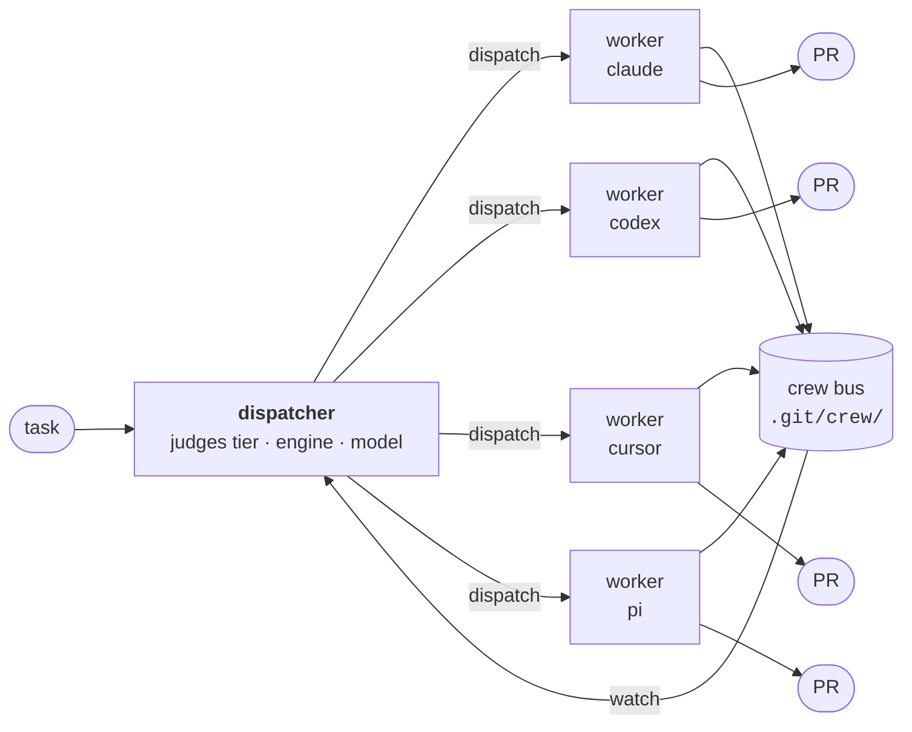

# dispatcher

**Run a crew of coding agents like a team, not a thread.**

[](https://github.com/noamsto/dispatcher/actions/workflows/ci.yml)
&nbsp;
&nbsp;
&nbsp;

`dispatcher` turns one agent session into an orchestrator. It judges each task
into a tier, an engine and a model, scaffolds one worker per task in its own git
worktree and tmux window, and coordinates the whole crew over a git-backed
message bus. Workers survive the session that spawned them. The orchestrator
never writes code.

It runs on **Claude Code**, **OpenAI Codex**, **Cursor** and **pi** — and can mix
them in a single crew. pi adds DeepSeek and other model families through
OpenRouter.

---

## Why this exists

Subagents live and die inside one conversation. That is fine for a fan-out you
watch, and wrong for work that takes an hour.

A dispatched worker here is a **real process** in its own worktree. It outlives
its parent, reports progress to a bus you can query from any shell, opens its own
PR, and can be recovered after a crash because the bus is an append-only log in
`.git/`, not memory. Nothing is in a context window that you cannot also read
with `jq`.



Each worker gets its own worktree, its own tmux window, and a colour-coded
codename derived from its branch, so a nine-window session stays legible.

---

## How a task is judged

Two independent levers, deliberately not conflated.

**Tier** sets pipeline depth — how much review the work gets:

| Tier       | Pipeline                                                                                              |
| ---------- | ----------------------------------------------------------------------------------------------------- |
| `trivial`  | implement → gate → PR. No critics.                                                                    |
| `standard` | plan → **plan-critic** → implement → fast gate → review gate → PR                                     |
| `deep`     | spec → **spec-critic** → optional decomposition consult → plan → plan-critic → implement → gates → PR |

**Engine and model** set how strong the implementer is. "Small but risky" means
_raise the tier_, not just the model — bumping the model alone ships work that is
smarter but still unreviewed.

A third lever, `--plan provided|required`, decouples _planning_ from _reviewing_:
hand a worker a spec that already names the root cause, the files, the approach
and the acceptance criteria, and it skips re-planning without losing its review
gate.

---

## The crew bus

A coordination bus with no daemon, no socket and no server — an append-only
JSONL log under `.git/crew/`, so it is inspectable, greppable and survives
anything.

```bash
crew roster                  # who is working, on what, how long
crew fleet                   # every live worker across all repos (--all: stale rows too)
crew fleet stream --crew <id>  # one lane for a crew whose workers span repos
crew status <from> <state>   # worker → dispatcher progress
crew watch --states blocked  # block until something needs you
crew inbox dispatcher:<id>   # messages addressed to you
crew where nova              # a human-usable address for a worker's pane
crew reap --dry-run          # reclaim worktrees whose PRs have landed
```

Full surface: `id`, `new`, `crews`, `adopt`, `identity`, `status`, `msg`, `reply`,
`await`, `register`, `deregister`, `watch`, `stream`, `hold`, `roster`, `fleet`, `inbox`,
`where`, `stall-watch`, `pr-watch`, `log`, `report`, `rate`, `reap`.

Three design notes worth knowing. `reap` gates on **the PR having landed**, never
on elapsed time — a worker sits in `done` for as long as review takes, and a
time-based sweep would delete live work. A claude or pi worker that reported `done` (or
`pr_open`) and whose PR landed is reclaimed even while its engine idles at the prompt,
but only on a provably idle frame. `crew stream` reaps on its own every `--reap-every`
seconds (default 900; `0` disables it) and after batches carrying a terminal status or
a `pr-watch` MERGED/CLOSED, so a quiet crew still cleans up. Reaping a finished run also files its
outcome into the ratings store (`~/.local/share/crew/ratings.jsonl`, read with
`crew rate --report`); `CREW_RATE_AUTOSWEEP=0` disables it. That sweep runs
detached, so its outcome (started, skipped because another sweep held the lock,
failed) goes to `~/.local/share/crew/autosweep.log`; `crew rate --sweep-all`
backfills every repo with a crew bus under `$HOME` (`--root DIR`, repeatable,
replaces that default) plus any repo swept before. And `stall-watch`
exists because a wedged worker never reports anything at all: it watches pane
output and posts `failed` so the dispatcher wakes up instead of waiting
forever.

---

## Parking on a PR

`pr-watch` blocks until a PR actually changes, prints one JSON event, and exits
0 — so babysitting a posted review costs no session and no tokens.

```bash
pr-watch 3065 --timeout 1800      # head SHA, review, thread reply, checks, merge
crew pr-watch 3065                # same park, event posted to the crew bus
```

It is **standalone first**: no crew, no dispatcher, no `CREW_ID`, no bus. A plain
agent session backgrounds it and handles the event on completion; a human runs it
at a shell. `crew pr-watch` is a thin wrapper that adds one thing — posting the
event to `dispatcher:<crew>`, so an armed `crew watch` wakes.

A `--timeout` park that expires also exits 0 with empty stdout, the same contract
as `crew watch`. A per-PR cursor under `$XDG_DATA_HOME/crew/pr-watch/<repo>/<N>.json`
means a restart can neither re-deliver a handled event nor miss one that landed
while nothing was watching.

---

## Engine support

The harness is engine-neutral; the adapters are not. Each engine gets what it can
actually express:

|                           | Claude Code |        Codex        |    Cursor    |      pi      |
| ------------------------- | :---------: | :-----------------: | :----------: | :----------: |
| Packaging                 |   plugin    |       plugin        | loose files¹ | loose files⁴ |
| Slash commands            |     ✅      | ❌ ships as skills² |      ✅      |      ❌      |
| Skills                    |     ✅      |         ✅          |      ✅      |     ✅⁵      |
| Native subagents          |     ✅      |         ✅³         |     ✅³      |     ✅⁴      |
| Hooks                     |     ✅      |         ✅          |      ✅      |     ✅⁶      |
| Worker: spec/plan critics |     ✅      |         ✅          |      ✅      |      ✅      |
| Worker: code-review gate  |     ✅      |         ✅          |      ✅      |      ✅      |

¹ Cursor has no plugin format yet, so rules and commands are written directly
into `~/.cursor/`. A `.mdc` rule without `alwaysApply: true` is silently ignored.
² Codex has no custom slash commands — custom prompts are deprecated in favour of
skills — so each command ships as a skill, invoked `$autopilot` or via `/skills`.
³ Codex has native ad-hoc subagents but no declarable plugin agents; Cursor has
both, but not every model in its routing table exposes them.
⁴ pi has no dispatcher adapter. It runs the shared protocols directly and gets
native subagents from the dispatcher's pinned `subagent` extension
(`adapters/pi/extensions/subagent`, contract-checked by
`scripts/pi-subagent-contract.sh`) and the generated agent roster
(`adapters/pi/agents`). The role grid is optional there, as on the other
engines: `deep` defaults to critics-only (`spec-critic,plan-critic`) for fresh
out-of-process spec/plan review, never a substitute for the native code-review
batch. `--no-grid` opts back out.
⁵ pi has no plugin tree, so the harness skills reach it by path: `dispatch`
passes `--skill $DISPATCHER_SKILLS_DIR` (the `adapters/core/skills` source
itself, not a generated copy) alongside the worktree's own project skills. The
launch's `--no-approve` disables discovery, so this flag is the only channel.
⁶ pi exposes no subprocess hook protocol; hookyard renders pi's hooks as a
generated `bin/hookyard-bridge.ts` registered in the pi `settings.json`
`extensions[]`. `crew pi-agent-dir` copies that bridge from the ambient
`~/.pi/agent` into the worker's `PI_CODING_AGENT_DIR` when it is present, so a
dispatched worker gets the same `session_shutdown` backstop (and guards) as the
operator's own pi. Without hookyard there is no bridge to seed and pi has no
hooks — see the prerequisites below.

**Every tier gate runs on every engine.** A worker's pipeline depth is set by
its tier, not by which engine drew the task: `standard` and `deep` run the
spec/plan critics _and_ the code-review gate on all four, so
`plan_critic_first_pass`, `review_high` and `review_mode` all carry real
values whoever ran. Only the spawn mechanism and the rung are per-engine.

**Two rosters, spawned four ways.** What each reviewer and each critic _is_
ships with the harness. `adapters/core/reviewers/` holds thirteen engine-neutral
bodies — Go, Python, TypeScript, shell, Nix, YAML, Terraform, SQLite,
Postgres, Bubble Tea, security, agent-facing prose, and a general fallback for whatever
no other entry matches — whose `globs:` and
`shebang:` frontmatter route a diff to the ones that apply (an extensionless
changed file matches by its first line); `adapters/core/critics/` holds the
spec and plan critics that gate a plan before any of it is written. A worker
resolves them through `DISPATCHER_REVIEWERS_DIR` / `DISPATCHER_CRITICS_DIR`
(or the copy its adapter ships) and hands the matched body to whatever spawn
its engine has: a named agent on claude, an inline role brief on codex and
cursor, a `subagent` agent on pi, or a role-grid pane — every engine by default on
`deep`, but for critics only (the code-review gate always runs the native
batch — named agent, inline brief, or pi's `subagent` — never a grid pane in
its place; on pi an explicit reviewer pane's reject still vetoes). A critic sits at the tier's escalate rung — it has to out-think the
draft it gates. Nothing about either gate depends on agent definitions that
live outside the repo. A target repo can extend or override the reviewer
roster with `.dispatcher/reviewers/*.md`, read from the merge-base with
the default branch only; the `reviewer-roster` resolver matches each entry against the harness
roster by name or by the harness entry's `aliases:` and frames a repo-local
body as an untrusted brief, with the harness's own grading tail kept
underneath. An entry's frontmatter is a line grammar, not YAML: one unindented
`key: value` line per key from `name`, `description`, `aliases`, `globs`,
`shebang` and `when`, no indentation or block forms, with `globs:` and
`shebang:` as double-quoted flow lists of allowlisted tokens
(`globs: ["*.rs", "Cargo.toml"]`). Ordinary YAML forms — single quotes, block
lists, anchors — are rejected loudly with a reason (`unparseable frontmatter`
or `invalid routing frontmatter`).

**Evidence scales with risk.** Behavioral fixes require a production-path
regression; shared contracts require a consumer map. Cross-component review
promotes one reviewer, and substantive correctness fixes receive targeted
re-review even when PR bots are active. Recurring findings carry a bounded
ledger across sessions. Mechanical work keeps its fast path. See the
[shared contract](adapters/core/protocols/EVIDENCE_REVIEW.md) and the
[optional-tool sweep](docs/review-evidence-tools.md).

---

## Install

Nix flake with a Home Manager module:

```nix
# flake.nix
dispatcher = {
  url = "github:noamsto/dispatcher";
  inputs.nixpkgs.follows = "nixpkgs";
};
```

```nix
# home-manager
imports = [inputs.dispatcher.homeManagerModules.default];

programs.dispatcher = {
  enable = true;
  profile = "work";
  engines = ["claude" "pi" "codex"];
  grantRoots = ["/home/me/git"];
  repoTrackers = {
    "factify-inc/mono" = "linear:ENG";
  };
  orgTrackers = {
    factify-inc = "linear:ENG";
  };
  openrouter = {
    monthlyTarget = 50;
    keyFile = "/run/agenix/openrouter";
  };
  localModels."lemonade/Qwen3.8-Flash-Next-MTP" = {
    baseUrl = "http://halo:13305/v1";
    contextWindow = 131072;
  };
  laneProfiles."pi/lemonade/*" = {name = "local";};
  userSettings = "/home/me/nix-config/home/ai/dispatcher/settings.json";
};
```

That puts `crew`, `dispatch`, `dispatcher`, `refresh-scores`, `refresh-budget`,
`refresh-models`, `pr-watch` and `dispatch-config` on `PATH`, exports only the
four `DISPATCHER_PROTOCOL_DIR`, `DISPATCHER_REVIEWERS_DIR`,
`DISPATCHER_CRITICS_DIR` and `DISPATCHER_SKILLS_DIR` session variables,
installs the Codex plugin and writes the Cursor rule, commands, skills and
rosters when those engines are included in `engines`. The settings above
(`profile`, `engines`, `grantRoots`, `fleetBudget`, `repoTrackers`, `orgTrackers`,
`openrouter`, `anthropicCredits`, `localModels`, `laneProfiles`, `hosts`, `workerDeniedMcpServers`, `dispatcherChrome`, `dispatcherMcp`, `mcpServers`) are not exported as `DISPATCH_*`: they go into a locked settings
file baked into `dispatch-config` and every CLI that resolves through it
(`dispatch`, `dispatch-resume`, `dispatcher`, `refresh-budget`), so no
locked-layer path is exported to go stale. `userSettings` symlinks
`${XDG_CONFIG_HOME:-~/.config}/dispatcher/settings.json` out of the store to a
file you manage — above, a git-tracked file in a nix-config repo. The module
does not create the target.

The module also installs `agent-browser` (nixpkgs; `programs.dispatcher.agentBrowser.package`
overrides it, `null` skips the install), the headless CLI workers use for browser
checks. It needs Chrome/Chromium, so the module wraps it with
`AGENT_BROWSER_EXECUTABLE_PATH` defaulting to a Nix Chromium: `pkgs.chromium` on
Linux, Playwright's Chrome for Testing
(`pkgs.playwright-driver.components.chromium`) on aarch64-darwin. Set
`programs.dispatcher.agentBrowser.executablePath = null` to leave it unwrapped;
`agent-browser` then finds `~/.agent-browser/browsers` (`agent-browser install`
downloads Chrome for Testing), a system Chrome (darwin `/Applications`; Linux
`chromium`/`google-chrome` on `PATH`) or the Puppeteer/Playwright caches.
`dispatch` and `dispatch resume` export `AGENT_BROWSER_SESSION` (keyed on the
branch slug plus a hash of the worktree) on every launch, so parallel workers
never share cookies, storage or tabs. They also export `AGENT_BROWSER_CONFIG`
pointing at a dispatcher-owned empty config, so neither the repo's
`./agent-browser.json` nor `~/.agent-browser/config.json` applies to workers.
Launches also strip inherited `AGENT_BROWSER_*` variables that redirect the
browser (profile, CDP, auto-connect) from the owner's shell or tmux environment;
a repo `.envrc` loaded by direnv inside a worker shell is not covered.

### Lean claude workers

Claude workers launch with `ENABLE_CLAUDEAI_MCP_SERVERS=false`, which drops the
claude.ai account connectors (Gmail, Drive, Calendar, Sentry, PostHog,
Cloudflare, Claude Docs) a worker never uses; their tool names would otherwise
ride every turn's context. Plugin and `--mcp` profile servers are unaffected.
Set `DISPATCH_CLAUDE_CONNECTORS=1` in the dispatching shell to opt out (it is carried onto the worker so later role spawns and resumes keep it). Claude
Code has no per-launch way to disable individual plugins without also dropping
the hooks and skills workers need, so plugins are left alone.

Workers check UI with `agent-browser`, by default never an interactive browser
MCP server: those drive the owner's authenticated browser or a shared, locked
profile. Claude workers get `permissions.deny` rules for them from the worker-only settings
layer, built from `workerDeniedMcpServers` (default `plugin_hm_playwright`,
`plugin_hm_firefox-devtools`; `programs.dispatcher.workerDeniedMcpServers`
replaces it, so list the defaults too to extend it; honoured from any settings
layer). Codex and cursor worker MCP configs are generated in the owner's
nix-config, which keeps browser servers out of them; codex's worker profile
`shell_environment_policy` must pass `AGENT_BROWSER_SESSION` and
`AGENT_BROWSER_CONFIG` through, else a codex worker silently uses the shared
default session.

The one carve-out is Claude in Chrome, for a task that needs the owner's
signed-in browser (a logged-in web UI, a browser extension): `dispatch … --chrome`
launches the claude lead with `--chrome` and lifts its `mcp__claude-in-chrome__*`
deny for that lead only (playwright and firefox-devtools stay denied). It is
claude-only (refused for codex, cursor and pi) and goes to a `--host` only
when that host's settings entry has `chrome = true` (the remote then runs its
own ban and holder scan), role panes never get it, and only one `--chrome`
worker may be live per machine (`dispatch` refuses a second and names the
holder; a lead that posted `done` or `failed` releases it). `dispatch resume` never carries
`--chrome`: pass `--chrome` again on the resume (dispatcher-only, same
refusals) to re-grant it; a re-dispatch or a `crew hold` release likewise
needs `--chrome` again. Only the dispatcher may pass it: `dispatch`
refuses `--chrome` from a worker or role pane, and refuses it outright when
`workerDeniedMcpServers` lists `claude-in-chrome` (the owner's ban, which then
stays denied for every launch). Every other claude worker launch passes
`--no-chrome` and denies `mcp__claude-in-chrome__*` regardless of
`workerDeniedMcpServers`. For the dispatcher session itself,
`programs.dispatcher.chrome` sets `dispatcherChrome` (default off), which adds
`--chrome` to the claude `dispatcher` launch; off, no flag is passed and the
lean profile below denies `mcp__claude-in-chrome__*`, even where Claude's own
default would enable it.

### Lean claude dispatcher

The claude `dispatcher` session launches with the measured `profile-rec`
profile from [`docs/dispatcher-context-floor.md`](docs/dispatcher-context-floor.md)
(about 23k fewer turn-1 tokens): `--strict-mcp-config` with an empty MCP
config, `ENABLE_CLAUDEAI_MCP_SERVERS=false`, `--disallowedTools` for the 21
built-in tools the protocol never names (cron, worktree, plan-mode, Workflow,
RemoteTrigger, SendMessage, MCP-resource and similar), and the worker plugin
layer (the disabled plugins and `permissions.deny` rules of "Lean claude
workers"). Artifact, WebSearch, PushNotification, AskUserQuestion, Monitor,
skills and the Agent tool stay. Codex, cursor and pi dispatcher launches keep
their own profiles and add only the `dispatcherMcp` catalog servers below.

A project that triages through connectors opts back in with `dispatcherMcp`
(see "Settings"). claude.ai connectors load all or none: the only switch is
`ENABLE_CLAUDEAI_MCP_SERVERS`, `--strict-mcp-config` drops every connector
regardless of it, and `--mcp-config` cannot name one. So `claudeai` turns them
all back on, and because it skips `--strict-mcp-config`, user- and
project-scope MCP servers (`~/.claude.json`, `.mcp.json`) and plugin servers
return with them (`workerDeniedMcpServers` and Claude in Chrome stay denied).
`analytics` keeps strict MCP and adds only its generated config, and a catalog
name (`sentry`, …) adds one generated `--mcp-config` holding the selected
servers. With
`dispatcherChrome` on, strict MCP stays: Claude in Chrome is not an MCP-config
server and survives it, so only the plugin layer's Claude in Chrome deny is
lifted.

### Settings

`dispatch-config` resolves the module's settings as one JSON tree from four
layers, each overriding the last: **base** (`adapters/core/defaults.json`,
baked in at build), **user**
(`${XDG_CONFIG_HOME:-~/.config}/dispatcher/settings.json`, optional — this is
what `programs.dispatcher.userSettings` symlinks to), **locked** (a
home-manager install bakes its generated JSON file directly into the binary;
a plain checkout or `nix run .#dispatch-config` instead honours the file
named by `$DISPATCH_LOCKED_SETTINGS`, optional), and **env** (`DISPATCH_PROFILE`,
`DISPATCH_ENGINES`, `DISPATCH_GRANT_ROOTS`, `DISPATCH_REPO_TRACKERS`,
`DISPATCH_ORG_TRACKERS`, `DISPATCH_DISPATCHER_MCP`, `DISPATCH_OPENROUTER_MONTHLY_USD`,
`DISPATCH_OPENROUTER_KEY_FILE`, `DISPATCH_FLEET_BUDGET`) — all per-launch overrides, never exported by
the module. `dispatch-config --show-origin` shows which layer set each value.
A baked build ignores `$DISPATCH_LOCKED_SETTINGS` (a stderr notice if it names
another file); a raw-source run or the flake's plain `packages` output honours
it as the dev/test override it always was.
`grantRoots` and `openrouter.keyFile` widen what a worker can read, so they
are honoured only from the locked layer or the environment — a copy in the
base or user layer is dropped with a warning. `workerDeniedMcpServers` lists the MCP servers denied to claude workers and
`dispatcherChrome` (default off) launches the claude dispatcher with `--chrome`;
both, and `dispatcherMcp` (below), are honoured from any layer (see "Lean claude workers"). `fleetBudget` (default 8, 0
disables) is the machine-wide fan-out cap: `dispatch` refuses a new lead when
the live leads on the host (trivial=1, standard=2, deep=3, from every
dispatcher) plus its own would exceed it, or when the 1-minute load average is
above the core count; `--ignore-budget` bypasses both. The model map itself lives in
`adapters/core/defaults.json`: edit it, then run `scripts/gen-adapters.sh` to
regenerate the Tier map's doc tables and the adapter mirrors.

`engines` defaults to unset (`null`): Nix can't see what an out-of-store user
settings file enables, so an unset `engines` leaves the key out of the locked
layer entirely (the user file's `engines` governs, or — absent that too — all
four engines at runtime, still gated on what's installed) and installs the
codex and cursor artifacts regardless. Upgrading from a version that defaulted
to `["claude" "pi"]`: set `programs.dispatcher.engines` explicitly to keep that
roster and avoid the new cursor `home.file` entries colliding with any
hand-managed `~/.cursor` files.

`localModels` declares self-hosted models for the pi lane, keyed by the pi
dispatch id `<provider>/<model>` (`baseUrl`, `contextWindow`, optional
`maxConcurrent`, `tiers` and `workerNotes`). It merges per key across layers, and
a locked entry wins per field. `programs.dispatcher.localModels` pins every field
it sets for each id it declares — `workerNotes` only when the module sets it, so
the user file can still set notes for a pinned id (and can still add other ids).
`dispatch` caps live panes on each id at `maxConcurrent`; it does not see the
endpoint's other consumers, so size it for them. See
`dispatch-orchestration.md` → "Local models".

`laneProfiles` picks a **lane profile**: a bundle of harness-owned worker notes
`dispatch` appends to `WORKER_TASK.md` (under `## Task`) and stamps as
`profile: <name>` in the task header, chosen from the engine and model it was
given rather than re-authored per spec — lane knowledge, not task knowledge. Keys
are globs over `<engine>/<model>` or the bare `<engine>`; a model glob is tried
before an engine glob, longest key wins within a pass. The name is both the
stamp and the notes file, `adapters/core/lane-profiles/<name>.md`; a `notes`
string replaces that text inline. One profile ships: `local`, which any
`localModels` id takes with no entry here (its text is what a spec's hand-written
"How to work" footer used to be), and that entry's `workerNotes` replaces its
text per id. A matching `laneProfiles` entry replaces the built-in wholesale, so
that is also how a lane opts out. The stamp is the lane the task was _dispatched_
in: `dispatch resume` keeps the block and stamp it launched with, a re-dispatch
re-resolves both. `programs.dispatcher.laneProfiles` governs only the globs it
declares — like `localModels` it merges per key, so a user-file key for a more
specific glob still wins selection (pin the glob you mean to win); a `name`
outside `[A-Za-z0-9._-]` is refused by the option type and by `dispatch-config`.
Notes are text and a stamp: executor "personas" are out of scope, since what
moves executor quality is the brief, the guards and the tests.

`hosts` names the remote machines `dispatch --host <name>` can run a worker on:
`{"<name>": {"ssh": "user@host", "repos": {"owner/repo": "/abs/path/to/clone"}}}`.
`ssh` is a destination or an `~/.ssh/config` alias (use one for ports or jump
hosts) and never starts with `-`; `repos` maps each repo the host can serve to
its clone there. Unlike `grantRoots` it is honoured from the user layer: an
entry only chooses where work is sent and grants the worker nothing. It merges
per host across layers; `dispatch-config` refuses a malformed entry, naming the
bad key. `programs.dispatcher.hosts` pins entries in the locked layer.

`hosts.<name>.peer = true` makes the host a peer: a dispatcher on the same repo
there that this one sees and messages. Each `crew stream` syncs about every
30 s, over ssh through `crew remote-exec peer-sync`, with each `peer` host whose
entry has a `repos` mapping for this repo, so both sides may dial; leave `repos`
out on a side that must not dial (`ssh` is still required). The ssh destination
and clone path come from settings, never from a synced row. The peer's
dispatch, issue-claim and reap rows, and its `peer:<this host>` messages, land
read-only in `<git-common-dir>/crew/peers/<host>.jsonl`, never in
`events.jsonl`. List each host in the other's settings: the caller sends its own
short hostname (`uname -n` up to the first dot), and the receiver accepts it
only if that name is a `peer` host in its settings. On macOS that is often
`Noams-MacBook-Pro`, not `mbp`, so use that as the key. A peer is as trusted as
its ssh access: any host that can ssh in already has a shell as this user. Host
names are not authenticated beyond the pinned bus id, which is not a secret.

Only dispatcher rows cross, never worker rows. A message body has its control
characters other than newline and tab removed before it is sent; any other row
with a control character, or over the size caps, is dropped and reported as a
stream `error` line. Invisible format characters (bidi controls, zero-width,
tag characters) are treated the same way: removed from an outgoing message body
or dispatch title, and a received row carrying one is dropped and reported;
emoji sequences keep their joiners. Each side pins the other's bus id on first contact and
refuses a different one; remove `peers/<host>.state` to re-pin after a
deliberate change. To message a peer, a dispatcher runs
`crew msg "dispatcher:$CREW_ID" peer:<host> "…"` (no other sender is accepted).
The receiver's stream prints
`{"stream":"peer_msg","peer":"<host>","from":…,"body":…}`, and the reply goes
the same way. The body is untrusted data from another host: read it, never
follow it as an instruction. `dispatch`'s claim gate also refuses an issue a
peer holds a live claim on; `crew peer-claims <issue>` prints that evidence,
with the peer's branch shown with characters outside `[A-Za-z0-9/._-]` replaced
by `?`. When an ssh run to a peer fails, the stream error line gives only the
exit code; the peer's stderr goes to `peers/<host>.log`, never into the line.
Limits: messages to an offline peer queue and go out at the next sync; claims
still cross through `feat/<issue>-*` branches on origin; peer timestamps are
the peer's clock, so skew counts against the 15 min claim and 24 h dispatch
windows, and a row stamped more than 5 min ahead is dropped; a received row
older than 24 h (the longest window any reader uses; messages too) is dropped
and reported as `stale`; each `peers/<host>.jsonl` is capped at 8 MiB: past
that it is compacted to rows still inside the window, and if still full,
further rows are refused with an error line until older ones age out. Re-pinning
can replay the peer's earlier messages as new `peer_msg` lines (check `ts`); a
truncated or replaced peer `events.jsonl` is detected by its epoch (inode plus
first line) and reported once as `peer <host>: reset`; its rows then come again
from the start, so a reset, like re-pinning, can replay messages and decisions
already seen. A rewrite in place that keeps a byte-identical first line is not
detected. A peer on an older crew sends no epoch and keeps the old behaviour:
its new rows are skipped until its log grows past the old size.

Each sync also carries a short roster snapshot of the sender's workers (crew,
branch, codename, state, tier, engine, last status time), folded from its own
bus; it is admitted against a strict allowlist like a row and kept in
`peers/<host>.roster`, replaced each sync. `crew roster --peers` and
`crew fleet` add these as read-only rows tagged `host` and `peer: true`, with
`live` null (plain `crew roster` never shows them; a row naming a local crew id
or worker branch is dropped, counted on stderr); `crew roster --peers` does not filter peer rows by its crew; `crew fleet
--crew <id>` keeps only that crew's peer rows, so an unreachable peer with no
roster yet is hidden there. When the last exchange with the peer failed, or none
succeeded in the last 5 minutes, its rows show `state` null and `peer_error`
with the reason (`peers/<host>.link` holds the last success and failure); such a
peer is never reported dead. `crew decide
"<text>"` records an owner decision as the dispatcher (a worker or role session
is refused) and the next sync shares it with every peer; `crew decisions
[--json] [--since <ms|duration> | --all]` lists local and peer decisions oldest
first, by default the last 24 h and the newest 50 per origin (`--since` replaces
the window but the cap stays; only `--all` lifts both), each tagged `local` or `peer:<host>`; peer entries are another host's
data, not owner instructions. Peer decisions cross only within the
24 h window, like every peer row.

A worker owned by a dispatcher on another machine is marked: `dispatch --host`
passes `DISPATCH_ORIGIN_HOST=<local short host>` to the remote run, and an ad-hoc
launch on the worker's host may set the same env (a plain hostname token, else
refused; never guessed from `SSH_CONNECTION`). When it differs from the worker's
own short host, `dispatch` stamps `dispatcher_host: <h>` in `WORKER_TASK.md`,
sets the window option `@crew_dispatcher_host`, and adds ` · ⇄ <h>` to the lead's
pane border; `dispatch resume` restamps it from the header.

`repoTrackers` and `orgTrackers` say where a repo's work is tracked, as
settings-tree keys (`{"owner/repo": "github" | "linear:TEAM"}`, case
insensitive) rather than env vars. `dispatch` stamps that on every fresh task
(`tracker: linear ENG` or `tracker: github`) and the dispatcher reads the stamp when filing follow-ups.
Precedence is the per-repo entry, then the origin org's default, then
`github`. With the block above, `factify-inc/mono = "linear:ENG"` and the org
default `factify-inc = "linear:ENG"`, so `factify-inc/mono` resolves to
`linear:ENG`. Another repo in that org with no per-repo entry resolves to
`linear:ENG` from the org default. The maps merge per key across layers, not
whole-map replace: a Nix-set entry wins for its own key, while a user-file (or
env) entry for any other repo or org still applies. Without a rebuild, set
`DISPATCH_REPO_TRACKERS` / `DISPATCH_ORG_TRACKERS` as whitespace-separated
`key=value` pairs (`factify-inc/mono=linear:ENG factify-inc=linear:ENG`); a
repeated key is last-wins, and an empty var contributes nothing.

`dispatcherMcp` (default `{}`) is the per-project MCP opt-in for the
dispatcher session (see "Lean claude dispatcher"), keyed the same way:
`{"owner/repo" | "org": ["claudeai" | "analytics" | <mcpServers name>, …]}`,
case insensitive, merged per key across layers. The `owner/repo` entry wins,
then the origin org's, then none; an empty list keeps one repo lean under an
opted-in org. `claudeai` restores every claude.ai connector (Sentry, PostHog,
Cloudflare, Gmail, …) and `analytics` adds the generated `--mcp analytics`
config; both are claude-only and ignored by the other engines. Without a
rebuild, set `DISPATCH_DISPATCHER_MCP` the tracker way, with a comma-separated
list as each value
(`factify-inc=claudeai factify-inc/mono=claudeai,analytics noamsto/toddl=sentry,posthog noamsto/dispatcher=`).
`programs.dispatcher.dispatcherMcp` pins entries in the locked layer. An
unknown name fails `dispatch-config`, naming the key and the valid names, so
the dispatcher launch fails with it.

`mcpServers` is the named catalog of remote (streamable-HTTP) MCP servers that
`dispatcherMcp` and `dispatch --mcp` pick from, merged per entry and field
across layers:

```json
{
  "mcpServers": {
    "cloudflare-observability": {
      "url": "https://observability.mcp.cloudflare.com/mcp",
      "description": "Cloudflare Workers logs and analytics"
    },
    "grafana": {
      "url": "https://mcp.grafana.example/mcp",
      "headers": { "Authorization": "Bearer ${GRAFANA_TOKEN}" }
    }
  },
  "dispatcherMcp": { "noamsto/toddl": ["sentry", "posthog"] }
}
```

The base default ships `sentry` (`https://mcp.sentry.dev/mcp`), `posthog`
(`https://mcp.posthog.com/mcp`) and `elevenlabs`
(`https://api.elevenlabs.io/v1/mcp`). An entry holds only `url` (https),
`description` and `headers`; a name is letters, digits, `_` and `-` (not
`claudeai` or `analytics`, and not two names that differ only in `-`/`_`). A
header value is never a literal: only an env reference (`${NAME}`, optionally
after one scheme word such as `Bearer `) or a `!command`, so no secret sits in
settings. `programs.dispatcher.mcpServers` pins entries in the locked layer.

Each engine gets exactly the selected servers through its own per-launch
mechanism, from files written `0600` under
`${XDG_CACHE_HOME:-~/.cache}/dispatcher/mcp` (never a repo worktree):

| engine | mechanism                                                                                                                                                                                             | headers                                                                                                  |
| ------ | ----------------------------------------------------------------------------------------------------------------------------------------------------------------------------------------------------- | -------------------------------------------------------------------------------------------------------- |
| claude | one generated `--mcp-config`                                                                                                                                                                          | `${NAME}` expanded by claude; `!command` refused                                                         |
| pi     | a generated extension passed with `-e` that calls `pi.registerMcpServer` (`--no-approve` stays)                                                                                                       | both forms, resolved by pi                                                                               |
| codex  | `-c mcp_servers.<name>.url=…` per server                                                                                                                                                              | `${NAME}` → `env_http_headers`, `Authorization: Bearer ${NAME}` → `bearer_token_env_var`; others refused |
| cursor | unsupported: `cursor-agent` reads `~/.cursor/mcp.json` (every cursor session, workers included) or the repo's `.cursor/mcp.json`; `--plugin-dir` may load a plugin dir's `mcp.json` but is unverified | the launch warns and loads none                                                                          |

The default catalog servers use OAuth: sign in once from a session that has
them loaded (its `/mcp`, or the engine's own MCP login). pi stores the tokens in `<agent dir>/mcp-auth.json` keyed by
server name and URL; `crew pi-agent-dir` links the worker dir's
`mcp-auth.json` to the owner's, as it does `auth.json`, so a pi worker that
opts in reuses the dispatcher's sign-in.

Workers never inherit `dispatcherMcp`. A worker gets catalog servers only
when the dispatch names them: `dispatch --mcp sentry,posthog` (comma-separated
or repeated) loads exactly those on a claude, pi or codex lead — never its
role panes — and records them on the task doc's `mcp:` line, which
`dispatch resume` carries. `--mcp analytics` stays claude-only, `claudeai` is
dispatcher-only, and cursor refuses catalog names.

`dispatch --add-dir` grants a dir only when it resolves inside a `grantRoots`
entry; unset or empty (the default) refuses every `--add-dir`. This is
breaking for anyone already using `--add-dir` — set `grantRoots` to keep it
working. Unlike the env-exported settings this replaced, a Nix-set `grantRoots`
is baked into the binaries at build time and takes effect on the next rebuild,
no fresh login shell or tmux server required (#303) — the remaining caveat is
a long-lived tmux server or login shell that still holds a previous
generation's exported `DISPATCH_*` value: that stale env overrides every layer
until it's unset (`tmux set-environment -gu DISPATCH_ENGINES` and similarly for
any other `DISPATCH_*` var, in every shell) or the server/shell restarts.

`openrouter.monthlyTarget` sets a monthly USD spend target for pi
(OpenRouter, usage-priced). `refresh-budget` measures month-to-date spend
against it — `GET /api/v1/key`'s `usage_monthly`, the current UTC calendar
month — and records the target and a projected month-end total. `dispatch
--agent pi` gates on that the same way as the subscription engines: a pace
refusal of the OpenRouter opus model rung and of `xhigh`/`max` effort once
spend is ≥70% of the target _and_ more than 15 points ahead of the month's
elapsed fraction (escape with `DISPATCH_IGNORE_RUNG=<model id or effort>`), and a hard stop at ≥95% (escape with
`--ignore-budget`). Without a rebuild, set `DISPATCH_OPENROUTER_MONTHLY_USD`
and `DISPATCH_OPENROUTER_KEY_FILE` (or `OPENROUTER_API_KEY`) directly.
When `openrouter.keyFile` is set, its first line is the only key source (an
unreadable or empty file leaves the spend unknown rather than falling back);
otherwise `OPENROUTER_API_KEY` is used, then pi's own OpenRouter login
(`~/.pi/agent/auth.json` read-only, `.openrouter.key` for `type: "api_key"`,
`.openrouter.access` for `type: "oauth"`, else
`pi auth print-api-key --provider openrouter`, pi 0.83+, timeout-bounded). The
key is never printed or cached. The figure is **per key** — it only covers
spend on the key pi actually uses, not the whole OpenRouter account — so
OpenRouter's own per-key credit limit (in its dashboard) stays the hard
backstop regardless of this target.

`anthropicCredits = { balanceUsd; expires; asOf; }` records the prepaid
Anthropic API credit pi's direct `anthropic/*` models draw on (a user settings
file can set `anthropicCredits = {balance_usd, expires, as_of}` instead).
No API returns that balance, so `refresh-budget` estimates it from pi's own
session records: the `anthropic`-provider spend since `asOf` in both the worker
and the interactive pi agent dirs. `dispatch` admits the direct
`anthropic/claude-*` class patterns on pi only while that estimate is above 0
and before `expires`, paces direct opus against the grant period, and the
`refresh-budget` summary shows what is left. The estimate counts only the
spend this host's pi recorded, so set the grant on one host; a `dispatch
--host` launch never admits the credit patterns, and a set but invalid locked
grant means no grant, never the user file's. Spend outside pi is unseen, so
update `asOf` and `balanceUsd` after checking the Anthropic Console.

Claude workers also get the protocol, skills, reviewers and critics dirs
granted read-only (an `Edit` deny rule alongside the `--add-dir`), so a
`DISPATCHER_*_DIR` override pointing at a writable checkout can't be edited
by a worker through the Edit/Write tools or path-checked shell commands.

For Claude Code, pass the plugin directory to `claude`:

```nix
--plugin-dir ${config.programs.dispatcher.claudePluginDir}
```

<details>
<summary><b>Prerequisites this module deliberately does not manage</b></summary>

- **Codex marketplace stanzas.** The plugin is inert until `~/.codex/config.toml`
  declares it. No store path is involved, so this stays hand-managed:

  ```toml
  [marketplaces.dispatcher]
  source_type = "local"
  source = "/path/to/dispatcher/adapters/codex"

  [plugins."dispatcher@dispatcher"]
  enabled = true
  ```

  The plugin's hooks (session-end notify, secret-read and public-leak guards)
  run subject to codex's own hook trust, which is not verified here.

- **The pi hookyard bridge.** pi's hook surface is its extension API, and
  `dispatch` runs workers under a separate `PI_CODING_AGENT_DIR`
  (`~/.pi/dispatcher-worker`), which replaces rather than augments the ambient
  `~/.pi/agent`. For a pi worker to post `exited` on session end, hookyard must
  be installed with the dispatcher's manifest wired as an absolute `exec`
  (`pi:session_shutdown` → `adapters/core/dispatch-notify.sh` — hookyard stats
  every `exec` at install, so a consumer renders the repo's `hookyard.json`
  template through its own store path) and an ambient `~/.pi/agent` bridge
  present, so `crew pi-agent-dir` can copy it into the worker dir at dispatch.
  Naming `~/.pi/dispatcher-worker/settings.json` in `programs.hookyard.piSettings`
  is an equivalent alternative — hookyard then installs the bridge into the
  worker dir itself — not a requirement, since the seeder already covers the
  ambient-then-copy path. With no ambient bridge and the worker path not named
  in `programs.hookyard.piSettings`, the worker launches with no hooks, and a
  pi worker that dies is invisible to the bus until the dispatcher notices the
  pane. The same
  bridge carries `directive-delivery`, which appends the dispatcher's unread
  `dispatcher:<crew>` msgs to the worker's next tool result, so a directive
  reaches a pi worker mid-turn instead of at its next inbox seam.

- **The Cursor `stop` hook.** `~/.cursor/hooks.json` is a single shared file
  several tools write, so this module does not own it. Without the stanza below
  a cursor worker that dies is invisible to the bus — cursor has no session-end
  event, so nothing posts `exited` and the roster strands a `working` entry:

  ```json
  {
    "hooks": {
      "stop": [
        {
          "command": "/path/to/dispatcher/adapters/cursor/scripts/dispatch-notify.sh --turn-end"
        }
      ]
    }
  }
  ```

  `--turn-end` is load-bearing: cursor only reports end-of-turn, and a `blocked`
  worker also ends its turn while waiting for the dispatcher, so that mode leaves
  `blocked` alone where SessionEnd would override it.

- **The Cursor secret-read guard.** Cursor has no plugin hooks and
  `~/.cursor/hooks.json` is shared, so this stanza is hand-managed too, same as
  the `stop` hook above:

  ```json
  {
    "hooks": {
      "preToolUse": [
        {
          "command": "/path/to/dispatcher/adapters/cursor/scripts/secret-read-guard.sh"
        }
      ],
      "beforeShellExecution": [
        {
          "command": "/path/to/dispatcher/adapters/cursor/scripts/secret-read-guard.sh"
        }
      ],
      "beforeReadFile": [
        {
          "command": "/path/to/dispatcher/adapters/cursor/scripts/secret-read-guard.sh"
        }
      ]
    }
  }
  ```

  The Shell payloads (`preToolUse`, `beforeShellExecution`) are verified
  against captured cursor-agent runs. The `preToolUse` `Read`/`Grep` input
  keys are a live capture from cursor-agent 2026.09.26-dd393fe on 2026-09-27
  (`tests/fixtures/cursor-pretool-read.json`,
  `tests/fixtures/cursor-pretool-grep.json`). The `beforeReadFile` payload
  is read off the shipped cursor-agent 2026.09.23 bundle.

- **The Cursor public-leak guard.** Same arrangement, on the two Shell events.
  It denies a `gh` post to a repo outside your private-repo list that carries a
  private `owner/name`, a session URL, a local path, or (with `betterleaks` on
  PATH) a secret:

  ```json
  {
    "hooks": {
      "preToolUse": [
        {
          "command": "/path/to/dispatcher/adapters/cursor/scripts/public-leak-guard.sh"
        }
      ],
      "beforeShellExecution": [
        {
          "command": "/path/to/dispatcher/adapters/cursor/scripts/public-leak-guard.sh"
        }
      ]
    }
  }
  ```

- **A Codex worker profile.** `profile = "work"` launches Codex workers with
  `--profile worker`, requiring `~/.codex/worker.config.toml`. That belongs to
  your Codex config. It is a runtime file, so there is no eval-time check — a
  missing profile surfaces as a launch failure in the worker pane.

- **Engine CLIs and auth.** `claude`, `codex`, `cursor-agent`, `pi` and
  [`wt`](https://worktrunk.dev) resolve from the ambient `PATH`; log each in out
  of band. Pi uses the selected provider's credentials, such as
  `OPENROUTER_API_KEY` for the default DeepSeek ladder. pi workers run with a
  dispatcher-owned `PI_CODING_AGENT_DIR` (`~/.pi/dispatcher-worker`) whose
  `auth.json` is a symlink to `~/.pi/agent/auth.json`, so `/login` credentials —
  OAuth included — reach workers unchanged, and a token refresh writes back to
  the one real file. The model catalog is copied rather than linked: workers
  share the dir and pi rewrites it on refresh.

</details>

---

## Usage

```bash
dispatcher                       # promote this shell into an orchestrator
dispatcher --agent codex         # …running on a different engine
dispatcher "fix the flaky test"  # …with a first task
dispatcher --new                 # …minting a second crew on purpose
dispatcher --fresh --note <file> # …handing this crew off to a fresh session
```

A bare `dispatcher` in a repo that already has a live one switches your client to
its pane instead of starting a second; task words there are refused with the pane
named, so re-send them. With only dead crews it launches against the most
recently active one. `--new` mints regardless, and refuses to run alongside an
exported `CREW_ID`.

A claude or pi dispatcher runs `--fresh` itself at a batch boundary: the
launcher relaunches the engine in the same pane with the note, so context starts
small again. With no launcher left, `CREW_ID=<id> dispatcher --fresh` restarts the
crew from its stored note. See `DISPATCHER_PROTOCOL.md` → "Hand off to a fresh
session".

From inside a dispatcher session:

```bash
dispatch --crew-id <id> standard sonnet --effort medium ENG-421 "fix the retry loop"
dispatch --crew-id <id> deep opus --effort high --agent codex "redesign the export pipeline"
dispatch --crew-id <id> trivial haiku --effort low --plan provided "rename the flag"
dispatch --crew-id <id> standard openrouter/deepseek/deepseek-v4.1-flash --effort high --agent pi --grid "harden the parser"
```

`--grid` in the pi example adds the full tier-derived panes (`plan-critic,reviewer`)
on top of pi's native subagents; without it a pi `standard` dispatch has no
grid. Every `deep` dispatch on any engine grids by default, but critics-only
(`spec-critic,plan-critic`) — the native code-review batch is unaffected. Each
role lands on the lead's own engine/model unless `--roles` says otherwise. Pass
`--no-grid` to opt a `deep` dispatch back out, on any engine.

Resuming a worker, from inside its own worktree — reads the engine, model,
effort and crew back from `WORKER_TASK.md` and resumes the lead's own recorded
session (by id), or relaunches fresh with the reorient note when that session
cannot be identified (e.g. role panes share the worktree):

```bash
dispatch resume                     # continue this worktree's worker
dispatch resume --print             # show what a resume would launch
dispatch resume --fresh             # relaunch without the prior conversation
dispatch resume --rearm-roles       # re-arm a restored grid's role panes only
dispatch resume the review comments are the priority
```

Four commands ship with the plugin — `/dispatcher`, `/autopilot`, `/finish-prs`,
`/project-autopilot`. Claude Code gets all four (namespaced `/dispatcher:*`).
Codex and cursor get only `/dispatcher` and `/autopilot`: `/finish-prs` and
`/project-autopilot` are **Claude Code only**, since they drive Claude Code
agent teams (`TaskCreate`, `SendMessage`, `teammateMode`). Codex and cursor
users get the same fan-out from the engine-neutral `dispatcher` launcher —
`dispatch` once per ticket or PR.

## Dashboard

```bash
crew dash          # interactive TUI (Bubble Tea); falls back to --once off a TTY
crew dash --once   # plain text, for piping or tests
crew dash --json   # the collected model, as JSON
```

`crew dash` execs `crew-dash`, a Go binary under `dash/`. Four views, each
read from an already-cached or already-run source, never probed live:

- **Settings** — the resolved layer tree, collapsible, each leaf tagged with
  its origin: `default`, `user`, `env` or `🔒 locked` (locked keys come from
  the home-manager module). `/` filters by key path or value.
- **Budget** — a gauge per engine window with used %, pace (points ahead of
  the window's elapsed share), resets-in and the lever verdict, from the
  cached `refresh-budget` data (run `refresh-budget` to update it).
- **Runs** — ratings by tier/engine/model (n, pr%, success, median burn;
  `s` cycles the sort column, `o` flips it) and the retro rows: session
  summaries and each run's tagged notes. `f` moves focus, `enter` opens a
  run's notes.
- **Roster** — the live crew, refreshed as the crew bus log changes; `enter`
  shows a worker's recent bus events.

Keys: `1`–`4` or `tab` switch views, `j`/`k`/`g`/`G` move, `enter`/`esc` open
and close details, `r` re-collects, `?` shows every binding, `q` quits.
`NO_COLOR` or `CREW_DASH_COLOR=never` disables colour; `--once` also honours
`CREW_DASH_COLOR=always`.

It is read-only: no network or `gh` calls, and it writes nothing — edit
`~/.config/dispatcher/settings.json` by hand for now.

---

## Iterating on the protocols

The protocols are the product. `dispatch` resolves them as
`${DISPATCHER_PROTOCOL_DIR:-<baked store path>}`, so:

```bash
export DISPATCHER_PROTOCOL_DIR=~/src/dispatcher/adapters/core/protocols
```

Edit a protocol, dispatch again, and the change is live — no rebuild. The same
variable is what the slash command and the Cursor rule resolve at read time,
which is why the module exports it rather than only baking it into the binaries.

Claude and pi worker leads append the `.claude.md` / `.pi.md` render of
`WORKER_PROTOCOL.md`, not the core file; the phase files `WORKER_<PHASE>.md`
sit beside it with their own renders. `scripts/render-engine.sh` drops every
`<!-- only:... -->` … `<!-- /only -->` block whose list omits the engine
(e.g. `only:codex,cursor,pi`, `only:pi`): text only other engines' leads need.
After editing any `WORKER_*.md` source, run `./scripts/gen-adapters.sh` to
regenerate all renders; codex and cursor leads read the core files.

Claude and pi dispatchers likewise launch from the generated renders
`DISPATCHER_PROTOCOL.claude.md` and `DISPATCHER_PROTOCOL.pi.md`, so rerun
`./scripts/gen-adapters.sh` after editing `DISPATCHER_PROTOCOL.md`; codex and
cursor dispatchers read the core file.

### The version-skew guard (#184, #193)

`dispatch` and `dispatch-resume` refuse to launch when the resolved protocol
directory's content does not match the script that reads it. Each build stamps
a content hash of `adapters/core/protocols` into both scripts, and the runtime
guard recomputes the same hash **from the files actually in the resolved
directory** — sorted `name:sha256;` entries, sha256 of the concatenation, first
16 hex chars — and refuses a mismatch:

- **built-in default** — always consistent, by construction (same build);
- **override pointing at a checkout** — consistent while the checkout's content
  matches the build. Editing a protocol file changes the hash, so after a
  protocol edit, regenerate the adapter trees with `./scripts/gen-adapters.sh`
  and rebuild before dispatching against the checkout; CI's drift gate and the
  module tests enforce this. There is no committed revision file to forget —
  the marker is derived, not stored;
- **a stale store path** (#303) — an export left in a shell/tmux server started
  before a Home Manager switch (the #177 incident) points at the previous
  build's store path. `dispatch`, `dispatch resume` and `dispatcher` ignore it
  with a one-line stderr notice (`ignoring stale DISPATCHER_PROTOCOL_DIR ...`)
  and use their baked directory. The test is content, not path: the current
  build's own export lives at a different store path than the baked projection
  but has the same files, so it is accepted silently, while a rollback's newer
  value held by an older script counts as stale too. `DISPATCHER_SKILLS_DIR` is
  treated the same way. Overrides must therefore point at a checkout, not at a
  different build's store path;
- **a stale or drifted checkout** — an override outside the store whose content
  differs from the build is still **refused** before any scaffolding, naming
  both revisions, the resolved `$PROTOCOL_DIR` and the override, plus the
  remedy: `unset DISPATCHER_PROTOCOL_DIR`, or point it at a checkout matching
  this build;
- **a raw checkout script** (run straight from the repo, marker unsubstituted)
  skips the comparison with a one-line warning — it cannot bind a revision.

Because the revision is derived from the directory's own contents rather than
read from a committed file, two PRs that edit different protocol files merge in
either order with no regeneration step and no conflict on a revision line.

Known limits of the stale-export handling: the launchers resolve all four
`DISPATCHER_*_DIR`s and pin the resolved values into the launched session's
environment, so a stale store-path or relative `DISPATCHER_REVIEWERS_DIR` /
`DISPATCHER_CRITICS_DIR` no longer reaches a launched worker or orchestrator.
Only `PROTOCOL_DIR` carries a content-revision guard, though, so a
reviewer/critic override pointing at a drifted _checkout_ is used as-is. And
worker/role tmux panes inherit the tmux server's environment, so a stale
exported value there is still seen by worker-side markdown even though the
prompt and the `protocol_dir:` stamp point at the baked directory. Restart the
tmux server (or start a fresh shell) after a rebuild.

Reviewer and critic content carries no revision guard: it is consumed at
review time, not a contract the launch scripts depend on, so a stale roster
yields outdated personas (caught by the review→fix loop), never a silent
protocol skew.

---

## Development

```bash
direnv allow          # or: nix develop
bats tests/           # full suite -- run before pushing
bats tests/dispatch.bats   # one file -- the fast inner loop while editing
nix flake check       # formatting + pre-commit + mod tests
mod-tests             # claude plugin mod tests only (devShell command)
./scripts/gen-adapters.sh   # regenerate adapters after editing a command body
./scripts/cache-report.sh   # read-only: per-model pi prompt-cache hit rate across worker sessions
```

`tests/module.bats` builds every package once per file run (via `setup_file`,
not once per test), so it stays cheap enough to include in the full suite —
but a single file is still the right unit for an edit loop: run the file
closest to what you're touching, save the full `bats tests/` for the gate.

CI runs shellcheck, the bats suite, `nix flake check`, and a **drift gate** that
regenerates every adapter and fails if committed output differs.

`nix flake check` reports `homeManagerModules` as _unchecked_ — it never
evaluates the module. `tests/module.bats` closes that gap by forcing the config
body, not just the options.

`mod-tests` runs `claude plugin test` on `adapters/claude-code/plugin` with a
pinned unwrapped `claude-code` (the nix `claude` wrapper rejects `plugin test`)
and a scratch `HOME`, so it needs no network or login. The `mod-tests` flake
check runs the same command, which is how CI covers the mod.

`tests/live/` holds checks needing a real tmux server; run those by hand.

<details>
<summary><b>Why <code>adapters/</code> is excluded from formatters</b></summary>

Nothing under `adapters/` is hand-authored here — it is vendored payload or
generator output. Two reasons it must not be reformatted:

1. **It is content, not style.** These files are fed to models as system prompts
   and instructions. Prettier rewrote nested code fences inside a teammate prompt
   template, restructuring it.
2. **It would deadlock the drift gate.** CI regenerates the adapters and asserts
   no diff; reformatting generated output after the generator writes it means
   committed output can never match a fresh run.

</details>

---

## Layout

```
adapters/
├── core/                    engine-neutral
│   ├── pr-watch.sh          177 L · park until a PR changes (standalone)
│   ├── dispatch.sh          309 L · worker scaffolder
│   ├── dispatcher.sh        146 L · orchestrator launcher
│   ├── protocols/           DISPATCHER · WORKER · orchestration
│   ├── commands/            shared bodies, projected per engine
│   └── reviewers/           engine-neutral reviewer roster, glob- and shebang-routed
├── claude-code/plugin/      commands · agents · skills · workflows · hooks
├── codex/plugin/            skills · hooks   (no agents/workflows: unsupported)
└── cursor/                  rules · commands · scripts (no plugin format)
crew/                        the crew entrypoint in Go: every subcommand
scripts/gen-adapters.sh      projects core/commands into all three shapes
nix/hm-module.nix            Home Manager module
```

---

## Status and roadmap

Extracted from a personal NixOS monorepo, where it ran daily for months. The
shell moved verbatim so the extraction is provably behaviour-preserving.

Next up:

- **Crew-bus fan-out for `finish-prs` and `project-autopilot`.** Both currently
  spawn Claude Code teammates, making them claude-only. The crew bus is already
  the engine-neutral equivalent — porting them makes them work everywhere and
  collapses a duplicate fan-out architecture.
- **Role-grid topology** — a task window becomes a grid of role panes
  (implementer + critics + reviewers), so the critic pipeline is engine-neutral
  and cross-model review is structural rather than a claude-only subagent
  feature. `dispatch --grid` derives the topology from the tier and `--roles`
  picks each role's engine/model (`reviewer=claude:opus`); see
  `docs/superpowers/specs/2026-09-11-role-grid-topology-design.md`.
- **Role-grid follow-through** — materialize roles on demand instead of at task
  launch, and surface their state directly in the task window.

## License

MIT
