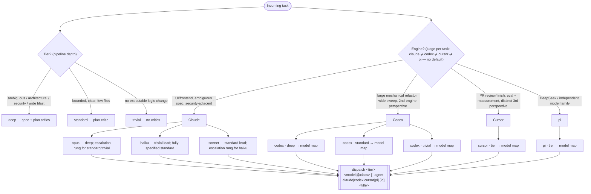

# Dispatch orchestration — the choosing tree

Canonical reference for how the dispatcher judges a task into **tier**, **engine**, and **model**. Keep it in sync with `DISPATCHER_PROTOCOL.md` (the baked rubric), `adapters/core/defaults.json` (the map's data), and `dispatch.sh` (the mechanism).



## Model map (single source of truth)

The dispatcher picks the tier-appropriate model for the chosen engine by
**class**: `cheap`, `standard` or `premium`, the burn classes' names. Each
engine's classes, the tiers whose default they supply, the tiers that admit
them, their patterns and their seed defaults are data in
`adapters/core/defaults.json` (`classes`, `modelMap`); the table below is
generated from it. Model versions appear only in generated tables and in rules
about one model (the recorded cursor Task roster, the direct-anthropic credit
lane); prose names classes. A class means the engine's current class default: the seed default
below, or one a promotion recorded (`DISPATCHER_PROTOCOL.md` → "Model-class
promotions"); `dispatch --models` prints the live one.

**The `@class` sigil.** Pass a class as the model: `dispatch deep @premium
--agent codex`, `dispatch resume --model @standard`, `--roles
reviewer=codex:@premium`, or `crew hold add --model @premium` (resolved at
release). It resolves before every gate to the class default of that tier's
row, or of the engine's first row of that class: claude, with no catalog, gets
its alias (`@premium` → `opus`). The task doc, the dispatch row and
`roles.json` record the resolved id. A class the tier does not admit is
refused like an off-row model, naming the class; `--ignore-map` still resolves
it and skips only that check. A class with no default on the engine (pi has no
premium row, though pi `deep` admits premium ids: name the id) is refused,
naming why. `DISPATCH_IGNORE_RUNG` and `DISPATCH_SKIP_MODEL_CHECK` take the
resolved id, never the sigil. `dispatch resume --model @class` resolves once
and hands its precheck that id, with the sigil in `DISPATCH_CLASS_SIGIL` for
class admission and refusal text only, so the checked id is the launched one.

<!-- BEGIN generated:model-classes from adapters/core/defaults.json by scripts/gen-model-map-doc.sh -->

| engine | class | default on | admitted on | patterns | seed default |
| --- | --- | --- | --- | --- | --- |
| claude | `@cheap` | `trivial` | `trivial`, `standard` | `haiku`, `claude-haiku-*` | `haiku` |
| claude | `@standard` | `standard` | `trivial`, `standard`, `deep` | `sonnet`, `claude-sonnet-*` | `sonnet` |
| claude | `@premium` | `deep` | `trivial`, `standard`, `deep` | `opus`, `claude-opus-*` | `opus` |
| codex | `@cheap` | `trivial` | `trivial`, `standard` | `gpt-*-luna` | `gpt-5.6-luna` |
| codex | `@standard` | `standard` | `standard`, `deep` | `gpt-*-terra` | `gpt-5.6-terra` |
| codex | `@premium` | `deep` | `deep` | `gpt-*-sol` | `gpt-5.6-sol` |
| cursor | `@cheap` | `trivial` | `trivial`, `standard` | `grok-*-low`, `grok-*-low-fast`, `cursor-grok-*-low`, `cursor-grok-*-low-fast` | `grok-4.7-low` |
| cursor | `@standard` | `standard` | `standard`, `deep` | `grok-*-medium`, `grok-*-medium-fast`, `cursor-grok-*-medium`, `cursor-grok-*-medium-fast` | `grok-4.7-medium` |
| cursor | `@premium` | `deep` | `deep` | `kimi-*-high`, `grok-*-high`, `grok-*-high-fast`, `cursor-grok-*-high`, `cursor-grok-*-high-fast` | `kimi-k3-high` |
| pi | `@standard` | `trivial`, `standard`, `deep` | `trivial`, `standard`, `deep` | `openrouter/deepseek/deepseek-v*-flash`, `openrouter/z-ai/glm-*-flash`, `openrouter/qwen/qwen*-flash`, `anthropic/claude-sonnet-*` (needs anthropic_credits) | `openrouter/deepseek/deepseek-v4.1-flash` |
| pi | `@premium` | — | `deep` | `openrouter/anthropic/claude-opus-*` (needs pi_month_target), `anthropic/claude-opus-*` (needs anthropic_credits) | — |

<!-- END generated:model-classes -->

Orchestrator (dispatcher-session) defaults live in "Orchestrator engines"
below. A newer catalogued match of a class pattern needs no map edit: the
catalog (`refresh-models`) admits it as a trial, and promotion makes it the
class default. The `refresh-scores` cache flags a rung a newer model has
overtaken — see `DISPATCHER_PROTOCOL.md` → "External standings".

**Burn classes.** Claude, Codex, and Cursor are subscriptions, so their cost is
quota burn. Pi/OpenRouter is usage-priced; once a key is configured it's
represented as `engines.pi` (month-to-date spend vs an optional monthly
target, not a quota window) — a pi run on its standard class is roughly
$0.5–2, which is what makes pi the cheap lane to shed claude burn onto. A
subscription model burns at its selection class (weights: `burnClasses` in
`defaults.json`, else the class floor: cheap 1, standard 2, premium 4), with
four exceptions: opus's class follows effort (`low` → standard, `medium`+ →
premium, `xhigh`/`max` heavier); fable burns ≈2–4× opus per task; composer is
free; and **cursor `-fast` doubles the token rate**, lifting a rung a whole
class (`-medium-fast` burns like premium `-high`, `-low-fast` like standard) —
a deliberate "I need this turn now" override, never the cheap lane. Effort
multiplies burn within a rung (`xhigh`/`max`; codex `ultra` most). When the
budget tightens (`DISPATCHER_PROTOCOL.md` → "Budget is the fifth lever"), walk
down a burn class before walking down a tier — burn only sets model strength,
tier sets review depth.

| Tier       | claude (worker → execute → escalate) | codex (worker → execute → escalate) | cursor (worker → execute → escalate) | pi (worker → execute → escalate) |
| ---------- | ------------------------------------ | ----------------------------------- | ------------------------------------ | -------------------------------- |
| `deep`     | **@premium** → @standard / @cheap (named-edit plan steps, never the lead) → escalated @premium; escalate to **fable** only as a last resort after @premium @**`xhigh`** has failed on hard architecture/complex-bug work | **@premium** → @standard → escalated @premium | **@premium** (kimi) → @standard (Grok) → escalated Grok @premium | **@standard** @max → `execute` `:high` / `execute-light` `:low` → `execute-escalated` `:max`; default grid `spec-critic,plan-critic` |
| `standard` | **@standard** @**medium** / @cheap @**medium** (fully specified, `--plan provided`) → @standard / @cheap (named-edit plan steps) → escalated @premium @**medium**; @premium stays admitted in the row as the one-rung escalation; security-adjacent work leads on @premium @**medium** (Sonnet 5.5's safeguard fallback is Sonnet 5 with thinking disabled); UI and underspecified work lead on @standard like any other standard task | **@standard** → @cheap → escalated @standard | **@standard** → @cheap → escalated @standard | **@standard** → `execute` `:high` / `execute-light` `:low` → `execute-escalated` `:max`; no default grid; the other standard families (glm, qwen) rotate in |
| `trivial`  | **@cheap** @**low** → escalated @standard @**low** → @premium @**low**; no delegation | **@cheap** — no delegation | **@cheap** — no delegation | **@standard** — no grid |
| local      | — | — | — | ids from the `localModels` setting (trivial/standard by default) — see "Local models" |

On claude the classes are its aliases (`@cheap` haiku, `@standard` sonnet, `@premium` opus). Haiku leads `trivial` at `low` and may lead a fully specified `standard` at `medium`; sonnet leads `standard` at `medium` otherwise, and an opus escalation on those rows runs at that same tier-typical effort, never deep's `high` by habit; raise either only on the signals in `DISPATCHER_PROTOCOL.md` → "Effort is a sixth lever". On sonnet the ceiling is `high`: `dispatch` refuses sonnet @`xhigh`/`max`, and the next step past sonnet@`high` is opus@`medium` (standard), never sonnet `xhigh`/`max`. When the budget pace gate refuses opus, the fallback is `sonnet` at the same effort — or `sonnet at high` when the refused effort was `xhigh`/`max` (sonnet's ceiling) — not opus at a lower effort. An opus launch at `low` is *not* refused as a premium model rung — its burn class follows effort and it counts as standard (Burn classes, above) — while `medium` and above still refuse. The one-rung opus escalation after a failed sonnet run is exempt from the model refusal; effort refusals and the 95% stop still apply.

**Haiku on claude.** Haiku (alias `haiku`; accepts `low` through `max` effort, default `medium`) leads the `trivial` tier by default at `low`: `trivial` runs no critics and a failed haiku run costs one rerun, so the cheap rung is the default. It may also lead claude `standard` at `medium` when the work is bounded and fully specified — dispatched `--plan provided` with root cause or mechanism, an explicit file list, a named approach, and acceptance criteria all present — and not security-adjacent, UI, or genuinely underspecified. Otherwise sonnet leads `standard` at `medium`. A small change to a condition, guard or error path is never `trivial`: it takes this same `standard` row, haiku when fully specified and `--plan provided`, else sonnet. A failed haiku run escalates to sonnet in-row (`haiku → sonnet`) on both rows, then to opus. Haiku never leads `deep`. On claude `standard`/`deep`, an execute subagent runs `model: haiku` for a plan step whose files and edit are named (Agent `model: haiku`), and `model: sonnet` for a step that needs judgment; security or UI steps never use haiku. Haiku has no effort ceiling to enforce — it accepts every level, so the gate refuses none — so do not raise effort to compensate for a task that needs judgment; escalate the model instead.

**Every `deep` row also grids by default** — claude, codex, and cursor each pick up `spec-critic,plan-critic` panes (critics only; their native code-review batch is unchanged), all on the lead's own engine and model unless `--roles` says otherwise. Pi's `deep` cell does the same; its execute and review stages run as native `subagent` agents (the pinned extension and generated roster in `adapters/pi`).

**Pi effort.** Pi's tier-typical effort is **`high` for `trivial`, `high` for
`standard`, and `max` for `deep`** — the lever that separates pi `standard`
from `deep`, since every pi row defaults to the same standard-class model. Pi
clamps `--thinking` per model through that model's `thinkingLevelMap` —
generic, not DeepSeek-specific: a level the model does not expose clamps to a
supported one, so the generic `trivial`→`low` / `standard`→`medium` rungs land
on `high` on the DeepSeek Flash defaults, deep's `max` passes through, and a
model with no map supports through `high`. Pi deep has no higher pi model
rung: after a failed deep pi worker, the dispatcher re-dispatches on another
engine by judgement. `EVIDENCE_REVIEW.md`'s reviewer promotion is already met
on pi: every pi reviewer agent runs at pi's escalate rung (the seed standard
default, pinned in the generated agent roster, at `:max`). None of this needs new clamp machinery — every id launches
with the standard ladder.

Codex model ids carry a **variant suffix**, which is the class: `-sol`
premium (frontier), `-terra` standard (balanced everyday), `-luna` cheap (fast
+ affordable). A variant family has **no bare generation id** — dispatching one
dies on a 400, "model is not supported when using Codex with a ChatGPT
account". Authoritative list for this account is `jq -r '.models[].slug'
~/.codex/models_cache.json`; the older bare generations it also lists stay
admitted through the seed row, no longer a rung.

Codex's tier-typical rung (deep→high, standard→medium, trivial→low) is the
starting point, independent of which gpt model is chosen — not an automatic
default: `--effort` is a required flag `dispatch` refuses to scaffold without
(`dispatch.sh:532-533`), and the dispatcher departs from the tier-typical rung
on the raise/hold signals in `DISPATCHER_PROTOCOL.md` → "Effort is a sixth
lever". Above `xhigh` the ladder continues with `max` (both engines) and
codex-only `ultra`
(maximum reasoning with automatic task delegation) — `ultra` exists on premium
and standard only, cheap caps at `max`. Session effort `ultra` is itself an
orchestration layer: `dispatch` still enables `agents.*` but pins
`agents.default_subagent_reasoning_effort` one rung below the session (floor
`low`, **never** `ultra` — an ultra subagent would nest automatic delegation).
The worker must not add a second harness execute-subagent orchestration on top
of ultra's built-in delegation. See `WORKER_PROTOCOL.md` rule 1.

Both codex launch paths (`dispatch` workers and the `dispatcher --agent codex`
orchestrator) pin `service_tier="default"` — the interactive `/fast` toggle
persists locally and would otherwise leak into unattended runs, burning ChatGPT
credits at 2.5x for latency nobody is watching.
Cursor has **no reasoning-effort flag** — effort is baked into the model id
suffix and `dispatch`'s `--effort` is accepted-and-ignored for cursor. Grok
exposes both an effort suffix (`-low`/`-medium`/`-high`/`-xhigh`), which is its
class, and a speed suffix (`-fast`), so the dispatcher expresses effort by
_picking the class_. The class defaults are the **non-fast** slugs: `-fast` is
a paid speed tier at ~2× the token rate, not a cheaper high-throughput one, so
reach for it only when a turn's latency actually matters and say why. cursor
`deep` uses kimi (its premium default) as the worker (plans) and Grok as the
execute ladder (implements) — escalate to Grok `-high`, not back to Kimi (a
launch id; in-session Task spawns resolve through "Cursor Task-spawn slugs").
The patterns take the older `cursor-grok-*` ids too, so a pinned older run
keeps dispatching. **Grok is the default cursor distinct-implementer** — a
genuinely non-Claude perspective, which is the point of reaching for cursor.
`--model` is open across cursor's whole multi-vendor id space (the gate checks
id _shape_ and the seed row, not this table), so a cursor worker can still
front **composer** (no effort variants) as an alternative on every tier, or —
on `deep` only, per the Tier map gate below — an effort-suffixed cross-vendor
`claude-*` / `gpt-*` id. `dispatch` validates the model slot
against `--agent` before scaffolding — see **Model gate** below.

**Worker-session model vs execute-subagent model.** The first class in each map
cell is the **worker session** — it does spec / plan / reconcile / judging. The
second is the **default execute subagent**; the third is the escalated execute
rung for plan-tagged high-risk steps. Claude, Codex, Cursor, and pi (via its `subagent` agents) follow this split
on standard/deep (trivial does not delegate). See `WORKER_PROTOCOL.md` rule 1 (and
the fast deterministic gate + parallel review gate it describes). `dispatch.sh`
sets codex `agents.*` guardrails and a process-authority spawn clause only —
never model slugs for execute subagents (those stay in this table / rule 1).
Cursor has no CLI concurrency cap; the cap of 3 is protocol-only.

The role grid is now the **default on `deep`, on every engine**. The default
grid is **critics only** (`spec-critic,plan-critic`, no `reviewer`): every
engine runs a full native reviewer-roster batch at the code-review gate
(`WORKER_REVIEW.md` → "Code review gate"; on pi the generated `subagent`
roster), and a default grid must not silently replace it — the grid gives the
lead fresh out-of-process contexts for the spec/plan critics only. With no
`--roles` given, every role pane inherits the lead's own agent and model (the
**single-engine fallback**): a claude-only host still gets its critic panes,
all on claude, and dispatch never refuses or reaches for an engine the caller
didn't ask for. A `--review` worker has no spec/plan phase to critique, so it
gets no critic grid: native batch and refuters. A `deep` dispatch under
`--plan provided` also gets no default grid (nothing left for spec/plan
critics to check). `--roles` opts into deliberate cross-engine review,
including adding a `reviewer` pane — that pane is **additive**, a second
opinion alongside the native batch, never a replacement
(`reviewer=codex:@premium`); on pi crew's seam gate still lets that pane's
`reject` veto. `--grid`, passed explicitly, keeps its original meaning
regardless of engine or `--plan`: the full tier-derived topology (`standard`
→ `plan-critic,reviewer`, `deep` → `spec-critic,plan-critic,reviewer`; on a
`--review` worker `reviewer,refuter` for both) — only the *default* trigger is
critics-only. `--no-grid` opts back out of the default on any engine.
`--no-grid` combined with `--grid` or `--roles` is a usage error.

`--lazy` records whichever topology resolves — explicit or the engine/tier
default above — without creating any panes; the lead materializes each role
with `dispatch --spawn-role <role>` at its seam and may `dispatch
--reap-roles` when done (see `WORKER_GRID.md` → "Grid mode"). It needs no
`--grid`/`--roles` of its own when a default already resolves one (`deep`) —
adding `--grid` there would change the topology itself (adding `reviewer`), not
just make it lazy. **The default topology stays eager**: both deep default
roles are used by any task that reaches its plan seam, so laziness only defers
a one-time startup-read cost, not a permanent saving.
`--lazy` is a deliberate per-dispatch opt-in (see skill `dispatcher:grid-lazy`),
never a default.

**Bounded execute-time replanning.** A missing lower execute rung is a same-rung implementation fallback: it is not planning and does not consume the bounded re-plan budget. The provided/legacy contradiction fallback and a plan-shaped three-amendment recovery share exactly one execute-time budget. The latter must use a strictly higher planning tuple from the task file's authoritative engine/model/effort metadata; it never changes engines or skips a rung; a same-or-higher Grok substitute for a refused next rung is not a skipped rung. Claude ascends `haiku → sonnet → opus → fable` (subject to the existing opus-to-fable eligibility check). Codex ascends effort `low → medium → high → xhigh → max`, then at max class `-luna → -terra → -sol` (cheap → standard → premium); never ultra. Cursor ascends Grok's classes `-low → -medium → -high`. Claude fable/ineligible opus/unknown ids, codex premium/max or legacy/unknown/outside-table tuples, and cursor high/Kimi/Composer/cross-vendor/unknown ids are top/no-rung blocks, as are unavailable planning launches. A cursor Task-slug refusal takes the substitution rule in “Cursor Task-spawn slugs” first. The full auditable ledger, viability rule, and blocking evidence are in `WORKER_EXECUTE.md` → “Bounded plan-shaped recovery”.

Pi has no supported strictly-higher planning rung yet (an effort-ladder
planning subagent is not wired), so a plan-shaped recovery on pi is an
unavailable-planning block. The dispatcher
must supply a replacement; the lead cannot count self-replanning as independent.

**Shape-tag vocabulary.** The outcome log's `shape` field is a closed set:
`mechanical`, `ui`, `ambiguous`, `security`, `wide`.

**Orchestration consult (worker-side, deep).** Decomposition help from a top-tier consultant — claude's premium **opus** (neutral-fit default) or **fable** (architecture-heavy decompositions), codex's premium, or cursor's Grok premium — is decided **in the worker's worktree** at the plan seam (whether *and* which), not by the dispatcher — the dispatcher's only lever is tiering the task `deep` (its existing "architectural / wide-blast" signal). Every consultant is reachable from any lead engine as a read-only shell one-shot gated on `dispatch --engines --in-budget` (the machine-local roster minus engines at ≥95% or a limit); the Agent-tool (fable) and codex-MCP (codex premium) forms stay claude-lead conveniences. See `WORKER_PLAN.md` → "Orchestration consult" and "Cross-engine one-shots". Every deep worker emits an outcome-metrics record to the bus at finish:
`crew msg worker:<branch> metrics:<crew_id> '{"consulted":…,"consult_engine":…,"plan_critic_first_pass":…,"rework_count":…,"replanned":…,"review_high":…}'`.
It rides `crew msg` (no `crew.sh` change) and never wakes the dispatcher. Consulted vs non-consulted deep workers are the A/B for whether the consult lever pays — `consult_engine` splits it by consultant — the counterfactual #86's oracle gate needs. Read it offline: `crew log <crew> | jq 'select(.to|startswith("metrics:"))'`.

Read `replanned` together with `rework_count`: it distinguishes ordinary mechanical gate convergence from an execute-time planning episode. Workers emit a complete latest-state metrics snapshot immediately before every stopping path; ratings select the latest timestamp. Old metrics bodies without `replanned` remain legacy-null in ratings.

### Model gate

`dispatch` validates `<model>` against `--agent` **before** it scaffolds
anything — no issue, no branch, no worktree, no window. It checks per-engine id
_shape_, not membership of the table above, so a model bump needs no
`dispatch.sh` edit; a seed bump is an edit to the row's `default`, `models`
and refusal text `expected` in `adapters/core/defaults.json` (plus
`escalation` / `paceDowngrades` when a rung moves), a rebuild, and
`scripts/gen-adapters.sh` to regenerate the tables:

- **claude** — an alias (`opus`, `sonnet`, `haiku`, `fable`) or a full
  `claude-*` id. An effort suffix is rejected: `claude-opus-<n>-high` is a
  _cursor_ id, and claude takes intensity through `--effort`.
- **codex** — `gpt-<gen>-<variant>`, variant mandatory, which is what rejects a
  bare variant-family generation; the older bare generations pass. When
  `$HOME/.codex/models_cache.json` is readable and holds a non-empty `.models`
  array, the slug must also appear in it — an absent or unusable cache is
  skipped, never fatal.
- **cursor** — an open multi-vendor id space, so shape is the floor: claude CLI
  aliases are rejected, and a `claude-*` / `gpt-*` id must carry an effort
  suffix (`gpt-<gen>-sol-high`) or name one in a bracket block
  (`claude-opus-<n>[context=1m,effort=high,fast=false]`). The bracket rule is a
  conservative guess — `cursor-agent` calls the pairs "overrides", so a block
  that omits `effort=` may be legitimate and still get rejected; the override
  below is for that. On top of shape, a **cached existence check** (#95)
  mirrors codex's: when `${XDG_DATA_HOME:-~/.local/share}/crew/cursor-models-cache.json`
  is readable, at most 24h old (a catalog moves at the cadence of releases, not
  quota's hourly churn) and holds a non-empty `.models` array, a
  **non-bracketed** id must also appear in it; an absent, stale or unusable
  cache is skipped, never fatal. **Bracketed ids are exempt**: their
  pre-bracket base is not itself an invocable slug (cursor resolves the
  effort-suffixed slug from `effort=`). `refresh-models` builds the cache
  (`cursor-agent --list-models`; by hand or at dispatcher session start, no
  daemon); until it has run once only the shape floor applies. It does not
  probe the in-session Task roster — see "Cursor Task-spawn slugs".
- **pi** — a provider-qualified id (`<provider>/<model>`), verified against
  `pi --list-models`. A dated snapshot (`…-1017`) is admitted for trial and is
  never a default: an undated OpenRouter slug is pinned to one dated snapshot,
  so a new release never arrives under a slug a row already names.

The Model gate enforces **dispatchability**, not tier-appropriateness; the Tier
map gate below enforces **tier-appropriateness**.

**Override.** `DISPATCH_SKIP_MODEL_CHECK=<the exact model id>` skips the gate for
that one id and warns on stderr. Truthiness is exact string equality with the
resolved model, not "is set" — exporting it for a session still gates every
_other_ model, and a `@class` sigil never matches. Reaching for it means a
cache or the seed is stale: run `refresh-models`, or update the row in
`adapters/core/defaults.json` and rebuild. It covers the Model gate (shape)
only: a new model off its row also needs `--ignore-map` unless the catalog
already admits it by class (Tier map, below).

**Machine-readable view.** `dispatch --models [--json]` prints the tier map
the gate enforces, read from the resolved settings (`defaults.json` plus
overrides, and pi `localModels`) and the model, class-state and budget caches,
so tools such as a web dashboard need no hand-kept copy. It is
read-only and fast: no lock, live probe or crew write. It covers the engines
`dispatch --engines` lists. Without `--json` it prints a table. The JSON shape:

```json
{"engines": {"<engine>": {"tiers": {"trivial": {"class": "<class>", "admits": ["..."], "default": "<model>", "trial": "<model>", "models": ["..."], "regex": ["..."], "conditional": [{"id": "...", "requires": "pi_month_target", "met": false}]}, "standard": {...}, "deep": {...}}, "models": ["<union, map order>"], "warnings": ["..."]}}}
```

`default` is the model the protocol leads with for that tier (`null` if the
row has none). `models` is everything the gate accepts on that row, escalation
rungs (`outOfRow`) and catalog class admissions included, plus, for pi, each
`localModels` id whose `tiers` admit it; entries can be bash globs
(`claude-opus-*`), not only literal ids. `regex` lists the EREs the gate also
accepts (`[]` when none). `class` and `admits` come from `classes` in
`defaults.json`; `trial` is the newest undated, unconditional catalogued match of the row's
class that sorts before the default (`null` when none); dated, preview, exp and
beta IDs are never trials. A trial is dispatchable when named, as an A/B
candidate; `conditional` lists catalogued
matches of a gated pattern, `met` when the gate admits them now. The
engine-level `models` is the order-preserving union of its tiers; `warnings`
are the resolver's (on stderr in the table).

### Local models

A pi lane for a self-hosted OpenAI-compatible endpoint (Lemonade, llama.cpp,
vLLM). It is declared by the `localModels` setting, keyed by the pi dispatch id
`<provider>/<model>`, and layers like `repoTrackers` — per key across layers,
a locked entry winning per field:

```json
"localModels": {
  "lemonade/Qwen3.8-Flash-Next-MTP": {
    "baseUrl": "http://halo:13305/v1",
    "contextWindow": 131072,
    "maxConcurrent": 1,
    "tiers": ["trivial", "standard"]
  }
}
```

`baseUrl` is `http(s)://…` with no trailing slash; `maxConcurrent` defaults to
`1` and `tiers` to `trivial` + `standard`. Declare entries in the locked
home-manager layer (`programs.dispatcher.localModels`): the option pins every
field set on each id it declares, so a stray user file can't widen the cap or
the tiers. The user file can still add other ids.

Optional thinking fields (all omitted from `models.json` when unset). Without
`reasoning`, pi treats the model as non-reasoning and sends no thinking control,
so `--effort` never reaches it and a Qwen chat template thinks at full depth:
- `reasoning` (bool) and `thinkingFormat` (string; rendered as pi's
  `compat.thinkingFormat`, e.g. `qwen-chat-template` sends
  `chat_template_kwargs.enable_thinking`, `qwen` a top-level `enable_thinking`).
  Qwen's flag is on/off: on for every pi level but `off`.
- `thinkingLevelMap`, `samplingParams`, `samplingParamsByThinkingLevel`
  (objects, passed through to pi).
- `effortThinking`: dispatch `--effort` rung (`low` … `max`) to the pi
  `--thinking` level launched, for a local lead and a local role; unlisted
  rungs map unchanged. The effort on the bus stays the dispatch effort.

`maxTokens` (positive integer) is the model's per-response output cap, written
into `models.json`; omitted, pi's own default of 16,384 applies. Thinking tokens
count against that cap, so a local model that thinks can spend a whole turn
thinking and come back truncated (`Response was truncated before completion`).
Qwen3.8 recommends 32,768 for general use and more for hard reasoning.

`input` (a non-empty array of distinct `"text"`/`"image"` values holding
`"text"`) reaches `models.json` as pi's `input`, the model's input modalities.
Omitted, pi registers the model as text-only, so a vision-capable endpoint
never sees the screenshots a worker takes: declare `["text", "image"]` for one.

This lane's recommended entry adds `"reasoning": true, "thinkingFormat":
"qwen-chat-template", "effortThinking": {"low": "off"}`: `--effort low` runs
with thinking off, every other rung with it on.

- **Gate.** `dispatch --agent pi --model <id>` admits a local id only at the
  entry's `tiers`; `--ignore-map` overrides. Every other id is gated as before.
  pi's OpenRouter budget gates skip a local target: the lead costs no
  OpenRouter spend, but its standard/deep `subagent` agents run on pi's hosted
  standard class default and do.
- **Probe.** Before scaffolding, `dispatch` fetches `<baseUrl>/models` (5s) and
  refuses when the endpoint is `unreachable`, `returned an HTTP error` (4xx/5xx,
  e.g. a wrong `baseUrl` path), or `did not list '<model>'`.
- **Cap.** `dispatch` counts the live lead and role panes stamped `@crew_model`
  = the id whose engine runs, and refuses past `maxConcurrent`:
  ``dispatch: local model '<id>' has no free slot (1/1 in use: <holders>) — wait
  for it to finish (a finished worker holds its slot until `crew reap` closes
  its window), pick a hosted pi model, or pass --ignore-budget``. A finished pi
  worker's pane keeps holding its slot until reaped. `--ignore-budget` bypasses
  it with a stderr notice. The check is not a lock: two simultaneous dispatches
  can both pass it.
- **Roles.** A local lead's role panes with no explicit model default to hosted
  pi at the tier's `modelMap` default — a cross-model review that needs no
  second engine and doesn't take the slot; those hosted roles keep pi's
  OpenRouter gates. An explicit role on a local id shares the cap. Lazy roles
  on a local id count at the lead's dispatch and again when spawned.
- **Slot use.** `refresh-budget` (a probing run, not `--report`) prints
  `local: <id> <n>/<max> in use`.
- **Not counted.** The endpoint's other consumers — a chat bot, an interactive
  pi, a dispatcher session on the local id. Size `maxConcurrent` for them.
- **Worker dir.** `crew pi-agent-dir` generates
  `~/.pi/dispatcher-worker/models.json` from the setting, with a dummy
  `apiKey`. Every seed replaces any existing file (the dir is
  dispatcher-owned). It refuses a `localModels` provider name that has a stored
  credential in pi's `auth.json`: pi would send that credential instead of the
  dummy key.
- **Ratings.** `crew rate` groups by `[engine, model, tier]` and the id differs
  from every `openrouter/…` rung, so local runs rate separately with no extra
  tag. A local dispatch also stamps `profile: local` (below): it is available
  for lane-level grouping, which no consumer reads yet.
- **Lock scope.** `laneProfiles` merges per key like `localModels`: the locked
  layer governs the globs it declares, and a user-file key for a more specific
  glob still wins selection. Pin the glob you mean to win.

### Lane profiles

A **lane profile** is harness-owned worker notes `dispatch` appends to
`WORKER_TASK.md` under `## Task`, plus a `profile: <name>` header stamp. It is
chosen from the engine and model the dispatch was given, never written into the
spec: lane rules (a local model's "run only targeted tests", "never write a
process-matching wait loop", "post `crew status` per step") are the same for
every task in that lane, and a spec that forgets to repeat them regresses. The
block sits in the task doc because that file is what the worker protocol re-reads
after a compaction.

- **Selection.** `laneProfiles` keys are globs over `<engine>/<model>` or the
  bare `<engine>`; a model glob is tried before an engine glob, and within a
  pass the longest matching key wins. No match, and the target is a
  `localModels` id → the built-in `local` profile. No match at all → no stamp
  and no block.
- **Text.** `adapters/core/lane-profiles/<name>.md` ships with the harness; a
  `notes` string replaces it inline. `localModels.<id>.workerNotes` replaces the
  built-in `local` text for one id, and is ignored when a `laneProfiles` glob
  matched (a match replaces the profile wholesale — also how a lane opts out).
- **Idempotence.** The block is fenced by `<!-- lane-profile: <name> -->` …
  `<!-- /lane-profile -->`. A re-dispatch carries the old `## Task` body, so the
  carried copy is dropped and the current one appended — a block is replaced,
  never stacked. Only an opener followed by the constant heading counts as one,
  so a worker-planted sentinel cannot eat the task text.
- **Frozen per dispatch.** The stamp is the lane the task was *dispatched* in.
  `dispatch resume` patches header lines and rewrites no body, so a resume (even
  one escalated onto another model) keeps the block and stamp it launched with;
  a re-dispatch re-resolves both.
- **Not personas.** Text and a stamp only. What moves executor quality is the
  brief, the guards and the tests, so a lane profile carries no tiers, no effort
  and no executor behaviour.

### Task profiles

`dispatch --profile <name>` fills the tier, engine, class and effort the
dispatch leaves unset from the `taskProfiles` setting (owner data in
`defaults.json`, overridable per settings layer). Any explicit tier, model or
`@class`, `--agent` or `--effort` wins. The model resolves as the `@class`
sigil, so every gate runs on the resolved id. `dispatch --profiles` shows what
each profile resolves to on this machine.

`—` means the profile leaves it to you: tier → pass one (a profile's tier comes
only from the shipped defaults, or from a locked layer on a build that reads
`DISPATCH_LOCKED_SETTINGS`; the home-manager module bakes no `taskProfiles`, so
there it is defaults.json only, and the user layer cannot lower review rigour);
engine → `dispatch` runs claude unless you pass
`--agent`; choose it by the leans, budget rules and rotation, not by this
default; class → the tier row's class for the engine; effort → pass `--effort`.

A profile's class stays when `--agent` changes the engine: `--profile security --agent codex` is refused at `standard`, which on codex does not admit `@premium`; name a model or `@class`. `trivial-fix` is the trivial row's scope (no executable logic change); a small logic fix is `standard`.

<!-- BEGIN generated:task-profiles from adapters/core/defaults.json by scripts/gen-model-map-doc.sh -->

| profile | tier | engine | class | effort |
| --- | --- | --- | --- | --- |
| ui | `standard` | `claude` | — | `medium` |
| docs | `trivial` | — | — | `low` |
| mechanical-refactor | `standard` | `codex` | — | `medium` |
| security | — | `claude` | `premium` | `medium` |
| eval | `standard` | `cursor` | — | `medium` |
| trivial-fix | `trivial` | — | — | `low` |

<!-- END generated:task-profiles -->

### Tier map

`dispatch` layers a second check on top of the Model gate above: once a model
clears dispatchability (shape), it must also be tier-appropriate for the
`(tier, engine)` pair. A model is accepted from the seed row
(`modelMap.<engine>.<tier>.models` and `regex` in `defaults.json`): the
tier's worker and execute classes from the Model map above, and its escalate
class unless that is burn-stronger (Burn classes, above) than the worker —
none is today. The seed row also names a few extras: claude's full
`claude-<alias>-*` ids for each alias it accepts, plus fable on `deep` (the
deep cell's last-resort escalation); codex's older bare generations on every
tier; cursor's composer on every tier, plus an effort-suffixed or bracketed
cross-vendor `claude-*`/`gpt-*` id (the Model gate's cursor shape) on `deep`
only; pi's dated snapshot. `dispatch --models` prints each row.

**Class admission.** A model off its row is also admitted when
`${XDG_DATA_HOME:-~/.local/share}/crew/model-catalog.json` (`refresh-models`)
lists it and it matches a pattern of a class the row admits
(`classes.<engine>.tiers.<tier>.admits` in `defaults.json`;
`docs/model-classes.md` §5), so a new catalogued model needs no
`--ignore-map`. A pattern with `requires: "pi_month_target"` (pi premium,
`openrouter/anthropic/claude-opus-*`) also needs a pi monthly target
(`engines.pi.target_usd` in `engine-budget.json`, at most 2h old, refreshed by
`refresh-budget`). A pattern with `requires: "anthropic_credits"` (pi's direct
`anthropic/claude-opus-*` premium and `anthropic/claude-sonnet-*` standard)
needs pi's Anthropic credit instead: `engines.pi.anthropic` (`refresh-budget`'s
estimate from pi's session spend since `anthropicCredits.as_of`, same 2h and
future-dated guards, and its `balance_usd`, `starts_at` and `resets_at` must
match the current `anthropicCredits` grant) with `remaining_usd` above 0 and
`resets_at` in the future; the refusal names why (no fresh cache, no grant
recorded, a grant mismatch, spent, expired). The remote side of a `--host`
launch never admits them: that host's cache counts only its own pi spend.
A spent or expired credit refuses only the direct ids; it never sets
`limit_reached` or stops OpenRouter pi work. pi's
OpenRouter stops (≥95% month, `limit_reached`) still refuse every pi launch,
direct ids included. pi premium (either opus) is admitted only at `deep`,
where `admits` includes premium. The catalog itself has no age check. With no
catalog only the seed rows apply.

Reject with the tier, the model given, the row's expected model(s) (its
`expected` text in `adapters/core/defaults.json`), and `--ignore-map`; for a
`@class` sigil, the class, its resolved id and the classes the row admits
(`class @premium (<id>) is not standard's row for --agent codex — standard
admits @cheap, @standard; expected …`).

**Override.** `--ignore-map` skips this gate for the dispatched model and is
**silent when set** — mirroring `--ignore-budget` exactly, not
`DISPATCH_SKIP_MODEL_CHECK`'s stderr notice (see "Override" under Model gate
above). Reaching for it is **the human's model decision**, the same framing
`DISPATCHER_PROTOCOL.md` uses for `--ignore-budget`'s "the human's spend
decision".

**Budget-aware launch refusal.** Layered above (checked after) the Tier map
gate itself, so an off-row model is rejected by the Tier map check first,
regardless of budget. `dispatch` refuses the premium rung for an engine when
its pace window — `7d`, or the `month` window (pi's calendar month or cursor's
billing cycle) — is **both** ≥70% used **and** more than 15 points ahead of
pace — `used_pct` minus the
window's elapsed fraction, `elapsed = clamp(100 * (L - (resets_at - now)) /
L, 0, 100)` where `L` is `604800` for `7d`, or `resets_at - starts_at` (the
month's own length) for either `month`. Because `used_pct` tops out
at 100 the inequality can't fire once elapsed reaches 85%, so a window
inside its own last 15% (~25h on `7d`) stops refusing on its own — that's the
near-reset exemption, not a second rule to keep in sync. A weekly window's
`resets_at` is already capped at the engine's monthly reset
(`reset_source: "month"` in the cache). A null `resets_at`
means pace isn't computable and the gate falls back to the flat ≥70 rule it
always had. Either way it names the downgrade target below — before the
engine goes fully dark at the existing ≥95% gate (skill
`dispatcher:budget-holds`). Two overrides, different blast radii:
`DISPATCH_IGNORE_RUNG=<the exact model id or effort>` bypasses just the
matching model or effort refusal for that one launch target and leaves the ≥95% stop armed — the escape an
agent can actually reach for, since `--ignore-budget` reads as spend
authorization to the auto-mode classifier and a dispatcher agent can't pass
it; `--ignore-budget` still bypasses both this gate and the ≥95% stop, and
remains the human's spend decision. Codex and cursor carry a sibling: the
window-independent absolute-limit stop from `limit_reached` (#201, #629), lead
only, described in `DISPATCHER_PROTOCOL.md` → "Budget is the fifth lever".

The same rule applies independently to every lead and eager role target, and
to a lazy role after its persisted values and CLI overrides resolve. Premium
effort is `xhigh` and `max` (both downgrade to `high`); `high` is not
premium. Model refusal is checked before effort refusal, so a target that
is premium on both dimensions needs a matching escape for each (or
`--ignore-budget`). pi's OpenRouter opus pattern sheds to pi's standard
default on the `month` window. A direct `anthropic/*` id paces on pi's
Anthropic credit instead (`engines.pi.anthropic`, `L` = `resets_at -
starts_at`, i.e. `expires` minus `as_of`), never the month: direct opus sheds to `anthropic/claude-sonnet-5-5`
at any effort (the credit is dollars, so no burn-weight lift), and direct ids
have no effort rung, so direct sonnet is never refused. While pi's
`month` window is ahead of pace, both `max` and `xhigh` are refused at once,
so a refused pi dispatch lands directly on `high` — which matters because
pi's standard class default exposes no `xhigh` rung to land on in between.
Cursor is the reverse: it has a premium model rung (Grok `-high`) but no
effort knob — `--effort` is
accepted-and-ignored — so its effort is never refused, only the model rung;
its premium `-high-fast` ids are paced like their `-high` forms, to the
same downgrade; `kimi-*` ids have no entry and stay unrefused.

A table item is a glob, or `@<class>`: an id the model catalog lists under
that class (the most expensive class whose patterns match it), and
`@<class>:<glob>` one that also matches the glob. With no catalog only the
globs match. A downgrade is a literal id or `@<class>`, that class's resolved
default (`dispatch --models`). A literal downgrade applies only when its
`burnClasses` weight is lower than the refused rung's; if either has no weight,
the refusal stands. A `@<class>` downgrade never lifts a refusal on weight,
since its default comes from the class-state file. An unresolved `@<class>`
still refuses, with `(@standard, unresolved)`: pick a model from `dispatch
--models` or use the `DISPATCH_IGNORE_RUNG` escape. The refusal names the
engine, the refused rung's class and id, and the downgrade's class and
resolved id; a `@class` launch names the sigil too (`codex 7d is at 77% … —
the premium rung (codex premium: @premium → <id>) is refused; use the standard
rung (<id>) instead`). `DISPATCH_IGNORE_RUNG` takes that exact resolved id,
never a class name or `@<class>`. A bracketed id of a new cursor family
(`grok-<next>-high[effort=high]`) is never catalogued, so it stays unrefused.
`escalation`'s `failed` and `inRow` items take the same `@<class>[:<glob>]`
forms; `outOfRow` stays exact ids, since it widens what the tier gate admits.

<!-- BEGIN generated:pace-downgrades from adapters/core/defaults.json by scripts/gen-model-map-doc.sh -->

| engine | premium | downgrade target |
| --- | --- | --- |
| claude | `opus`, `claude-opus-*`, `fable`, `claude-fable-*` | `sonnet` |
| codex | `gpt-5.6-sol` | `gpt-5.6-terra` |
| codex | `@premium` | `@standard` |
| cursor | `grok-4.7-high`, `grok-4.7-high[*`, `grok-4.7-high-fast`, `grok-4.7-high-fast[*` | `grok-4.7-medium` |
| cursor | `cursor-grok-4.6-high`, `cursor-grok-4.6-high[*`, `cursor-grok-4.6-high-fast`, `cursor-grok-4.6-high-fast[*` | `cursor-grok-4.6-medium` |
| cursor | `@premium:grok-*-high`, `@premium:grok-*-high-fast` | `grok-4.7-medium` |
| cursor | `@premium:cursor-grok-*-high`, `@premium:cursor-grok-*-high-fast` | `cursor-grok-4.6-medium` |
| pi | `openrouter/anthropic/claude-opus-*` | `@standard` |
| pi | `anthropic/claude-opus-*` | `anthropic/claude-sonnet-5-5` |

<!-- END generated:pace-downgrades -->

The table is the configured model→downgrade mapping; opus's effort-aware
exception lives in `pace_rule_target`, not in the mapping. Claude `standard`
leads on `sonnet` (or a fully specified `haiku`), and `trivial` on `haiku`, so
the ≥70% pace gate only touches those rows
when `opus` is used as the escalation, and refuses it at `medium`+ — the
tier-typical `low` opus burns at the standard class and is admitted, and the
escalation is exempt (Burn classes, above). Where it does refuse, the downgrade target is the same:
`sonnet`.

### Cursor Task-spawn slugs

Two slug namespaces exist on cursor. **Launch slugs** are what
`cursor-agent --model` accepts: the `cursor-agent --list-models` list, cached by
`refresh-models` and checked by the `dispatch` model gate — the worker column of
the model map. **Task-spawn slugs** are the in-session Task tool's subagent
allowlist — execute, escalate, reviewer, critic, and planner spawns. The Task
list is narrower and is **not** probed by `refresh-models`, so the cursor
execute/escalate slugs in the model map are launch-list names, not guaranteed
Task-spawnable.

Recorded Task roster, 2026-09-27, cursor-agent 2026.09.26-dd393fe:
`claude-fable-5-1-thinking-high`, `claude-opus-5-5-medium`,
`claude-opus-5-thinking-high`, `composer-2.5`, `composer-2.5-fast`,
`cursor-grok-4.6-medium`, `gemini-3.8-flash-high`, `gpt-5.6-sol-medium`,
`grok-4.7-medium`, `muse-spark-1.3-high`. `grok-4.7-medium` is the only
grok-4.7 slug on it.

**Substitution rule.** A Task spawn refused with "not in the allowed slug list"
or "could not be resolved to a valid subagent model" is not retried on the same
slug. Walk the named slug's candidate list in order and spawn the first the
roster accepts — the refusal error quotes the live roster, so read it instead of
probing. Candidates are the same burn class or higher, never lower. Classes:
`grok-4.7-low` cheap; `grok-4.7-medium`, `cursor-grok-4.6-medium` standard;
`grok-4.7-high`, `claude-opus-5-thinking-high` premium;
`claude-fable-5-1-thinking-high` above premium.

| named | candidates, in order |
| ----- | -------------------- |
| `grok-4.7-low` | `grok-4.7-medium`, `cursor-grok-4.6-medium`, `claude-opus-5-thinking-high` |
| `grok-4.7-medium` | `cursor-grok-4.6-medium`, `claude-opus-5-thinking-high` |
| `grok-4.7-high` | `claude-opus-5-thinking-high`, `claude-fable-5-1-thinking-high` |

Walking the list is the retry: the same slug is never respawned. A named slug
without a row uses the row of its base slug: drop a `-fast` suffix (speed, not
strength — the base slug is tried first, then its row, always non-fast) and
read `cursor-grok-4.6-<effort>` like `grok-4.7-<effort>`, with `-xhigh` taking
the `grok-4.7-high` row.

In plan-shaped recovery the candidates are limited to Grok-family
(non-cross-vendor) slugs, and the substitute must be strictly above the
authoritative tuple. A same-or-higher Grok substitute for a refused next rung is
the same rung, not a skipped one.

**Logging.** Each substitution is one free line below the ledger table in
`REVIEW_NOTES.md` (not a table row; create the file if absent — spec/plan seams
may precede any ledger): `task-slug substituted: <named> → <used>
(<refusal text>)`. When the caller has a crew bus, also send one retro note (not
a metrics field),
`{"seam":"<spec|plan|execute|review>","tag":"other","detail":"task_slug_substituted: <named> → <used>"}`,
per `WORKER_PROTOCOL.md` → "Retro notes" (mid-execute → the `retro:` sink;
otherwise the metrics snapshot's `notes` array). Direct commands (autopilot,
finish-prs) have no bus: they log only in `REVIEW_NOTES.md` and their report.
Substitution never changes
`review_mode`.

**When the list is exhausted**, each seam takes its existing path — never a
lower rung. A same-or-higher logged substitution is neither lighter nor silent,
so `EVIDENCE_REVIEW.md`'s "never silently substitute a lighter review" still
holds.

| seam | outcome |
| ---- | ------- |
| review gate; `EVIDENCE_REVIEW.md` promoted reviewer | the review-unavailable block path (`review_mode: unavailable`, `review_unavailable` note) |
| recurrence escalation assessor | `EVIDENCE_REVIEW.md`'s recurrence handoff: block with the ledger and the concrete decision needed (a worker uses block→await; `review_mode` unchanged) |
| spec-/plan-critic (`spec-plan-critic`) | the degraded same-context critic fallback, only after the list is exhausted |
| plan-shaped recovery planner | the existing `rung_blocked` block |
| execute default/escalated rung | block→await `blocked "task slug unavailable: <named>"` with an `other` retro note — not `review_mode: unavailable` |

## Orchestrator engines (dispatcher session)

The dispatcher itself can run on any engine in the machine-local
`dispatch --engines` roster — `dispatcher --agent claude|codex|cursor|pi`.
Orchestrator defaults — sourced from `orchestratorDefaults` in
`adapters/core/defaults.json`, each a pinned id equal to the seed default of
the class below (`dispatcher` takes no `@class`); bump it when a model ships:

| engine | model | effort | auto-compact window |
| ------ | ----- | ------ | ------------------- |
| claude | **premium** (opus) | **high** — not xhigh, for the same bounded-wait reason as codex | **300000** via `--autocompact` |
| codex | **premium** | **high** — not xhigh: blocked workers wait on a bounded ~2h in-band window | **300000** via `-c model_auto_compact_token_limit` |
| cursor | **premium** (kimi) | fixed in the model id (no knob; `--model` overrides: composer, Grok) | none — no knob |
| pi | **standard** | **high** through `--thinking` | none — no per-launch knob |

All four rows are pinned in `adapters/core/defaults.json` →
`orchestratorDefaults`, claude included — `dispatcher.sh` only reads them via
`orch_default`, so no model literal remains there. `/model` and `/effort`
persist across sessions, so an unpinned claude dispatcher would inherit whatever
a previous cheap session left set and judge the whole fan-out on it. `--model` /
`--effort` still override per launch.

The auto-compact window is capped well below the model default because a
dispatcher session's context only grows — it starts near 107k, most turns run
above 150k and it peaks at 704k (#701) — and every turn re-reads all of it while
its durable state lives on the crew bus. `--autocompact <N|auto>` overrides the
window per launch (`auto` keeps the engine default), and
`orchestratorDefaults.<engine>.autoCompact` sets the per-engine default through
the same settings layers as `model`/`effort`. claude and codex take the value at
launch. pi and cursor have no per-launch compaction knob: pi's trigger is
`compaction.reserveTokens` in its agent `settings.json`, and `PI_CODING_AGENT_DIR`
*replaces* the ambient config dir (so a launch-scoped settings dir would re-seed
auth/packages/hookyard), while the only existing pi agent-dir seeder is the
shared worker dir — so pi is left at its engine default. The cap only bounds
the peak; a claude or pi dispatcher also hands off to a fresh session at batch
boundaries (`dispatcher --fresh`, `DISPATCHER_PROTOCOL.md` → "Hand off to a
fresh session"), which keeps it near its floor.

Claude and pi bake their render (`DISPATCHER_PROTOCOL.claude.md` / `.pi.md`,
rendered from `DISPATCHER_PROTOCOL.md`) as a system prompt; codex/cursor inject
`DISPATCHER_PROTOCOL.md` as the first prompt. The judging rubric
is identical across engines; the crew-watch park primitive is not — see
`DISPATCHER_PROTOCOL.md` → "Read the bus".

## Fresh seam relaunch (worker lead)

A worker lead's context only grows: by execute or review it re-reads about twice its floor every turn. With `freshSeams` (boolean, default `false`; the owner's trial switch, off ends it) or `dispatch --fresh-seams` / `--no-fresh-seams` for one dispatch, a claude or pi lead runs under `lead-launcher` and ends its session at the execute and review seams. The launcher restarts the same engine in the same pane with a new session id and a seam prompt, so worker id, crew, claim and role panes carry over; the lead resumes from `handoff.md`, `SPEC.md`, `PLAN.md` and git (`WORKER_PROTOCOL.md` → "Fresh seam relaunch").

- Armed only for engine claude or pi, `kind: implement`, tier standard or deep, no `--owner-auth`, no `--host`; otherwise `dispatch: --fresh-seams not armed — <reason>` on stderr and today's launch. `--owner-auth` is never armed: the authorization lives only in the launch prompt, and a lead-triggered second session would be a new authorization path. `--host` is local-only. Armed adds `fresh_seams: true` to the task header and the `dispatch` bus event.
- `dispatch resume` runs without the launcher and rewrites the header to `fresh_seams: false`: a resumed run keeps one session.
- Offline read, `crew rate` doesn't carry it: `crew log <crew> | jq 'select(.kind=="dispatch" and .fresh_seams)'` for armed runs; each relaunch is a `kind:"relaunch"` row (`stage`, `engine_session`), joined to `metrics:` msgs and `dispatch` rows on `worker_id`; `scripts/context-budget.py` reads `relaunch` rows' `engine_session` only to classify post-seam sessions as worker-lead sessions; its `growth` view still counts each session as its own run.

## Three orthogonal levers

- **Tier = pipeline depth (who reviews).** Driven by risk/ambiguity/blast-radius, not size. A one-line security change is still `standard`/`deep`. Pipeline depth also flexes **down** when the target repo self-reviews: a repo with an active automated PR-review gauntlet permits a light internal pass except for cross-component correctness risk, which promotes one reviewer per `EVIDENCE_REVIEW.md` (see `WORKER_REVIEW.md` → Code review gate, "Repo-aware scaling"). Targeted re-review after behavioral fixes still applies. Tier sets *planning* depth regardless — review scaling does not rewrite the spec or plan.
- **Engine = who implements.** First run `dispatch --engines`; judge only its output per task (claude ⇄ codex ⇄ cursor ⇄ pi) — no default, and **on neutral fit rotate to the least-recently-dispatched engine** rather than drifting back to claude (see `DISPATCHER_PROTOCOL.md` engine lever). Every engine automatically gets critic panes on `deep`; pi supplies an independent OpenRouter family (DeepSeek, with Moonshot/Z.ai/Qwen alternatives) and, like the others, executes and reviews through native subagents. The other routing preferences remain in `DISPATCHER_PROTOCOL.md`.
- **Model/effort = how strong / how hard it thinks.** All engines pick the tier's class from the model map. Claude, codex, and pi have explicit effort knobs; cursor folds effort into the model id. Effort is judged separately from model strength — see `DISPATCHER_PROTOCOL.md` → "Effort is a sixth lever" for the raise/hold signals.

## MCP is no longer a routing factor

Configured engines defer MCP tool schemas, so the base stack is ~free until a tool is used:

- **Claude** — deferred by default via tool-search (haiku is the one eager exception).
- **Codex** — schemas deferred (baked-in `always_defer_mcp_tools`; measured ~0 token cost), and the base stack is provisioned from the same `mcp-servers.nix` source via the nix-generated `--profile worker`.
- **Cursor** — base stack comes from the single shared `~/.cursor/mcp.json` (same `mcp-servers.nix` source); there's no per-invocation MCP-config flag, so there's no separate worker profile. The dispatch launch passes `--approve-mcps` for unattended auto-approval. Codebase **indexing is disabled** (`--disable-indexing --disable-codebase-ref`, `CURSOR_CLI_INDEXED_GREP=0`) for parity with claude/codex (read + grep, no semantic index) and to skip a merkle index build over a large monorepo — not as a stall fix. The worker runs **cursor's interactive TUI** (a bare prompt argument, no `-p`), like the claude and codex launches: it repaints as it works, so the pane stays a truthful liveness signal for the stall watchdog and legible to a human. Headless `-p` is wrong for a worker — `--output-format text` prints only the final message, so a running worker reads as a wedge (the real #103), and `stream-json` only cures that by relaying events through a formatter. `-p` is still right for one-shot consults, where stdout is the product.
- **Interactive browser MCP servers are excluded from workers by default**, since they drive the owner's authenticated browser or a shared, locked profile. Claude: the worker-only settings layer denies them (`workerDeniedMcpServers`, default `plugin_hm_playwright`, `plugin_hm_firefox-devtools`). The one carve-out: a claude lead dispatched with `--chrome` gets Claude in Chrome (launched with `--chrome`, its `mcp__claude-in-chrome__*` deny lifted for that launch only; playwright/firefox-devtools stay denied; one live per machine; never role panes or non-claude engines; `--host` only to a host with `hosts.<h>.chrome`; dispatcher-only, refused from a worker or role pane; refused outright when `workerDeniedMcpServers` lists `claude-in-chrome`). Every other claude worker launch passes `--no-chrome` and denies `mcp__claude-in-chrome__*` regardless of `workerDeniedMcpServers`. `dispatcherChrome` (`programs.dispatcher.chrome`, default off) adds `--chrome` to the claude `dispatcher` launch. Codex/cursor: the owner's generated worker MCP configs omit them (codex's worker profile `shell_environment_policy` must pass both `AGENT_BROWSER_SESSION` and `AGENT_BROWSER_CONFIG`). Browser checks use `agent-browser` in the per-worktree `AGENT_BROWSER_SESSION` (branch slug plus a worktree hash) that `dispatch` and `dispatch resume` export on every launch, with `AGENT_BROWSER_CONFIG` pointing at a dispatcher-owned empty config so no repo or user agent-browser config applies; launches strip inherited `AGENT_BROWSER_*` variables that could redirect the browser (profile, CDP, auto-connect, …) (role panes share their lead's session), so parallel workers never share cookies, storage or tabs.
- **Pi** — uses its own global provider/tool configuration; a worker's seeded
  agent dir has no `mcp.json`, so it starts with no MCP server.

Per-task MCP comes from the `mcpServers` catalog: `dispatch --mcp <name>[,…]`
loads exactly the named servers on the lead (claude: a generated
`--mcp-config`; pi: a generated `-e` extension; codex: `-c mcp_servers.*`
overrides), never on role panes, and records them in `mcp:` for `dispatch
resume`; cursor refuses catalog names. The additive `--mcp analytics` profile
stays claude-only. The dispatcher's own session gets catalog servers per
project through `dispatcherMcp`.
