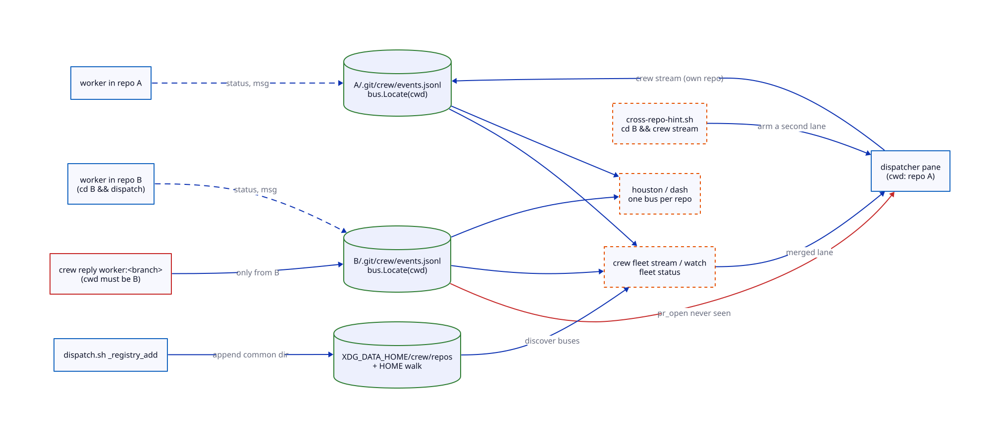
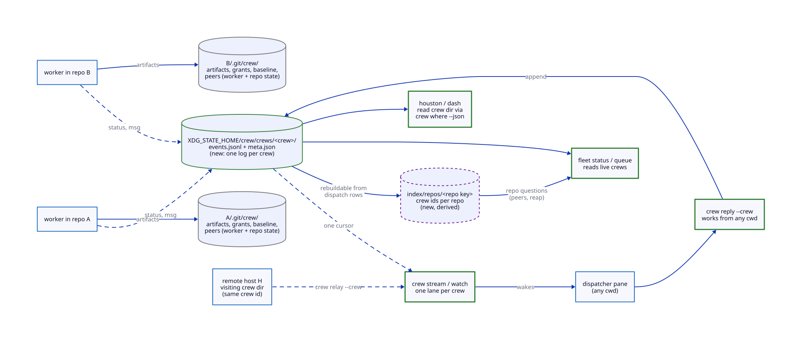

# Crew bus keyed by crew: design and migration

**Purpose.** Decide what replaces the per-repo crew bus (`<git-common-dir>/crew/events.jsonl` and its sibling dirs) now that one crew
routinely dispatches into several repos, and plan how to get there safely. Issue: #1740.

**Status.** Proposal, not implemented. This document changes nothing outside `docs/`. Commands, settings and files it names that do not
exist at the pin (for example `crew where --log`, `crew gc`, `meta.json`, the repo index) are proposals.

**Pinned revision.** `96185e7a`. Every `path:line` citation, count and file size is at this commit. Check a citation with
`git show 96185e7a:<path>` (for a range, pipe it to `sed -n 'A,Bp'`). Line numbers stay valid at the pin after `main` moves; they do not
track `main`.

**Conventions.** "Measured" means counted or read at the pin or on the measurement host, with the method stated next to the number.
"Estimated" means projected from a measured base, with the method stated (sizes in section 4, the ×10 scale in section 2). "Inference"
marks a claim that was not read in code. Citations into sibling repos are unpinned and written `houston:<path>:<line>` (also `tmux-og:`,
`hookyard:`, `aeye:`, `tmux-remux:`); 1.6 names the commit each was read at. Row ids such as `F4` or `T11` point at inventory tables.

**Sources.** The code at the pin, and three prior design docs it must stay consistent with: `docs/dispatch-redesign.md`,
`docs/crew-go-port.md` and `docs/crew-syscall-interfaces.md` (3.6). Measurements were taken read-only on host halo on 2026-11-23 (1.13
and section 2, "Measurements used here").

**Pending PRs.** Two open PRs touch this area and are not at the pin. #1737 adds an opt-in `--max-age` cache for `crew fleet status`.
#1739 changes protocol text so that park lanes use `crew fleet watch`. The inventory describes them in 1.14 but cites nothing from them. Phase 6 removes both if they merge
first (4.9).

**Contents.**

1. Inventory: every reader and writer of bus state, locks, cursors, trust checks, the scope classification, measured scale, the
   fan-in layers, and the PR-state readers.
2. Designs compared: A, A+, B, C (SQLite), D (broker) and E (NATS JetStream) on nine criteria, and why other libraries are in or
   out.
3. Recommendation: A+, with its data model, trust model, multi-host story, what stays repo-local, and where a proposed PR-event
   listener writes, and how readers wake on new rows (3.8).
4. Migration phases: the phase table, notes per phase, the deletion schedule, programme size.
5. Open questions, each with a recommended answer.

- Appendix A: every `git-common-dir` / `CommonDir` hit in `crew`, `adapters`, `dash` and `scripts`, mapped to its inventory row.
- Diagrams (directly below): current and recommended data flow.

## Diagrams

Current data flow (per-repo buses and their fan-in layers) and the recommended data flow (one log per crew). D2 sources sit beside the renders.

|             | Light                                                                                         | Dark                                                                                                    | Source                                                                                      |
| ----------- | --------------------------------------------------------------------------------------------- | ------------------------------------------------------------------------------------------------------- | ------------------------------------------------------------------------------------------- |
| Current     | [issue.svg](diagrams/2026-11-23-feat-1740-design-crew-bus-keyed-by-crew-not-repo-d-issue.svg) | [issue-dark.svg](diagrams/2026-11-23-feat-1740-design-crew-bus-keyed-by-crew-not-repo-d-issue-dark.svg) | [issue.d2](diagrams/2026-11-23-feat-1740-design-crew-bus-keyed-by-crew-not-repo-d-issue.d2) |
| Recommended | [plan.svg](diagrams/2026-11-23-feat-1740-design-crew-bus-keyed-by-crew-not-repo-d-plan.svg)   | [plan-dark.svg](diagrams/2026-11-23-feat-1740-design-crew-bus-keyed-by-crew-not-repo-d-plan-dark.svg)   | [plan.d2](diagrams/2026-11-23-feat-1740-design-crew-bus-keyed-by-crew-not-repo-d-plan.d2)   |





## 1. Inventory

Facts only. Every `path:line` is at `96185e7a` and repo-relative, unless it starts with `houston:`, `tmux-og:`, `hookyard:`, `aeye:`
or `tmux-remux:`; those are unpinned sibling repos read at the HEAD named in 1.6. A claim that was not read in code is marked
"inference". `<c>` is the git common dir and `<c>/crew` the bus dir. Row ids (`L3`, `W2`, ...) are what Appendix A cites. In a cell, a
bare `:N` continues the path just before it in that cell. Exception: in the 1.4 table (S rows), a bare `:N` or bare file name cites the
script named in the row's script column, under `adapters/core/`.

### 1.1 Where the bus is and how it is found

| id  | what                                           | where                                                                                                                                                                                                                                                                                                                                                                                                                                      | fact                                                                                                                                                                                                                                                                                                                                                                                                                                                                                                                                                  |
| --- | ---------------------------------------------- | ------------------------------------------------------------------------------------------------------------------------------------------------------------------------------------------------------------------------------------------------------------------------------------------------------------------------------------------------------------------------------------------------------------------------------------------ | ----------------------------------------------------------------------------------------------------------------------------------------------------------------------------------------------------------------------------------------------------------------------------------------------------------------------------------------------------------------------------------------------------------------------------------------------------------------------------------------------------------------------------------------------------- |
| L1  | `bus.Paths{Common, Dir, Log}`                  | `crew/internal/bus/bus.go:229-239`                                                                                                                                                                                                                                                                                                                                                                                                         | `Dir = Common + "/crew"`, `Log = Dir + "/events.jsonl"`; the struct every per-repo Go command passes around                                                                                                                                                                                                                                                                                                                                                                                                                                           |
| L2  | `Paths.CrewDir(id)`                            | `crew/internal/bus/bus.go:241-242`                                                                                                                                                                                                                                                                                                                                                                                                         | `Dir + "/crews/" + id`; untrusted ids pass `ValidCrewID` first (`crew/internal/bus/bus.go:264-278`: charset `[A-Za-z0-9._-]`, no leading `-`, not `.` or `..`)                                                                                                                                                                                                                                                                                                                                                                                        |
| L3  | `bus.Locate(ctx, cwd)`                         | `crew/internal/bus/bus.go:244-251`                                                                                                                                                                                                                                                                                                                                                                                                         | runs `git -C cwd rev-parse --path-format=absolute --git-common-dir`; an empty answer is `ErrNotRepo` (`crew/internal/bus/bus.go:20-21`). The only constructor of `Paths` from a cwd                                                                                                                                                                                                                                                                                                                                                                   |
| L4  | crew id resolution                             | `crew/internal/bus/bus.go:296-325`                                                                                                                                                                                                                                                                                                                                                                                                         | `CrewID`: first `crew_id:` line of `<git toplevel>/WORKER_TASK.md`, else env `CREW_ID`. `CrewIDEnvFirst` (`:309-315`): env first, used by stall and role-watch because a worker can rewrite its own task doc. The header read needs `git rev-parse --show-toplevel` (`Toplevel`, `crew/internal/bus/bus.go:260-262`); the env read needs nothing                                                                                                                                                                                                      |
| L5  | `main.go` arms that run before `Locate`        | `crew/main.go:608-748`                                                                                                                                                                                                                                                                                                                                                                                                                     | `fleet` (`:611`), `rate --sweep-all` (`:616-624`), `class` worker refusal (`:626-631`, falls through), `reap --fleet` (`:632-644`), `overseer *` (`:645-672`), `completion` (`:673`), `remote-exec` (`:680`), `occupants` (`:688`), `id` (`:696`), `help`/`new`/`engine-cmd`/`dash`/`pi-agent-dir` (`:705-715`), `git-guard`/`git-baseline` (`:727-740`). `crew new` mints `<unix>-<pid>` and "registers nothing" (`crew/internal/entry/new.go:20-24`)                                                                                                |
| L6  | `role-watch`                                   | `crew/main.go:515-516` and `:742-747`                                                                                                                                                                                                                                                                                                                                                                                                      | calls `bus.Locate` itself and tolerates a failure                                                                                                                                                                                                                                                                                                                                                                                                                                                                                                     |
| L7  | `main.go` arms after `Locate`                  | `crew/main.go:749-752`                                                                                                                                                                                                                                                                                                                                                                                                                     | every other subcommand takes `paths` from the cwd's repo or prints `crew: not in a git repo`. Arms visible at `crew/main.go:760-1000`: `reap`, `reap-autosweep`, `stack`, `crews`, `inbox`, `await`, `watch`, `relay`, `remote-run`, `dispatch-row`, `peer-sync`, `peer-claims`, `decide`, `class`, `migrate`, `decisions`, `stream`, `roster-render`, `hold`; the writers in 1.2 add `queue`, `status`, `msg`, `reply`, `merge`, `nudge`, `stall-watch`, `pr-watch`, `register`/`adopt` (partial list; any arm not named is inference)               |
| L8  | shell `crew_dir` derivation                    | `adapters/core/dispatch.sh:4157` (main path), `:2416`, `:2819`, `:3010`, `:3711` (escalation), `:2359` (`--role-exited` log path); `adapters/core/dispatch-resume.sh:449`; `adapters/core/dispatch-migrate.sh:139-143`; `adapters/core/dispatcher.sh:491-503`, `:644-700`, `:804`, `:1012-1063`, `:1069`; `adapters/core/dispatch-notify.sh:152-162`; `adapters/core/phase-status.sh:329-336`; `adapters/core/permission-check.sh:126-136` | each runs `git rev-parse --path-format=absolute --git-common-dir` in the cwd and appends `/crew`. The repo is whatever the cwd is; no `--repo` flag exists (inference: `adapters/core/dispatch.sh:4157` is the only main-path derivation)                                                                                                                                                                                                                                                                                                             |
| L9  | common recovered by stripping `/crew`          | `adapters/core/dispatch.sh:455`, `:596`, `:1016`, `:2417`, `:4164`, `:4189`, `:4618`, `:4671-4726`, `:5508`, `:5520`                                                                                                                                                                                                                                                                                                                       | the shell treats `crew_dir` as `<c>/crew` and derives `<c>` as `${crew_dir%/crew}` for worktree, baseline and registry calls, so `crew_dir` must end in `/crew`                                                                                                                                                                                                                                                                                                                                                                                       |
| L10 | `crew_dir:` header of `WORKER_TASK.md`         | `adapters/core/dispatch.sh:5269-5270`                                                                                                                                                                                                                                                                                                                                                                                                      | stamps the dispatching cwd's `<c>/crew` (also `crew_id`, `dispatcher_pane`, `worker_id`). Go never reads it (no `crew_dir:` parse in `crew/` or `dash/`). Only `adapters/core/directive-delivery.sh:55-100` trusts it (`-d` check, then a git fallback at `:91`). `adapters/core/dispatch-resume.sh:978` prints a header with no `crew_dir:` line. Workers are told to read `<crew_dir>` from it: `adapters/core/protocols/WORKER_PROTOCOL.md:32`, `:45`, `adapters/core/protocols/WORKER_PLAN.md:20-21`, `adapters/core/protocols/WORKER_GRID.md:22` |
| L11 | tmux window option `@crew_dir`                 | set `adapters/core/dispatch.sh:5517`, `adapters/core/dispatch-resume.sh:836`, `:1072`; read `adapters/core/dispatch.sh:2133` (`--spawn-role`, deliberately not via git, `:2126-2136`) and `adapters/core/dispatch.sh:1312-1330` (`_chrome_holders` reads `$ldir/events.jsonl` of other repos)                                                                                                                                              | the stamp carries the bus dir. `tmux-remux` restores `@crew_name`, `@crew_color`, `@crew_role*`, `@crew_state` only (`tmux-remux:internal/config/config.go:109-118`), so a restored window has no `@crew_dir`; `dispatch resume` restamps it (`adapters/core/dispatch-resume.sh:836`, `:1072`)                                                                                                                                                                                                                                                        |
| L12 | `@crew_dir` comparers                          | `crew/internal/nudge/arm.go:143-158` (`r[2] == paths.Dir`); `crew/internal/reap/reap.go:317-323`; `crew/internal/reap/stale.go:303-309` (`dir != r.paths.Dir`); `crew/internal/where/where.go:41-42`, `:224-233` (`f[2] != dir`); `crew/internal/rosterrender/model.go:37` (reads it in the role-pane format)                                                                                                                              | each filters windows to "this repo's bus" by string equality with `paths.Dir`. `adapters/core/dispatch-resume.sh:218-220` deliberately applies no `@crew_dir` filter, so the same branch name in another repo fails closed                                                                                                                                                                                                                                                                                                                            |
| L13 | worktree records bind a worktree to `<c>/crew` | `adapters/core/worktree-git.sh:28-36` (path), `:117-135` (`_wt_trusted_cwd` compares line 2 to `$common/crew`); `crew/internal/wtgit/trusted.go:20-35`, `:73`                                                                                                                                                                                                                                                                              | record = `${XDG_DATA_HOME}/crew/worktrees/<sha256(realpath worktree)>`, 4 lines: worktree, crew dir, branch, admin dir (written `adapters/core/dispatch.sh:1982`, verified `adapters/core/dispatch-resume.sh:463-470`). The stored form is `<c>/crew`                                                                                                                                                                                                                                                                                                 |
| L14 | dash                                           | `dash/internal/data/bus.go:18-27`                                                                                                                                                                                                                                                                                                                                                                                                          | `EventsPath` = `<c>/crew/events.jsonl` of the cwd's repo; see 1.5                                                                                                                                                                                                                                                                                                                                                                                                                                                                                     |
| L15 | existence probes                               | `adapters/core/dispatcher.sh:194`, `:794`, `:981`, `:1037`, `:1333`, `:1430`; `adapters/core/dispatch-resume.sh:165`, `:397`                                                                                                                                                                                                                                                                                                               | `git rev-parse --git-common-dir` used only as "is this a repo"; no path is derived from the answer                                                                                                                                                                                                                                                                                                                                                                                                                                                    |

### 1.2 Go writers of `events.jsonl`

Every Go append goes through `bus.Append(path, line)` (`crew/internal/bus/append.go:39-54`): one `O_APPEND|O_CREATE` write, with a
leading `\n` when the last byte is a torn fragment. No flock. `LineMax` is 4096 bytes (`crew/internal/bus/append.go:18-20`);
`RelayLineMax` is 16 MiB (`crew/internal/bus/append.go:22-25`). The location assumption is "`paths.Log` of the cwd's repo" unless
stated.

| id  | package / command                                                         | file:line                                                                                                                                                  | location assumption and notes                                                                                                                                                                                                                                                                                                                                                                    |
| --- | ------------------------------------------------------------------------- | ---------------------------------------------------------------------------------------------------------------------------------------------------------- | ------------------------------------------------------------------------------------------------------------------------------------------------------------------------------------------------------------------------------------------------------------------------------------------------------------------------------------------------------------------------------------------------ |
| W1  | `status` (`crew status`, `crew msg`, `crew decide`, local `overseer msg`) | `crew/internal/status/status.go:161-162`; `crew/internal/status/decide.go:38`; `crew/internal/status/overseer.go:19`, `:46`                                | cwd repo. `begin` does `os.MkdirAll(paths.Dir)` first (`crew/internal/status/status.go:107-120`). The overseer path takes `paths` from `onBus(common, crew)` after registry discovery (`crew/internal/overseer/msg.go:108-114`, `:337-343`)                                                                                                                                                      |
| W2  | `reply` (`crew reply`; `crew merge` calls it)                             | `crew/internal/reply/reply.go:124`; `crew/internal/merge/merge.go:340`                                                                                     | cwd repo only. `reply.Run` does `MkdirAll(paths.Dir)` before resolving (`crew/internal/reply/reply.go:76`); the cross-repo refusal is F10                                                                                                                                                                                                                                                        |
| W3  | `hold`                                                                    | `crew/internal/hold/hold.go:473`, `:654`; spec file `crew/internal/hold/hold.go:451-455` (`<c>/crew/holds/<id>.md`)                                        | cwd repo. Sink `hold:<crew>` (`crew/internal/hold/hold.go:1-5`)                                                                                                                                                                                                                                                                                                                                  |
| W4  | `queue`                                                                   | `crew/internal/queue/queue.go:417`, `:477`                                                                                                                 | cwd repo. Sink `queue:<crew>` (`crew/internal/queue/queue.go:1-5`)                                                                                                                                                                                                                                                                                                                               |
| W5  | `prwatch`                                                                 | `crew/internal/prwatch/prwatch.go:177`                                                                                                                     | cwd repo                                                                                                                                                                                                                                                                                                                                                                                         |
| W6  | `stall` (`stall-watch`)                                                   | `crew/internal/stall/post.go:83`                                                                                                                           | cwd repo; the shell starts it from the dispatcher's cwd (`adapters/core/dispatch.sh:5834`)                                                                                                                                                                                                                                                                                                       |
| W7  | `nudge`                                                                   | `crew/internal/nudge/wire.go:46-51`; `crew/internal/nudge/arm.go:502`; `crew/internal/nudge/nudge.go:225`                                                  | cwd repo; also the `nudge-wait/` lock (1.8)                                                                                                                                                                                                                                                                                                                                                      |
| W8  | `migrate mark`                                                            | `crew/internal/migrate/migrate.go:396`; snapshots under `<c>/crew/migrate/<branch>/<UTC>` (`crew/internal/migrate/migrate.go:261`, `:285-290`, `:404-407`) | cwd repo                                                                                                                                                                                                                                                                                                                                                                                         |
| W9  | `reap` rows (`reap`, `release`, `stale`, `reaped` status)                 | `crew/internal/reap/release.go:110`; `crew/internal/reap/remove.go:126`, `:326`; `crew/internal/reap/stale.go:201`; `crew/internal/reap/probes.go:65`      | cwd repo, or each discovered repo under `--fleet` through a hand-built `Paths` (`crew/internal/reap/fleet.go:78-81`). `reapRowJSON` has no `crew_id` field (`crew/internal/reap/remove.go:303-313`); `releaseRow` has none (`crew/internal/reap/release.go:114-121`); the `reaped` status row and the `stale` row do (`crew/internal/reap/remove.go:336-343`, `crew/internal/reap/stale.go:183`) |
| W10 | `stack cut`                                                               | `crew/internal/stack/cut.go:123`; `crew/internal/stack/probes.go:30`                                                                                       | cwd repo                                                                                                                                                                                                                                                                                                                                                                                         |
| W11 | `class promote`                                                           | `crew/internal/classes/promote.go:676`, `:679`                                                                                                             | cwd repo (announcement msg plus decision row)                                                                                                                                                                                                                                                                                                                                                    |
| W12 | `claimindex.Release`                                                      | `crew/internal/claimindex/claimindex.go:82-94`                                                                                                             | not the bus: appends to the machine claim file (1.7) with `bus.Append`                                                                                                                                                                                                                                                                                                                           |
| W13 | `crews` pidfile audit                                                     | `crew/internal/crews/crews.go:316-324`                                                                                                                     | `<c>/crew/pidfile.log`, diagnostic, not `events.jsonl`                                                                                                                                                                                                                                                                                                                                           |
| W14 | `peer` store                                                              | `crew/internal/peer/peer.go:343-375`                                                                                                                       | `<c>/crew/peers/<host>.jsonl`, never `events.jsonl` (`crew/internal/peer/peer.go:1-12`)                                                                                                                                                                                                                                                                                                          |

Crew-dir creators (state, not rows): `crew/internal/register/register.go:80`, `crew/internal/adopt/adopt.go:165`,
`crew/internal/adopt/reattach.go:84`, `crew/internal/watch/watch.go:110`, `:118`, `:260`, `crew/internal/stream/stream.go:160`,
`crew/internal/spill/spill.go:82`, `crew/internal/rosterrender/rosterrender.go:105`, `crew/internal/stream/relay.go:154`, and houston (X4).
So today a read-side command such as `watch` can create `crews/<id>/` for an id it was handed.

### 1.3 Go readers of `events.jsonl`

| id  | kind                                                        | readers (file:line)                                                                                                                                                                                                                                                                                                                                                                                                                                                                                                                                                                                                                                                                                                                                                                                                                                                                                                                                                                                                                                                                                                                                                                            | location assumption                                                                               |
| --- | ----------------------------------------------------------- | ---------------------------------------------------------------------------------------------------------------------------------------------------------------------------------------------------------------------------------------------------------------------------------------------------------------------------------------------------------------------------------------------------------------------------------------------------------------------------------------------------------------------------------------------------------------------------------------------------------------------------------------------------------------------------------------------------------------------------------------------------------------------------------------------------------------------------------------------------------------------------------------------------------------------------------------------------------------------------------------------------------------------------------------------------------------------------------------------------------------------------------------------------------------------------------------------- | ------------------------------------------------------------------------------------------------- |
| R1  | whole-log, cwd repo                                         | `crew/internal/log/log.go:36`; `crew/internal/report/report.go:47`; `crew/internal/retro/retro.go:159`; `crew/internal/rate/sweep.go:88`; `crew/internal/queue/queue.go:379`, `:430`; `crew/internal/hold/hold.go:181`; `crew/internal/reap/folds.go:66`, `:89`, `:106`, `:125`; `crew/internal/reap/forget.go:37`; `crew/internal/reap/stale.go:136`; `crew/internal/reap/remove.go:444`; `crew/internal/reap/migrated.go:22`; `crew/internal/identity/identity.go:208-213`; `crew/internal/resolve/resolve.go:135`; `crew/internal/where/where.go:104`; `crew/internal/nudge/arm.go:270`, `:288`; `crew/internal/nudge/wire.go:32`; `crew/internal/crews/crews.go:101`, `:165`; `crew/internal/adopt/adopt.go:218`, `:312`; `crew/internal/inbox/inbox.go:71`; `crew/internal/await/await.go:101`; `crew/internal/reply/reply.go:146`, `:167`; `crew/internal/peer/sync.go:111-209`; `crew/internal/peer/decisions.go:94`; `os.ReadFile(paths.Log)` at `crew/internal/merge/merge.go:220`, `:320`, `crew/internal/followups/draft.go:38`, `crew/internal/stack/stack.go:161`; `crew/internal/rolewatch/loop.go:134-138`; rosterrender model build (`crew/internal/rosterrender/model.go:86`) | `paths.Log` from `Locate(cwd)`; each reader re-reads the whole file per call except R2            |
| R2  | tail / incremental                                          | `crew/internal/stall/probe/tail.go:38` (`BusRows`, tail window that doubles; callers `crew/internal/stall/bus.go:25`, `crew/internal/stall/probe_detectors.go:479`, `crew/internal/nudge/wire.go:73`); `crew/internal/rolewatch/loop.go:134-160` (stat skip, in-memory `since`)                                                                                                                                                                                                                                                                                                                                                                                                                                                                                                                                                                                                                                                                                                                                                                                                                                                                                                                | `paths.Log` of the cwd repo                                                                       |
| R3  | fleet fan-in over every discovered repo                     | `crew/internal/fleet/fleet.go:105`, `:185`; `crew/internal/fleet/status.go:339-380`, `crew/internal/fleet/status.go:556`, `:687`, with `busCache` at `crew/internal/fleet/queue.go:154-170`; `crew/internal/fleet/load.go:181`, `:223`; `crew/internal/fleet/queue.go:176`, `:354-357`; `crew/internal/fleet/prio.go:158-162`; `crew/internal/fleet/federate.go:155`; `crew/internal/fleet/peers.go:16`, `:42`; `crew/internal/fleet/relays.go:26`; `crew/internal/stream/fleet.go:340`, `:423-425`; `crew/internal/stream/fleetwatch.go:126`, `:138`; `crew/internal/stream/overseer.go:412`; `crew/internal/overseer/msg.go:108`, `:338`; `crew/internal/overseer/trust.go:142-165`; `crew/internal/rate/sweepall.go:33`, `:79-82`; `crew/internal/reap/fleet.go:29`, `:78-81`; `crew/internal/rosterrender/sources.go:109-130`                                                                                                                                                                                                                                                                                                                                                              | one `<c>/crew/events.jsonl` per registry or walk entry (F1)                                       |
| R4  | hand-built `<c>/crew/events.jsonl` (duplicates of `Locate`) | full `bus.Paths` literals: `crew/internal/overseer/msg.go:338`, `crew/internal/rate/sweepall.go:81`, `crew/internal/reap/fleet.go:80`, `crew/internal/rosterrender/sources.go:120`, `crew/internal/stream/fleetwatch.go:138`; path-only joins: `crew/internal/fleet/fleet.go:185`, `crew/internal/fleet/load.go:181`, `crew/internal/fleet/federate.go:155`, `crew/internal/stream/fleet.go:340`, `:425`, `crew/internal/stream/overseer.go:412`; registry code: `crew/internal/repos/repos.go:45` (`busSuffix`), `:176` (`Stat`), `:206` (walk match); `<c>/crew/crews` joins: `crew/internal/fleet/status.go:556`, `:687`, `crew/internal/fleet/relays.go:26`, `crew/internal/fleet/queue.go:354`, `:357`, `crew/internal/overseer/trust.go:164`, `crew/internal/stream/fleetwatch.go:126`, `crew/internal/stream/fleet.go:423`; `crew/internal/fleet/peers.go:16`, `:42` build `Paths` with `Dir` only                                                                                                                                                                                                                                                                                      | none goes through a shared constructor: `newPaths` is unexported (`crew/internal/bus/bus.go:236`) |

`bus.ReadEventsTolerant` keeps the rows before a torn line and returns a `DecodeError` (`crew/internal/bus/bus.go:196-230`); torn tails
are expected because writers take no lock.

### 1.4 Shell writers and readers (adapters/core and plugin copies)

Copies: `phase-status.sh`, `directive-delivery.sh`, `dispatch-notify.sh` exist byte-identical under
`adapters/claude-code/plugin/scripts/`, `adapters/codex/plugin/scripts/` and `adapters/cursor/scripts/` (`cmp`-checked at the pin);
`DISPATCHER_PROTOCOL*.md` and `skills/peers/SKILL.md` are copies of the core files too. `scripts/gen-adapters.sh` produces them
(plugin scripts and protocols `scripts/gen-adapters.sh:145-172`, cursor scripts `scripts/gen-adapters.sh:190-205`, cursor protocols `scripts/gen-adapters.sh:208-215`, protocol renders `scripts/gen-adapters.sh:120-127`, skills `scripts/gen-adapters.sh:235-242`).

| id  | script                                                               | bus-dir reads / writes                                                                                                                                                                                                                                                                                                                                                                                                                                                                                                                                                                                                                                                  | location assumption                                                                                                                                                       |
| --- | -------------------------------------------------------------------- | ----------------------------------------------------------------------------------------------------------------------------------------------------------------------------------------------------------------------------------------------------------------------------------------------------------------------------------------------------------------------------------------------------------------------------------------------------------------------------------------------------------------------------------------------------------------------------------------------------------------------------------------------------------------------- | ------------------------------------------------------------------------------------------------------------------------------------------------------------------------- |
| S1  | `adapters/core/dispatch.sh`                                          | `crew_dir` (`:4157`), `mkdir -p` (`:4185`); events append through `_crew_append` (`:1019`) and reads (`:416`, `:475`, `:824`, `:838`, `:2679-2730`, `:4327-4333`, `:4749`); `crews/<id>/{pid,pane}` (`:5840-5842`); `grants/<branch>` (`:5144-5182`); `artifacts/<branch>/` (`:2180`, `:5201-5207`, `:5397`, `:5412`; handoff `:5657`); `leads/<branch>` (`:5164`); `protocol-dirs/<branch>` (`:2144-2148`); `migrate/` bundle check (`:2828-2830`); `dispatch-<cksum>.lock` symlink (`:4588-4592`); `identity.lock` dir (`:4600`); `launch/` through launcher-common (`adapters/core/launcher-common.sh:902`); registry append (`adapters/core/dispatch.sh:1002-1018`) | cwd repo. A cross-repo worker is `cd <repo B> && dispatch`                                                                                                                |
| S2  | `adapters/core/dispatch.sh`, remote path                             | `crew remote-run ... dispatch` (`:2958`); `crew dispatch-row` recover (`:2645`); `_remote_finish` appends the row with `host`, `remote:true` to the local bus (`:2657-2672`); `_remote_dup_holder` reads the local log and claim index because "the remote cannot see this machine's bus" (`:2709-2745`; the message is at `:2925`)                                                                                                                                                                                                                                                                                                                                     | the local bus records the remote worker; the remote host uses its own clone's bus                                                                                         |
| S3  | `adapters/core/directive-delivery.sh`                                | reads `$crew_dir/events.jsonl`; cursor file `$crew_dir/directive-delivery/<key>` (`:55-100`)                                                                                                                                                                                                                                                                                                                                                                                                                                                                                                                                                                            | `crew_dir:` header, else `git rev-parse` at `:91`                                                                                                                         |
| S4  | `adapters/core/dispatch-notify.sh`                                   | reads the last status; appends an `exited` row with its own `_bus_append` copy (`:136`, `:150-165`, `:189`)                                                                                                                                                                                                                                                                                                                                                                                                                                                                                                                                                             | the worker's `git -C $cwd` common (`:152`); `crew_id` from `WORKER_TASK.md` (`:151`)                                                                                      |
| S5  | `adapters/core/phase-status.sh`                                      | throttle file `$common/crew/phase-status/<sanitized worker id>.<cksum>` (`:326-336`); posts through `crew status` (`:370`)                                                                                                                                                                                                                                                                                                                                                                                                                                                                                                                                              | the worker's `git -C $cwd` common (`:329`)                                                                                                                                |
| S6  | `adapters/core/dispatch-migrate.sh`                                  | `crew_dir` (`:139-144`); lock `$crew_dir/migrate-<cksum>.lock` (`:212-218`); `roles.json` (`:299`); `leads/<branch>` (`:526`); `handoff.md` (`:587`); `crew migrate ... --crew`, `crew inbox`, `crew reply`                                                                                                                                                                                                                                                                                                                                                                                                                                                             | cwd repo; worktree record scanned from `${XDG_DATA_HOME}/crew/worktrees/*` (`:228`)                                                                                       |
| S7  | `adapters/core/dispatch-resume.sh`                                   | `crew resolve-target`, `crew where` (`:165-205`); scans worktree records for a matching crew dir and branch (`:197-210`); `crew_dir` (`:449`); anchor check (`:459-470`); `_bus_append` of the `resume` row (`:1213`); `crews/<id>/{pid,pane}` (`:1110`)                                                                                                                                                                                                                                                                                                                                                                                                                | cwd repo; refuses "needs the repo's crew bus — run from inside the repository" (`:165-168`)                                                                               |
| S8  | `adapters/core/dispatcher.sh`                                        | `crew new` and `crew register $$` (`:1026-1045`); launch record `crews/<id>/launch` (`:1057-1063`); `--relaunch` lock `crews/<id>/.relaunch.lock`, `relaunch`, `launch` (`:491-612`); `--spawn` `<c>/crew/.spawn.lock`, `<c>/crew/spawn` marker, `crews/<id>` (`:644-700`); `handoff/` dir exported as `DISPATCHER_HANDOFF_DIR` (`:804`, `:1069-1071`); overseer state `${XDG_STATE_HOME}/crew/overseer` (`:922-949`)                                                                                                                                                                                                                                                   | cwd repo; the overseer state is machine-level                                                                                                                             |
| S9  | `adapters/core/launcher-common.sh`, `adapters/core/lead-launcher.sh` | `_bus_append` canonical copy (`launcher-common.sh:16`); `leads/` (`:327-354`), `launch/` (`:881-902`), `artifacts/` (`:950-954`), `attach-tmp/` (`:1013-1016`), `protocol-dirs/` (`:1071-1153`), `grants/` (`:1253-1317`); `lead-launcher.sh` writes `launch/lead.$$.restart` and a `_bus_append` (`lead-launcher.sh:175-177`, `lead-launcher.sh:228`; `--crew-dir` must be absolute, `lead-launcher.sh:163`)                                                                                                                                                                                                                                                           | caller-provided `$crew_dir`                                                                                                                                               |
| S10 | `adapters/core/permission-check.sh`, `adapters/core/grant-check.sh`  | `--crew-dir` default `<c>/crew` after `_wt_trusted_cwd` (`permission-check.sh:126-136`); reads `$CREW_DIR/{grants,artifacts,leads}` (`:726-754`); `grant-check.sh:380-391` refuses a grant at, above or under `$crew_dir` and at, above or under `${XDG_STATE_HOME}/crew`                                                                                                                                                                                                                                                                                                                                                                                               | the dispatcher's cwd repo                                                                                                                                                 |
| S11 | `adapters/core/cross-repo-hint.sh`                                   | read-only; see F6                                                                                                                                                                                                                                                                                                                                                                                                                                                                                                                                                                                                                                                       | the worker repo's cwd                                                                                                                                                     |
| S12 | `adapters/core/subagent-notify.sh`, `adapters/core/pr-watch.sh`      | post through `crew msg` (`subagent-notify.sh:63`); `pr-watch.sh:94` keeps `${XDG_DATA_HOME}/crew/pr-watch/<repo>`                                                                                                                                                                                                                                                                                                                                                                                                                                                                                                                                                       | cwd repo, machine                                                                                                                                                         |
| S13 | claim index                                                          | `adapters/core/dispatch.sh:576-640` (`_claim_index_file`; `_bus_append` at `:609`, `:625`); `_claim_index_clone` = dirname of common (`:595-598`)                                                                                                                                                                                                                                                                                                                                                                                                                                                                                                                       | machine file keyed by origin owner/repo; reads other clones' buses at `<clone>/.git/crew/events.jsonl` (assumes `<clone>/.git` is a directory; inference from `:595-598`) |
| D1  | protocol text                                                        | `adapters/core/protocols/DISPATCHER_PROTOCOL.md:163`; `adapters/core/protocols/DISPATCHER_PROTOCOL.claude.md:153`; `adapters/core/protocols/DISPATCHER_PROTOCOL.pi.md:152`; copies `adapters/claude-code/plugin/protocols/DISPATCHER_PROTOCOL.claude.md:153`, `adapters/claude-code/plugin/protocols/DISPATCHER_PROTOCOL.md:153`, `adapters/codex/plugin/protocols/DISPATCHER_PROTOCOL.md:163`, `adapters/cursor/protocols/DISPATCHER_PROTOCOL.md:163`                                                                                                                                                                                                                  | teaches "**The bus is per repo.** ... `cd <worker repo> && crew stream --crew <id>`"                                                                                      |
| D2  | skill text                                                           | `adapters/core/skills/peers/SKILL.md:8` (+ three copies, 1.4 header)                                                                                                                                                                                                                                                                                                                                                                                                                                                                                                                                                                                                    | "`<git-common-dir>/crew/peers/<name>.jsonl`, never on your bus"                                                                                                           |
| D3  | other teaching text                                                  | `adapters/core/commands/dispatcher.md:29` (`.git/crew/crews/<crew_id>/`); worker protocols name `<crew_dir>/artifacts/<branch>/...`: `adapters/core/protocols/WORKER_PLAN.md:20-21`, `adapters/core/protocols/WORKER_GRID.md:22`, `adapters/core/protocols/WORKER_PROTOCOL.md:45-47`, `adapters/core/protocols/REVIEW_TASK.md:59`                                                                                                                                                                                                                                                                                                                                       | the artifacts path comes from the `crew_dir:` header, not from git                                                                                                        |

Drift guards over the byte copies: `tests/adapters.bats:17-37` no raw `>>...events.jsonl` append outside `_bus_append` anywhere under
`adapters/`; `tests/adapters.bats:62-70` `dispatch-notify.sh`'s `_bus_append` equals `launcher-common.sh`'s whole function;
`tests/adapters.bats:134-136` `scripts/gen-adapters.sh` is idempotent over the generated trees (idempotence only; a compare against the
committed tree is not asserted there, inference); `tests/adapters.bats:240` and `tests/adapters.bats:443-448` protocol files are `cmp`-equal in
every adapter; `tests/adapters.bats:296` core and cursor `dispatch-notify.sh` are `cmp`-equal; `tests/adapters.bats:323-324` and
`tests/adapters.bats:329-338` (`guard_ships_row`) core `phase-status.sh` and `directive-delivery.sh` are `cmp`-equal to all three copies.
`crew/internal/bus/append.go:1-7` states that bats byte-compares the three bash `_bus_append` copies. No bus path is wired in `nix/` or
`flake.nix`: `flake.nix:129-134` bakes `@crossRepoHintLib@`, `@worktreeGitLib@`, `@crewGoBin@` and store paths only; `nix/hm-module.nix:606-609`
documents `CREW_SWEEP_ROOTS` as the overseer root fallback (discovery roots, F1).

### 1.5 dash

| id  | what              | file:line                                                                                                                                                                                                                               | assumption                                                                            |
| --- | ----------------- | --------------------------------------------------------------------------------------------------------------------------------------------------------------------------------------------------------------------------------------- | ------------------------------------------------------------------------------------- |
| H1  | bus path          | `dash/internal/data/bus.go:18-27`; callers `dash/main.go:78`, `:175`                                                                                                                                                                    | `git rev-parse --git-common-dir` of the cwd repo plus `/crew/events.jsonl`            |
| H2  | non-fleet commons | `dash/main.go:196-201`                                                                                                                                                                                                                  | `repo = dirname(dirname(eventsPath))`; one common                                     |
| H3  | fleet commons     | `dash/main.go:498-512`; `dash/internal/data/fleet.go:187` (`CollectFleetStatus` shells to `crew fleet status`), `:345-350` (`CollectReapKeeps` shells to `crew reap --fleet --dry-run --json`)                                          | commons come from the registry through `crew`, not from a walk in dash                |
| H4  | scanners          | `dash/internal/data/fleet.go:315-330` (one `BusScanner` per common); `dash/internal/data/digest.go:86-131` (byte offset, reset on shrink)                                                                                               | incremental per file                                                                  |
| H5  | watch paths       | `dash/main.go:268-283` (`watchPaths`): `<c>/crew/events.jsonl`, `crews/*/relay/*.cursor`, `peers/*.link`, `peers/*.roster`; fsnotify only on the current repo (`dash/main.go:242-248`); fleet fallback ticker 30 s (`dash/main.go:266`) | per common                                                                            |
| H6  | `RecentEvents`    | `dash/internal/data/bus.go:48-78` (16 MiB scanner buffer, `:60`)                                                                                                                                                                        | whole-file scan                                                                       |
| H7  | repo label        | `dash/internal/ui/crewheader.go:12-22` (`repoOfEvents`)                                                                                                                                                                                 | infers the repo name from `<c>/crew/events.jsonl`, i.e. assumes the repo-keyed layout |

### 1.6 Out-of-repo consumers

Search scope: the six sibling repos under `~/git/noamsto/` (`houston` `1790aba`, `tmux-og` `1195fc30`, `hookyard` `339be55`, `prdash`
`5ccb6f2`, `aeye` `c027318`, `tmux-remux` `d38c5f0`): `git grep -I` for `events.jsonl`, `git-common-dir`, `.git/crew`, `crew/crews`, `CrewBus`,
`crew_dir`. All unpinned. Not searched: non-Go and non-script files beyond
file-name matches, Nix modules outside tmux-og's `flake.nix`, `.claude/worktrees/` copies, and other repos under `~/git/` (kitty, a private app repo and
others hold buses but were not read as consumers).

User Claude hooks: `~/.claude/settings.json` is a symlink into the Nix store; a search for `events.jsonl|crew_dir|git-common-dir` found 0
matches in it, and `~/.claude/hooks` does not exist. Hook commands that live in plugin or Nix store files were not searched (gap).

| id  | consumer                        | role                                 | facts (all `houston:` lines unpinned)                                                                                                                                                                                                                                                                                                                                                                                                                                                                                                                                            |
| --- | ------------------------------- | ------------------------------------ | -------------------------------------------------------------------------------------------------------------------------------------------------------------------------------------------------------------------------------------------------------------------------------------------------------------------------------------------------------------------------------------------------------------------------------------------------------------------------------------------------------------------------------------------------------------------------------- |
| X1  | houston: locate                 | reader                               | `houston:runs/crewsource.go:412-433` (`crewDir`: `git -C root rev-parse --git-common-dir`, a relative answer joined onto root, then `+ "/crew"`; callers `:252`, `:359`); `houston:runs/project.go:22-32` (`GitCommonDir`, absolute); `houston:runs/project.go:35-41` (`ProjectFromCommonDir` names the project from the common dir's parent); `houston:server/workspace_repo.go:44` (classifies main vs linked worktree; not bus reading); `houston:runs/run.go:70-73` (`Run.CrewBus`, not serialized). Houston never uses the `crew` CLI to find a bus                         |
| X2  | houston: events tailing         | reader                               | `houston:crewfeed/store.go:125-175` (`Advance(bus)` opens `<bus>/events.jsonl`, resets on a shrunk file or changed first line; entry id = `epoch.byte-offset`, `entryID` `:116-118`); fields parsed: `ts crew_id from to kind branch title tier engine model name state pr_state tmux engine_session session pr body` (`houston:crewfeed/fold.go:28-62`, `houston:runs/crewsource.go:441-473`)                                                                                                                                                                                   |
| X3  | houston: crew-dir join          | reader                               | `houston:runs/crewdispatch.go:40-100` (reads `crews/<id>/pane` mtime against the tmux server start and `crews/<id>/pid` ownership of the pane); `houston:runs/crewsource.go:318-345` (`crewHomes`: a crew dir present in several buses has no known home and is dropped); `houston:server/dispatch.go:281-311` (lists `<c>/crew/crews/*`, stats `pane`), `:459-465` (requires an existing `crews/<id>`); `houston:server/dispatcher_restart.go:199`, `:223-228` (`filepath.Join(run.CrewBus, "crews", crew)`, reads `pid`)                                                       |
| X4  | houston: **writer**             | writer                               | `houston:server/dispatch.go:560-575` (`mintDispatchCrew`: `MkdirAll <c>/crew/crews`, then `Mkdir crews/<unix>-<pid>`, 409 on a same-second clash); callers `houston:server/dispatch.go:482` and `houston:server/dispatcher_launch.go:477`; it removes the minted dir on failure (`houston:server/dispatch.go:520-526`, `houston:server/dispatcher_launch.go:485-488`); it launches the dispatcher launcher with `CREW_ID=<minted>` (`houston:server/dispatcher_launch.go:730`, `:757-765`). It writes no event rows itself                                                       |
| X5  | houston: `crew reply` shell-out | CLI caller                           | `houston:server/runs_reply.go:136-143` (argv `crew reply worker:<branch> -- <text>`, `Dir: run.Worktree`; `CREW_ID=<crew>` appended at `:50-51`). Verified: the cwd is the worker's worktree, so `bus.Locate` lands on the worker's repo bus. `houston:server/dispatch_exec.go:47` strips `DISPATCH_SPEC CREW_ID CREW_WORKER_ID TMUX_PANE`                                                                                                                                                                                                                                       |
| X6  | houston: fixtures and QA        | test                                 | `houston:internal/loadfixture/crews.go:53-93` (writes `repo/.git/crew/events.jsonl` and `crews/`), `houston:scripts/qa/scenarios/crew.cjs:66`, `:73`, `:264`, `houston:scripts/qa/setup.sh:96`, `houston:scripts/perf/crewtmux.sh:78`, `houston:runs/crewsource_test.go` (many `bus/events.jsonl` writes)                                                                                                                                                                                                                                                                        |
| X7  | houston: repo list              | none                                 | its own `repoReg` (`houston:server/repos_api.go:29-74`); it does not read `${XDG_DATA_HOME}/crew/repos`                                                                                                                                                                                                                                                                                                                                                                                                                                                                          |
| X8  | tmux-og                         | not a consumer                       | `tmux-og:picker/prenrich/pass.go:66` runs `git rev-parse --git-common-dir` only to group windows by repo; no `events.jsonl` read. `crew dash` float launcher `tmux-og:scripts/tmux-crew-dash.sh` runs `crew dash` in pane context (its bus comes from the cwd; that claim is from `tmux-og:docs/superpowers/plans/2026-11-16-crew-dash-float-launcher.md:35`, a doc, not read in code). `tmux-og:scripts/pi-relaunch-stamp.sh:81-82` reads `CREW_WORKER_ID`/`CREW_ROLE_ID` env only                                                                                              |
| X9  | hookyard                        | not a bus reader or writer in code   | `hookyard:cmd/priors/internal/gate/programs.go:16`, `:23` lists `crew` among allowed programs ("crew writes only its own crew dir"); its `git-common-dir` uses (`hookyard:cmd/priors/native_dir.go:27`, `hookyard:cmd/priors/internal/commit/commit.go:311`, `hookyard:cmd/priors/internal/route/route.go:328`, `hookyard:cmd/priors/internal/pin/pin.go:179`) are hookyard's own state. `hookyard:docs/design/hookyard.md:3075` says dispatcher's `dispatch-notify.sh` appends `exited` to `$GIT_COMMON_DIR/crew/events.jsonl`; that is dispatcher code (S4), not hookyard code |
| X10 | prdash                          | not a consumer                       | no `crew`, `common-dir` or `events.jsonl` match outside `.git`                                                                                                                                                                                                                                                                                                                                                                                                                                                                                                                   |
| X11 | aeye                            | not a consumer                       | reads the tmux window option `@crew_grid` only (`aeye:scripts/tmux-claude-images.sh:171`, `:256`)                                                                                                                                                                                                                                                                                                                                                                                                                                                                                |
| X12 | tmux-remux                      | not a consumer (window options only) | restores `@crew_name`, `@crew_color`, `@crew_role`, `@crew_role_color`, `@crew_state` (`tmux-remux:internal/config/config.go:109-118`); not `@crew_dir`, `@crew_id`, `@crew_branch` (`adapters/core/dispatch-resume.sh:834-835` states tmux-remux does not restore `@crew_branch`)                                                                                                                                                                                                                                                                                               |

### 1.7 Every bus-dir entry and every machine-level store

Bus dir `<c>/crew/` at the pin. The dispatcher repo's live listing (read-only `ls`, 2026-11-23) is `artifacts await await.lock crews
directive-delivery events.jsonl git-config-baseline grants holds homes launch leads nudge-wait phase-status pidfile.log protocol-dirs remote-exec`
(33 crew dirs). Entries not in that listing but created by code (`peers/`, `reap.lock.d`, `handoff/`, `migrate/`, `.spawn.lock`, `spawn`,
`dispatch-<cksum>.lock`, `migrate-<cksum>.lock`, `identity.lock`, `attach-tmp/`) are listed from source.

| entry                                                                                                                                      | writer                                                                                                                                                                              | reader                                                                                                                                                                               | lock                                                                                     | scope in code                                                                                                                                                                                              |
| ------------------------------------------------------------------------------------------------------------------------------------------ | ----------------------------------------------------------------------------------------------------------------------------------------------------------------------------------- | ------------------------------------------------------------------------------------------------------------------------------------------------------------------------------------ | ---------------------------------------------------------------------------------------- | ---------------------------------------------------------------------------------------------------------------------------------------------------------------------------------------------------------- |
| `events.jsonl`                                                                                                                             | 1.2, S1, S2, S4, S7, S9                                                                                                                                                             | 1.3, 1.4, 1.5, X2                                                                                                                                                                    | none (`O_APPEND`, one write, `LineMax`)                                                  | per repo today                                                                                                                                                                                             |
| `crews/<id>/pid`, `pid.start`                                                                                                              | `crew/internal/register/register.go:57-86`; `crew/internal/adopt/adopt.go:136`; `crew/internal/adopt/reattach.go:64-69`                                                             | `crew/internal/crews/crews.go:75`, `:115`; `crew/internal/reply/reply.go:217`; `crew/internal/crews/home.go:132`; `crew/internal/fleet/status.go:640`; X3                            | none                                                                                     | per crew                                                                                                                                                                                                   |
| `crews/<id>/pane`                                                                                                                          | `crew/internal/register/register.go:102`; `crew/internal/adopt/adopt.go:192`; `crew/internal/adopt/reattach.go:97`                                                                  | `crew/internal/overseer/trust.go:164-171`; `crew/internal/fleet/status.go:695`; X3                                                                                                   | none                                                                                     | per crew                                                                                                                                                                                                   |
| `crews/<id>/launch`, `relaunch`, `.relaunch.lock`                                                                                          | `adapters/core/dispatcher.sh:522-612`, `:1057-1063`                                                                                                                                 | `adapters/core/dispatcher.sh` relaunch                                                                                                                                               | `.relaunch.lock` mkdir (`adapters/core/dispatcher.sh:598`)                               | per crew                                                                                                                                                                                                   |
| `crews/<id>/cursor`                                                                                                                        | `crew/internal/watch/watch.go:228` via a temp `.cursor.*` created in `<c>/crew` and renamed (`:395-416`)                                                                            | `crew/internal/watch/watch.go:146-152`, `:270` (`seedCursor` `:422`)                                                                                                                 | `watch.lock.d`                                                                           | per crew, shared by the repo stream and `fleet stream/watch`                                                                                                                                               |
| `crews/<id>/watch.lock.d`, `stream.lock.d`, `stream.tick`, `stream.{out,err,hold.err,reap.out,reap.err}`                                   | `crew/internal/watch/watch.go:134`, `:264`; `crew/internal/stream/stream.go:160-206`, `:924`; `crew/internal/lane/lane.go:33-42`                                                    | `crew/internal/fleet/status.go:664-667`; `crew/internal/lane/lane.go:42`                                                                                                             | the `.lock.d` dirs                                                                       | per crew                                                                                                                                                                                                   |
| `crews/<id>/relay/<host>.lock.d`, `.cursor`                                                                                                | `crew/internal/stream/relay.go:153-170`, `:462-475`                                                                                                                                 | `crew/internal/fleet/relays.go:26-39`; dash `watchPaths` (H5)                                                                                                                        | `<host>.lock.d`                                                                          | per crew and remote host                                                                                                                                                                                   |
| `crews/<id>/roster-render.{lock.d,pane,ci.json,dot,published,slots.json}`                                                                  | `crew/internal/rosterrender/daemon.go:31-32`; `crew/internal/rosterrender/rosterrender.go:104-126`; `crew/internal/rosterrender/ci.go:22`; `crew/internal/rosterrender/files.go:19` | same                                                                                                                                                                                 | `roster-render.lock.d`                                                                   | per crew                                                                                                                                                                                                   |
| `crews/<id>/msg-bodies/<ts>-<salt>.txt`                                                                                                    | `crew/internal/spill/spill.go:67-105`; caller `crew/internal/status/msg.go:67`                                                                                                      | `crew/internal/spill/spill.go:112-200`; `crew/internal/rolewatch/loop.go:223`                                                                                                        | none                                                                                     | per crew; no pruning in code (`crew/internal/spill/spill.go` has no prune path)                                                                                                                            |
| `homes/<id>`                                                                                                                               | `crew/internal/crews/home.go:17-26` (`WriteHome`, called from `crew/internal/register/register.go:93`, `crew/internal/adopt/adopt.go:180`, `crew/internal/adopt/reattach.go:102`)   | `crew/internal/crews/home.go:123-150` (`IsHome`, used at `crew/internal/crews/crews.go:106-107`)                                                                                     | none                                                                                     | per crew; records the dispatcher's home common dir; sits beside `crews/` so `crew deregister` (`crew/internal/register/register.go:121`, `RemoveAll(cdir)`) keeps it (`crew/internal/crews/home.go:14-16`) |
| `pidfile.log`                                                                                                                              | `crew/internal/crews/crews.go:316-324`; `crew/internal/adopt/adopt.go:341`                                                                                                          | `crew/internal/crews/home.go:146` (`loggedHome`)                                                                                                                                     | none                                                                                     | audit log, bus-wide                                                                                                                                                                                        |
| `await/<crew-me sanitized>.<cksum>`, `await.lock/<same>`                                                                                   | `crew/internal/marks/marks.go:40-96`, `:132-141`                                                                                                                                    | `marks.Read`/`marks.Past` callers (1.9)                                                                                                                                              | blocking `syscall.Flock` on the `await.lock` file (`crew/internal/marks/marks.go:74-96`) | per crew and session, stored bus-wide, not under `crews/<id>/`                                                                                                                                             |
| `nudge-wait/<sid>.lock.d`                                                                                                                  | `crew/internal/nudge/arm.go:385-392`                                                                                                                                                | same                                                                                                                                                                                 | `lock.Acquire`                                                                           | per lead session                                                                                                                                                                                           |
| `holds/<id>.md`                                                                                                                            | `crew/internal/hold/hold.go:451-455`                                                                                                                                                | hold readers                                                                                                                                                                         | none                                                                                     | per hold (id `<ts-ms>-<pid>`, `crew/internal/hold/hold.go:447`)                                                                                                                                            |
| `peers/` (`self.id`, `<host>.{jsonl,state,seen,reset,log,link,roster,lock.d}`)                                                             | `crew/internal/peer/peer.go:124-445`                                                                                                                                                | claim gate (`crew/main.go:878`), roster (`crew/main.go:1294`), stream (`crew/internal/stream/peers.go:99`), `crew/internal/fleet/peers.go:16-42`, dash H5                            | `<host>.lock.d` plus an in-process mutex (`crew/internal/peer/peer.go:156-175`)          | per repo and remote host                                                                                                                                                                                   |
| `reap.lock.d`                                                                                                                              | `crew/internal/reap/reap.go:257-270`                                                                                                                                                | same                                                                                                                                                                                 | `lock.Acquire`                                                                           | per repo                                                                                                                                                                                                   |
| `artifacts/<branch>/...` (`roles.json`, `plan.md`, `attachments/`, `migrated.md`, `handoff.md`, discard patches, `issue.d2`, review diffs) | `adapters/core/dispatch.sh:5201-5412`, `:5657`; `crew/internal/reap/discard.go:92`; workers (protocols)                                                                             | `crew/internal/rosterrender/model.go:231-243` (`roles.json`); `adapters/core/dispatch.sh:2180`; `adapters/core/permission-check.sh:726-754`; `adapters/core/phase-status.sh:305-321` | none                                                                                     | per branch in this repo                                                                                                                                                                                    |
| `grants/<branch>`                                                                                                                          | `adapters/core/dispatch.sh:5144-5182`; `adapters/core/launcher-common.sh:1253-1317`                                                                                                 | `adapters/core/permission-check.sh:732`; `adapters/core/launcher-common.sh:1309-1317`; removed by `crew/internal/reap/forget.go:27-34`                                               | none                                                                                     | per branch                                                                                                                                                                                                 |
| `protocol-dirs/<branch>`                                                                                                                   | `adapters/core/launcher-common.sh:1153`; `adapters/core/dispatch.sh`                                                                                                                | `adapters/core/dispatch.sh:2144-2148`; removed by `crew/internal/reap/forget.go:27-34`                                                                                               | none                                                                                     | per branch                                                                                                                                                                                                 |
| `leads/<branch>`                                                                                                                           | `adapters/core/launcher-common.sh:346-354`; `adapters/core/dispatch.sh:5164`; `adapters/core/dispatch-migrate.sh:526`                                                               | `adapters/core/dispatch-resume.sh`, `adapters/core/dispatch-migrate.sh`; removed by `crew/internal/reap/forget.go:27-34`                                                             | none                                                                                     | per branch                                                                                                                                                                                                 |
| `launch/`                                                                                                                                  | `adapters/core/launcher-common.sh:881-902`; `adapters/core/lead-launcher.sh:175-177`                                                                                                | `adapters/core/lead-launcher.sh`                                                                                                                                                     | none                                                                                     | per worker launch                                                                                                                                                                                          |
| `phase-status/<key>`                                                                                                                       | `adapters/core/phase-status.sh:326-336`                                                                                                                                             | same; removed by `crew/internal/reap/forget.go:53`                                                                                                                                   | none                                                                                     | per worker session id                                                                                                                                                                                      |
| `directive-delivery/<key>`                                                                                                                 | `adapters/core/directive-delivery.sh:55-100`                                                                                                                                        | same; removed by `crew/internal/reap/forget.go:54-57`                                                                                                                                | none                                                                                     | per worker session id                                                                                                                                                                                      |
| `migrate/<branch>/<UTC>`, `migrate-<cksum>.lock`                                                                                           | `crew/internal/migrate/migrate.go:285-290`, `:404-407`; `adapters/core/dispatch-migrate.sh:212-218`                                                                                 | `adapters/core/dispatch.sh:2828-2830`                                                                                                                                                | symlink lock `ln -s $$`                                                                  | per branch                                                                                                                                                                                                 |
| `remote-exec/`                                                                                                                             | `crew/internal/remote/exec.go:81-96`                                                                                                                                                | same (scratch, removed on exit)                                                                                                                                                      | none                                                                                     | per repo (scratch for the clone a request names)                                                                                                                                                           |
| `git-config-baseline`                                                                                                                      | `crew/internal/gitguard/baseline.go:22`, `:92-108`; `crew/internal/gitguard/baseline_cmd.go:205`                                                                                    | `gitguard` checks                                                                                                                                                                    | none                                                                                     | per repo                                                                                                                                                                                                   |
| `handoff/`                                                                                                                                 | `adapters/core/dispatcher.sh:804`, `:1069-1071`                                                                                                                                     | `adapters/core/dispatcher.sh`                                                                                                                                                        | none                                                                                     | per repo, exported to a relaunching dispatcher                                                                                                                                                             |
| `.spawn.lock`, `spawn`                                                                                                                     | `adapters/core/dispatcher.sh:675-681`                                                                                                                                               | same                                                                                                                                                                                 | `mkdir` lock                                                                             | per repo                                                                                                                                                                                                   |
| `dispatch-<cksum>.lock`, `identity.lock`, `attach-tmp/`                                                                                    | `adapters/core/dispatch.sh:4588-4600`; `adapters/core/launcher-common.sh:1013-1016`                                                                                                 | same                                                                                                                                                                                 | `ln -s` (dispatch), `mkdir` (identity)                                                   | per repo (the dispatch lock is keyed by branch cksum)                                                                                                                                                      |

Machine-level stores (already outside the repo):

| store                              | path                                                                                                                                                                                                               | writer                                                                                                                                                                              | reader                                                                                                                                                                                                                  | lock                                                                                                                    | scope                                                              |
| ---------------------------------- | ------------------------------------------------------------------------------------------------------------------------------------------------------------------------------------------------------------------ | ----------------------------------------------------------------------------------------------------------------------------------------------------------------------------------- | ----------------------------------------------------------------------------------------------------------------------------------------------------------------------------------------------------------------------- | ----------------------------------------------------------------------------------------------------------------------- | ------------------------------------------------------------------ |
| repo registry                      | `${XDG_DATA_HOME}/crew/repos`                                                                                                                                                                                      | `adapters/core/dispatch.sh:1002-1018` (`_registry_add`, called from `_crew_append` `:1013-1019`); `crew/internal/repos/repos.go:63-80`; `hold add --fleet` through `repos.Register` | `crew/internal/repos/repos.go:83-156` (`Discover`: registry plus a `walk` of `--root`, `$CREW_SWEEP_ROOTS` or `$HOME`, depth 6, matching `*/.git/crew/events.jsonl`, `:44-46`, `:186-215`; `Registered`: registry only) | none (append, `grep -qxF` dedupe)                                                                                       | machine; one common dir per line                                   |
| claim index                        | `${XDG_DATA_HOME}/crew/claims/<owner>/<repo>.jsonl`                                                                                                                                                                | `crew/internal/claimindex/claimindex.go:60-94`; `adapters/core/dispatch.sh:576-640`                                                                                                 | the `dispatch.sh` claim gate                                                                                                                                                                                            | none                                                                                                                    | machine, keyed by origin slug (shared across clones)               |
| ratings                            | `${XDG_DATA_HOME}/crew/ratings.jsonl`, `ratings.lock.d`, `ratings.sweep.lock.d`                                                                                                                                    | `crew/internal/rate/rate.go:236-249`; `crew/internal/rate/sweep.go:100`; `crew/internal/reap/autosweep.go:19-25`, `:78-135`                                                         | `reap`, `rate`                                                                                                                                                                                                          | the two `.lock.d`                                                                                                       | machine                                                            |
| worktree records                   | `${XDG_DATA_HOME}/crew/worktrees/<sha256>`                                                                                                                                                                         | `adapters/core/dispatch.sh:1982`                                                                                                                                                    | `adapters/core/dispatch-resume.sh:197-210`, `:463-470`; `crew/internal/wtgit/trusted.go:20-77`; pruned by `crew reap` (`adapters/core/worktree-git.sh:28-31`)                                                           | none                                                                                                                    | machine, keyed by worktree realpath; the value includes `<c>/crew` |
| git-baseline armed marker          | `${XDG_DATA_HOME}/crew/git-baseline-armed/<sha256(realpath common)>`                                                                                                                                               | `crew/internal/gitguard/armed.go:26-31`                                                                                                                                             | `crew/internal/gitguard/baseline.go:92-100`                                                                                                                                                                             | none                                                                                                                    | machine, keyed by common dir                                       |
| engine budget                      | `${XDG_DATA_HOME}/crew/engine-budget.json`, `.refresh-at`, `.refresh.d`                                                                                                                                            | `adapters/core/refresh-budget.sh:78`; `crew/main.go:1590-1596`                                                                                                                      | `adapters/core/dispatch.sh:1489`, `:3838`; `crew/internal/fleet/load.go:63`; `stall`                                                                                                                                    | `.refresh.d` (`crew/internal/stall/budget.go`)                                                                          | machine                                                            |
| model class state, catalog, scores | `model-class-state.json`, `model-class-state.lock.d`, `model-catalog.json`, `model-scores.json`                                                                                                                    | `crew/internal/classes/state.go:33-74`; `adapters/core/refresh-models.sh:24`; `adapters/core/refresh-scores.sh:22`                                                                  | `adapters/core/dispatch.sh:1559`; `adapters/core/dispatch-resume.sh:575`                                                                                                                                                | `model-class-state.lock.d`                                                                                              | machine                                                            |
| harness                            | `harness-state.json`, `harness-report.{json,md}`, `harness-history.jsonl`                                                                                                                                          | `adapters/core/refresh-harness.sh:11-22`                                                                                                                                            | same                                                                                                                                                                                                                    | none                                                                                                                    | machine                                                            |
| priors, autosweep                  | `priors-import.stamp`, `priors-import.lock.d`, `autosweep.log`                                                                                                                                                     | `crew/internal/reap/priors.go:22-40`; `crew/internal/reap/autosweep.go:90-148`                                                                                                      | same                                                                                                                                                                                                                    | `priors-import.lock.d`                                                                                                  | machine                                                            |
| pr-watch state                     | `${XDG_DATA_HOME}/crew/pr-watch/<repo>`                                                                                                                                                                            | `adapters/core/pr-watch.sh:94`                                                                                                                                                      | same                                                                                                                                                                                                                    | none                                                                                                                    | machine, keyed by repo name                                        |
| fleet due, fleet priority          | `${XDG_STATE_HOME}/crew/fleet-due.json`, `fleet-due.lock.d`; `${XDG_DATA_HOME}/crew/fleet-priority.json`, `.lock.d`, `.log` (the file sits in the registry's dir, `crew/internal/fleet/prio.go:47`, `:86`, `:113`) | `crew/internal/fleet/queue.go:590-654`; `crew/internal/fleet/prio.go`                                                                                                               | same                                                                                                                                                                                                                    | the `.lock.d`s                                                                                                          | machine                                                            |
| fleet stream lane                  | `${XDG_STATE_HOME}/crew/fleet-stream/<crew>/` (`stream.lock.d`, `stream.tick`, `buses/<sha256(common)[:8]>/{stream.out,...}`)                                                                                      | `crew/internal/stream/fleet.go:94`, `:183-212`, `:288`, `:405-446`                                                                                                                  | `crew/internal/fleet/status.go:632`                                                                                                                                                                                     | `stream.lock.d`                                                                                                         | machine, per crew; scratch per repo                                |
| fleet watch rotation               | `${XDG_STATE_HOME}/crew/fleet-watch/<crew>/last`                                                                                                                                                                   | `crew/internal/stream/fleetwatch.go:65`, `:105`                                                                                                                                     | same                                                                                                                                                                                                                    | none                                                                                                                    | machine, per crew                                                  |
| overseer                           | `${XDG_STATE_HOME}/crew/overseer/{pid,hosts/<host>/...,buses/<sha256(common)[:8]>/cursor}`                                                                                                                         | `crew/internal/lane/lane.go:125-155`; `adapters/core/dispatcher.sh:922-949`; `crew/internal/stream/overseer.go`                                                                     | same                                                                                                                                                                                                                    | `stream.lock.d`, `follow.lock.d` (`crew/internal/stream/overseer.go:117`, `crew/internal/stream/overseer_follow.go:71`) | machine; the cursor is keyed by common dir                         |
| standing policy                    | `${XDG_STATE_HOME}/crew/policy/<sha256(realpath common)>`                                                                                                                                                          | `crew/internal/policy/policy.go:111-124`                                                                                                                                            | same; `adapters/core/grant-check.sh:389-391` refuses grants there                                                                                                                                                       | none                                                                                                                    | machine, keyed by common dir                                       |

### 1.8 Locks

`lock.Acquire(dir, owner)` is flock(2) on `<dir>.flock` plus a `<dir>/pid` and `<dir>/flock` record (`crew/internal/lock/lock.go:178-186`,
`:56-94`): non-blocking, callers poll, re-entrant per owner within one process. Shell uses `mkdir` or `ln -s $$` locks. No lock guards appends.

| lock                                                                                                                                                                                        | guards                                          | code                                                                                                                                                                                                                                                              | scope                             |
| ------------------------------------------------------------------------------------------------------------------------------------------------------------------------------------------- | ----------------------------------------------- | ----------------------------------------------------------------------------------------------------------------------------------------------------------------------------------------------------------------------------------------------------------------- | --------------------------------- |
| `crews/<id>/watch.lock.d`                                                                                                                                                                   | one parked `crew watch`; fold plus cursor write | `crew/internal/watch/watch.go:134`, `:264`                                                                                                                                                                                                                        | crew in one repo                  |
| `crews/<id>/stream.lock.d`                                                                                                                                                                  | one stream lane                                 | `crew/internal/stream/stream.go:176`                                                                                                                                                                                                                              | crew in one repo                  |
| `fleet-stream/<crew>/stream.lock.d`                                                                                                                                                         | one `fleet stream` lane                         | `crew/internal/stream/fleet.go:197`                                                                                                                                                                                                                               | crew, machine                     |
| overseer `stream.lock.d`, `follow.lock.d`                                                                                                                                                   | the overseer lane                               | `crew/internal/stream/overseer.go:117`; `crew/internal/stream/overseer_follow.go:71`                                                                                                                                                                              | host                              |
| `crews/<id>/relay/<host>.lock.d`                                                                                                                                                            | one relay per remote host                       | `crew/internal/stream/relay.go:153-165`                                                                                                                                                                                                                           | crew and host                     |
| `crews/<id>/roster-render.lock.d`                                                                                                                                                           | roster-render daemon                            | `crew/internal/rosterrender/daemon.go:31-32`                                                                                                                                                                                                                      | crew                              |
| `crews/<id>/.relaunch.lock`                                                                                                                                                                 | one `--relaunch`                                | `adapters/core/dispatcher.sh:598`                                                                                                                                                                                                                                 | crew                              |
| `<c>/crew/reap.lock.d`                                                                                                                                                                      | one reap per bus                                | `crew/internal/reap/reap.go:257-270`                                                                                                                                                                                                                              | repo                              |
| `<c>/crew/nudge-wait/<sid>.lock.d`                                                                                                                                                          | one `nudge --wait` per lead session             | `crew/internal/nudge/arm.go:385-396`                                                                                                                                                                                                                              | repo and session                  |
| `<c>/crew/peers/<host>.lock.d` plus a mutex                                                                                                                                                 | peer state and store                            | `crew/internal/peer/peer.go:156-175`                                                                                                                                                                                                                              | repo and host                     |
| `<c>/crew/await.lock/<key>`                                                                                                                                                                 | marks read-then-record                          | `crew/internal/marks/marks.go:74-96` (blocking `Flock`)                                                                                                                                                                                                           | crew and session, stored bus-wide |
| `<c>/crew/dispatch-<cksum>.lock` (symlink)                                                                                                                                                  | two dispatches of one branch                    | `adapters/core/dispatch.sh:4588-4592`                                                                                                                                                                                                                             | repo and branch                   |
| `<c>/crew/identity.lock` (dir)                                                                                                                                                              | codename assignment                             | `adapters/core/dispatch.sh:4600`                                                                                                                                                                                                                                  | repo                              |
| `<c>/crew/migrate-<cksum>.lock` (symlink)                                                                                                                                                   | two migrations of one branch                    | `adapters/core/dispatch-migrate.sh:212-218`                                                                                                                                                                                                                       | repo and branch                   |
| `<c>/crew/.spawn.lock` (dir)                                                                                                                                                                | one `--spawn`                                   | `adapters/core/dispatcher.sh:675-683`                                                                                                                                                                                                                             | repo                              |
| machine: `ratings.lock.d`, `ratings.sweep.lock.d`, `model-class-state.lock.d`, `priors-import.lock.d`, `fleet-due.lock.d`, `fleet-priority.lock.d`, `ok.lock.d`, engine-budget `.refresh.d` | machine files                                   | `crew/internal/rate/sweep.go:100`; `crew/internal/reap/autosweep.go:78`, `:135`; `crew/internal/classes/state.go:33`; `crew/internal/reap/priors.go:23`; `crew/internal/fleet/queue.go:633`; `crew/internal/fleet/prio.go:86`; `crew/internal/fleet/okfile.go:25` | machine                           |

### 1.9 Cursors and delivered marks

| mechanism           | location                                                                                                                                   | semantics                                                                                                                                                                                                                                         | code                                                                                                                                                  |
| ------------------- | ------------------------------------------------------------------------------------------------------------------------------------------ | ------------------------------------------------------------------------------------------------------------------------------------------------------------------------------------------------------------------------------------------------- | ----------------------------------------------------------------------------------------------------------------------------------------------------- |
| `crew watch` cursor | `crews/<id>/cursor`: digits, the batch's last `ts`                                                                                         | seeds the fold when `--since` is absent; written after the batch is flushed through a temp file renamed over the cursor (the temp is created in `<c>/crew`, so cursor and bus dir share a filesystem); fold filter `ts > since`, order `(ts, .i)` | `crew/internal/watch/watch.go:146-152`, `:228`, `:395-416`, `:422`; `crew/internal/watch/watch.jq:9`, `:68-70`                                        |
| `--since`           | a ms ts                                                                                                                                    | always works without the lock                                                                                                                                                                                                                     | `crew/internal/watch/watch.go`                                                                                                                        |
| relay cursor        | in memory in the remote relay; the local reader keeps `crews/<id>/relay/<host>.cursor`                                                     | lock-free relay; the local file is the resume point                                                                                                                                                                                               | `crew/internal/watch/relay.go:36-80`; `crew/internal/stream/relay.go:462-475`                                                                         |
| delivered marks     | `await/<sanitized "<crew>-<me>">.<cksum of the unsanitized key>`; one JSON object `{sender: newest ts handed over}`                        | `inbox` and `await` filter `ts > mark[from]`; `await` reads marks once before polling and records after flush; `inbox --since` for a worker also passes msgs addressed to that exact session that are past its marks (rescue branch)              | `crew/internal/marks/marks.go:40-150`; `crew/internal/await/await.go:98-118`; `crew/internal/inbox/inbox.go:89-172` (rescue `:98-130`)                |
| other mark users    | the undelivered gate on `pr_open`/`done`; `merge`; `unread`; reap removal                                                                  | the gate fails closed if the lock cannot be taken                                                                                                                                                                                                 | `crew/internal/status/gate.go:224-267`; `crew/internal/merge/merge.go:400`; `crew/internal/unread/unread.go:85`; `crew/internal/reap/forget.go:50-51` |
| overseer cursor     | `${XDG_STATE_HOME}/crew/overseer/buses/<sha256(common)[:8]>/cursor`, outside the bus because `crews/<crew>/cursor` is the dispatcher's own | keyed by common dir                                                                                                                                                                                                                               | `crew/internal/lane/lane.go:134-143`; `crew/internal/stream/overseer.go:1-12`                                                                         |
| peer state          | `peers/<host>.state` = `State{ID, HWM, Scan, Ack, Epoch, AckEpoch}`; `<host>.seen` = announced byte offset into `<host>.jsonl`             | one offset and one epoch per (repo bus, host)                                                                                                                                                                                                     | `crew/internal/peer/peer.go:102-112`, `:221-234`                                                                                                      |
| in memory           | role-watch and stall `since`                                                                                                               | process lifetime                                                                                                                                                                                                                                  | `crew/internal/rolewatch/loop.go:134-160`; `crew/internal/stall/bus.go:25`                                                                            |

### 1.10 Event identity, ordering, retention

| topic                                               | fact                                                                                                                                                                                                                                                                                                | code                                                                                                                                        |
| --------------------------------------------------- | --------------------------------------------------------------------------------------------------------------------------------------------------------------------------------------------------------------------------------------------------------------------------------------------------- | ------------------------------------------------------------------------------------------------------------------------------------------- |
| event id                                            | none. A row is identified by `ts` (ms) plus its position in the file. `watch.jq` stamps a transient index `.i` and sorts by `(ts, .i)`                                                                                                                                                              | `crew/internal/watch/watch.jq:9`                                                                                                            |
| other ids                                           | crew id `<epoch-sec>-<pid>`; session `s<ts>-<pid>`; hold id `<ts-ms>-<pid>`                                                                                                                                                                                                                         | `crew/internal/entry/new.go:20-24`; `crew/internal/bus/bus.go:281-290`; `crew/internal/hold/hold.go:447`                                    |
| peer identity                                       | peer rows carry `seq` = byte offset just past the row's line in the writer's `events.jsonl`; `epoch` = sha256(inode + first line); a changed epoch resets the peer's offsets to 0; the design relies on the log being append-only and never rewritten                                               | `crew/internal/peer/peer.go:59-62`; `crew/internal/peer/admit.go:274-282`, `:317-345`                                                       |
| ordering                                            | file order is append order; `ts` is assumed non-decreasing and is not enforced; the tie-break is the log index. Rows are stamped with real time (`CREW_CLOCK` is ignored for rows). The only skew handling: a peer row more than `maxSkew` (5 min) ahead is dropped. Tail readers tolerate disorder | `crew/internal/peer/admit.go:26-28`, `:113-115`; `crew/internal/stall/probe/tail.go:30-36`                                                  |
| row kinds on the dispatcher bus (2026-11-23, 14:20) | `status` 8686, `msg` 5478, `claim` 774, `dispatch` 773, `claim-issue` 697, `reap` 637, `release` 312, `reclaim` 49, `nudge` 35, `resume` 31, `nudge_wait` 24, `stale` 3                                                                                                                             | measured (1.13)                                                                                                                             |
| msg sinks (`to` prefix)                             | `review` 1422, `role` 1318, `worker` 1208, `metrics` 790, `dispatcher` 405, `retro` 153, `subagent` 78, `hold` 67, `findings` 13, `queue` 12                                                                                                                                                        | measured (1.13)                                                                                                                             |
| dispatch row keys                                   | `branch color crew_id effort engine engine_session host kind model name owner_auth plan pushed_oid resume session shape task_kind tier title tmux ts worker_id`; no `repo` and no worktree path                                                                                                     | measured on the last dispatch row                                                                                                           |
| rotation, truncation, compaction                    | none for `events.jsonl` in Go (searched `rotate`, `truncate`, `compact`, `archive`). Exceptions elsewhere: `peers/<host>.jsonl` compaction at 8 MiB, the overseer lane's size-rotated segments, `autosweep.log` trimmed to 200 lines                                                                | `crew/internal/peer/peer.go:336-340`, `:365`; `crew/internal/stream/overseer_log.go:27-62`; `crew/internal/reap/autosweep.go:16-17`, `:148` |
| crew-dir retention                                  | `crew deregister` `RemoveAll`s one crew dir; no other code removes `crews/<id>/`; reap removes per-branch `grants`, `protocol-dirs`, `leads`, marks, `phase-status`, `directive-delivery` and keeps `artifacts/` and `msg-bodies/`; `spill` has no prune                                            | `crew/internal/register/register.go:121`; `crew/internal/reap/forget.go:27-57`                                                              |
| read cost                                           | each reader reads the whole file per call except R2, dash `BusScanner` (offset) and houston `Advance` (offset)                                                                                                                                                                                      | 1.3, 1.5, X2                                                                                                                                |
| torn lines                                          | `ReadEventsTolerant` keeps the prefix before a decode error; `EventsFromLines` skips bad lines; `Append` prefixes `\n` onto a torn tail                                                                                                                                                             | `crew/internal/bus/bus.go:151`, `:209-230`; `crew/internal/bus/append.go:39-54`                                                             |

### 1.11 Sender identity and trust-boundary checks

`sender.Check` is documented as a tripwire, not authentication: all sessions run as one uid (`crew/internal/sender/sender.go:1-13`).
"Needs the git repo" means the check reads git state or the repo's git dir. "Only co-located" means it reads only the environment, tmux, or
files that live with the bus under `<c>/crew`.

| id  | check                                                                                                                                                                                     | code                                                                                                                                                                                                                                                            | reads                                                                                      | needs the git repo?                                           | only co-located with the bus?                                                    |
| --- | ----------------------------------------------------------------------------------------------------------------------------------------------------------------------------------------- | --------------------------------------------------------------------------------------------------------------------------------------------------------------------------------------------------------------------------------------------------------------- | ------------------------------------------------------------------------------------------ | ------------------------------------------------------------- | -------------------------------------------------------------------------------- |
| T1  | env rule: a session with `CREW_WORKER_ID` or `CREW_ROLE_ID` cannot post `dispatcher:*`                                                                                                    | `crew/internal/sender/sender.go:148-153`                                                                                                                                                                                                                        | env                                                                                        | no                                                            | no (location-free)                                                               |
| T2  | overseer rule: `overseer:<host>` needs `CREW_OVERSEER` equal to this host's name, no worker or role id, outside every crew pane; any unreadable probe refuses                             | `crew/internal/sender/sender.go:161-214` (`overseerEnv`, `overseerPane`)                                                                                                                                                                                        | env, tmux, settings host name                                                              | no                                                            | no                                                                               |
| T3  | pane anchor and stamp rule: a lead pane posts only `worker:<branch>[#s<sid>]`, a role pane only `role:<branch>:<role>`, the window's `@crew_id` must equal the row's crew                 | `crew/internal/sender/sender.go:26-30`, `:49-62`, `:237-251`, `:271` (tmux `list-panes -a`, ancestry walk)                                                                                                                                                      | tmux window stamps                                                                         | no                                                            | no. Without an anchor only T1 applies (`crew/internal/sender/sender.go:1-13`)    |
| T4  | `crew msg` refuses `from=overseer:*`                                                                                                                                                      | `crew/internal/status/msg.go:30-33`                                                                                                                                                                                                                             | argv                                                                                       | no                                                            | no                                                                               |
| T5  | `CheckRelay` gates `overseer deliver`: origin host name valid and not self, settings host entry, no `CREW_*` ids in env, caller outside every tmux pane                                   | `crew/internal/sender/relay.go:16-50`                                                                                                                                                                                                                           | env, tmux, settings                                                                        | no                                                            | no                                                                               |
| T6  | crew id source: `bus.CrewID` header then env; `CrewIDEnvFirst` env first                                                                                                                  | `crew/internal/bus/bus.go:296-325`                                                                                                                                                                                                                              | `WORKER_TASK.md` at the git toplevel, env                                                  | the header branch needs the toplevel; the env branch does not | the env branch is location-free; the header branch ties the id to the checkout   |
| T7  | crew id charset, checked before `RemoveAll` of a crew dir                                                                                                                                 | `crew/internal/bus/bus.go:264-278`; `crew/internal/register/register.go:51-55`                                                                                                                                                                                  | argv                                                                                       | no                                                            | no                                                                               |
| T8  | `await` refuses a worker id without a session suffix; undelivered gate on `pr_open`/`done`                                                                                                | `crew/internal/await/await.go:139-153`; `crew/internal/status/gate.go:224-267`                                                                                                                                                                                  | marks under `<c>/crew/await`                                                               | no                                                            | yes (marks file)                                                                 |
| T9  | git-config baseline: refuse exec-capable config drift; refuse a missing baseline once armed                                                                                               | file `crew/internal/gitguard/baseline.go:22`, refusal `:92-101`; armed marker `crew/internal/gitguard/armed.go:26-31`; shell wrappers `adapters/core/worktree-git.sh:39-47`; calls `adapters/core/dispatch.sh:4189`, `adapters/core/dispatch-resume.sh:477-478` | the repo's git config; the baseline file under `<c>/crew`; the armed marker under XDG data | yes (checks git config)                                       | the baseline file merely lives with the bus (inference: it could live elsewhere) |
| T10 | commondir pin: a main git dir never has a `commondir` file                                                                                                                                | `crew/internal/gitguard/pin.go:14-31`, `:39-65`, `:96-112`; `adapters/core/worktree-git.sh:117-135`; `adapters/core/dispatch-resume.sh:370-371`                                                                                                                 | git dir                                                                                    | yes                                                           | no                                                                               |
| T11 | worktree record: line 2 must equal the realpath of `<c>/crew`; also worktree path, branch, admin dir                                                                                      | `crew/internal/wtgit/trusted.go:20-77`; `adapters/core/worktree-git.sh:117-135`; `adapters/core/dispatch-resume.sh:463-470`                                                                                                                                     | XDG record plus git                                                                        | yes (admin dir, common)                                       | the record is machine-level; its stored value is `<c>/crew`                      |
| T12 | `_wt_trusted_cwd`: if the cwd sits in a recorded worker worktree, `cd` to the main checkout                                                                                               | `adapters/core/worktree-git.sh:117-135`; called `adapters/core/dispatch.sh:2417`, `:2834`, `:3011`, `:4164`; `adapters/core/dispatch-resume.sh:170`; `adapters/core/dispatch-migrate.sh:142`; `adapters/core/permission-check.sh:131`                           | XDG records, cwd                                                                           | yes (moves the cwd)                                           | no                                                                               |
| T13 | one worktree per branch                                                                                                                                                                   | `adapters/core/dispatch.sh:4603-4616`, `:4648`; `adapters/core/permission-check.sh:151-165` (`pane_worktree`)                                                                                                                                                   | `git worktree list`                                                                        | yes                                                           | no                                                                               |
| T14 | grant records and their refusal rules: no grant at, above or under `$crew_dir`, none containing any repo's git dir, hooks or common dir, none at, above or under `${XDG_STATE_HOME}/crew` | write `adapters/core/dispatch.sh:5144-5182`; reread `adapters/core/permission-check.sh:726-754`; refusals `adapters/core/grant-check.sh:200-234`, `:380-391`                                                                                                    | files under `<c>/crew/grants`, git paths                                                   | the record: no; the git-dir refusal: yes                      | the record: yes                                                                  |
| T15 | `--spawn-role` takes `crew_dir` and branch from the window stamp, never git                                                                                                               | `adapters/core/dispatch.sh:2126-2136`                                                                                                                                                                                                                           | tmux `@crew_dir`, `@crew_branch`                                                           | no                                                            | no                                                                               |
| T16 | `crew_dir:` header in `WORKER_TASK.md`                                                                                                                                                    | `adapters/core/dispatch.sh:5269`, read only by `adapters/core/directive-delivery.sh:55-100`                                                                                                                                                                     | a worker-writable file                                                                     | no                                                            | worker-writable, so only one reader trusts it, with a `-d` check                 |
| T17 | remote: `remote-exec` argv allowlist; `checkRepo` requires an absolute dir that is a clone whose origin slug matches                                                                      | `crew/internal/remote/exec.go:180`, `:353-374`, `:376-387`; `crew/internal/remote/remote.go:267-300`                                                                                                                                                            | settings `hosts.<h>.repos.<slug>`, git origin                                              | yes (`bus.Locate(repo)`, origin)                              | no                                                                               |
| T18 | peer rows: field allowlist, size caps, skew drop, pinned bus id in `<host>.state`                                                                                                         | `crew/internal/peer/peer.go:1-12`; `crew/internal/peer/admit.go:26-28`, `:113-115`; `crew/internal/peer/sync.go:106`                                                                                                                                            | files under `<c>/crew/peers`                                                               | no                                                            | yes                                                                              |
| T19 | overseer trust: finds the bus from a pane's cwd and `@crew_id`, or from a `crews/<id>/pane` file                                                                                          | `crew/internal/overseer/trust.go:137-185`                                                                                                                                                                                                                       | tmux, git (pane cwd), `crews/*/pane`                                                       | yes (pane cwd to common)                                      | partly                                                                           |

### 1.12 Scope classification

Classes: **crew** (coordination between one dispatcher and its workers), **worker** (a branch in a repo; stays repo-local), **repo** (guards the
git repo or pairs two hosts on one repo; stays repo-local), **machine** (one per machine). Reasons marked "inference" were not read in code.

| entry                                                                                                                                                           | class                            | citation                                                                                                                                                                                                                                                                                                           | reason                                                                                                                                                                          |
| --------------------------------------------------------------------------------------------------------------------------------------------------------------- | -------------------------------- | ------------------------------------------------------------------------------------------------------------------------------------------------------------------------------------------------------------------------------------------------------------------------------------------------------------------ | ------------------------------------------------------------------------------------------------------------------------------------------------------------------------------- |
| `events.jsonl` rows: status, msg (all sinks), dispatch, claim, claim-issue, reclaim, hold, queue, nudge, nudge_wait, resume, pr-watch, stale                    | crew                             | writers stamp `crew_id`: `crew/internal/status/status.go:161-162`, `crew/internal/hold/hold.go:473`, `crew/internal/queue/queue.go:417`, `crew/internal/reply/reply.go:124`; dispatch row keys in 1.10; sinks `hold:<crew>`, `queue:<crew>` (`crew/internal/hold/hold.go:1-5`, `crew/internal/queue/queue.go:1-5`) | readers filter by `crew_id` (`crew/internal/watch/watch.jq:68-70`); fleet-wide evaluation is a read over live crews                                                             |
| `reap` rows                                                                                                                                                     | crew once tagged; untagged today | `crew/internal/reap/remove.go:303-313` (no crew field)                                                                                                                                                                                                                                                             | the row carries `branch`, `pr`, `worktree`; the crew is resolvable from the log's dispatch row by branch (inference; one worktree per branch, `adapters/core/dispatch.sh:4301`) |
| `release` rows                                                                                                                                                  | crew once tagged; untagged today | `crew/internal/reap/release.go:114-121`                                                                                                                                                                                                                                                                            | the row carries `session`; dispatch and status rows with that session carry `crew_id` (inference)                                                                               |
| `reaped` status row                                                                                                                                             | crew                             | `crew/internal/reap/remove.go:336-343`                                                                                                                                                                                                                                                                             | already carries `crew_id`                                                                                                                                                       |
| `crews/<id>/*` (pid, pid.start, pane, launch, relaunch, cursor, watch, stream and relay and roster-render locks, `stream.*` scratch, msg-bodies, relay cursors) | crew                             | `crew/internal/register/register.go:57-102`; `crew/internal/watch/watch.go:148-228`; `crew/internal/stream/stream.go:160-206`; `crew/internal/stream/relay.go:153-170`; `crew/internal/spill/spill.go:67-105`                                                                                                      | keyed by crew id by construction                                                                                                                                                |
| `await/`, `await.lock/`                                                                                                                                         | crew (keyed crew + session)      | `crew/internal/marks/marks.go:40-96`                                                                                                                                                                                                                                                                               | the key is `<crew>-<me>`; stored bus-wide today                                                                                                                                 |
| `homes/<id>`                                                                                                                                                    | crew                             | `crew/internal/crews/home.go:14-26`                                                                                                                                                                                                                                                                                | per crew id; records the dispatcher's home repo                                                                                                                                 |
| `pidfile.log`                                                                                                                                                   | crew                             | `crew/internal/crews/crews.go:316-324`; read at `crew/internal/crews/home.go:146`                                                                                                                                                                                                                                  | lines are per crew id (inference: a bus-wide log of per-crew events)                                                                                                            |
| `nudge-wait/<sid>`                                                                                                                                              | crew                             | `crew/internal/nudge/arm.go:385-396`                                                                                                                                                                                                                                                                               | per lead session; one crew's wait                                                                                                                                               |
| `holds/<id>.md`                                                                                                                                                 | crew                             | `crew/internal/hold/hold.go:451-455`                                                                                                                                                                                                                                                                               | the spec file of a hold row, which is a crew row                                                                                                                                |
| `artifacts/<branch>/`                                                                                                                                           | worker                           | `adapters/core/dispatch.sh:5201-5412`; `adapters/core/grant-check.sh:380-391`; protocols name it from `crew_dir:` (L10)                                                                                                                                                                                            | a branch is a repo concept; engine `--add-dir` write grants and refusal checks are built on these paths                                                                         |
| `grants/<branch>`                                                                                                                                               | worker                           | `adapters/core/dispatch.sh:5144-5182`; `adapters/core/permission-check.sh:726-754`                                                                                                                                                                                                                                 | per branch; same grant-check path rules                                                                                                                                         |
| `protocol-dirs/<branch>`                                                                                                                                        | worker                           | `adapters/core/launcher-common.sh:1071-1153`; `adapters/core/dispatch.sh:2144-2148`                                                                                                                                                                                                                                | per branch                                                                                                                                                                      |
| `leads/<branch>`                                                                                                                                                | worker                           | `adapters/core/launcher-common.sh:346-354`                                                                                                                                                                                                                                                                         | per branch lead record                                                                                                                                                          |
| `launch/`                                                                                                                                                       | worker                           | `adapters/core/launcher-common.sh:881-902`; `adapters/core/lead-launcher.sh:175-177`                                                                                                                                                                                                                               | per worker launch script                                                                                                                                                        |
| `phase-status/`, `directive-delivery/`                                                                                                                          | worker                           | `adapters/core/phase-status.sh:326-336`; `adapters/core/directive-delivery.sh:55-100`                                                                                                                                                                                                                              | keyed by worker session id                                                                                                                                                      |
| `migrate/<branch>`, `migrate-<cksum>.lock`                                                                                                                      | worker                           | `crew/internal/migrate/migrate.go:261-290`; `adapters/core/dispatch-migrate.sh:212-218`                                                                                                                                                                                                                            | per branch                                                                                                                                                                      |
| `remote-exec/`                                                                                                                                                  | worker (repo-anchored scratch)   | `crew/internal/remote/exec.go:81-96`                                                                                                                                                                                                                                                                               | scratch for the clone a request names, so tied to a checkout                                                                                                                    |
| `attach-tmp/`                                                                                                                                                   | worker                           | `adapters/core/launcher-common.sh:1013-1016`                                                                                                                                                                                                                                                                       | staging for `--attach` files before they land under `artifacts/<branch>/attachments`                                                                                            |
| `git-config-baseline`                                                                                                                                           | repo                             | `crew/internal/gitguard/baseline.go:22`                                                                                                                                                                                                                                                                            | records the repo's git config                                                                                                                                                   |
| `peers/`                                                                                                                                                        | repo                             | `crew/internal/peer/peer.go:1-12`, `:124-128`                                                                                                                                                                                                                                                                      | pairs two hosts on one repo; `self.id` is a repo-bus id (`crew/internal/peer/peer.go:441-476`)                                                                                  |
| `reap.lock.d`                                                                                                                                                   | repo                             | `crew/internal/reap/reap.go:257-270`                                                                                                                                                                                                                                                                               | "two reaps racing a removal on one tree"                                                                                                                                        |
| `dispatch-<cksum>.lock`, `identity.lock`, `.spawn.lock`, `spawn`                                                                                                | repo                             | `adapters/core/dispatch.sh:4588-4600`; `adapters/core/dispatcher.sh:675-683`                                                                                                                                                                                                                                       | guard worktree creation and codename assignment in one repo                                                                                                                     |
| `handoff/`                                                                                                                                                      | repo                             | `adapters/core/dispatcher.sh:804`, `:1069-1071`                                                                                                                                                                                                                                                                    | a relaunch hand-off note exported by a dispatcher in this repo (inference on contents)                                                                                          |
| derived repo index                                                                                                                                              | machine (new)                    | none exists today; the registry is the nearest (`crew/internal/repos/repos.go:49-59`)                                                                                                                                                                                                                              | proposal only; no current code                                                                                                                                                  |
| machine log for untagged rows                                                                                                                                   | machine (new)                    | none exists today                                                                                                                                                                                                                                                                                                  | proposal only                                                                                                                                                                   |
| registry, claim index, ratings, worktree records, armed marker, engine budget, class state, harness, priors, pr-watch, fleet due and priority, overseer, policy | machine                          | 1.7 machine table                                                                                                                                                                                                                                                                                                  | already under XDG                                                                                                                                                               |

Unsettled (for open questions):

| entry                                                  | what is unknown                                                                                                                                                                                              |
| ------------------------------------------------------ | ------------------------------------------------------------------------------------------------------------------------------------------------------------------------------------------------------------ |
| `pidfile.log`                                          | whether it is better read as one bus-wide audit log or as per-crew data; the only reader found is `loggedHome` (`crew/internal/crews/home.go:146`)                                                           |
| `handoff/` contents                                    | not read beyond the `DISPATCHER_HANDOFF_DIR` export; whether it is crew or repo state depends on whether it is keyed by `CREW_ID` (`adapters/core/dispatcher.sh:347-349` mentions `DISPATCHER_HANDOFF_CREW`) |
| `phase-status/`, `directive-delivery/`: worker vs crew | classified worker by key (session id); they live under the bus today only because the hook derives the bus from git                                                                                          |
| `reap` and `release` crew resolution                   | whether the crew can always be resolved at write time (a worktree may predate a dispatch row; windows may lack `@crew_id`)                                                                                   |

### 1.13 Measured scale

Method (2026-11-23, host `halo`): read the registry `${XDG_DATA_HOME}/crew/repos`, `stat` and `wc -lc` each `<common>/crew/events.jsonl`;
`jq -r 'select(.crew_id)'` per file for distinct `(crew_id, bus)` pairs (199 pairs). Re-measured
at 14:20-14:24 local time the same day, read-only.

| measure                              | lead's value                                                                               | re-measured                                               |
| ------------------------------------ | ------------------------------------------------------------------------------------------ | --------------------------------------------------------- |
| registry lines                       | 34 (2 under `/tmp`)                                                                        | 34                                                        |
| buses with a live `events.jsonl`     | 17                                                                                         | 17                                                        |
| total lines / bytes                  | 54,033 / 22,531,536                                                                        | 54,082 / 22,552,369                                       |
| dispatcher bus                       | 17,487 lines, 7.28 MB                                                                      | 17,499 lines, 7,292,925 bytes                             |
| largest others                       | a private app repo 6.40 MB / 16,175 lines; tmux-og 1.86 MB; houston 1.44 MB; kitty 1.27 MB | not re-measured                                           |
| crews seen across all buses          | 133                                                                                        | not re-measured (the tsv has 133 distinct ids)            |
| crews with rows on more than one bus | 37                                                                                         | not re-measured (the tsv has 37 ids on more than one bus) |
| max buses for one crew               | 10                                                                                         | not re-measured                                           |
| dispatcher crew dirs                 | 33                                                                                         | 33                                                        |

Rows with no `crew_id` on the dispatcher bus (`jq -r 'select((.crew_id // "") == "") | .kind' events.jsonl | sort | uniq -c`, 14:20): `637 reap`,
`312 release`; every other kind carries one. Task evidence (owner, 2026-11-22/23, not re-measured): halo, 14 of 15 crews in 30 days touched 2+
repos (one 10); tp-g6, 7 of 13 (one 12) over 22 buses; one `crew fleet status` run took 17 s under load.

### 1.14 Existing fan-in layers and cross-repo workarounds

| id  | layer                          | where                                                                                                                                                                                                                                                                                                                                               | how it works                                                                                                                                                                                                                                                                                                                                                                                                                                         | limits                                                                                                                                                                                                                                                                                                                                                                                                                                                                                   |
| --- | ------------------------------ | --------------------------------------------------------------------------------------------------------------------------------------------------------------------------------------------------------------------------------------------------------------------------------------------------------------------------------------------------- | ---------------------------------------------------------------------------------------------------------------------------------------------------------------------------------------------------------------------------------------------------------------------------------------------------------------------------------------------------------------------------------------------------------------------------------------------------- | ---------------------------------------------------------------------------------------------------------------------------------------------------------------------------------------------------------------------------------------------------------------------------------------------------------------------------------------------------------------------------------------------------------------------------------------------------------------------------------------- |
| F1  | repo registry and `$HOME` walk | `crew/internal/repos/repos.go:51-156`, `:186-215`; writers `adapters/core/dispatch.sh:1002-1018`, `crew/internal/repos/repos.go:63-80`                                                                                                                                                                                                              | `Discover` = registry lines plus a bounded walk (`--root`, else `$CREW_SWEEP_ROOTS`, else `$HOME`, depth 6, skips dot dirs except `.git` and `.worktrees`); each repo is tagged ok, gone or no bus (`statusOf`, `:172-184`). `Registered` is registry only                                                                                                                                                                                           | assumes `workdir = filepath.Dir(common)` is the checkout (`crew/internal/reap/fleet.go:62`, `crew/internal/rate/sweepall.go:47`, `crew/internal/fleet/fleet.go:126`)                                                                                                                                                                                                                                                                                                                     |
| F2  | callers of `Discover`          | `crew/internal/fleet/fleet.go:105`; `crew/internal/fleet/status.go:278`, `:356`; `crew/internal/overseer/msg.go:108`; `crew/internal/overseer/trust.go:153`; `crew/internal/rate/sweepall.go:33`; `crew/internal/reap/fleet.go:29`; `crew/main.go:972` (roster-render); `crew/internal/stream/fleet.go:90`; `crew/internal/stream/fleetwatch.go:61` |                                                                                                                                                                                                                                                                                                                                                                                                                                                      |                                                                                                                                                                                                                                                                                                                                                                                                                                                                                          |
| F3  | callers of `Registered` only   | `crew/internal/fleet/queue.go:176` ("every dispatcher must see the same queue"); `crew/internal/fleet/prio.go:162`; `ServedRepos` (`crew/internal/fleet/status.go:274-276`)                                                                                                                                                                         |                                                                                                                                                                                                                                                                                                                                                                                                                                                      |                                                                                                                                                                                                                                                                                                                                                                                                                                                                                          |
| F4  | `crew fleet stream --crew`     | `crew/internal/stream/fleet.go:1-12`, `:183-212`, `:328-446`                                                                                                                                                                                                                                                                                        | one bus loop per discovered repo that has any row for the crew; each runs `crew watch` against that repo's `crews/<id>/cursor`; yields to a live per-repo stream (`yielder`, `:450`); lane lock and tick under `${XDG_STATE_HOME}/crew/fleet-stream/<crew>`                                                                                                                                                                                          | the cursor stays per (repo, crew); delivery is at-least-once                                                                                                                                                                                                                                                                                                                                                                                                                             |
| F5  | `crew fleet watch --crew`      | `crew/internal/stream/fleetwatch.go:61-185` (#1734)                                                                                                                                                                                                                                                                                                 | one `watch.Once` per joined repo, rotation fairness through `fleet-watch/<crew>/last`                                                                                                                                                                                                                                                                                                                                                                | one-shot                                                                                                                                                                                                                                                                                                                                                                                                                                                                                 |
| F6  | `cross-repo-hint.sh`           | `adapters/core/cross-repo-hint.sh:17-34`, called at `adapters/core/dispatch.sh:5508`                                                                                                                                                                                                                                                                | when `TMUX_PANE` is set, the dispatcher pane's common dir differs from the worker's, and `crew stream --status --crew <id>` is not rc 0, prints `dispatch: cross-repo worker — its bus is <c>/crew, not the dispatcher checkout's (<dc>).` and `  arm/adjust the lane: cd <worker top> && crew stream --crew <id>`                                                                                                                                   | read-only; must run from the worker repo                                                                                                                                                                                                                                                                                                                                                                                                                                                 |
| F7  | `fleet status`                 | `crew/internal/fleet/status.go:339-420`                                                                                                                                                                                                                                                                                                             | reads every repo's bus concurrently into slots; in-process `busCache` per command (`crew/internal/fleet/queue.go:154-170`); no on-disk cache at the pin                                                                                                                                                                                                                                                                                              | one run measured 17 s under load (1.13)                                                                                                                                                                                                                                                                                                                                                                                                                                                  |
| F8  | `roster-render` sources        | `crew/internal/rosterrender/sources.go:109-130`                                                                                                                                                                                                                                                                                                     | "local repo first, then every discovered repo whose bus holds an event for the crew"; the discovery list is reused for `rediscoverEvery`                                                                                                                                                                                                                                                                                                             | per-crew pane; reads each bus fully per refresh                                                                                                                                                                                                                                                                                                                                                                                                                                          |
| F9  | `homes/<id>` and `IsHome`      | `crew/internal/crews/home.go:14-150`; `crew/internal/adopt/reattach.go:75-81`, `:101-105`                                                                                                                                                                                                                                                           | records the dispatcher's own common dir; `IsHome` falls back to `pidfile.log` or the pid's cwd repo; `adopt --reattach` refuses a crew whose engine runs in another repo                                                                                                                                                                                                                                                                             | the crew-level cross-repo story that exists today                                                                                                                                                                                                                                                                                                                                                                                                                                        |
| F10 | `crew reply` from another repo | `crew/internal/reply/reply.go:67-130`, `:160-215`, `:291`; `crew/main.go:749`                                                                                                                                                                                                                                                                       | `reply.Run` uses the cwd's `paths`; for `worker:<branch>` it reads only `paths.Log`, runs `newestSession` over that repo's rows and checks `crews/<c>/pid` liveness (`crew/internal/reply/reply.go:217`). If the worker's rows are on repo B's bus and the dispatcher stands in A, A's log has no session and `refuse` prints exactly `crew: no session on <branch> — dispatch a worker before replying to one` (`crew/internal/reply/reply.go:291`) | even when a session is found, the row is appended to the cwd repo's log (`crew/internal/reply/reply.go:124`), which the worker, reading its own repo's bus, never sees. `sender.Check` passes `crew` and checks the window's `@crew_id` (not repo-aware). `crew merge` shares the limit (`crew/internal/merge/merge.go:340`). Remote routing: `routeHost` reads the local bus's newest `dispatch` row (`crew/internal/reply/reply.go:136-152`, `crew/internal/remote/remote.go:360-402`) |
| F11 | remote and peers               | `crew/internal/remote/exec.go:71-98`, `:353-387`; `crew/internal/remote/remote.go:267-302`, `:642`; `crew/internal/peer/sync.go`; `crew/internal/stream/peers.go:30-130`                                                                                                                                                                            | `remote-run` forwards one command over ssh to a clone matched by origin slug; relays forward batches tagged with the host and never append them locally (`crew/internal/stream/relay.go:1-7`, `:186-200`); peers store the other host's rows in `peers/<host>.jsonl`, driven from the repo stream every 30 s                                                                                                                                         | one clone and one bus per (repo, host)                                                                                                                                                                                                                                                                                                                                                                                                                                                   |
| F12 | overseer                       | `crew/internal/overseer/msg.go:108-143`, `:337-343`; `crew/internal/overseer/deliver.go:56-70`; `crew/internal/fleet/federate.go:140-175`                                                                                                                                                                                                           | reaches buses by registry discovery plus `onBus(common, crew)`; the far host picks the bus from `fleet.ServedRepos`; the cursor is kept outside the bus                                                                                                                                                                                                                                                                                              | the crew id must be on the chosen bus (`crews.IDs`)                                                                                                                                                                                                                                                                                                                                                                                                                                      |
| F13 | claim index                    | 1.7                                                                                                                                                                                                                                                                                                                                                 | machine-level, keyed by origin slug; the only place a dispatch can see another clone's decision                                                                                                                                                                                                                                                                                                                                                      | assumes `<clone>/.git` is a directory (`adapters/core/dispatch.sh:595-598`)                                                                                                                                                                                                                                                                                                                                                                                                              |

Pending PRs (open, not on `main` at the pin; confirmed with `gh pr list --state open`). **#1737** "opt-in shared `--max-age` cache for fleet
status" adds `crew/internal/fleet/statuscache.go` and edits `crew/internal/fleet/status.go`, `dash/internal/data/{collect,fleet}.go` and
`dash/main.go`; its test names a cache file `${XDG_CACHE_HOME}/crew/fleet-status-<key>.json` (mode 0600). **#1739** "park lanes use
`crew fleet watch` for cross-repo crews" edits the `DISPATCHER_PROTOCOL*.md` copies only. Neither is in the tables above; the doc plans their
removal if they merge before phase 6.

### 1.15 PR-state readers

Code that learns a PR's state from GitHub at the pin. Each reads with `gh` and none receives pushed events.

| id  | reader                           | where                                                                                                                                                                                                                                                                                                             | how it learns PR state                                                                                                     |
| --- | -------------------------------- | ----------------------------------------------------------------------------------------------------------------------------------------------------------------------------------------------------------------------------------------------------------------------------------------------------------------- | -------------------------------------------------------------------------------------------------------------------------- |
| P1  | standalone `pr-watch` (the park) | `adapters/core/pr-watch.sh:105-108` (`_poll`: `gh pr view --json headRefOid,state,reviewDecision,latestReviews,statusCheckRollup,comments,baseRefName,baseRefOid,mergeable`, plus review-thread replies through `gh api`); loop `:204-234`; defaults `--timeout 1800`, `--interval 60` (`:30-31`); cursor `:94`   | polls every interval, diffs a fingerprint against the per-PR cursor, prints one event and exits. Needs no crew and no repo |
| P2  | `crew pr-watch` (bus bridge, W5) | `crew/internal/prwatch/prwatch.go:1-11`; post `:165-177`                                                                                                                                                                                                                                                          | runs P1 as a child and appends its event as `msg` from `pr-watch:<N>` to `dispatcher:<crew>` (`:172-174`)                  |
| P3  | `crew merge` preconditions       | `crew/internal/merge/merge.go:148` (one `gh pr view`); refusals on `UNKNOWN` mergeability (`:161-162`), on a non-mergeable PR (`:163-164`) and on pending checks (`:174-175`)                                                                                                                                     | one read per call. There is no CI wait loop at the pin: a pending check refuses with "retry when they finish"              |
| P4  | merge-conflict detection         | no dedicated detector found (`git grep` for `mergeable`, `CONFLICTING` and `onflict` under `crew/` and `adapters/core/`, non-test). Mergeability is read only by P1's fingerprint (`adapters/core/pr-watch.sh:132`, lazy-value settle `:143-150`, diff `:209`) and by P3 (`crew/internal/merge/merge.go:161-164`) | a conflict surfaces as a P1 `mergeable` change or a P3 refusal                                                             |

Proposed, not at the pin: one machine-wide PR-event listener (noamsto/tmux-og#1220, open, unpinned) over
`gh event listen --resource <PR URL> --event ... [--follow]`, which that issue says gh 2.105.0 adds. Not verified locally: the
measurement host halo runs gh 2.96.0, which lacks the subcommand (lead's reading). The listener pushes thin CloudEvent JSON lines per PR
(head changed, check suite completed, merge conflict, state changed, review submitted) for the reader to re-fetch. It subscribes per PR
only; gh has no repo- or account-wide subscription. It would be a new writer that is neither a worker nor a dispatcher; 3.7 decides
where it writes and how P1-P4 consume it.

## 2. Designs compared

The inventory sorts bus-dir state into four scope classes (1.12). **Crew** state is coordination between one dispatcher and its
workers: every `events.jsonl` row except untagged `reap`/`release`, `crews/<id>/*`, the await marks, `homes/<id>`, `nudge-wait/`,
`holds/`. **Worker** state is per branch in one repo: `artifacts/`, `grants/`, `protocol-dirs/`, `leads/`, `launch/`, `phase-status/`,
`directive-delivery/`, `migrate/`, `remote-exec/`, `attach-tmp/`. **Repo** state guards the git repo or pairs two hosts on it:
`git-config-baseline`, `peers/`, `reap.lock.d`, the dispatch dedupe locks, `handoff/`. **Machine** state is already under XDG (1.7,
machine table). The problem is that the bus dir stores crew state at repo scope (L1, L3): one crew's rows and files are spread over every
repo it dispatched into (37 of 133 crews span more than one bus, one spans 10; 1.13), and each cross-repo reader rebuilds the crew from
those pieces (F1-F12). Worker and repo state are keyed correctly today. The designs differ in where crew state goes and what serves the
machine-level questions ("which crews touched this repo", "which rows have no crew").

Two facts constrain every design that stores crew state outside the repo. Crew ids are `<epoch-sec>-<pid>` and `crew new` "registers
nothing" (`crew/internal/entry/new.go:19-24`), so nothing records that a crew exists until its first row. And writers create the bus dir
on demand: `status`/`msg` (`crew/internal/status/status.go:107-120`, W1) and `reply` (`crew/internal/reply/reply.go:74-79`, W2) run
`os.MkdirAll(paths.Dir)`, and `watch`, `stream`, `spill` and `roster-render` create `crews/<id>/` for any id they are handed (1.2,
crew-dir creators). Under today's layout that is how a crew's rows reach a new repo. Under a per-crew store the same habit would turn a
stale or mistyped `CREW_ID` into a new, empty crew. So A, A+, C, D and E each need a rule for who may create a crew; B does not.

### Design A: per-crew, per-machine store

**What it is.** `${XDG_STATE_HOME}/crew/crews/<crew>/` holds `events.jsonl` (that crew's rows only), `meta.json` (layout version, home
host, home repo, created ts, dispatcher session), and everything now under `<c>/crew/crews/<id>/` (pid, pane, launch, cursor, the
watch/stream/relay/roster-render locks, `msg-bodies/`, relay cursors), plus the crew's await marks, `homes` record, `nudge-wait/` and
`holds/`. Worker and repo state stay in `<c>/crew/` unchanged.

**Scope mapping.** Crew: moves to the crew dir. Worker: stays repo-local, so engine grants and `grant-check.sh` path rules are untouched
(T14). Repo: stays repo-local. Machine: unchanged. Untagged `reap`/`release` rows have no crew to go to: plain A either keeps writing them
to the repo bus (so the legacy file never goes away) or drops them.

**Writers.** Every Go `bus.Append` caller (W1-W11) passes a crew-log path from one resolver instead of `paths.Log`; `bus.Append` itself
(`crew/internal/bus/append.go:39-54`) and its torn-line and `LineMax` rules carry over unchanged. The shell writers (`_crew_append` in
`adapters/core/dispatch.sh:1013-1020`, the `_bus_append` copies in S4, S7, S9) get the log path from `crew` instead of
`git rev-parse` (L8). Writers refuse to create a crew dir; `meta.json` is written only by a crew-creating command (dispatcher launch,
houston's mint once it goes through the CLI, the remote dispatch on a visiting host). Houston's `mintDispatchCrew` (X4, unpinned) moves
from `Mkdir <c>/crew/crews/<id>` to the CLI.

**Readers.** One crew = one file. `watch`, `await`, `inbox`, `reply`, `merge`, roster-render and dash read that file from any cwd.
`fleet stream/watch` (F4, F5), `cross-repo-hint.sh` (F6) and the per-repo lanes in roster-render sources (F8) have nothing left to merge.
Repo-keyed questions (peer export, `reap --fleet`, houston's repo view) scan every crew's `meta.json` and dispatch rows.

**Failure modes.**

- Crew-id resolution without a repo: `bus.CrewID` reads `WORKER_TASK.md` at the git toplevel, else env (L4); a command outside any crew
  context must refuse rather than guess, or a row lands in the wrong crew.
- Worker identity collapses to branch within a crew. `worker:<branch>`, the stamp rule (`crew/internal/sender/sender.go:235-249`) and
  reply's newest-session lookup (F10) key on branch alone, which the per-repo bus made unique per repo. Measured: 0 (crew, branch) pairs
  dispatched into more than one bus (method below). A second live dispatch of the same branch in one crew must be refused.
- A torn or corrupt crew log affects one crew, not every crew in the repo.
- Repo-keyed questions cost a scan of every crew dir (133 today, 1.13), including finished ones unless they are archived.
- Untagged rows have no home (above).

### Design A+: A plus a derived repo index and a machine log

**What it adds.** (1) A repo index `${XDG_STATE_HOME}/crew/index/repos/<sha256(realpath common)>` (the full hex digest, as in 3.2): a header line naming the common
dir and origin slug, then one line per crew id that dispatched into that repo, appended by `dispatch` after the crew-log dispatch row. It
is a cache: it is rebuilt from `meta.json` plus dispatch rows (which gain a `repo` field), and a torn or missing line is repaired, never
trusted over the logs. (2) A machine log `${XDG_STATE_HOME}/crew/machine/<yyyy-mm>.jsonl` for rows whose crew cannot be resolved; after
the writers tag `reap`/`release` with `crew_id` where they can, that is only pre-migration worktrees and windows without `@crew_id`.

**Difference from A.** Repo-keyed readers read one index file instead of scanning crew dirs, and finished crews stay findable by repo
after archive. Untagged rows get a home outside the repo bus, so the repo bus can go. Cost: one more append in `dispatch`, a rebuild
command, and a monthly segment to prune. Everything else is A.

### Design B: per-repo buses, a machine crew-to-repos index, one merged reader

**What it is.** `<c>/crew/` stays as it is. A machine index `${XDG_STATE_HOME}/crew/index/<crew>` lists the common dirs a crew has
written to. One library replaces the hand-built fan-in (R3, R4): given a crew, it opens each listed bus, filters by `crew_id`, merges by
`(ts, bus, position)`, and keeps a cursor per (repo, crew).

**Scope mapping.** Crew: stays split per repo; `crews/<id>/` exists once per repo the crew touched (33 crew dirs on the dispatcher bus
alone, 1.7). Worker, repo, machine: unchanged.

**Writers.** No Go or shell writer changes, except that something must append to the index the first time a crew writes to a repo. The
natural place is next to `_registry_add` in `_crew_append` (`adapters/core/dispatch.sh:1013-1020`), which only runs on the dispatch path.
Rows written from another cwd, such as a `crew reply` run in the wrong repo (W2 appends to `paths.Log` at
`crew/internal/reply/reply.go:124`), land on a bus the index does not list unless every writer, including the shell copies, also
updates it. Houston is untouched: it keeps minting crew dirs and tailing per-repo buses (X1-X4).

**Readers.** Crew-keyed readers call the library. `fleet stream/watch`, roster-render sources and the overseer's `onBus` (F12) become thin
callers of one merge instead of five hand-built ones.

**Steelman.** Smallest migration: no layout change, no houston change, no shell writer change, no running crew affected, rollback is
deleting the library's callers. Fan-in stops being duplicated: the 11 path-only joins and five `bus.Paths` literals in R4 become one
constructor. Repo-keyed questions keep their natural answer (read the repo's bus). Peers, `remote-exec` and relay keep their per-repo
model (F11).

**Residual costs.**

- N files per crew: up to 10 buses for one crew today (1.13), each also holding every other crew's history.
- Vector cursors: one cursor per (repo, crew), as `fleet stream` has today with at-least-once delivery (F4).
- Merge by `ts` across files: `ts` is not enforced non-decreasing and ties are broken by file position (1.10), which has no meaning
  across files; the merge needs a bus tie-break that no writer chose.
- The index is still a registry: a crew's buses are found through a list that can miss rows written outside the dispatch path (above),
  and repo enumeration for fleet views still needs F1 (`fleet queue` reads every registered repo, F3).
- `reply` still needs a crew-to-repo lookup to pick the bus the worker reads; the library can find the session, but the row must be
  appended to the worker's repo bus, not the cwd's (F10).
- Retention stays mixed per repo: a finished crew's rows cannot be removed without rewriting a file other crews are appending to.

### Design C: single machine-wide SQLite store (WAL)

**What it is.** `${XDG_STATE_HOME}/crew/bus.db` in WAL mode:
`events(id INTEGER PRIMARY KEY, crew_id TEXT NOT NULL REFERENCES crews(id), repo TEXT, kind TEXT, from_ TEXT, to_ TEXT, ts INTEGER, body TEXT)`
with indexes on `(crew_id, id)`, `(repo, id)` and `(kind, ts)`, and `crews(id, home_host, home_repo, created_ts, ...)`. Locks,
pid/pane files, roster-render output and `msg-bodies/` stay files, because they are flock locks, pane stamps and daemon scratch (1.8);
so C still needs a per-crew directory for them, the same one A has.

**Scope mapping.** Crew rows: table rows. Crew files: per-crew dirs as in A. Worker and repo: repo-local. Machine: unchanged, or folded
into tables later.

**Writers.** Go writers go through a store package instead of `bus.Append`. `crew/go.mod:5-9` has no SQLite driver: the choice is a cgo
driver (crew-go is built by Nix from `./crew`) or a pure-Go one (a large new dependency). Shell writers cannot keep a one-line append; they
call `crew` (as `phase-status.sh` already does through `crew status`, S5) or need `sqlite3` on PATH, including in the plugin copies that
ship as raw text (1.4). Houston writes through the CLI or opens the database itself.

**Readers.** Readers query by `crew_id` and `id > cursor`; houston's byte-offset tailing (X2) becomes an id cursor.

**Steelman.** A total order with real event ids: `id` is assigned by the database, so cursors, peer `seq` (today a byte offset,
`crew/internal/peer/admit.go:274-282`) and houston's entry ids all become one integer that survives retention. Indexed queries: fleet
status reads only live crews' rows, with no whole-file scan. Atomic multi-row writes: a dispatch row and its claim rows, or a
`status` plus its gate check, commit together or not at all. Retention is `DELETE FROM events WHERE crew_id IN (ended)`, with no rewrite
that resets peer epochs (`crew/internal/peer/admit.go:317-345`) or houston offsets. WAL lets any number of readers run beside one
writer. The `REFERENCES crews(id)` constraint is the crew-creation rule for free: a row for an unknown crew is rejected by the store.

**Failure modes.** One file is the blast radius of every crew: corruption, a full disk or a stuck write transaction stops coordination
machine-wide (inference: a long `rate --sweep-all` transaction holds the single write lock). Writers serialize on one lock and must
handle `SQLITE_BUSY` with a timeout; today writers take no lock at all (1.2). `jq` on the log stops working; debugging needs `sqlite3` or
an export command. Every shell writer and houston gain a dependency on the binary or on `crew`.

### Design D: local broker daemon over a store

**What it is.** `crewd` listens on `${XDG_RUNTIME_DIR}/crew/crewd.sock`. Clients (`crew`, shell via `crew`, houston) send append and
subscribe requests; the daemon is the only writer of the store behind it (A's files or C's database), checks the sender, and pushes new
rows to subscribers.

**Scope mapping.** As the backing store (A or C). Worker and repo state stay repo-local files.

**Writers.** Every writer becomes a socket client; the shell copies call `crew`. Houston calls the socket or the CLI.

**Readers.** `watch`, `await` and `stream` subscribe instead of polling. Today `watch` sleeps an interval (default 2 s,
`crew/internal/watch/watch.go:280-296`, sleep at `:185`) and re-reads the whole log each pass (`fold` calls `bus.ReadEvents`,
`crew/internal/watch/watch.go:356-357`); `await` polls at 2 s too (`crew/internal/await/await.go:39`, `:127`).

**Steelman.** Push wakes replace polling: a parked lane costs nothing until a row arrives, and latency drops from up to one interval to
one socket write. One writer: no torn lines, no `O_APPEND` reasoning, ids and order assigned in one place. The sender check moves to the
server: `SO_PEERCRED` gives the connecting pid, and the daemon walks that pid's ancestry to the pane, so a client cannot pick its own
`from` by unsetting env. Today `sender.Check` runs in the writer's own process and calls itself a tripwire
(`crew/internal/sender/sender.go:1-13`).

**What the check does not buy.** If `crewd` runs as the user's uid, any same-uid process can open the backing files and write them
directly, bypassing the socket; the server-side check then protects only the sanctioned path, which is what `sender.Check` already does.
Real tamper resistance needs the daemon to run as another uid owning the store. That costs a system user and a service on every host
(a NixOS module and a nix-darwin launchd job), a socket permission model, and the loss of every direct write: the shell `_bus_append`
copies, houston and offline tooling all go through the socket, and when the daemon is down nothing can post. `SO_PEERCRED` is
Linux-only; macOS has `getpeereid`/`LOCAL_PEERPID`, so the check differs per platform. Engine sandboxes that hide the host process tree
already defeat the pane-ancestry rule (`crew/internal/sender/sender.go:1-13`), and they would defeat the daemon's walk the same way
(inference).

**Failure modes.** A single point of failure for all coordination; a fallback to direct writes reintroduces what D removes. Daemon
lifecycle: upgrades across a home-manager switch (roster-render already needs a self-`exec` to follow the installed binary,
`docs/crew-go-port.md:803-811`), crash recovery, stale sockets. Its state is opaque to `jq` unless the store stays plain files.

**Re-weighed with a PR-event listener.** The proposed PR-event listener (1.15, noamsto/tmux-og#1220) means each machine will run one supervised,
long-lived process anyway. That lowers two of D's costs:

- Supervision is no longer new. A user service (home-manager unit, nix-darwin launchd job) with restart and upgrade handling will
  exist for the listener, so `crewd` would copy a pattern instead of introducing one (inference: the listener's packaging is not
  built yet).
- Push for PR events no longer needs D. The listener appending `github:` rows to crew logs (3.7) wakes PR parks without polling, which was part of D's
  steelman.

Three costs stay, and they dominate:

- **Optional versus mandatory.** The listener is off the write path: when it is down or gh is older than 2.105, consumers poll as
  today (3.7). `crewd` is on the write path: when it is down, nothing posts, and a fallback to direct writes brings back what D
  removes. A second supervised process does not change that asymmetry.
- **Tamper resistance still needs another uid**, with the system user, per-platform peer credentials and socket permissions listed
  above. The listener runs as the user and does not help.
- **Every writer moves to the socket**: the byte-copied shell `_bus_append` copies, houston and offline tooling (1.4, X4).

This doc does not assume the listener's process is the broker. It belongs to tmux-og with tmux-og's release cycle; making it the
write path would tie every crew append to another repo's process. Where D still wins is push for bus rows, and that is the only
gain left that A+ lacks. A+ plans a file-change wake per crew log without a daemon (phase 10, 3.8; dash already watches its bus with
fsnotify, `dash/main.go:242-248`). The re-weigh moves D's migration cell (criteria table) and does not change the outcome.

### Design E: NATS JetStream

External facts in this subsection were read on 2026-11-23 from the linked docs and from the nats-server source at tag
[v2.15.3](https://github.com/nats-io/nats-server/releases/tag/v2.15.3) (published 2026-11-11). They are not pinned to `96185e7a`.

**What it is.** D with an off-the-shelf broker instead of a hand-built `crewd`. A nats-server with JetStream enabled holds one
file-backed stream per crew, `CREW_<id>`, bound to subjects `crew.<id>.>` (for example `crew.<id>.status`, `crew.<id>.msg`). A
stream stores its messages on disk with file storage, a wildcard subject captures every subject below it, and only one stream may
hold a given subject ([streams](https://docs.nats.io/nats-concepts/jetstream/streams)). Each reader that keeps a cursor today
(`watch`, `stream`, roster-render, the overseer, relay) becomes a durable consumer: a durable consumer persists its delivery progress
on the server and is found again by name ([consumers](https://github.com/nats-io/nats.docs/blob/master/using-nats/developing-with-nats/js/consumers.md)).
Holds, crew-scoped locks and await marks go into KV buckets. A bucket is a stream (`KV_<bucket>`, subjects `$KV.<bucket>.>`), a key
can carry its own TTL, and a watch delivers current values and then live updates
([key-value store](https://docs.nats.io/nats-concepts/jetstream/key-value-store)). `Create` writes only if the key does not exist
and `Update` only if the last revision matches, which is what a lock and a compare-and-set mark need
([KV API](https://github.com/nats-io/nats.docs/blob/master/using-nats/developing-with-nats/js/kv.md)). A `repos` bucket keyed by
repo hash would play the A+ repo index. Worker and repo state stay repo-local files, as in every other design.

**Who runs the server.** Three placements, one of which works:

- Embedded per `crew` process: not viable. The embedding API exists: `server.NewServer(opts *Options)`
  ([server.go:704-708](https://github.com/nats-io/nats-server/blob/v2.15.3/server/server.go#L704-L708)), `Options.DontListen`,
  `JetStream` and `StoreDir` ([opts.go:431](https://github.com/nats-io/nats-server/blob/v2.15.3/server/opts.go#L431),
  [:476](https://github.com/nats-io/nats-server/blob/v2.15.3/server/opts.go#L476),
  [:497](https://github.com/nats-io/nats-server/blob/v2.15.3/server/opts.go#L497)), and `Server.InProcessConn`, a `net.Pipe`
  connection "within the same process" ([server.go:2938-2942](https://github.com/nats-io/nats-server/blob/v2.15.3/server/server.go#L2938-L2942)).
  But `crew status`, `crew msg` and `crew reply` live for milliseconds and run many at once. Each would start its own server over the
  same store directory, and an in-process connection reaches only the server in that process. Whether nats-server refuses a second
  server on one `StoreDir` was not verified; either way, two servers writing one file store is not a supported shape (inference).
- Embedded in one long-lived crew process (a `crew serve`, or the PR-event listener's process): this is D's `crewd` with NATS inside.
  Every other `crew` process connects over TCP, because nats-server has no Unix-socket client listener (no such option in
  [opts.go](https://github.com/nats-io/nats-server/blob/v2.15.3/server/opts.go); the default client port is 4222,
  [const.go:77-78](https://github.com/nats-io/nats-server/blob/v2.15.3/server/const.go#L77-L78)). It needs the same supervision as
  D, and a dispatcher or listener restart takes the bus down with it.
- A per-host user service (systemd user unit from home-manager, launchd agent on nix-darwin) running the stock `nats-server`
  binary. This is the placement E assumes. Packaging it in this repo's flake is new work; nixpkgs carrying a `nats-server` package is
  an inference, not checked.

**Writers.** Go writers publish with a JetStream publish that waits for the server's ack, which returns the stream sequence. Shell
writers cannot keep a one-line `>>`: they call `crew` (the S5 shape) or the `nats` CLI
([natscli](https://github.com/nats-io/natscli), v0.5.2, linux-amd64 zip 10.3 MB), which adds a second binary to every host and to
the plugin copies' assumptions (1.4). Houston (X1-X6) becomes a NATS client through nats.go or goes through `crew`. When the server is
down, nothing posts: a short-lived `crew status` has no process to buffer in.

**Readers.** The docs recommend pull consumers for new projects, and a pull fetch with a timeout, called in a loop, returns as soon as
a message arrives ([consumers concepts](https://github.com/nats-io/nats.docs/blob/master/nats-concepts/jetstream/consumers.md),
[JetStream overview](https://github.com/nats-io/nats.docs/blob/master/nats-concepts/jetstream/README.md)). So `watch`, `await` and
`stream` stop sleeping 2 s (`crew/internal/watch/watch.go:185`, `crew/internal/await/await.go:39`) and wake on the row. With
`AckExplicit`, a message not acked within `AckWait` is redelivered (consumers concepts), so delivery is at-least-once with an ack
per row.

**Steelman.**

- Push without writing a broker. Everything D's steelman claims (one writer assigns order, push wakes, server-side checks) comes from
  a maintained project instead of `crewd`, and it adds KV with TTL and compare-and-set, which fits the await marks' read-then-record
  (1.8, `crew/internal/marks/marks.go:74-96`) and the shell `mkdir` locks that need stale-owner handling.
- Real ids. The stream sequence is a per-crew integer assigned by the server, the role phase 8 gives `(epoch, offset)`.
- Retention as configuration. Per-stream limits on age, count and bytes, and deleting a finished crew's stream, replace the planned
  `crew gc` archive and prune for rows ([streams](https://docs.nats.io/nats-concepts/jetstream/streams)).
- Remote and peer paths as configuration. A leaf node opens one outbound connection to a remote NATS system and bridges subject
  interest; each side keeps its own JetStream domain ([leaf nodes](https://docs.nats.io/running-a-nats-service/configuration/leafnodes)).
  A mirror or source names a stream in another domain and copies it, and leaf node domains are supported through the API prefix
  ([source and mirror](https://github.com/nats-io/nats.docs/blob/master/nats-concepts/jetstream/source_and_mirror.md),
  [JetStream leaf nodes](https://github.com/nats-io/nats.docs/blob/master/running-a-nats-service/configuration/leafnodes/jetstream_leafnodes.md)).
  Mirroring `CREW_<id>` from the home host to a visiting host would stand in for relay batches. Peer sync is removed (3.4), so
  there are no peer cursors left for it to replace.
- Identity that is enforced, not checked. Users carry publish and subscribe allow and deny lists; once an allow list exists every
  other subject is denied ([authorization](https://docs.nats.io/running-a-nats-service/configuration/securing_nats/authorization)).
  A worker user allowed to publish only `crew.<id>.from.worker.<branch>` cannot post as the dispatcher, whatever its env says.
- A sink for PR events. The listener of 3.7 could publish `gh event listen` lines to `pr.<owner>.<repo>.<pr>`, and any interested
  crew or `pr-watch` session subscribes, instead of ingest appending rows to crew logs.

**What the steelman does not survive.**

- **The service is on the write path.** This is D's decisive cost and E inherits it unchanged ("Re-weighed with a PR-event
  listener", above): the listener can fail into polling; a JetStream bus cannot fail into anything. Using a stock server removes the
  cost of writing and testing `crewd`, not the cost of depending on a process for every append.
- **Permissions authenticate a connection, not a process.** The server checks the user a connection logged in as. A worker gets its
  identity from a credentials file (a user JWT plus an NKey seed that "should be treated as a secret",
  [creds](https://github.com/nats-io/nats.docs/blob/master/using-nats/developing-with-nats/connecting/security/creds.md)) or from a
  token in its env. Every worker and the dispatcher run as one uid, so any of them can read another's credentials file, and a same-uid
  process can read another's `/proc/<pid>/environ` (inference: standard Linux permission rules, not tested here). The server also runs
  as that uid, so its store directory is writable without going through the server at all. Enforcement therefore holds only with D's
  other-uid arrangement: the server and the credentials owned by a separate user, credentials handed to each worker by a launcher
  that the worker cannot impersonate. That is the same system-user and per-platform cost D lists, now with a JWT or NKey issuing step.
- **A network listener on every host.** Clients other than an embedder connect over TCP (above), so the server must bind localhost
  and require authentication against other local users. The leaf and mirror story adds a hub, its credentials and an open port
  (7422 by default for leaf nodes, per the leaf node docs) beside the ssh-based `remote-exec` allowlist (T17) that remote work uses
  today.
- **Debugging moves from `jq` to the `nats` CLI.** The file store is a binary format; inspection goes through `nats stream view`,
  `nats sub` and `nats kv` (natscli README), and only while the server is up. Piping CLI output into `jq` works for message bodies
  (inference), but `jq . events.jsonl` on a stopped host does not exist any more.
- **Size.** The nats-server v2.15.3 linux-amd64 binary is 19,117,749 bytes (7.4 MB tarball; darwin-arm64 tarball 6.9 MB, release
  assets). Its [go.mod](https://github.com/nats-io/nats-server/blob/v2.15.3/go.mod) has 11 direct requirements (among them
  `nats-io/jwt`, `google/go-tpm`, `minio/highwayhash`, `klauspost/compress`). A client-only crew adds
  [nats.go v1.55.0](https://github.com/nats-io/nats.go/blob/v1.55.0/go.mod) with three direct requirements (`klauspost/compress`,
  `nkeys`, `nuid`) to a module that has three today (`crew/go.mod:5-9`). Embedding the server in crew adds the whole server graph and
  roughly the server binary's size to `crew-go` (inference from the release binary; not built).
- **A's work does not go away.** Crew-id resolution without a repo (L4), the crew-creation rule (which becomes "the stream exists"),
  the same-branch refusal, houston's mint moving to the CLI and the shell writers calling `crew` are all still needed. E adds the
  service, the client, the subject and permission scheme, and the data import on top.

**Migration.** E cannot run per-crew alongside legacy buses without a pin, so it reuses A+'s shape: phase 1 as written; a phase 2 that
creates a stream instead of a crew dir behind the same per-crew pin; every reader moved to consumers (phase 3); peers and relay
replaced by mirrors (peer sync is removed, 3.4); houston on nats.go (3h); then the flip and deletions. Two steps have no A+
counterpart and are the risky ones: installing and supervising the server on every host before the first E crew, and a rollback that
must export each E crew's stream back to a file, because an old binary reads only files. History import is a publish of each
legacy crew's rows into a stream, keyed by `(bus, offset)` so a re-run adds nothing (inference). The size is A+'s 6,800-13,500 lines (4.11, without the peer deletion)
plus the service packaging, the subject and permission design, the export path and the mirror topology; it is not estimated here.

**Failure modes.** Server down, store full or a stuck consumer stops every crew on the host. A server upgrade across a
home-manager switch restarts every client connection. Store corruption is repaired with server tooling, not by hand. A misconfigured
permission silently drops a writer's rows unless every publish checks its ack.

### Other libraries considered

**modernc.org/sqlite (in, as C's driver).** It is "a CGo-free port of the C SQLite3 library" (v1.63.0, published 2026-11-22),
listing linux and darwin on amd64 and arm64 ([pkg.go.dev](https://pkg.go.dev/modernc.org/sqlite)), so it removes C's cgo question
(`crew-go` is built by Nix from `./crew`). Multi-process access is SQLite's own: WAL lets readers and one writer proceed at once, and
"all processes using a database must be on the same host computer" because the wal-index is shared memory mapped from the `-shm` file
([sqlite.org/wal.html](https://www.sqlite.org/wal.html)); modernc keeps the POSIX locks on that `-shm` file (pkg.go.dev). Many
short-lived `crew` writers on one host are therefore supported. It does not change C's ranking: the machine-wide blast radius, the
shell writers that lose their one-line append, houston's dependency and the loss of `jq` are properties of SQLite, not of the driver.
Its module size was not measured.

**bbolt (out).** "Bolt obtains a file lock on the data file so multiple processes cannot open the same database"; a second open
hangs until the first process closes it unless `Options.Timeout` is set, and a read-only open takes a shared lock that still blocks
any read-write open ([bbolt README](https://github.com/etcd-io/bbolt)). Short-lived writers could take turns (open, write, close),
so the lock alone does not make writes impossible. It does make long readers impossible: a parked `watch` or `stream` holding the
file blocks every writer, and a reader that reopens per poll is today's polling with a lock added. In practice one process must own
the file and serve the rest, which is D.

**Badger (out).** Badger takes `flock(LOCK_EX|LOCK_NB)` on its directory and a second process fails at once with "Another process is
using this Badger database"; read-only opens take a shared lock that excludes writers
([dir_unix.go](https://github.com/dgraph-io/badger/blob/main/dir_unix.go), read at `main` on 2026-11-23). `BypassLockGuard` turns the
lock off and "can cause data corruption if multiple badger instances are using the same directory"
([options.go](https://github.com/dgraph-io/badger/blob/main/options.go)). This is disqualifying for many concurrent `crew` processes:
the open fails instead of waiting, so every caller would need a retry loop, and only a single owning process can use it, which is
again D.

**Watermill (out).** "Watermill is a Go library for working efficiently with message streams"
([README](https://github.com/ThreeDotsLabs/watermill)). It is not a broker: it puts one publisher and subscriber interface over
backends that include NATS JetStream, SQLite, Bolt, Redis Streams, Kafka and a Go channel ([pub/subs](https://watermill.io/pubsubs/)).
Choosing it means choosing one of those backends as well, with that backend's costs (its SQLite and Bolt backends keep the locking
above). Only crew's Go code would use the interface; the shell writers, houston and dash would not. It would matter only as a seam
if E or C were adopted and a later backend swap were planned; neither is recommended.

### Prior art

A sweep of existing solutions on 2026-11-23 looked for something that replaces the bus. None does. Every serious candidate either puts
a server on the write path (D's cost) or allows one writer process (the bbolt and Badger cost above), and crew needs many
short-lived writers, fan-out readers and `jq` over plain files. The claims below come from each project's own README or docs at the
time of the sweep; none was re-verified in code, and "unverified" marks a cost nobody measured.

| candidate                                                                      | category                 | verdict                                                                                                                                        |
| ------------------------------------------------------------------------------ | ------------------------ | ---------------------------------------------------------------------------------------------------------------------------------------------- |
| [beads](https://github.com/steveyegge/beads)                                   | agent coordination       | Reject as the bus: an issue tracker on Dolt, and its embedded mode allows one writer. Optional interop: a bead id on dispatch rows.            |
| [MCP Agent Mail](https://github.com/Dicklesworthstone/mcp_agent_mail)          | agent coordination       | Reject: an HTTP server and SQLite sit on the write path, and the project is deprecated for a Rust rewrite.                                     |
| [agent-message-queue](https://github.com/avivsinai/agent-message-queue)        | agent coordination       | Borrow the idea: one file per message (temp write, fsync, rename), no daemon. It has the shape crew already has, so adopting it gains nothing. |
| Claude Code agent teams                                                        | agent coordination       | Reject: experimental, Claude-only, per-agent JSON inboxes that are polled.                                                                     |
| claude-squad                                                                   | agent coordination       | Reject: a tmux and worktree UI with no message layer.                                                                                          |
| DBOS Go                                                                        | durable execution        | Reject: its state is a SQLite or Postgres file, which is C's machine-wide blast radius, and the shell writers lose their append.               |
| Restate, Temporal, Inngest, Hatchet                                            | durable execution        | Reject: each puts a server on the write path. Their local-deployment costs are unverified.                                                     |
| [Electric Durable Streams](https://github.com/durable-streams/durable-streams) | durable streams          | Borrow the semantics (catch up from any offset, then tail live). Reject adoption: it needs a server and is in beta.                            |
| S2 / s2-lite                                                                   | durable streams          | Reject: a server process over a binary LSM store.                                                                                              |
| goqite, backlite                                                               | SQLite queues            | Reject: consume-once queues, where crew needs fan-out reads.                                                                                   |
| [tidwall/wal](https://github.com/tidwall/wal)                                  | append-only log library  | Reject: one process owns the segments.                                                                                                         |
| [fsnotify](https://github.com/fsnotify/fsnotify) (v1.10.1)                     | file-change notification | **Adopt** for push wakes, keeping a poll fallback (phase 10, 3.8).                                                                             |

NATS JetStream, modernc SQLite, bbolt, Badger and Watermill are covered above. The sweep confirms A+: the two ideas worth taking
(Durable Streams' offset catch-up and agent-message-queue's rename-into-place) are what the offset cursor (3.2) and `bus.Append`
already do, and the one piece worth adopting is a library for push wakes (fsnotify), not a store.

### Criteria table

Markers compare each design with today's per-repo buses at the pin: `+` better, `0` about the same, `−` worse.

| criterion                            | A                                                                  | A+                                               | B                                                          | C                                              | D                                                   | E                                                                                                                                          |
| ------------------------------------ | ------------------------------------------------------------------ | ------------------------------------------------ | ---------------------------------------------------------- | ---------------------------------------------- | --------------------------------------------------- | ------------------------------------------------------------------------------------------------------------------------------------------ |
| correctness and ordering guarantees  | `+` one file per crew, one cursor, row written once                | `+` as A; untagged rows in machine log           | `0` per-file order, cross-file ts merge, vector cursor     | `+` total order, real ids, atomic txns         | `+` single writer assigns order and ids             | `+` server-assigned stream sequence per crew; acked publish; KV compare-and-set                                                            |
| cross-repo ergonomics                | `+` any cwd; repo questions scan crew dirs                         | `+` any cwd; repo questions read one index       | `0` one library, still N buses and a repo lookup for reply | `+` any cwd, SQL by repo or crew               | `+` as C, plus push                                 | `+` any cwd, subjects per crew, a `repos` KV bucket as index, push                                                                         |
| trust boundary and tamper resistance | `0` same uid; check unchanged; creation rule needed                | `0` as A                                         | `0` unchanged                                              | `0` same uid; FK rejects unknown crews         | `0` same uid; `+` only as another uid, at high cost | `0` permissions bind a connection, and same-uid workers can read each other's credentials; `+` only as another uid with issued credentials |
| concurrency and locking              | `+` contention per crew; no new lock                               | `+` as A; index append is dispatch-only          | `0` unchanged; merge adds no locks                         | `0` one machine-wide write lock; busy handling | `0` serialized through one process                  | `+` server serializes appends; KV TTL locks expire on their own; `−` only while the server is up                                           |
| cleanup and retention                | `+` archive a crew dir; no row for untagged                        | `+` archive crew dir; prune machine segments     | `−` mixed logs need rewrites that reset peers and houston  | `+` DELETE by crew, ids stable                 | `0` inherits store                                  | `+` stream limits and stream delete per crew; KV TTL                                                                                       |
| remote-host and peer story           | `0` visiting crew dir; peer sync removed (3.4), so no peer cursors | `0` as A; the index no longer serves peer export | `+` unchanged                                              | `0` peer seq = id; remote host has its own db  | `0` local only; a networked socket is new surface   | `0` mirrors over leaf nodes could replace relay and peer code; a hub, credentials and open ports are new surface                           |
| performance at today's scale ×10     | `+` reads bounded by live crews                                    | `+` as A                                         | `−` grows with total history                               | `+` indexed, bounded by live rows              | `+` push, near-zero idle cost                       | `+` consumer fetch wakes on a new row; new rows only                                                                                       |
| migration cost and risk              | `−` resolver, layout pin, houston                                  | `−` as A, slightly more                          | `+` smallest; houston untouched                            | `−` new dependency, all shell writers, houston | `−` C or A plus a mandatory write-path service      | `−` A's work plus a write-path service per host, a client in houston, shell via `crew` or `nats`, export for rollback                      |
| operator debuggability               | `+` `jq` one file per crew                                         | `+` as A; index is plain text                    | `0` jq per bus; crew view needs the library                | `−` binary db, `sqlite3` needed                | `−` daemon state, sockets, logs                     | `−` binary file store; `nats` CLI with the server up instead of `jq`                                                                       |

### Correctness and ordering guarantees

Today a row has no id: it is `ts` plus file position, and `watch.jq` stamps a transient index and sorts by `(ts, .i)`
(`crew/internal/watch/watch.jq:63-64`, 1.10). Within one file that order is append order. A and A+ keep exactly this within one crew,
which is the only order any crew reader uses (`crew/internal/watch/watch.jq:66-71` filters `crew_id == $crew`); a crew's cursor becomes
one value instead of one per repo (1.9), and a row is written once to one place. A+ also gives untagged rows (637 `reap` and 312 `release`
on the dispatcher bus, 3,138 rows across all buses, measured below) a defined home. B keeps per-file order but every crew view spans files:
the merge must order rows from different files by `ts`, which no writer guarantees non-decreasing (1.10), and must break ties by a bus
order no writer chose; `fleet stream` already lives with this as at-least-once delivery (F4). C and D are the strongest here: one total
order and an id per row, and C can commit related rows atomically. No reader at the pin needs a cross-crew order; the gain of C and D over
A is ids and atomicity, not order. E with one stream per crew keeps A+'s per-crew order and adds D's ids: the server gives every row a per-crew stream sequence and
acks each publish, and KV
`Update` with an expected revision gives compare-and-set. Whether JetStream can publish several rows atomically was not checked.

### Cross-repo ergonomics

Today `reply` from the dispatcher's repo cannot see a worker on another repo's bus and refuses with `no session on <branch>`
(`crew/internal/reply/reply.go:286-292`, F10), and even when it finds one it appends to the cwd's log (`crew/internal/reply/reply.go:124`),
which the worker never reads. Protocol text teaches `cd <worker repo> && crew stream` (D1) and `cross-repo-hint.sh` prints the same (F6).
Under A, A+, C, D and E the crew's rows are in one place keyed by crew id, so these commands work from any cwd once the crew id resolves (L4).
E answers repo-keyed questions from a `repos` KV bucket, the A+ index held by the server.
A answers repo-keyed questions (peer export, `reap --fleet`, houston's repo view) by scanning crew metas; A+ reads one index file. B
centralizes the merge, which removes the duplicated readers (R3, R4), but `reply` still has to find which repo bus the worker reads and
append there, and repo enumeration still needs the registry and `$HOME` walk (F1).

### Trust boundary and tamper resistance

`sender.Check` reads env, tmux stamps and the window's `@crew_id`, none of which depends on where the log lives (T1-T5, all "location-free"
in 1.11), and it is a tripwire because every session runs as one uid (`crew/internal/sender/sender.go:1-13`). That holds for every
design: a same-uid process can write `<c>/crew/events.jsonl` today and `${XDG_STATE_HOME}/crew/...` or `bus.db` tomorrow. Engine write
confinement is unchanged in A, A+ and C because worker state stays repo-local and `grant-check.sh` already refuses any grant at or under
`${XDG_STATE_HOME}/crew` (`adapters/core/grant-check.sh:389-391`, T14). What A, A+, C, D and E add is a crew-creation rule, needed because
crew ids carry no registration (`crew/internal/entry/new.go:19-24`) and several writers create the dir on demand (W1, W2, the creator list
in 1.2); C gets it as a foreign key, A and A+ as "the crew dir must exist with `meta.json`", E as "the stream must exist". D is the only
design that can raise the bar, and only by running as another uid, with the costs listed in its subsection. E's publish permissions look
like enforcement but bind a connection's credentials, which any same-uid process can read; they raise the bar only under the same
other-uid arrangement as D (Design E, "What the steelman does not survive").

### Concurrency and locking

No lock guards appends today: `bus.Append` is one `O_APPEND` write with a torn-tail repair (`crew/internal/bus/append.go:39-54`), and
readers tolerate torn lines (1.3, `ReadEventsTolerant`). A and A+ keep that path and narrow contention from every crew in a repo to one
crew's writers. The per-crew locks (1.8: watch, stream, relay, roster-render, relaunch) already live under `crews/<id>/` and move with it;
the await marks move under the crew dir, keeping their blocking flock (`crew/internal/marks/marks.go:74-96`). The A+ index append runs on
the dispatch path only. B changes nothing here. C replaces lock-free appends with one machine-wide write lock: correct, but every writer
needs busy handling, and a slow transaction delays every crew's writes (inference). D serializes all writes in one process, which removes
torn lines but makes throughput and availability that process's. E does the same with a stock server. KV keys with a TTL could hold the
crew-scoped locks (1.8), but the Go `lock.d` locks already release on exit through flock, so the gain is limited to shell `mkdir` locks
such as `.relaunch.lock`; the repo-local locks (dispatch dedupe, `reap.lock.d`) stay files.

### Cleanup and retention

Nothing rotates or truncates `events.jsonl` at the pin, and no code removes `crews/<id>/` except `crew deregister`; `msg-bodies/` has no
prune (1.10, `crew/internal/spill/spill.go`). A per-repo log mixes every crew, so retention means rewriting a file other crews append to.
That rewrite changes the inode or first line, which peers treat as a new epoch and reset to offset 0
(`crew/internal/peer/admit.go:317-345`), and houston resets its offset on a shrunk file (X2). B inherits that. A and A+ make retention
"archive the crew dir, then prune it", which touches no live file; A+ adds monthly machine-log segments pruned on the same window. Plain A
has no place for untagged rows. C deletes by crew with stable ids and needs periodic `VACUUM` (inference) to return space. E sets age,
count and byte limits per stream and deletes a finished crew's stream; KV keys expire by TTL. Archive-before-prune then means exporting
a stream to a file, since a deleted stream is gone.

### Remote-host and peer story

**Owner decision (2026-11-23): remove peer sync** (3.4). The comparison below was written when peers were a v2 migration; the
peer row's A and A+ cells in the criteria table are restated for the decision (the `0` markers stay as the earlier comparison
scored them), and the rest of this section describes the peer link as it exists at the pin.

Today a remote worker runs through `crew remote-run`/`remote-exec` against a clone matched by origin slug (T17), relays forward batches
without appending locally, and peers keep the other host's rows in `peers/<host>.jsonl` with one offset and one epoch per (repo bus, host)
(F11, 1.9). B changes none of it, which is its strongest column. A and A+ need a visiting crew dir on the remote host, created by the remote
dispatch (the only crew-creating path there), and peer cursors become per (host, crew); peer export must select a repo's crews, which A
does by scanning crew metas and A+ by reading the repo index. `reply` routing to a remote worker already reads the local log's newest
`dispatch` row (`routeHost`, F10), which under A is the crew log and so works from any cwd. C maps peer `seq` onto the event id but each
host still has its own database, so the per-host model stays. D could in principle forward its socket over ssh, but that is a new network
surface beside `remote-exec`'s allowlist, not a simplification. E has the strongest off-the-shelf answer: a leaf node per host, one
JetStream domain each, and a mirror of `CREW_<id>` on the visiting host would carry what relay batches and peer cursors carry today.
It also needs a reachable hub (which host is a new decision), credentials per host, and the leaf port open, and it replaces a
transport that works today (ssh with an argv allowlist) rather than one that is missing.

### Performance at today's scale ×10

Method. Today (measured, 1.13 and below): 17 buses, 22.5 MB, 54,033 lines; 133 crews; per-crew row bytes median 35.5 KB, p90 289 KB, max
2.82 MB; 7 crews with a row in the last 24 h. "×10" (estimated) means 10× total history (225 MB, 170 buses, 1,330 crews) and 10× crews
live at once (70). It assumes per-crew size does not grow with history, because a crew's log ends when the crew ends. Two costs are
compared: bytes decoded per `fleet status` pass, and bytes decoded per poll of one parked `watch`, which today re-reads the whole log every
2 s (`crew/internal/watch/watch.go:185`, `:356-357`).

| cost                         | today                         | B ×10 (estimated)                                           | A / A+ ×10 (estimated)                                     | C ×10 (estimated)                                          | D ×10 (estimated)            | E ×10 (estimated)                                                           |
| ---------------------------- | ----------------------------- | ----------------------------------------------------------- | ---------------------------------------------------------- | ---------------------------------------------------------- | ---------------------------- | --------------------------------------------------------------------------- |
| fleet status pass            | 22.5 MB, 17 files (F7)        | ~225 MB, up to 170 files                                    | 70 live crews × 35.5 KB median ≈ 2.5 MB; p90 bound ≈ 20 MB | index range over live crews' rows, same bytes as A at most | in-memory fold after warm-up | a durable consumer per live crew stream: new rows only after the first fold |
| one parked watch poll        | up to 7.3 MB (dispatcher bus) | ~73 MB per poll, × up to 10 buses through the merged reader | one crew log, median 35.5 KB, max 2.82 MB                  | `crew_id = ? AND id > ?`: new rows only                    | no poll; push                | no poll; fetch returns on a new row                                         |
| files opened per crew stream | up to 10 (1.13)               | up to 10-12 (task evidence max 12)                          | 1                                                          | 1 database                                                 | 1 socket                     | 1 TCP connection                                                            |

The 17 s `fleet status` run was measured under load and not profiled. The code says the per-repo builds, not the reads, "dominate the
pass" (`crew/internal/fleet/status.go:366-368`; reads stay serial, builds run concurrently, `:369-382`), so bus reads are not claimed as
the cause of the 17 s. What the table shows is the trend: B's read
cost grows with total history because every reader decodes whole mixed files (R1, H6), while A and A+ grow with live crews only, and C,
D and E grow with new rows only. A and A+ could add offset tailing per crew later (houston and dash already tail by offset, X2, H4) to reach
C's per-poll cost without a database.

### Migration cost and risk

B is the cheapest: one library, its callers, and an index append; houston, the shell writers, peers and remote are untouched, and
rollback is reverting the callers. A and A+ need a resolver seam for every Go writer (W1-W11), a per-crew layout pin so running crews never
switch mid-flight, shell writers that ask `crew` for the log path (L8, S1-S9 and the byte-copy drift guards in 1.4), a houston change
from in-repo minting to the CLI (X4). A+ adds the index and machine log. C needs all of A's reader changes plus
a new driver dependency (`crew/go.mod:5-9`), shell writers that cannot stay one-line appends, houston on SQL or the CLI, and a one-way
data conversion. D needs C or A plus a service on every host and a fallback story. The PR-event listener (1.15) will bring a
supervised user service to each host, so D's packaging cost drops. Its write-path cost does not: the listener can fail into
polling, while `crewd` cannot fail into anything (D, "Re-weighed with a PR-event listener"). E costs the most: all of A's work
(resolver, creation rule, same-branch refusal, houston through the CLI) plus a server installed and supervised on every host before
the first E crew, a NATS client in crew and houston, shell writers through `crew` or the `nats` CLI, a subject and permission scheme,
a mirror topology if peers move to it, and a rollback that must export streams back to files for an old binary (Design E,
"Migration").

### Operator debuggability

Today `jq` over one file shows a repo's history, but a crew's history needs every bus it touched (1.13: up to 10). A and A+ make
`jq . ${XDG_STATE_HOME}/crew/crews/<id>/events.jsonl` the whole crew, and the index and machine log are plain text. B keeps per-bus `jq`
and needs the library (or N greps) for a crew view. C needs `sqlite3` or an export command for any inspection, and a corrupt page is not
readable by hand. D adds a process whose in-memory state, socket and logs are a new thing to inspect. E replaces `jq` over a file with
`nats stream view`, `nats sub` and `nats kv` against a running server; the stock CLI is better than anything D would ship, but on a
host whose server is down there is nothing to read without server tooling.

### Measurements used here

Per-crew sizes, untagged rows, recent crews and same-branch pairs were measured read-only on halo on 2026-11-23 at 14:42. Method: for each
registry entry with a live `<c>/crew/events.jsonl`, `jq -R` over every line, summing line bytes by `crew_id` (lines with no `crew_id`
counted separately); crews by newest `ts` within 24 h and 7 days; and distinct `(crew_id, branch)` from `kind == "dispatch"` rows per bus,
counted across buses. Results: 133 crews, 21.84 MB tagged and 712 KB / 3,138 rows untagged; per-crew median 35,523 bytes, p90 288,899,
max 2,816,976; 7 crews active in 24 h, 75 in 7 days; 0 (crew, branch) pairs dispatched into more than one bus.

### What the extra work buys

The cheapest viable design is B; the recommended direction is A+. The extra work is the resolver seam, the per-crew layout pin, shell
writers asking `crew` for a path, houston minting through the CLI, the index and the machine log (peer sync is removed rather than migrated, 3.4). In exchange:

- Fan-in layers disappear instead of being consolidated: `fleet stream` and `fleet watch` (F4, F5), `cross-repo-hint.sh` (F6), the
  per-repo lanes of roster-render sources (F8), the hand-built bus paths (R4), the registry and `$HOME` walk for crew questions (F1), the
  `cd` before `reply`/`stream` (D1, F10). Under B these remain as callers of a merge library.
- Bug classes become impossible rather than handled: a row appended to a bus its reader never reads (F10); a crew invisible from the
  dispatcher's cwd; cross-file `ts` ties and at-least-once vector cursors (F4); a crew dir present in several buses with no known home
  (`crewHomes` drops it, X3); retention that resets peer epochs and houston offsets (1.10, X2).
- Read cost is bounded by live crews instead of total history (performance table).
- What remains: same-uid tamper resistance is unchanged; worker ids are unique per crew only by the
  same-branch refusal; commands outside a crew context must refuse; untagged rows need the machine log; the repo index is a cache to keep
  rebuildable; houston must migrate before the default flips.

C would buy, beyond A+, a total order, real ids and atomic multi-row writes. No reader at the pin consumes a cross-crew order, cursors are
per crew, and history analytics live in `ratings.jsonl` and the retro index (1.7). A derived, rebuildable SQLite index over the crew logs
stays available if a reader appears that needs indexed history across crews.

E would buy, beyond A+, what D buys without writing `crewd`: push wakes for every parked lane, server-assigned ids, KV
compare-and-set and TTL, retention as stream configuration, and a ready-made mirror path for remote and peer sync. It would also be
the natural sink for PR events. It costs a mandatory write-path service on every host, a TCP listener with its own authentication, a
NATS client in crew and houston, `jq`-free debugging, and A's whole migration on top. Its sender permissions do not buy tamper
resistance while every session shares one uid. Of its gains, only push for bus rows has a reader asking for it today (the 2 s polls
of `watch` and `await`), and A+ approaches it with the planned file-change wake (phase 10, 3.8).

**Outcome of the comparison.** A+ wins on six of the nine criteria (correctness, cross-repo ergonomics, concurrency, retention,
performance, debuggability) and ties on trust; it loses only on migration cost to B and on the peer story to B, which keeps today's
per-repo model. (The owner has since decided to remove peer sync, 3.4, so the peer story no longer differentiates the designs;
the peer row's markers stay as scored.) C matches A+ on ordering, performance and retention and adds ids and atomicity, but pays with a machine-wide blast radius,
a new dependency in every writer including the shell copies, and `jq`-free debugging, while still needing A's per-crew directories for
locks and pane files. The evidence supports A+; D is worth its cost only if tamper resistance becomes a requirement,
and then only as a separate uid. A machine that runs a supervised PR-event listener lowers D's supervision cost but leaves D on the
mandatory write path, so the outcome stands.

E is the better way to build D if D is ever wanted: it replaces a hand-built broker with a maintained one and adds KV and mirroring
that D would have to write. It does not change the outcome, for two decisive costs. Every append depends on a per-host service, which
A+ avoids and which the optional PR-event listener does not make acceptable (D's asymmetry, unchanged). And the identity enforcement
that would justify a broker needs a separate uid, as it does for D. E becomes the right move when the owner accepts a supervised
service on the bus write path on every host for another reason: tamper resistance as a requirement (with the server and credentials
under another uid), several hosts that need continuous crew sync beyond ssh relay (weaker now that peer sync is removed, 3.4: the
working model is one dispatcher per repo, and other hosts only run workers), or measured push latency that the phase 10 file-change
wake cannot meet. A+ keeps that door open. Its per-crew log maps one-to-one onto a per-crew stream, and its resolver, creation rule,
`meta.json`, repo index and `crew where` are what E needs first. A later phase could publish each crew log into JetStream keyed by
`(crew, offset)` from phase 8, giving push readers and mirrors while the files stay the source of truth (inference: no such phase is
planned or sized). The remaining step to E as the store would be moving the shell writers from appending to the path `crew where
--log` prints to calling `crew` for the append. Libraries other than NATS do not change the outcome: modernc.org/sqlite is the
right driver if C is ever chosen, bbolt and Badger need a single owning process (which is D), and Watermill is an interface over one
of these, not an alternative to them (Other libraries considered).

## 3. Recommendation: A+ (per-crew logs, derived repo index, machine log)

### 3.1 Decision

Each crew gets one directory on each machine it runs on, `${XDG_STATE_HOME:-~/.local/state}/crew/crews/<id>/`. That
directory holds the crew's only event log and every file that today sits under `<c>/crew/crews/<id>/`, plus the crew-keyed
entries that today sit beside it at bus level (await marks, `homes/`, `holds/`, `nudge-wait/`, `pidfile.log`, `handoff/`). A
row is written once, to the log of the crew it names. Two machine-level files serve questions no crew owns: a derived repo
index (which crews dispatched into this repo) and a monthly machine log (rows whose crew cannot be resolved). Worker and repo
state stay in `<c>/crew/`. The reasons are the outcome of section 2: one crew is the unit of coordination, of retention and of
failure. The design keeps `bus.Append` with its torn-line repair and `LineMax` (`crew/internal/bus/append.go:39-54`), and it
keeps `jq` over plain files. Read cost is bounded by live crews, not by total history.

What A+ is not:

- **No daemon.** Writers stay lock-free `O_APPEND` appenders. Go readers poll today and gain a push wake from file-change events in
  phase 10 (3.8), with the poll kept as the safety net; dash and houston already tail by offset (H4, X2). The proposed PR-event
  listener (3.7) is a separate process whose only bus role is appending ordinary rows to a crew log.
- **No SQLite.** There is no new dependency (`crew/go.mod:5-9`), and the shell writers and houston need no driver. A derived
  SQLite index stays possible later as a rebuildable cache, never as the source of truth (open questions).
- **No NATS or other broker library.** No server, client or `nats` CLI is added, and no host runs a bus service. A per-crew stream
  mirrored from the crew log stays possible later, and adopting JetStream as the store is open question 16, tied to accepting a
  supervised write-path service on every host (section 2, outcome).
- **No dual-write.** A crew is pinned to one layout for its whole life, and the pin is the presence of `meta.json` (3.2). A
  dual-written row would have two positions, which means two houston entry ids (X2) and, while peer sync still exists at the pin,
  two peer `seq` values (`crew/internal/peer/peer.go:59-62`). Any divergence between the copies would be a split brain that no reader could
  arbitrate. Per-crew pinning has neither problem, and a running legacy crew never changes layout.

### 3.2 Data model

#### Paths

```text
${XDG_STATE_HOME:-~/.local/state}/crew/
├── crews/<id>/                       one per crew on this machine (home or visiting)
│   ├── meta.json                     written once by a crew-creating command; never rewritten
│   ├── events.jsonl                  every row of this crew
│   ├── pidfile.log                   pid-file audit lines (was <c>/crew/pidfile.log)
│   ├── pid, pid.start, pane          dispatcher registration; removed by deregister
│   ├── launch, relaunch, .relaunch.lock
│   ├── handoff/{note.md,<pid>.restart}  (was <c>/crew/handoff/<id>.md, <id>.<pid>.restart)
│   ├── cursor                        watch cursor (ts), one per crew
│   ├── overseer.cursor               (was overseer/buses/<sha256(common)[:8]>/cursor)
│   ├── watch.lock.d, stream.lock.d, stream.tick, stream.{out,err,hold.err,reap.out,reap.err}
│   ├── identity.lock                 codename assignment (was <c>/crew/identity.lock)
│   ├── await/, await.lock/           delivered marks (was <c>/crew/await*)
│   ├── directive-delivery/<key>      byte offset into this events.jsonl (was <c>/crew/directive-delivery)
│   ├── nudge-wait/<sid>.lock.d
│   ├── holds/<hold-id>.md
│   ├── msg-bodies/<ts>-<salt>.txt
│   ├── relay/<host>.{lock.d,cursor}
│   └── roster-render.{lock.d,pane,ci.json,dot,published,slots.json}
├── index/repos/<sha256(realpath common)>   derived repo index
├── machine/<yyyy-mm>.jsonl           rows with no resolvable crew; gc audit rows
├── archive/<id>/                     ended crews: meta.json, events.jsonl.gz, msg-bodies/, pidfile.log, handoff/, archived
├── gc.lock.d
├── overseer/                         unchanged, except buses/*/cursor (removed in phase 6)
├── policy/<sha256(realpath common)>  unchanged: owner policy is per repo
├── fleet-due.json, fleet-due.lock.d  unchanged: machine
├── fleet-stream/<crew>/              removed with `crew fleet stream` (phase 6)
└── fleet-watch/<crew>/last           removed with `crew fleet watch` (phase 6)

<common>/crew/                        repo-local, unchanged in meaning
├── artifacts/<branch>/  grants/<branch>  protocol-dirs/<branch>  leads/<branch>  launch/  attach-tmp/
├── phase-status/<key>  migrate/<branch>/<UTC>  migrate-<cksum>.lock  remote-exec/
├── git-config-baseline  peers/  reap.lock.d  dispatch-<cksum>.lock  .spawn.lock  spawn
└── events.jsonl, crews/<id>/, homes/, await*/, handoff/, ...   legacy-layout crews only, until phase 6
```

The existing XDG entries fold in as follows. The fleet lanes exist only to merge one crew across repo buses
(`crew/internal/stream/fleet.go:1-12`, F4, F5). With one log per crew they have nothing left to merge, so they go when the
last legacy crew ends. The overseer keeps its tree, but its per-common-dir cursor (`crew/internal/lane/lane.go:139-143`) is
replaced by a per-crew one. Policy stays keyed by common dir because it is the repo owner's standing policy
(`crew/internal/policy/policy.go:1-8`, `:106-124`). The repo index key uses the same full sha256 of the realpath, so one
helper serves both. A prefix would not match: the existing realpath-keyed stores (`policy.go:123-124`,
`crew/internal/gitguard/armed.go:26-31`) use the full hash. `homes/<id>` and the `loggedHome` fallback
(`crew/internal/crews/home.go:123-150`) collapse into `meta.json`'s `home_repo`.

#### `meta.json`

| field                | type              | meaning                                                                                                |
| -------------------- | ----------------- | ------------------------------------------------------------------------------------------------------ |
| `layout`             | int               | `2`. A crew dir with no `meta.json` is not a layout-2 crew                                             |
| `id`                 | string            | the crew id; must equal the directory name and pass `ValidCrewID` (`crew/internal/bus/bus.go:264-278`) |
| `created`            | int (ms)          | creation time                                                                                          |
| `home_host`          | string            | settings host name of the dispatcher's machine                                                         |
| `home_repo`          | string or null    | realpath of the dispatcher's git common dir at registration; null when launched outside a repo         |
| `home_slug`          | string or omitted | origin `owner/repo` of `home_repo`                                                                     |
| `visiting`           | bool              | true on a remote host that runs this crew's workers but not its dispatcher                             |
| `created_by`         | string            | `register` or `remote-dispatch`                                                                        |
| `dispatcher_session` | string or omitted | the dispatcher's session id, when known at registration                                                |

The file is written once, through a temp file hard-linked into place. That is the exclusive create `peer.Store.BusID` already
uses (`crew/internal/peer/peer.go:441-476`), so a concurrent second creator fails. It is never rewritten. Lifecycle state is
derived (see retention), so `meta.json` needs no lock.

**Crew-dir creation rule.** At the pin, `crew new` mints `<unix>-<pid>` and "registers nothing"
(`crew/internal/entry/new.go:19-24`). `dispatcher.sh` exports that id (`adapters/core/dispatcher.sh:1030-1033`) and then runs
`crew register $$`, but only inside a git repo (`adapters/core/dispatcher.sh:1036-1046`). Houston mints
`<c>/crew/crews/<unix>-<pid>` itself and launches the dispatcher with `CREW_ID` set to it (X4, `houston:server/dispatch.go:560-575`,
`houston:server/dispatcher_launch.go:757-765`, unpinned). The `: "${CREW_ID:=...}"` at `adapters/core/dispatcher.sh:1031`
keeps houston's id, so its crews also pass through `crew register`.

Under A+, `crew register` is the only local creator of a layout-2 crew dir and its `meta.json`. It creates one when three
things hold: the layout-2 setting is on, no `meta.json` exists under `crews/<id>/` or `archive/<id>/`, and no legacy `<c>/crew/crews/<id>/` exists in the cwd repo.
The third condition keeps houston-minted crews and adopted legacy crews on layout 1 until phase 3h, with no flag.

The resolver treats an id as layout 2 when any of these holds, checked in this order: `crews/<id>/meta.json` exists,
`archive/<id>/meta.json` exists, or a repo index file (`index/repos/*`, below) lists the id. The index is read only when both
`meta.json` lookups miss, and it is advisory: an index hit with no `meta.json` anywhere is reported in the refusal (with
`crew index rebuild` as the fix), never trusted as proof that the crew exists, and nothing is written for it. Only when all three
miss does the id take the legacy path. For a live layout-2 id (`crews/<id>/meta.json`), every other writer opens the existing
crew dir and refuses otherwise. For an archived id, every writer and `adopt` refuses with `crew <id> is archived` and creates
nothing; moving the archive back (one rename, phase 7) is the way to resume it. The creators that refuse are:

- `status.begin`'s `MkdirAll(paths.Dir)` (`crew/internal/status/status.go:107-120`, W1), `reply.Run`'s
  (`crew/internal/reply/reply.go:74-79`, W2) and `crew pr-watch`'s (`crew/internal/prwatch/prwatch.go:165`, W5);
- the read-side creators `watch` (`crew/internal/watch/watch.go:110`, `:118`, `:260`), `stream`
  (`crew/internal/stream/stream.go:160`), `spill` (`crew/internal/spill/spill.go:82`), roster-render
  (`crew/internal/rosterrender/rosterrender.go:105`) and relay (`crew/internal/stream/relay.go:154`);
- `adopt` and `adopt --reattach` (`crew/internal/adopt/adopt.go:165`, `crew/internal/adopt/reattach.go:84`).

A refusal names the id and lists live crews.

The refusal applies only to layout-2 ids. An id that misses all three lookups takes the legacy path, and the legacy path keeps today's
on-demand `MkdirAll` creators until phase 6 removes it. Running cross-repo legacy crews depend on them: under layout 1 a crew
gets `<B>/.git/crew/crews/<id>/` only on demand. Every cross-repo dispatch runs `_ensure_roster_render` from repo B
(`adapters/core/dispatch.sh:5845`), which ends in `os.MkdirAll(paths.CrewDir(crew))`
(`crew/internal/rosterrender/rosterrender.go:104-105`). The protocol-taught `cd B && crew stream --crew <id>` does the same
(`crew/internal/stream/stream.go:159-160`). Refusing there would break 37 of 133 crews mid-flight (1.13). The cost is that until
phase 6 a stale or mistyped id that misses all three lookups still falls back to the legacy path and creates a legacy crew dir,
as it does today. Before phase 6 the creation rule therefore protects two cases: (a) archived layout-2 ids, which without the
`archive/` lookup would fall through to the legacy creators after `crew gc` moves their dir; and (b) live layout-2 ids whose crew
dir was removed by hand, found through the index. A live layout-2 id always has its dir in normal operation, so for it the rule is
about not recreating a removed crew, not about a dir that goes missing. After phase 6 it protects every id (3.3, T6). `crew register` no longer needs a repo, because the crew dir is not in one. A
dispatcher launched outside a repo can register with `home_repo: null`, which removes the `git rev-parse` gate at
`adapters/core/dispatcher.sh:1037`. On a visiting host the remote dispatch is the only creator (3.4).

`crew deregister` changes meaning. Today it `RemoveAll`s the crew dir (`crew/internal/register/register.go:121`). Under A+ that
would delete the crew's log. It removes only `pid`, `pid.start`, `pane`, `launch` and `relaunch`, and the dir stays for
retention.

#### Crew-id resolution

The order is unchanged where it exists today. An explicit `--crew` comes first, as `reply.Run` already prefers it
(`crew/internal/reply/reply.go:70-72`). Next is `bus.CrewID` (the `WORKER_TASK.md` header, then env), or `CrewIDEnvFirst` (env
first) for stall and role-watch (`crew/internal/bus/bus.go:294-316`). Last, and new, is the window `@crew_id` of the caller's
pane, the same stamp `sender.Check` already trusts (T3). The resolved id must pass `ValidCrewID` and name a live crew dir with
`meta.json` (archived and index-only ids are refused, creation rule above); a legacy crew is found by the pre-A+ path. With no crew context, a command that needs a crew fails with
`crew: no crew context — pass --crew <id>` followed by the live-crew list, and never guesses. `begin` already refuses an empty
id (`crew/internal/status/status.go:108-111`); A+ extends that refusal to readers. Repo-keyed commands with no crew context
(`crew crews`, `reap`) answer from the repo index for the cwd repo, or across all live crews outside a repo.

#### Worker identity within a crew

`worker:<branch>`, `role:<branch>:<role>`, the stamp rule (`crew/internal/sender/sender.go:235-249`) and reply's newest-session
lookup (F10) key on branch alone. The per-repo bus made that unique per repo. Under A+, `dispatch` refuses a second live
dispatch of a branch name already dispatched into another repo in the same crew. "Live" means no later `reap` or `release` row
for that branch in the crew log. Measured: 0 such (crew, branch) pairs across all buses (section 2, "Measurements used here").

The check runs twice, so that a refusal normally leaves nothing behind and a race still cannot pass:

1. **Pre-check, lock-free.** It runs before the `wt switch` block (`adapters/core/dispatch.sh:4696-4702`), beside the
   reuse-or-refuse logic (`:4603`). At that point the base fetch (`:4553-4566`) is done, and no branch or worktree has been made.
2. **Re-check, authoritative.** It runs under the crew's `identity.lock` (below), taken just before the `claim` row (`:4852`).
   At the pin `dispatch.sh` takes that lock later, at `:4963-4964`, appends the dispatch row inside the window
   (`_crew_append "$line"`, `:5048`) and releases it at `:5052-5054`. The lock is best-effort: after 10 s busy, dispatch proceeds
   unlocked (`:4969`), so a refusal that relied on it as-is could let two concurrent dispatches both pass. For the re-check the
   lock is mandatory: if it cannot be taken within 30 s, dispatch refuses instead of proceeding unlocked.

The lock is not held across the base fetch, worktree creation, the post-switch hooks or the `--pr` head re-fetch. Holding a
crew-wide lock over network I/O and hooks would queue every dispatch of the crew behind the slowest one. At the pin the `--pr`
check, with its `git fetch` and hard reset (`:4902-4929`, fetch and reset at `:4919-4923`), runs after the claim row, inside the
span the lock would cover. Phase 1 moves it, with the worktree lookup it needs (`wt_path` and `wt_admin`, `:4859-4872`), ahead of
the claim row. It then runs under the per-repo, per-branch `dispatch-<cksum>.lock` only (`:4588-4597`), which already serializes
dispatches of that branch in that repo. The crew lock covers only the claim row through the dispatch row: local file work (bus
appends, `crew identity`, tmux setup). The 30 s bound is mandatory and fixed; a dispatch that waits longer refuses with the holder
named. With no network I/O under the lock, a holder keeps it for seconds at most (inference: the span is local appends and process
launches), so 30 s is reached only by a hung or killed holder, which the stale-lock break handles, and not by a slow fetch in
another repo.

When the pre-check passes and the re-check fails, another dispatch of the same branch in another repo won the race. The refused
dispatch then removes what it created before it exits, keyed on two facts recorded before the switch: `prev_wt` (the branch's
existing worktree, `:4620`) and `switch_mode`. The five modes are `create` and `resume` (`:4538-4541`) and, for `--pr`, `name`,
`fetch-name` and `pr-ref` (`:4488-4494`); the switch block is `:4691-4827`. The rules:

- `prev_wt` set: the dispatch attached to an existing worktree, and it touches nothing.
- `prev_wt` empty: it removes the worktree, which every mode creates in that case (`:4696-4702`, `:4802`, `:4808`, `:4819`, `:4825`).
- The branch is deleted only when the mode was `create` or `fetch-name`, the two modes that make a new branch with `wt switch -c`
  (`:4696-4702`, `:4819`). For `fetch-name` the cleanup also unsets the `branch.<b>.remote` and `branch.<b>.merge` config it wrote
  (`:4820-4821`). `resume` and `name` switch to a branch that already existed (`:4538-4539`, `:4488-4490`), so it stays. `pr-ref`
  lets worktrunk pick the local branch for `pr:<n>` (`:4825`); whether that creates one was not read (inference), and the cleanup
  leaves it, as a later dispatch of the same PR reuses it.

The per-repo `dispatch-<cksum>.lock` is still held at that point, so no other dispatch in this repo can be using that worktree.
The alternative, taking the crew lock at `:4603` and holding it through `wt switch`, was rejected for the queueing cost above.

Dispatch, `claim-issue`, `reap` and `release` rows gain a `repo` field, the realpath of the common dir as `policy.Dir` computes
it (`crew/internal/policy/policy.go:108-114`). The two other kinds peers export (`crew/internal/peer/admit.go:62-72`, msg
and decision at `:70-71`), `msg` rows addressed to `peer:*` and `decision` rows (`crew decide`,
`crew/internal/status/decide.go:30-39`; `class promote`, W11), would take the writer's cwd common dir as `repo` only to select
rows for peer export. Peer sync is removed (3.4), so those two stamps are dropped unless it is still alive when phase 1 ships.
Qualifying worker ids with a repo is left as an open question.

#### Event identity and ordering

Phase 1 keeps rows byte-compatible apart from the added `repo` and `crew_id` fields. A row is still identified by `ts` plus file
position, and readers still order by `(ts, .i)` (`crew/internal/watch/watch.jq:63-64`). That order now spans one crew's rows only,
and no reader at the pin needs more (`crew/internal/watch/watch.jq:66-71` filters by crew). `ts` stays unenforced (1.10). An
optional later phase (8) adds offset cursors `(gen, byte offset)` per crew log. `gen` is the generation marker `epochOf` computes
today, the sha256 of the log's inode and first line (`crew/internal/peer/admit.go:317-345`), and houston's entry id
`epoch.byte-offset` (X2) has the same shape. The helper moves out of the peer package into `bus` in phase 8, because peer sync is
removed (3.4) and its package goes in phase 6. Rows relayed to another host are identified by `(host, crew, offset)`. Peer `seq`
is that offset at the pin (`crew/internal/peer/peer.go:59-62`).

#### Cursors and delivered marks

The `crew watch` cursor stays `crews/<id>/cursor` with the same content (the batch's last `ts`) and the same temp-and-rename
write (`crew/internal/watch/watch.go:395-416`, temp now created in the crew dir). There is one cursor per crew instead of one
per (repo, crew) (F4). `--since` semantics are unchanged. Marks keep `marks.Path(dir, crew, me)`
(`crew/internal/marks/marks.go:48-66`) with `dir` set to the crew dir, so the key format, the blocking flock
(`crew/internal/marks/marks.go:74-96`) and the undelivered gate (`crew/internal/status/gate.go:224-267`) do not change. Relay
cursors stay at `crews/<id>/relay/<host>.cursor`. The overseer cursor becomes `crews/<id>/overseer.cursor`. It stays a separate
file from `cursor` for the reason given at `crew/internal/lane/lane.go:139-141`, and it now ages out with the crew.

**Offset cursor form (phase 8).** The target cursor is `{gen, off}`: `off` is the byte offset just past the last row the reader
handled, and `gen` is the generation marker of the file it was read from (inode plus first-line hash, 3.2, event identity). It is
written by temp-file-and-rename like today's `ts` cursor, so a reader killed mid-write sees the old value or the new one and never
a torn one. On every read the reader computes `gen` and the file size, then:

- `gen` equal and `off` at or below the size: read from `off`. This is the normal case, and appends never change `gen`.
- `gen` changed (the log was replaced by rename, or truncated and rewritten), or the size is below `off` (truncated in place):
  reset to offset 0 of the file now at the path and read it whole. Rows already handled may be seen again, so consumers keep
  their at-least-once rules (the `ts` dedupe in `watch`, delivered marks in `await`). An empty file has no first line and an
  unknown `gen`, which counts as no change until a first row lands, so the first row never reads as a reset.
- A missing log reads as no rows and keeps the cursor.

The `ts` cursor stays authoritative until every reader takes the offset form (phase 8), and `--since` semantics are unchanged.

**Rotation and segments.** Phase 7 does not rotate a live crew's log. A crew log is small (median 35.5 KB per active crew, section
2), and retention is by crew: `crew gc` archives an ended crew's dir whole and prunes archives (retention lifecycle, below). So no
live reader sees a segment boundary under this design, and no live writer holds a file descriptor across a rotation: every writer
opens the path per append (`bus.Append` calls `os.OpenFile` each time, `crew/internal/bus/append.go:39-54`; the shell writers use
`>>`). The machine log is the one segmented file, `machine/<yyyy-mm>.jsonl`, and its writers never rewrite a segment (machine log,
below).

If a later change rotates a live log into segments (`events-<first-off>.jsonl`, the active file
`events.jsonl`), the rules are:

- **Writers.** Rotation renames `events.jsonl` to `events-<first-off>.jsonl`, where `<first-off>` is the log's cumulative byte offset
  of that segment's first byte (not a `ts`, which is unenforced, 1.10), so segments order by it and `(host, crew, offset)` stays
  unique across segments (the row's offset is `<first-off>` plus its offset in the file). The
  next append creates a fresh `events.jsonl`. A writer that opened the path before the rename holds a descriptor on the renamed
  file and lands one straggler row in a closed segment. That is the only effect: nothing is lost and no second file is written.
- **Readers.** The cursor names the segment (its file name) as well as `{gen, off}`. When the reader finds its segment renamed
  (its `gen` now sits on an `events-*.jsonl` file, or the active file's `gen` changed), it finishes that segment from `off` to its
  end, keeps re-checking that closed segment's size on each poll until a later segment has rows (so a straggler written by a
  writer that opened the path before the rename is picked up), then continues with the next segment in `<first-off>` order and
  ends on the active file at offset 0. A reader whose segment was pruned resets to the oldest remaining
  segment at offset 0.
- **Archive and prune** treat segments as part of the crew dir: archive gzips each, prune deletes the dir.

This is a design for a change that is not planned or sized (inference); phases 7 and 8 do not depend on it.

#### Locks

| lock                                                                                                 | today (scope)                                                                                                                   | after                                                                                                                                                                    |
| ---------------------------------------------------------------------------------------------------- | ------------------------------------------------------------------------------------------------------------------------------- | ------------------------------------------------------------------------------------------------------------------------------------------------------------------------ |
| `crews/<id>/watch.lock.d`, `stream.lock.d`                                                           | crew in one repo (`crew/internal/watch/watch.go:134`, `crew/internal/stream/stream.go:176`)                                     | crew, machine. One stream lane per crew; `fleet-stream/<crew>/stream.lock.d` (`crew/internal/stream/fleet.go:197`) goes in phase 6                                       |
| `relay/<host>.lock.d`, `roster-render.lock.d`, `.relaunch.lock`                                      | crew (`crew/internal/stream/relay.go:153-165`, `crew/internal/rosterrender/daemon.go:31-32`, `adapters/core/dispatcher.sh:598`) | same files, under the crew dir                                                                                                                                           |
| `await.lock/<key>`                                                                                   | crew + session, stored bus-wide (`crew/internal/marks/marks.go:68-72`)                                                          | `crews/<id>/await.lock/<key>`                                                                                                                                            |
| `nudge-wait/<sid>.lock.d`                                                                            | lead session, in the repo bus (`crew/internal/nudge/arm.go:385-396`)                                                            | `crews/<id>/nudge-wait/`                                                                                                                                                 |
| `identity.lock`                                                                                      | repo (`adapters/core/dispatch.sh:4600`)                                                                                         | `crews/<id>/identity.lock`; see below                                                                                                                                    |
| `reap.lock.d`, `dispatch-<cksum>.lock`, `migrate-<cksum>.lock`, `.spawn.lock`, `peers/<host>.lock.d` | repo or repo + branch                                                                                                           | unchanged                                                                                                                                                                |
| overseer `stream.lock.d`, `follow.lock.d`; machine `.lock.d`s (1.8)                                  | host, machine                                                                                                                   | unchanged                                                                                                                                                                |
| repo-index append                                                                                    | none                                                                                                                            | none: one `O_APPEND` write, deduplicated with a pre-read as `_registry_add` does (`adapters/core/dispatch.sh:1005-1010`); rebuild writes temp + rename under `gc.lock.d` |

`identity.lock` is crew state, not repo state. Codename occupancy is computed per crew from the log
(`crew/internal/identity/identity.go:200-213` passes `crew` to `Occupied` and `Assign`), so the lock that serializes it belongs
to the crew. With a repo-scoped lock, two repos in one crew could race codename assignment on a shared crew log.

#### Repo index

The key is `index/repos/<sha256(realpath common)>`. The first line is `{"v":1,"common":"<realpath>","slug":"<owner/repo>"}`.
Each further line is `{"crew":"<id>","ts":<ms>}`. `dispatch` appends a line after the crew-log dispatch row when the crew is not
already listed. The append sits where `_registry_add` runs today, in `_crew_append` (`adapters/core/dispatch.sh:1013-1020`). The
remote path writes its row through the same function (`adapters/core/dispatch.sh:2659-2661`), so remote dispatches are indexed on
the origin host too.

`crew index rebuild` regenerates every file from `crews/*/meta.json`, `archive/*/meta.json` and the `repo` field of dispatch
rows, and replaces each file by rename. Staleness rule: the logs win. A reader ignores an index line whose crew has no dispatch
row for that repo, and a missing line is restored by rebuild, which `crew gc` runs. The index answers `reap --fleet`,
`rate --sweep-all` and houston's repo view, and its file list is the repo enumeration for fleet views. It replaces the registry
and the `$HOME` walk (`crew/internal/repos/repos.go:83-156`, F1) for those questions in phase 6.

#### Machine log

`machine/<yyyy-mm>.jsonl` takes, through `bus.Append`, `reap` and `release` rows whose crew cannot be resolved, plus one `gc`
row per archive or prune. Untagged rows keep their `repo`, `branch`, `worktree` or `session` fields. Readers are reap's folds
for untagged history (`crew/internal/reap/folds.go:65`) and `crew log --machine`. They read the current and the previous segment.
Writers never rewrite a segment; `crew gc` deletes segments older than the retention window. After phase 1 the only writers
are reaps of worktrees that predate the `repo`/`crew_id` tagging, and of windows without `@crew_id`.

#### Retention lifecycle

| state    | definition                                                                                                                                                                                                                                                                                                                                                      | what happens                                                          |
| -------- | --------------------------------------------------------------------------------------------------------------------------------------------------------------------------------------------------------------------------------------------------------------------------------------------------------------------------------------------------------------- | --------------------------------------------------------------------- |
| live     | `meta.json` present and any of: the dispatcher pid is alive (`crews.PidAlive`, `crew/internal/crews/crews.go:267-276`), a tmux window carries `@crew_id` = id, a dispatch row has no later `reap`/`release` row (reap's fold, `crew/internal/reap/folds.go:65`), or the crew has an outstanding hold (`hold.Outstanding`, `crew/internal/hold/hold.go:197-203`) | normal                                                                |
| ended    | none of the live conditions hold, and no `relay/*.lock.d` is held                                                                                                                                                                                                                                                                                               | `crew adopt` and `--relaunch` still work                              |
| archived | ended for the grace period, and the crew's runs are folded into `ratings.jsonl`                                                                                                                                                                                                                                                                                 | `crew gc` moves the dir to `archive/<id>/`                            |
| pruned   | archived for the retention window                                                                                                                                                                                                                                                                                                                               | `crew gc` deletes `archive/<id>/`; a `gc` row goes to the machine log |

The "dispatch row with no later reap row" condition reuses what reap already reads: reap is gated on the PR, not on time
(`crew/internal/reap/reap.go:68-73`), and checks a worktree by `worktreeAlive` (`crew/internal/reap/stale.go:264-284`).
The hold condition exists because a hold is parked work that "a successor session can resume ... without a human"
(`crew/internal/hold/hold.go:1-2`), and a quota window can be longer than the archive grace (section 5, question 2). Without it
`crew gc` could archive a crew whose hold is still waiting. Fleet views that list holds enumerate crews by this same rule, so
`fleet queue`, which at the pin reads every registered bus (`crew/internal/fleet/queue.go:172-189`), still sees them.

Before archive, `crew gc` runs the rate sweep over the crew's log. The sweep folds a bus into run records and merges them into
the global ratings store (`crew/internal/rate/sweep.go:1-3`, `:84-110`). It takes the checkout for each run from the dispatch row's
`repo` field, instead of `filepath.Dir(common)` of a discovered repo (F1). If the sweep fails (for example, gh is unreachable),
the crew stays ended and gc retries next pass. Archive format: the dir is renamed into `archive/<id>/` (same filesystem, so the
rename is atomic), with `events.jsonl` gzip-compressed through the Go standard library. Lock dirs, `pid`/`pane`, `stream.*`
scratch and roster-render output are dropped. An `archived` stamp file holds the archive time. `crew log --crew <id>` reads
archives transparently. `msg-bodies/` is archived, so a spilled body stays resolvable until prune; today it is never pruned
(`crew/internal/spill/spill.go:67-200`).

#### Unsettled inventory entries, settled

| entry                            | decision                                       | evidence                                                                                                                                                                                                                                                                                                                                                    |
| -------------------------------- | ---------------------------------------------- | ----------------------------------------------------------------------------------------------------------------------------------------------------------------------------------------------------------------------------------------------------------------------------------------------------------------------------------------------------------- |
| `pidfile.log`                    | per crew, at `crews/<id>/pidfile.log`          | every line names one crew (`crew/internal/crews/crews.go:319-325`). Its only reader, `loggedHome` (`crew/internal/crews/home.go:142-150`), is replaced by `meta.home_repo`. It exists to trace a crew dir that vanishes (`crew/internal/crews/crews.go:307-309`); under A+ deregister no longer removes the dir, and removal by gc leaves a machine-log row |
| `handoff/`                       | crew, at `crews/<id>/handoff/`                 | every file is keyed by `CREW_ID`: `<id>.md` and `<id>.<pid>.restart` (`adapters/core/dispatcher.sh:379-391`, `:1145`, `:1410`). The `--fresh` path already refuses another crew's handoff (`adapters/core/dispatcher.sh:353-356`). `DISPATCHER_HANDOFF_DIR` keeps its role with a new value                                                                 |
| `directive-delivery/`            | crew, at `crews/<id>/directive-delivery/<key>` | its value is a byte offset into the log the hook reads (`adapters/core/directive-delivery.sh:102-121`), so it belongs with that log and is archived with it. Reap's `forget` (`crew/internal/reap/forget.go:54-59`) follows it                                                                                                                              |
| `phase-status/`                  | worker, stays repo-local                       | the throttle records the last phase posted for a session and refers to no log (`adapters/core/phase-status.sh:332-337`); moving it would change a byte-copied hook for nothing                                                                                                                                                                              |
| `reap`/`release` crew resolution | tag at write time; machine log otherwise       | resolve in order: the window's `@crew_id`; a new fifth line in the worktree record (3.3); the newest dispatch row for the branch among the crews the repo index lists for this repo. Unresolved rows go to the machine log with `repo` and `branch`                                                                                                         |

### 3.3 Trust model

| check                                                                      | today                                                                                                                                                                                                                                        | after                                                                                                                                                        | gained / lost                                                                                                                                                                                                                                                                                                                                                                                                                                                                                                                                                                                                                                                                                                                                                                                                                                                                        |
| -------------------------------------------------------------------------- | -------------------------------------------------------------------------------------------------------------------------------------------------------------------------------------------------------------------------------------------- | ------------------------------------------------------------------------------------------------------------------------------------------------------------ | ------------------------------------------------------------------------------------------------------------------------------------------------------------------------------------------------------------------------------------------------------------------------------------------------------------------------------------------------------------------------------------------------------------------------------------------------------------------------------------------------------------------------------------------------------------------------------------------------------------------------------------------------------------------------------------------------------------------------------------------------------------------------------------------------------------------------------------------------------------------------------------ |
| T1 env rule: a worker or role session cannot post `dispatcher:*`           | `crew/internal/sender/sender.go:148-153`                                                                                                                                                                                                     | unchanged                                                                                                                                                    | none                                                                                                                                                                                                                                                                                                                                                                                                                                                                                                                                                                                                                                                                                                                                                                                                                                                                                 |
| T2 overseer rule                                                           | `crew/internal/sender/sender.go:161-224`                                                                                                                                                                                                     | unchanged                                                                                                                                                    | none                                                                                                                                                                                                                                                                                                                                                                                                                                                                                                                                                                                                                                                                                                                                                                                                                                                                                 |
| T3 pane anchor and stamp rule; window `@crew_id` must equal the row's crew | `crew/internal/sender/sender.go:235-249` (crew compare `:245-247`)                                                                                                                                                                           | unchanged; the checked crew is now also the file the row lands in                                                                                            | gained: a stamped pane cannot steer a row into another crew's log, because the same compare that refuses it today also guards the path                                                                                                                                                                                                                                                                                                                                                                                                                                                                                                                                                                                                                                                                                                                                               |
| T5 `CheckRelay`                                                            | `crew/internal/sender/relay.go:16-50`                                                                                                                                                                                                        | unchanged                                                                                                                                                    | none                                                                                                                                                                                                                                                                                                                                                                                                                                                                                                                                                                                                                                                                                                                                                                                                                                                                                 |
| T6 crew-id source                                                          | header then env, or env first (`crew/internal/bus/bus.go:294-316`)                                                                                                                                                                           | same order, plus `--crew` first and window `@crew_id` last; the id must name a live crew dir with `meta.json`; archived and index-only ids are refused (3.2) | gained: from phase 2, an id the resolver classifies as layout 2 but cannot write to (archived after phase 7, or listed in the index with its dir removed by hand) is refused instead of recreated; every stale or mistyped id is refused only after phase 6 (until then an id that misses all three lookups falls back to the legacy creators, 3.2). Lost: containment. Today a stale or forged `CREW_ID=Y` lands on the writer's own repo bus, and crew Y acts on it only if it has a lane there. Under A+ the same id lands in Y's log from any cwd, so misrouting scope grows from "crews sharing this repo" to "all live crews on this machine". T3's crew compare guards that only for anchored panes; an unanchored pane (a sandboxed engine) meets only T1. The id stays worker-influenced through `CREW_ID` and the worker-writable header, as the cwd selects the bus today |
| T7 crew-id charset                                                         | `crew/internal/bus/bus.go:264-278`; checked before `RemoveAll` (`crew/internal/register/register.go:51-55`)                                                                                                                                  | checked before every crew-dir path join                                                                                                                      | gained: one choke point instead of per-caller checks                                                                                                                                                                                                                                                                                                                                                                                                                                                                                                                                                                                                                                                                                                                                                                                                                                 |
| creation rule (new)                                                        | none: ten creators `MkdirAll` on demand (3.2)                                                                                                                                                                                                | `register` and the visiting-host remote dispatch only, for layout-2 ids; legacy ids keep the on-demand creators until phase 6                                | gained from phase 2: no writer or `adopt` recreates an archived id or an index-listed id whose dir was removed by hand; for every id after phase 6                                                                                                                                                                                                                                                                                                                                                                                                                                                                                                                                                                                                                                                                                                                                   |
| T8 marks, undelivered gate                                                 | marks under `<c>/crew/await` (`crew/internal/status/gate.go:224-267`)                                                                                                                                                                        | same code, under the crew dir                                                                                                                                | none                                                                                                                                                                                                                                                                                                                                                                                                                                                                                                                                                                                                                                                                                                                                                                                                                                                                                 |
| T9 git-config baseline                                                     | `crew/internal/gitguard/baseline.go:22`, `:92-101`                                                                                                                                                                                           | unchanged, repo-local                                                                                                                                        | none                                                                                                                                                                                                                                                                                                                                                                                                                                                                                                                                                                                                                                                                                                                                                                                                                                                                                 |
| T10 commondir pin                                                          | `crew/internal/gitguard/pin.go:14-31`; `adapters/core/worktree-git.sh:117-135`                                                                                                                                                               | unchanged                                                                                                                                                    | none                                                                                                                                                                                                                                                                                                                                                                                                                                                                                                                                                                                                                                                                                                                                                                                                                                                                                 |
| T11 worktree records                                                       | line 2 = realpath of `<c>/crew` (`adapters/core/worktree-git.sh:28-36`, `:134-136`; `crew/internal/wtgit/trusted.go:20-35`)                                                                                                                  | line 2 unchanged, because `crew_dir` keeps its meaning (3.5); a fifth line carries the crew id for reap and resume                                           | none. Line 2 is kept rather than replaced by the crew id and common dir: the record anchors a worktree to its repo, which A+ does not move. The Go reader takes only line 2 (`crew/internal/wtgit/trusted.go:70-71`) and the shell reader indexes `lines[1]` (`adapters/core/worktree-git.sh:134-135`), so an extra line is ignored. `dispatch-resume.sh` also reads records by index only: the record scan compares `_rl[1]`, `_rl[2]` and `_rl[0]` (`adapters/core/dispatch-resume.sh:201-202`) and the anchor check compares `_anchor_lines[0..3]` (`:459-470`). The other two readers index the same way (`adapters/core/dispatch.sh:1043-1045`, `crew/internal/migrate/migrate.go:160-170`), so an appended fifth line is ignored by every reader at the pin                                                                                                                    |
| T12 `_wt_trusted_cwd`                                                      | `adapters/core/worktree-git.sh:117-135`                                                                                                                                                                                                      | unchanged                                                                                                                                                    | none                                                                                                                                                                                                                                                                                                                                                                                                                                                                                                                                                                                                                                                                                                                                                                                                                                                                                 |
| T13 one worktree per branch                                                | `adapters/core/dispatch.sh:4603`, `:4648`; `adapters/core/permission-check.sh:151-165`                                                                                                                                                       | unchanged; plus the crew-level same-branch refusal (3.2)                                                                                                     | gained: branch ids stay unique within a crew                                                                                                                                                                                                                                                                                                                                                                                                                                                                                                                                                                                                                                                                                                                                                                                                                                         |
| T14 grants and refusals                                                    | artifacts and grant `--add-dir` (`adapters/core/launcher-common.sh:1301-1318`); `_add_dir_ok` refuses a grant inside or above `$crew_dir` (`adapters/core/grant-check.sh:385-388`) and inside or above `${XDG_STATE_HOME}/crew` (`:389-391`) | unchanged                                                                                                                                                    | none. Crew logs move under a path already refused (`:389-391`). Today the `$crew_dir` rule protects `<c>/crew/events.jsonl` equally, so engine write confinement is the same                                                                                                                                                                                                                                                                                                                                                                                                                                                                                                                                                                                                                                                                                                         |
| T15 `--spawn-role` from window stamps                                      | `adapters/core/dispatch.sh:2126-2136`                                                                                                                                                                                                        | `@crew_dir` still supplies the repo-local dirs; the crew log comes from `@crew_id`                                                                           | none                                                                                                                                                                                                                                                                                                                                                                                                                                                                                                                                                                                                                                                                                                                                                                                                                                                                                 |
| T16 `crew_dir:` header                                                     | worker-writable; trusted by `adapters/core/directive-delivery.sh:65-100` after a `-d` check                                                                                                                                                  | still read for repo-local paths only; the log path is derived from the crew id and requires `meta.json`                                                      | gained: the header can no longer point the hook at an arbitrary log                                                                                                                                                                                                                                                                                                                                                                                                                                                                                                                                                                                                                                                                                                                                                                                                                  |
| T17 `remote-exec`                                                          | argv allowlist and origin-slug clone check (`crew/internal/remote/exec.go:170-205`, `:350-387`)                                                                                                                                              | repo scope unchanged; a new crew scope (3.4) refuses a crew with no visiting `meta.json`                                                                     | gained: relay is bound to an existing visiting crew whose recorded home matches the request's self-asserted origin (`DISPATCH_ORIGIN_HOST` is caller-set and only regex-checked, `crew/internal/remote/remote.go:58`); ssh access remains the authentication                                                                                                                                                                                                                                                                                                                                                                                                                                                                                                                                                                                                                         |
| T18 peer rows                                                              | allowlist, caps, skew drop, pinned bus id (`crew/internal/peer/admit.go:26-28`, `crew/internal/peer/sync.go:429-449`)                                                                                                                        | removed with peer sync (3.4, phase 6)                                                                                                                        | none                                                                                                                                                                                                                                                                                                                                                                                                                                                                                                                                                                                                                                                                                                                                                                                                                                                                                 |
| T19 overseer trust                                                         | bus from the pane's cwd and `@crew_id` (`crew/internal/overseer/trust.go:137-185`)                                                                                                                                                           | crew dir from `@crew_id`, no git call                                                                                                                        | none in strength; one fewer probe that can fail                                                                                                                                                                                                                                                                                                                                                                                                                                                                                                                                                                                                                                                                                                                                                                                                                                      |
| L12 `@crew_dir` comparers                                                  | string equality with `paths.Dir` (`crew/internal/nudge/arm.go:156-158`, `crew/internal/where/where.go:224-233`, `crew/internal/reap/reap.go:317-323`, `crew/internal/reap/stale.go:302-311`)                                                 | repo-scoped comparers (reap, stale) keep `@crew_dir`; crew-scoped ones (nudge arm, `where`, roster-render) drop the `@crew_dir` term and keep `@crew_id`     | none; nudge and `where` work from any cwd                                                                                                                                                                                                                                                                                                                                                                                                                                                                                                                                                                                                                                                                                                                                                                                                                                            |

Who may write what:

| writer                                                                                    | creates a crew dir                                                     | writes in the crew dir                                          | writes repo-local                                                                                   |
| ----------------------------------------------------------------------------------------- | ---------------------------------------------------------------------- | --------------------------------------------------------------- | --------------------------------------------------------------------------------------------------- |
| dispatcher launch (`crew register`)                                                       | yes (local)                                                            | `meta.json`, `pid`, `pane`, `launch`, `pidfile.log`, `handoff/` | none                                                                                                |
| `dispatch`                                                                                | no                                                                     | dispatch and claim rows, `identity.lock`                        | worktree, `artifacts/`, `grants/`, `leads/`, `launch/`, dispatch locks; repo-index append (machine) |
| workers and role panes via `crew` (`status`, `msg`, `reply`, `hold`, `queue`, role-watch) | no                                                                     | rows, marks, `msg-bodies/`                                      | none                                                                                                |
| watchers (`watch`, `stream`, `stall-watch`, `nudge`, roster-render, relay reader)         | no                                                                     | cursors, lane locks, scratch, rows (stall, nudge)               | none                                                                                                |
| hooks (`dispatch-notify.sh`, `directive-delivery.sh`, `phase-status.sh`)                  | no                                                                     | `exited` rows, directive cursors                                | `phase-status/`                                                                                     |
| houston                                                                                   | not after phase 3h (CLI); before it, legacy `<c>/crew/crews/<id>` only | none                                                            | none                                                                                                |
| `remote-exec` on a visiting host                                                          | yes, only through the remote `dispatch` (3.4)                          | rows of the visiting crew                                       | the clone's worktree and worker state                                                               |
| `crew gc`                                                                                 | no                                                                     | archive, prune                                                  | none; machine log, index rebuild                                                                    |
| PR-event listener through `crew pr-events ingest` (3.7)                                   | no                                                                     | `github:` rows, only into logs of live existing crews           | none                                                                                                |

Same-uid tamper resistance is equal before and after. Every session runs as one uid, `sender.Check` is a tripwire
(`crew/internal/sender/sender.go:1-13`), and any process can write `<c>/crew/events.jsonl` today and
`${XDG_STATE_HOME}/crew/crews/<id>/events.jsonl` after. The crew id that selects the file is worker-influenced through `CREW_ID`
and the task header, exactly as the cwd that selects the bus is today. What A+ adds is fail-closed selection: the id must name
an existing crew (from phase 2 only for ids the resolver classifies as layout 2, archived ones included; every id after phase 6). What A+ widens is where a wrong id lands. Today a stale
or forged id stays in the writer's repo bus; under A+ it reaches the named crew's log from any cwd, so the misrouting scope
grows from the crews sharing one repo to every live crew on the machine. T3's crew compare is the guard, and only for anchored
panes (T6 row).

### 3.4 Multi-host

**Remote workers and visiting crews.** `dispatch --host H` runs the remote `dispatch` through `crew remote-run` and
`crew remote-exec`, which checks the argv allowlist and that the clone's origin slug matches
(`crew/internal/remote/exec.go:170-205`). The request may already carry `CREW_ID` and `DISPATCH_ORIGIN_HOST`
(`crew/internal/remote/remote.go:55-62`). When `CREW_LAYOUT=2` arrives (phase 2b), the remote `dispatch` runs `crew register --visiting <origin-host>`, which creates
`crews/<id>/meta.json` with `visiting: true`, `home_host = DISPATCH_ORIGIN_HOST`, `home_repo: null` and
`created_by: remote-dispatch` before the worker launches. It is the only crew-creating path on a visiting host. If H already has
`crews/<id>` with a different `home_host` or `visiting: false`, the dispatch is refused (see collisions below). A layout-1 trace
of the id in the clone (crew dir, home record, or a row on the repo log) also refuses creation, so a crew already running at
layout 1 on H never switches logs mid-flight. The dispatch and the panes it opens can see different state roots: the dispatch
runs with sshd's env and the panes with the tmux server's. So for a layout-2 crew the dispatch pins `XDG_STATE_HOME` into every
pane it opens (worker window, role panes including a lazy `--spawn-role` through the `@crew_state_home` window stamp, and
`dispatch resume`). The origin host is the origin crew's `meta.json` `home_host`. The origin host keeps recording the worker on its own crew log through `_remote_finish`
(`adapters/core/dispatch.sh:2659-2661`), plus the repo-index append.

**Relay without a clone cwd.** `relay` is a repo-scope subcommand today (`crew/internal/remote/remote.go:65`), so it needs a
clone. A+ adds a crew scope beside the existing host scope (`crew/internal/remote/remote.go:67-73`,
`crew/internal/remote/exec.go:210-218`). Crew-scope requests are version 2; a version 1 request carrying scope `crew` or
`CREW_LAYOUT` is refused. A crew-scope request names no repo, carries `CREW_ID` and `DISPATCH_ORIGIN_HOST` only, and runs
`crew relay` or `crew dispatch-row` (phase 2b). `reply`, `nudge`, `where` and `roster` stay repo-scoped until phase 3 makes them
repo-optional, and they reach the visiting crew through `meta.json` in the clone. The argv must carry exactly one `--crew`, equal
to the request's `CREW_ID`; without it the callee would fall back to a `WORKER_TASK.md` in the cwd. `admitCrew` refuses a crew id with no
`meta.json`, one with `visiting: false`, and one whose `home_host` differs from the request's origin. That origin is
`DISPATCH_ORIGIN_HOST`, which the caller sets and `EnvAllow` only regex-checks (`crew/internal/remote/remote.go:58`), so the
match binds a request to a recorded crew and is not authentication; ssh access remains the authentication. `dispatch`, `reap`,
`peer-sync` (removed in phase 6, 3.4) and `permission-check` stay repo-scoped because they act on a checkout. The stream relay
picks the scope per host from the origin row's `crew_layout`.

**Reply routing from any cwd.** `routeHost` reads the newest dispatch row for the branch (`crew/internal/reply/reply.go:136-152`).
Under A+ it reads the crew log, so `crew reply worker:<b>` routes local or remote from any cwd. The appended row lands in the log
the worker reads, which removes the F10 failure where reply refuses with `no session on <branch>` and appends to a log the
worker never reads (`crew/internal/reply/reply.go:124`, `:291`).

**Peers: remove peer sync (owner decision, 2026-11-23).** This is a decision, not an open question. An earlier draft migrated the peer
link to layout 2 as phase 3p (wire `v: 2`, per-(host, crew) cursors); that phase is dropped. Peer sync is deleted in phase 6
instead (4.9). The reasons:

- **It was never enabled.** `hosts.*.peer` (the option, `nix/hm-module.nix:483-487` at the pin) is unset on both hosts, per the owner.
- **Zero use.** Over the last 30 days both hosts recorded no peer rows (peer messages, claims, decisions) and no migrations
  (measured on halo and tp-g6, 2026-11-23; halo 952 dispatches, tp-g6 252).

  | measure (last 30 days)                       | halo | tp-g6 |
  | -------------------------------------------- | ---- | ----- |
  | dispatches                                   | 952  | 252   |
  | `--host` (remote) dispatches                 | 8    | 4     |
  | peer rows (peer messages, claims, decisions) | 0    | 0     |
  | migrations                                   | 0    | 0     |

- **The working model is one dispatcher per repo at a time.** Other hosts only run workers. Two dispatchers racing on one repo is
  not a supported mode, so there is nothing for a peer link to reconcile.
- **Double claims are already prevented.** The GitHub `dispatched` label is the claim, and it is visible to every host with no
  peer link.
- **The remaining cross-host traffic is small.** Remote workers are about 1% of dispatches (12 of 1,204 above). They keep the ssh
  relay (`crew remote-run`, `crew remote-exec`, `relay`, above), which needs only forwarding of the worker's rows into the home
  crew's log, not replication of two logs.

What this changes in the design:

- **Removed:** the peer package and its stream lane, `peers/` (self id, per-host jsonl, state, seen, reset, link, roster),
  `hosts.<h>.peer`, the peer skill copies, and the peer paths of `decide`, `fleet` and `overseer` (about 6,000 lines at the pin in
  `crew/internal/peer`, `crew/internal/fleet/peers.go` and `crew/internal/stream/peers.go` with their tests; their callers add to that,
  measured as a line count of those files only). See 4.9 for the deletion schedule.
- **Dropped from the migration:** phase 3p, the v1/v2 wire versions, `peers/<host>.crews.json`, the outside-a-repo refusal for
  `crew msg --to peer:*` and `crew decide`, and phase 4's wait on 3p. Phase 8 no longer depends on peer ids.
- **Unchanged:** the `repo` stamp phase 1 puts on dispatch, `claim-issue`, `reap` and `release` rows still serves the repo index
  rebuild and `reap --fleet`. Stamping `msg` to `peer:*` and `decision` rows with `repo` was for peer export only and can be
  dropped from phase 1 (inference: no other reader of that stamp was found).
- **Weaker:** JetStream's trigger "several hosts that need continuous crew sync beyond ssh relay" (section 2, outcome). With one
  dispatcher per repo and no peer link, nothing asks for continuous sync, so that trigger no longer exists in the working model.

A future multi-dispatcher setup (two hosts each running a dispatcher on one repo) would need, at minimum: a shared claim that beats
the `dispatched` label's race window, a way for each dispatcher to see the other's workers (read-only replication of a crew log, not
two writers), and an identity rule so a second dispatcher cannot post into the first's crew. The pieces this design leaves in place
for that are the per-crew log, the offset cursor `(gen, off)` (3.2) and `(host, crew, offset)` row ids (phase 8), and the crew-scope
relay below. A later design would start from those; it would not revive the peer link.

**Overseer by crew id.** The overseer reaches buses through registry discovery and `onBus(common, crew)`
(`crew/internal/overseer/msg.go:108-114`, `:337-343`). The far host picks a bus from `fleet.ServedRepos` (F12). Under A+ both
resolve `crews/<id>/` directly. A crew is "served" when its `meta.json` exists and the crew is live. The cursor is
`crews/<id>/overseer.cursor` (3.2).

**Crew-id collisions across hosts.** Ids are `<epoch-sec>-<pid>` (`crew/internal/entry/new.go:19-24`). They are unique per host
by construction, because one pid cannot mint twice in one second. Across hosts a clash needs the same second and the same pid
on two machines, and the clashing crew must then dispatch to the other machine. Houston already hits same-second clashes when
it mints with its own pid (its 409, X4), but that is one process on one host and does not apply here. Recommendation: do not
host-qualify ids now. Detect the clash where it matters, at visiting-crew creation (`home_host` mismatch, refused) and at local
creation (the exclusive `meta.json` link fails). Revisit only if a refusal is ever observed (open question). Host-qualifying
would change an id format that houston, tmux stamps and `EnvAllow`'s `CREW_ID` pattern (`crew/internal/remote/remote.go:56`)
all match today.

### 3.5 What stays repo-local, and why

Worker state (`artifacts/`, `grants/`, `protocol-dirs/`, `leads/`, `launch/`, `attach-tmp/`, `phase-status/`, `migrate/`,
`remote-exec/`) and repo state (`git-config-baseline`, `peers/`, `reap.lock.d`, the dispatch, migrate and spawn locks) stay in
`<c>/crew/`. A branch is a repo concept, and the trust checks are built on these paths. The `artifacts/<branch>` `--add-dir`
grant (`adapters/core/launcher-common.sh:1301-1308`) and the grant-check refusals (`adapters/core/grant-check.sh:385-391`) keep
working unchanged. So do the protocols, which tell workers to find `<crew_dir>/artifacts/<branch>/` from the task header
(`adapters/core/protocols/WORKER_PROTOCOL.md:45-47`, `adapters/core/protocols/WORKER_PLAN.md:20-21`). The baseline and commondir
pins guard the repo's own git config. Peer pairing of two clones (`peers/`) is removed in phase 6 (3.4).

`crew_dir` keeps its meaning: the repo-local `<c>/crew`. The shell's `${crew_dir%/crew}` recovery of the common dir (L9)
therefore stays valid, and worktree records keep line 2 (T11). The crew log gets a new name: `crew_log` in shell, printed by
`crew where --log [--crew <id>]` and computed in Go by the phase-1 resolver. No `crew_log:` header line is added. The path is a
pure function of the crew id and `XDG_STATE_HOME`, and a header would add a second worker-writable input. The hot hook
`directive-delivery.sh`, which avoids forks (`adapters/core/directive-delivery.sh:65-67`), may inline that derivation, with a
bats guard comparing it to `crew where --log`.

### 3.6 Consistency with prior docs

| doc                               | where A+ follows it                                                                                                                                                                                                                                                                                                                                  | where A+ departs, and why                                                                                                                                                                                                                                                                                                                                                                                                                                                                                                     |
| --------------------------------- | ---------------------------------------------------------------------------------------------------------------------------------------------------------------------------------------------------------------------------------------------------------------------------------------------------------------------------------------------------- | ----------------------------------------------------------------------------------------------------------------------------------------------------------------------------------------------------------------------------------------------------------------------------------------------------------------------------------------------------------------------------------------------------------------------------------------------------------------------------------------------------------------------------- |
| `docs/crew-go-port.md`            | "Idiomatic Go, behaviour not bytes" (`docs/crew-go-port.md:914-921`): the new store code is plain Go with `encoding/json` metadata, and `jq` folds keep running through jqrun (`:925-928`). The corrupt-bus exit rule (exit 5 or 2, one stderr line, `:931-932`) applies per crew log unchanged                                                      | none                                                                                                                                                                                                                                                                                                                                                                                                                                                                                                                          |
| `docs/crew-syscall-interfaces.md` | the new resolver is a pure path function over `Getenv`, the stdlib shape that doc chose for env (`docs/crew-syscall-interfaces.md:66`), so it needs no new seam. tmux reads for the window `@crew_id` fallback use the existing `tmux.Client` (`:61`)                                                                                                | that doc leaves "bus reads/appends (in-repo, not a system call)" out of the interfaces (`docs/crew-syscall-interfaces.md:68`). The crew log is no longer in-repo, but it is still a file under an env-derived root. A+ keeps it out of the interfaces and tests it with a temp `XDG_STATE_HOME`, as `policy.Dir` is tested (`crew/internal/policy/policy.go:108-124`). The bus resolver also stops needing `bus.Toplevel`'s git call (`docs/crew-syscall-interfaces.md:137-138`) whenever the env or `--crew` supplies the id |
| `docs/dispatch-redesign.md`       | the trust-boundary approach: name each check, state where its body and invocations live afterwards (`docs/dispatch-redesign.md:285-297`). 3.3 does the same, keeps the baseline, worktree-record and commondir bodies where that doc put them, and keeps `sender.Check` as "a tripwire rather than authentication" (`docs/dispatch-redesign.md:321`) | that doc noted that `--role-watch` and `--role-exited` locate the bus by discovery in the worker's cwd, and asked for "a stated decision, not inherit it silently" (`docs/dispatch-redesign.md:429`). The decision: role-watch resolves the crew log from `CrewIDEnvFirst` (`crew/main.go:544`), so the launcher's env, not the worker-editable checkout, picks the log, and `bus.Locate` (`crew/main.go:516`) is needed only for repo-local paths                                                                            |

### 3.7 PR events from a machine-wide listener

The owner approved design input for a listener that pushes PR events (1.15, noamsto/tmux-og#1220, open). Everything in this
subsection is a proposal. tmux-og would own the listener; this repo owns where its events land and how crew code consumes them.

**The listener is a plain writer.** `gh event listen --follow` output is piped into `crew pr-events ingest`, which appends each
accepted event to the log of the crew that owns the PR, as an ordinary row through `bus.Append`
(`crew/internal/bus/append.go:39-54`). There is no per-PR feed file, no `.subscribed` marker and no heartbeat file: the crew log is
the only store, so the cursor, rotation and retention rules of 3.2 apply to these rows unchanged, and phase 7 retires them with the
crew. An earlier draft of this section wrote a separate `pr-events/` tree; open questions 13 and 17 record why that was dropped.

**Sender identity.** The row carries `from: github:<owner>/<repo>#<pr>`. The listener is neither a worker nor a dispatcher, and the
identity names what it speaks for: one PR.

**Which crew owns a PR.** Ingest appends only to a crew that already exists and is live (3.2, creation rule); it never creates a
crew dir, so an outside process is a writer to existing logs and not a crew creator. The owner of a PR is every live crew whose log
already names it, for example through a `pr_open` status row or a `pr-watch` post (inference: the exact row fields are chosen when
phase 9 is built). Ingest finds those crews through the repo index (3.2) and a read of each live crew's log, and may cache the result.
Two cases follow:

- Several crews name one PR (the author's dispatcher and a reviewing crew): the event is appended to each, once per crew. This is
  the per-crew duplication the old feed avoided; the rows are small pointers (below), so the cost is a few lines per event.
- No live crew names the PR (a plain `pr-watch` session with no crew, which P1 allows, `adapters/core/pr-watch.sh:9-12`): the event
  is dropped and that session polls as today. Push is an optimisation, never the only path.

Row volume per busy PR was not measured (unverified). The mitigation, if it matters, is to coalesce identical `(pr, type)` events
that arrive within a short window before appending; this is not part of the first cut.

**Trust rule: events are pointers.** A consumer uses only `(owner/repo, pr, event type)` from a `github:` row, to decide that it
should re-fetch with `gh`. It never reads PR state from the payload. Ingest checks that the resource is
`https://github.com/<owner>/<repo>/pull/<n>`, that the type is one of the five events in 1.15, and that the line fits `LineMax`
(`crew/internal/bus/append.go:18-20`). It checks each segment's charset: owner `[A-Za-z0-9-]+`, repo `[A-Za-z0-9._-]+` and not `.`
or `..`, pr `[0-9]+`. A row that fails is dropped. The path no longer depends on these values (the log is chosen by crew id, not by
PR), so the check now only keeps garbage out of the log. Ingest projects each row onto a fixed field list, as peer admission did
at the pin (`crew/internal/peer/admit.go:62-72`), and drops anything else. A forged row therefore costs at most one extra `gh` read.

**`sender.Check`.** Rows from ingest carry the `github:` sender, so the identity must stay out of every other writer. The rule the
doc already sets stays, and ingest is its only writer:

- `crew msg` refuses `from: github:*`, as it refuses `overseer:*` (`crew/internal/status/msg.go:33-34`); phase 9 adds the same
  refusal to every other sender path that takes a `from` (inference: `crew status` is checked when it is built).
- `crew pr-events ingest` refuses from a crew-stamped pane and when `CREW_WORKER_ID` or `CREW_ROLE_ID` is set (the T1 and T2
  shape, `crew/internal/sender/sender.go:148-153`), so a worker cannot post as GitHub through it.
- Ingest appends with `bus.Append` directly after its own checks, the way crew code writes its other non-`crew msg` rows
  (inference: phase 9 confirms that `sender.Check` need not be loosened for it; if it must, the exception is exactly the
  `github:` prefix and only from this entry point).

Both refusals are same-uid tripwires like every other check (`crew/internal/sender/sender.go:1-13`). The crew-log row that a PR
change produces for a parked reader stays `from: pr-watch:<N>` (`crew/internal/prwatch/prwatch.go:172`), written by crew code after
its own `gh` re-fetch. A `github:` row is the wake, not the state.

**Consumers.**

| reader                | today                                                                                                                              | with `github:` rows in the crew log                                                                                                                                                                                                                                                                                                                       |
| --------------------- | ---------------------------------------------------------------------------------------------------------------------------------- | --------------------------------------------------------------------------------------------------------------------------------------------------------------------------------------------------------------------------------------------------------------------------------------------------------------------------------------------------------- |
| P1 `pr-watch`         | sleeps `--interval` (60 s default), then `_poll` (`adapters/core/pr-watch.sh:229-230`)                                             | waits for a new `github:` row for this PR in its crew log or the interval, whichever comes first, then `_poll` as today. The fingerprint diff (`:204-224`) still decides whether anything changed, so a spurious event prints nothing. The interval stays as it is: a shell reader cannot tell a live listener from a dead one, so it keeps polling (3.8) |
| P2 `crew pr-watch`    | posts P1's event (`crew/internal/prwatch/prwatch.go:165-177`)                                                                      | unchanged; it wakes sooner because P1 does                                                                                                                                                                                                                                                                                                                |
| P3 `crew merge`       | no wait: refuses on `UNKNOWN` mergeability and on pending checks with "retry" (`crew/internal/merge/merge.go:161-162`, `:174-175`) | unchanged. The retry is driven by a P1 park on the same PR, which a check-suite-completed or merge-conflict event now wakes. A `crew merge --wait` is not proposed                                                                                                                                                                                        |
| P4 conflict detection | a P1 `mergeable` change or a P3 refusal                                                                                            | a merge-conflict event wakes P1, whose re-fetch confirms it. GitHub computes mergeability lazily, so the re-fetch can still read `UNKNOWN` and keep the last value (`adapters/core/pr-watch.sh:143-150`)                                                                                                                                                  |

A `github:` row wakes any reader of that crew log, not only `pr-watch`: `watch`, `stream` and `await` return it like any other
row. Whether the dispatcher should see it or have it filtered is decided when phase 9 is built (inference); the safe default is to
filter `github:` rows out of the dispatcher's stream and let only `pr-watch` read them.

**Fallback.** The listener runs `gh event listen --help` at start. When that fails (gh older than 2.105, such as halo's 2.96.0),
it does not start and appends nothing. Consumers need no heartbeat to notice: no `github:` row arrives and `pr-watch` polls at
`--interval`, which is today's behaviour and stays the tested default. Dropping the heartbeat also drops the earlier proposal to
lengthen the interval to 300 s while a listener is alive; that saved `gh` calls only and is not worth a liveness file. Polling is
also the path on any host without tmux-og.

**Relation to the bus design.** The listener adds one writer to existing crew logs and no new store. It works the same for layout-1
and layout-2 crews only in the sense that the resolver (phase 1) finds either log. The owner lookup is the limit: the repo index
lists layout-2 crews only (3.2), and it is keyed by the common dir, so ingest maps the event's `owner/repo` to the index file whose
first line carries that `slug`. Legacy crews are not in the index and are not woken until the phase 4 flip makes new crews layout
2; they keep polling, which is correct but slower. It does not block any bus phase (phase 9, section 4).
Retention is the crew's: `crew gc` (phase 7) archives and prunes the rows with the log, so there is no separate pruning job and no
retention question. If E were adopted later (open question 16), ingest would publish to `pr.<owner>.<repo>.<pr>` instead of
appending to a crew log, with the same checks and projection; the listener's contract with `crew pr-events ingest` would not change.

### 3.8 Push wakes (file-change events)

Readers that wait on a crew log (`crew watch`, `crew stream`, `crew await`, dash and roster-render's lanes) poll every 2 s today.
Phase 10 adds a push wake and keeps the poll. The design is mechanism, not a store: the log stays authoritative.

**Mechanism.** A reader watches the crew directory with [fsnotify](https://github.com/fsnotify/fsnotify) (v1.10.1 at the sweep),
filters events to the log's file name (`events.jsonl`, or the active segment, 3.2), and on a matching event reads from its cursor.
It watches the directory, not the file, because fsnotify's own guidance is that watching a single file loses the watch when an
editor or tool replaces it by rename (unverified here: read from the project's README at the sweep). That matters for two paths in
this design: cursor-style temp-and-rename writes inside the directory, and rotation (3.2), which replaces the log file.

**The log stays authoritative.** An event only says "look now". A lost, coalesced or spurious event costs latency (the next 2 s
poll) and never a row, because the reader always reads from its cursor and never from the event. Overflow of the OS event queue is
handled the same way: the reader treats it as a wake and polls.

**Costs and limits.**

- **macOS (kqueue).** fsnotify's kqueue backend opens a file descriptor per watched file (unverified: from the project's docs).
  Watching one directory per crew keeps that to one descriptor per directory plus descriptors for the files kqueue reports
  inside it. A fleet view that waits on many crews would hold a few descriptors per live crew, which is within the default limit
  at today's crew counts (inference: halo has 75 crews active in 7 days, section 2). Phase 10 measures it on macOS before
  enabling the wake there; the poll covers a refusal to add the watch.
- **Shell readers keep polling.** `pr-watch.sh` and the other shell loops do not link a Go library, and the phase adds no new
  daemon or `inotifywait` dependency. Only the Go readers get the file-change wake; a shell reader that waits on `github:` rows
  (`pr-watch.sh`, 3.7) checks the crew log on a short loop, much shorter than its `gh` interval, so it still reacts before that
  interval.
- **Network and special filesystems.** A state dir on NFS or a similar mount may deliver no events (inference). The poll covers it.
- **Duplicated wake logic.** dash already watches with fsnotify (`dash/internal/buswatch/buswatch.go:37-60` at the pin: it watches the directory and
  forwards only events whose name matches the log's base name, falling back to a 2 s poll watcher; H5). Phase 10 moves the filter-and-read
  helper into one shared package so `crew` and dash use the same code.

Rollback is removing the watch: the poll is unchanged, so a bad wake path degrades to today's latency.

## 4. Migration phases

Nine phases (1, 2, 3, 3h, 4, 5, 6, 7, 8) take the system from per-repo buses to A+ (section 3). Phase 9 consumes PR events (3.7) and
phase 10 adds push wakes (3.8). An earlier draft had a phase 3p that moved peer sync to layout 2; the owner decided to remove peer
sync instead (3.4), and the removal is part of phase 6. Each phase can merge and roll back on its own. Phase 4, the default flip,
waits for 3 and 3h. Phases 5, 8, 9 and 10 are optional. Phase 9 needs the repo index from phase 2 and no bus phase needs it. Phase 10
needs the phase-1 resolver and no phase needs it. No phase moves a running crew: a crew keeps the layout it was created
with until it ends, and the pin is the presence of `meta.json` under `crews/<id>/` or `archive/<id>/` (3.2). Legacy crews keep today's on-demand crew-dir creators
until phase 6 (3.2, creation rule).

Names this section introduces (`crew where --log`, `crew where --json`, `crew_log`, `crew index rebuild`, `crew gc`, `crew bus import`, `crew crews
--legacy`, `crew pr-events ingest`, `github:` rows in crew logs, the layout setting and its `CREW_LAYOUT` env override, the `(gen, off)` cursor and the push-wake helper) do not exist at the pin. They are proposals.

### 4.1 Phase table

Sizes are changed lines (insertions plus deletions, tests included) and are estimated. Method: count the call sites at the pin
that a phase must touch, then compare with past PRs of similar shape (`git log --oneline --shortstat 96185e7a`, read-only):

| reference PR                                               | shape                                             | measured size                  |
| ---------------------------------------------------------- | ------------------------------------------------- | ------------------------------ |
| #969 `crew fleet stream`                                   | one new merged lane plus tests                    | 14 files, +1,680 / -41         |
| #1734 `crew fleet watch`                                   | one new one-shot lane plus tests                  | 14 files, +878 / -52           |
| #964 `crew fleet` and shared repo discovery                | new package plus callers                          | 12 files, +1,220 / -51         |
| #1606 re-attach only to crews homed in this repo           | crew-home rule across adopt, dispatcher.sh, tests | 16 files, +589 / -15           |
| #1722 dash lists a crew whose dispatcher is on another bus | dash data plus view                               | 17 files, +465 / -74           |
| #1347, #1362 peer link parts A and B                       | transport, messages, cursor state                 | +4,401 / -39 and +2,975 / -108 |
| #1361 protocol text for peers                              | one paragraph across the generated copies         | 15 files, +97 / -25            |

Call-site counts at the pin: 68 non-test Go files under `crew/` reference `bus.Paths` fields or `CrewDir`
(`git grep -lE 'bus\.Paths|paths\.Log|\.CrewDir\(' 96185e7a -- 'crew/*.go' ':!*_test.go'`); 32 lines in `adapters/core/*.sh`
name `events.jsonl` and 184 name `crew_dir`; 73 Go test files and 13 bats files or helpers name `events.jsonl` (`tests/dispatch.bats`
alone 79 times, `tests/dispatch-resume.bats` 28).

| id  | goal                                                           | changes by area                                                                                                                                                                                                                                                                                                                                                                                                                                                                                                                                                                                                                                                              | tier                                                 | size (est.)                                                                                                                             | depends on                                                                                            | rollback                                                                                                                  | fan-in it unlocks                                                     |
| --- | -------------------------------------------------------------- | ---------------------------------------------------------------------------------------------------------------------------------------------------------------------------------------------------------------------------------------------------------------------------------------------------------------------------------------------------------------------------------------------------------------------------------------------------------------------------------------------------------------------------------------------------------------------------------------------------------------------------------------------------------------------------- | ---------------------------------------------------- | --------------------------------------------------------------------------------------------------------------------------------------- | ----------------------------------------------------------------------------------------------------- | ------------------------------------------------------------------------------------------------------------------------- | --------------------------------------------------------------------- |
| 1   | resolver seam, row tags, same-branch refusal; no layout change | Go: one crew-log resolver used by every writer and reader (W1-W11, 1.2-1.3); `repo` on dispatch, `claim-issue`, `reap` and `release` (`msg` to `peer:*` and `decision` rows only if peer sync is still alive, 3.4); `crew_id` on reap/release where resolvable. Shell: `dispatch.sh` lock-free same-branch pre-check before `wt switch`, `--pr` head re-fetch moved ahead of the claim row, mandatory crew `identity.lock` (30 s bound) before the claim row with the authoritative re-check, removal of what the dispatch created on re-check refusal (keyed on `prev_wt` and `switch_mode`), `repo` field; fifth worktree-record line. Protocol: none. houston, dash: none | deep                                                 | 800-1,500                                                                                                                               | none                                                                                                  | revert; added row fields stay and are ignored                                                                             | none directly; the `repo` field is what the index rebuild needs       |
| 2   | layout-2 store behind a per-crew pin                           | Go: store under `${XDG_STATE_HOME}/crew/crews/<id>/`, `meta.json`, creation rule (`register` only, layout-2 ids only; resolver classifies `crews/`, `archive/` and index hits as layout 2 and refuses archived ids), `deregister` keeps the dir, repo index, machine log, `crew where --log`, crew-scope `remote-exec`, visiting-crew creation. Shell: `crew_log` from `crew where --log` in `dispatch.sh`, `dispatch-notify.sh`, `directive-delivery.sh`, `dispatcher.sh`, `dispatch-resume.sh`. Protocol: none (opt-in). houston, dash: none                                                                                                                               | deep                                                 | 2,000-3,500                                                                                                                             | 1                                                                                                     | setting off; layout-2 crews already running finish on the same binary                                                     | none yet                                                              |
| 3   | every consumer on layout 2                                     | Go: roster-render sources, fleet status/queue/prio from live crews, overseer by crew id, reap and `rate --sweep-all` through the repo index, `adopt`/`IsHome` from `meta.json`. dash: crew log path, watch paths, repo label. Shell: none beyond 2. Protocol: none                                                                                                                                                                                                                                                                                                                                                                                                           | standard per PR (3 to 4 PRs); overseer and reap deep | 1,500-3,000                                                                                                                             | 2                                                                                                     | revert per PR while the setting is off                                                                                    | F8 lanes, F10 refusal and `cd`, F7 walk, F9 homes, for layout-2 crews |
| 3h  | houston on layout 2                                            | houston (own repo): mint through `crew new`/`crew register`, locate through `crew where --json`, per-crew offset tailing, fixtures (X1-X6)                                                                                                                                                                                                                                                                                                                                                                                                                                                                                                                                   | standard                                             | 400-1,000 (inference: houston not sized at a pin)                                                                                       | 2 (and 3 for `crew where --json`)                                                                     | revert in houston; its crews mint legacy dirs again and `register` keeps them legacy                                      | houston's per-repo `crewDir` discovery                                |
| 4   | default flip                                                   | Go: layout setting default 2; `crew crews --legacy` gate query. Protocol: "The bus is per repo" rewritten (D1, 7 files) plus `adapters/core/commands/dispatcher.md:29`. houston, dash: none                                                                                                                                                                                                                                                                                                                                                                                                                                                                                  | trivial                                              | 60-200                                                                                                                                  | 3, 3h                                                                                                 | flip the setting back; crews created on layout 2 stay there                                                               | `cross-repo-hint.sh` goes silent for new crews                        |
| 5   | optional history import                                        | Go: `crew bus import` splits legacy logs by `crew_id` into `archive/<id>/`                                                                                                                                                                                                                                                                                                                                                                                                                                                                                                                                                                                                   | standard                                             | 300-700                                                                                                                                 | 2, 7 (archive format)                                                                                 | delete the `archive/<id>/` dirs it created; legacy logs untouched                                                         | none                                                                  |
| 6   | delete fan-in, legacy paths and peer sync                      | Go, shell, flake, protocol, dash: section 4.9 (includes the peer package, `peers/`, `hosts.<h>.peer` and the peer skill)                                                                                                                                                                                                                                                                                                                                                                                                                                                                                                                                                     | standard                                             | 7,500-10,500 (inference: 1,500-3,000 for fan-in plus 6,000-7,500 for peer code and tests, 3.4, and their callers), nearly all deletions | 4 plus the gate in 4.9                                                                                | revert; no data is deleted by this phase                                                                                  | all of 4.9                                                            |
| 7   | retention                                                      | Go: lifecycle derivation, `crew gc` (rate sweep, archive, prune), index rebuild under `gc.lock.d`, machine-log segment pruning; tests that archived ids are refused                                                                                                                                                                                                                                                                                                                                                                                                                                                                                                          | deep (deletes user state)                            | 600-1,200                                                                                                                               | 2, including its archived-id resolver rule (3.2)                                                      | disable `gc`; an archive moves back by rename; a prune is final                                                           | none                                                                  |
| 8   | optional offset cursors and event ids                          | Go: `(gen, off)` cursor per crew log beside the `ts` cursor, with reset on a changed inode or first line or a shrunk file (3.2); `epochOf` moved from `peer` into `bus`; relay ids `(host, crew, offset)`                                                                                                                                                                                                                                                                                                                                                                                                                                                                    | standard                                             | 500-1,200                                                                                                                               | 2                                                                                                     | revert; the `ts` cursor file was kept                                                                                     | none                                                                  |
| 9   | optional PR-event consumption (3.7)                            | Go: `crew pr-events ingest` (resource, type and charset checks, projection, owner-crew lookup through the repo index, append of `github:` rows to live existing crews' logs, no new files); `crew msg` and `crew status` refuse `from: github:*`. Shell: `pr-watch.sh` waits on a new `github:` row in its crew log or the interval before `_poll`. Protocol: the `pr-watch` skill only if the wake latency it describes changes (inference). houston, dash: none. tmux-og (own repo): the listener pipes `gh event listen` into ingest (#1220)                                                                                                                              | standard                                             | 300-700                                                                                                                                 | 2 (repo index, `meta.json` liveness); useful once tmux-og#1220 ships on a host with gh 2.105 or later | stop the listener or revert; `pr-watch` polls at today's interval; rows already appended stay in the logs and are ignored | none; PR wakes no longer wait up to one poll interval                 |
| 10  | optional push wakes (3.8)                                      | Go: shared helper that watches the crew directory with fsnotify, filters on the log name and reads from the cursor; `watch`, `stream`, `await`, roster-render and dash take it, the 2 s poll stays; a macOS descriptor-count check. Shell readers: none, they keep polling. Protocol, houston: none                                                                                                                                                                                                                                                                                                                                                                          | standard                                             | 400-900 (estimate: dash already has the fsnotify code, `dash/main.go:242-248`; the work is one helper, four readers and tests)          | 1 (the resolver gives the log path); best after 3, so one crew dir per crew is watched                | remove the watch; the poll was never changed, so latency returns to today's                                               | none; wakes drop from up to 2 s to the event latency                  |

### 4.2 Test strategy for every phase

- Go: `go test ./...` in `crew/` and `dash/` runs locally and in CI (`.github/workflows/ci.yml:30-31` for `crew`, with
  `CREW_DRIFT_REQUIRED=1`). `nix flake check` builds `crew-go` and `crew-dash`, which runs `go test ./...` through
  `buildGoModule` (`flake.nix:483-485`). Go drift guards that read files outside `crew/` use `crew/internal/drift`, which skips in the
  Nix sandbox and fails in CI (`crew/internal/drift/drift.go:1-17`).
- bats: workers run only the files `scripts/bats-affected.sh` selects, and never the full suite locally. CI runs the full suite in
  four shards (`.github/workflows/ci.yml:67-143`) plus `tests/module.bats` serially (`:55-65`). `launcher-common.sh`,
  `worktree-git.sh`, `flake.nix` and `nix/*` are "shared sources" that make `bats-affected.sh` answer "full suite"
  (`scripts/bats-affected.sh:63-65`). A phase that touches them (1, 2, 6) names its targeted files by hand in the PR and leaves the
  full run to CI.
- Store tests use a temp `XDG_STATE_HOME`, the way `policy.Dir` is tested (3.6). Every test that writes crew state sets
  `XDG_STATE_HOME`, `XDG_DATA_HOME` and `HOME` to fresh `mktemp -d` dirs and fails closed when one is unset, so no test can reach a
  real `~/.local/state/crew`.
- Protocol and skill edits go through `scripts/gen-adapters.sh`. `tests/adapters.bats:134-136` checks that the generator is
  idempotent, and `tests/adapters.bats:240` and `:443-448` check that every copy is `cmp`-equal.
- Trust pins: each phase updates the rows of `tests/trust-pins.tsv` it touches and adds a pin per new check in 3.3. The manifest
  pins guard invocations by fixed string and nth occurrence, and `scripts/trust-mutate.sh` requires each mutated site to turn
  its test red (`scripts/trust-mutate.sh:7-20`). CI runs it when a changed path is in the manifest
  (`trust-mutate.sh --affected`, `.github/workflows/ci.yml:161-182`), and that job gates the PR. Rows at risk: phase 1 edits
  `_record_worktree_anchor` (M11, `tests/trust-pins.tsv:20`), adds calls in `dispatch.sh` that can shift a row's `nth`, and moves
  role-watch and reap onto the resolver (W1, F23, F24, `tests/trust-pins.tsv:91-95`; CR1, CR2, `:57-58`). D5a and D5b
  (`:70-74`, `:90`) pin anchor lines 0-3 and must stay unchanged, because the fifth line is appended. New pins: the layout-2
  creation-rule refusal (phase 2), `admitCrew` (phase 2), the mandatory identity lock and the same-branch pre-check and re-check
  (phase 1), the T16 log derivation (phase 2), and the
  two `github:*` refusals (phase 9). Phase 6 drops rows whose sites it deletes.

### 4.3 Phase 1: resolver seam, row tags, same-branch refusal

**What ships.** One resolver in `crew/internal/bus` returns the crew log, crew dir and repo-local dir for a resolved crew id.
At the pin it still returns `<c>/crew/events.jsonl` and `<c>/crew/crews/<id>/`. Every Go writer and reader that builds a bus path
moves onto it: the `status.begin` and `reply.Run` creators, `watch`, `stream`, `spill`, roster-render, relay, `adopt` (3.2), and the
readers in 1.3. Crew-id resolution gains `--crew` first and the window `@crew_id` last (3.2). Dispatch, `claim-issue`, `reap`,
`release` rows gain `repo` (3.2; `msg` to `peer:*` and `decision` rows only while peer sync is alive, 3.4). `reap` and `release` gain `crew_id` when the window, the worktree record or a dispatch row names it
(3.2, settled table). `dispatch` writes a fifth worktree-record line with the crew id (`_record_worktree_anchor`,
`adapters/core/dispatch.sh:1963-1967`). Every reader indexes lines 0-3 only (T11), so old readers ignore it.

**Identity lock and the same-branch check.** At the pin `dispatch.sh` takes `identity.lock` at `adapters/core/dispatch.sh:4963-4964`,
appends the dispatch row at `:5048` and releases at `:5052-5054`. The lock is best-effort: after 10 s busy it proceeds unlocked
(`:4969`). The `claim` row is appended earlier, outside the window (`:4852`), and the worktree is created earlier still
(`wt switch`, `:4696-4702`). The `--pr` head re-fetch and hard reset run after the claim row (`:4919-4923`). Phase 1 changes five
things:

1. A lock-free same-branch pre-check runs before the `wt switch` block, beside the reuse-or-refuse logic (`:4603`), so the common
   refusal creates no branch or worktree.
2. The `--pr` head check, with the worktree lookup it needs (`:4859-4872`, `:4902-4929`), moves ahead of the claim row, under the
   per-repo, per-branch `dispatch-<cksum>.lock` only (`:4588-4597`).
3. The lock moves before the claim append and stays held through the dispatch row. It is not held across the base fetch
   (`:4553-4566`), worktree creation or the `--pr` re-fetch, so it covers local file work only (3.2).
4. The lock becomes mandatory, with a fixed 30 s wait bound. When it cannot be taken within that, dispatch refuses with the holder
   named and does not proceed unlocked. A lock
   left by a `kill -9` would then block every dispatch, so the lock dir records its owner pid, and a dead owner's lock is broken. Today
   the `EXIT` trap removes it (`:4601`), which a `SIGKILL` skips.
5. Under the lock, `dispatch` re-checks and refuses a second live dispatch of the branch into another repo in the same crew ("live"
   as in 3.2). A refusal here means a concurrent dispatch won between the two checks. Dispatch then cleans up by facts recorded
   before the switch (3.2): it removes the worktree only when `prev_wt` was empty and the worktree's admin id was not in the
   pre-switch listing. It deletes the branch (and, if the switch wrote them, unsets `branch.<b>.remote` and `branch.<b>.merge`)
   only when the branch did not exist before the switch, a fact recorded before the switch because a `name` switch can create it
   from `origin/<b>`; a `pr-ref` switch's branch is always kept. A git error while recording that fact never counts as "did not
   exist". The re-check confirms a candidate repo in that repo's own bus, so planted or stale rows naming another repo, or a
   repo that has moved, do not refuse. A junk `ts` value orders as 0.

Under layout 1 the check is satisfied by construction. Each repo bus is its own log, and a same-repo duplicate already hits
git's one-worktree-per-branch refusal (T13). The check starts to matter when phase 2 puts a crew's repos into one log. Shipping it
here keeps phase 2 a pure storage change.

**Compatibility.** Rows stay byte-compatible apart from the new fields. Go readers decode with `encoding/json`, which ignores unknown
fields. `jq` folds select by key, so an extra key is invisible to them. Houston parses a fixed field list (X2) that does not include
`repo`.

**Tests.** Go: the resolver's table tests (env, header, `--crew`, `@crew_id` fallback, invalid id, no crew context). The existing
`bus`, `status`, `reply`, `watch`, `stream`, `reap` suites must pass unchanged, which shows the seam is behaviour-neutral. bats:
`tests/dispatch.bats` (lock ordering, mandatory lock, stale-lock break, pre-check refusal leaves no branch or worktree, a re-check
refusal after a passed pre-check removes the worktree and branch a `create` made, a `fetch-name` re-check refusal removes the
worktree, the branch and its `branch.<b>.remote`/`branch.<b>.merge` config, a refusal with `prev_wt` set touches nothing, the
`--pr` re-fetch runs before the crew lock is taken, a lock held past 30 s refuses, `repo` field), `tests/dispatch-resume.bats` and
`tests/worktree-git.bats` (a five-line record is accepted), `tests/dispatch-migrate.bats` (`_migrate_retry_wt` and
`crew/internal/migrate/migrate.go:160-170` accept five lines). Go: `status` tests that `msg` to `peer:*` and `decide` rows carry
`repo` (only while peer sync exists; phase 6 deletes the check). Trust pins: as 4.2. Drift guards: none change.

**Rollback.** Revert. Rows written with `repo` and `crew_id` stay in the logs, and older readers ignore them. Five-line worktree
records stay valid for older readers.

**Mixed period.** A host on an older binary writes rows without `repo`. The index rebuild (phase 2) treats a dispatch row without
`repo` as belonging to the bus it sits in, which is true for every layout-1 row.

### 4.4 Phase 2: layout-2 store behind a per-crew pin

**What ships.** The store tree of 3.2, written only for crews that `crew register` creates while the layout setting is on (setting
in dispatcher settings, `CREW_LAYOUT=2` for one launch). The phase-1 resolver checks `crews/<id>/meta.json`, then
`archive/<id>/meta.json`, then the repo index, and falls back to the legacy path only when all three miss (3.2). The creation rule
lands here for layout-2 ids: `register` is the only local creator of a layout-2 crew, every other writer and `adopt` refuses an
archived id (`crew <id> is archived`) or an index-only id and creates nothing, and `deregister` keeps the dir. In this phase no
crew is archived yet, so the refusal that can fire is an index-listed id whose dir was removed by hand; the `archive/` lookup ships
here so that phase 7 needs no resolver change. An id that misses all three lookups takes the
legacy path, which keeps today's on-demand creators until phase 6, so running cross-repo legacy crews keep getting their crew
dir in each new repo (3.2). Also in this phase:

- The repo index is appended in `_crew_append` (`adapters/core/dispatch.sh:1013-1020`), next to `_registry_add`, which stays until
  phase 6. The machine log takes reap and release rows with no resolvable crew.
- Shell writers get the log path from `crew where --log` and keep it in `crew_log`. `crew_dir` keeps meaning `<c>/crew`.
  `directive-delivery.sh` may inline the path derivation to avoid a fork (3.5), guarded as below.
- The same-branch confirmation must be re-sourced. Under one shared crew log a candidate repo's legacy bus no longer holds its
  dispatch rows, so the phase-1 confirmation would stop confirming anything. The suggested source is the candidate repo's
  worktree HEADs, read as files. The phase adds an acceptance test with both repos' dispatch rows in one crew log.
- Visiting-crew creation (phase 2b): the origin forwards `CREW_LAYOUT=2` on the preflight and the dispatch, and the remote
  `dispatch` runs `crew register --visiting <origin-host>`, which writes `meta.json` with `visiting: true`. The remote prints
  `crew_layout: 2` on stdout beside `dispatch_row:` (`adapters/core/dispatch.sh:5050`). The origin records `crew_layout: 2` on its
  dispatch row, and relay picks the crew scope or today's repo scope from that field. Lost-link and `--recover` recovery use a
  crew-scope `dispatch-row`, which counts as the confirmation. A layout-2 dispatch to a host that already holds a pre-2b remote
  row of the crew is refused.

**Why per-crew pinning and not dual-write.** Dual-write would append every row of a crew to both its repo bus and its crew log for the
whole transition. That has three costs that pinning avoids:

- Every row gets two positions. Peer `seq` is a byte offset (`crew/internal/peer/peer.go:59-62`) and houston's entry id is
  `epoch.byte-offset` (X2). A dual-written row would carry two identities, and a reader that switches source mid-crew sees each row
  twice or loses some.
- The two appends are not atomic together. A crash between them, a full disk, or a `LineMax` rejection on one side leaves the copies
  diverged. No reader can tell which copy is right, so this is a split brain.
- Dual-write does not shorten the transition. Readers still have to switch, and the legacy file still has to be removed. It only
  doubles the writes and adds a reconciliation step.

Pinning has none of these costs. One crew's rows are in exactly one place, chosen once at registration. Running legacy crews never
change. Rollback is a setting, because a crew created under either layout finishes under it.

**Tests.** Go: store package (exclusive `meta.json` link, refusal of a second creator, `ValidCrewID` before every join, archive-free
`deregister`), creation-rule refusals at each former creator (`status`, `reply`, `pr-watch`, `watch`, `stream`, `spill`, roster-render, relay,
`adopt`) for an index-listed id whose `crews/<id>/` was removed, and for a fixture `archive/<id>/meta.json`, with no legacy dir
created in either case; an index hit with no `meta.json` anywhere is reported and not written to; resolver lookup order, the legacy carve-out (a legacy crew's first roster-render or `stream` run from a second
repo still creates `<B>/.git/crew/crews/<id>/`), repo-index append and dedupe, machine-log segment naming, the `remote-exec` crew scope (`admitCrew` refusals: no `meta.json`,
`visiting: false`, `home_host` mismatch, a missing, duplicate or mismatched `--crew`, a v1 request carrying scope `crew` or
`CREW_LAYOUT`). bats: `tests/dispatch.bats`, `tests/dispatcher.bats` (register outside a repo, legacy dir
keeps layout 1), `tests/dispatch-notify.bats`, `tests/directive-delivery.bats`, `tests/phase-status.bats` (unchanged, repo-local),
`tests/remote-host.bats` (visiting creation, `crew_layout` line, crew-scope relay, state-root pin, old-remote refusal). Drift guards:

- The existing raw-append guard (`tests/adapters.bats:17-37`) already matches `>>.*events\.jsonl` under `adapters/`, so shell
  writers must keep using `_bus_append` with `$crew_log`. The three byte-identical copies of the hooks (`tests/adapters.bats:296`,
  `:323-338`) and the `_bus_append` compare (`:62-70`) are updated together through `scripts/gen-adapters.sh`.
- New: if `directive-delivery.sh` inlines the derivation, a bats test asserts that its path equals `crew where --log` for the same
  `XDG_STATE_HOME` and crew id.
- New: a guard against a reintroduced repo-bus literal. A bats test in `tests/adapters.bats` greps `adapters/`, and a Go test greps
  `crew/` and `dash/` non-test sources, for `crew/events.jsonl`, `crew_dir/events.jsonl`, `"$crew_dir"/events.jsonl` and
  `filepath.Join(..., "events.jsonl")` built from a `Locate` result. It fails on any hit outside an allowlist. Until phase 6 the
  allowlist holds the legacy branch of the resolver, the shell legacy fallback and the fleet lanes. Phase 6 shrinks it to the store
  package. The Go half reads `adapters/` through `crew/internal/drift`, so it fails in CI if the files are missing.

**Rollback.** Turn the setting off: new crews are layout 1 again. Layout-2 crews that are running keep their store and finish on the
current binary. Reverting the code while layout-2 crews are live is unsupported: their logs stay on disk under
`${XDG_STATE_HOME}/crew/crews/` and can be read with `jq`, but no command reads them. End them first (`crew crews` lists them). The repo
index and machine log are derived or auxiliary and can be deleted.

**Mixed period.** The opt-in is for dogfooding. Until phase 3 a layout-2 crew is invisible to dash (H1), `fleet status` (F7) and
roster-render's other-repo lanes (F8). Until 3h it is invisible to houston (X1). An
older remote refuses the version-2 request before running anything, and `crew remote-run` adds a line naming the remote's request
version (v1). A layout-2 crew therefore cannot dispatch to an un-upgraded host. A layout-1 crew is unaffected. Turn the opt-in on only for crews that need none of these views.

### 4.5 Phase 3: consumers on layout 2

**What ships.** Ship as three or four PRs, each standard tier except overseer and reap (deep: they act on other crews' state).

| consumer                  | change                                                                                                           | inventory                                                                  |
| ------------------------- | ---------------------------------------------------------------------------------------------------------------- | -------------------------------------------------------------------------- |
| reply, merge              | read the crew log from any cwd. `routeHost` reads the crew's dispatch row (3.4)                                  | F10                                                                        |
| stream, watch             | one lane per crew. The lane lock and `cursor` move into the crew dir                                             | F4                                                                         |
| roster-render             | one source, the crew log, instead of per-repo discovery                                                          | F8 (`crew/internal/rosterrender/sources.go:109-130`)                       |
| fleet status, queue, prio | enumerate live crews (layout 2, including crews with an outstanding hold, 3.2) plus the registry walk (layout 1) | F2, F3, F7                                                                 |
| overseer                  | resolve `crews/<id>/` directly; cursor `crews/<id>/overseer.cursor`                                              | F12, `crew/internal/lane/lane.go:139-143`                                  |
| reap, `rate --sweep-all`  | repo enumeration from the repo index; checkout from the `repo` field instead of `filepath.Dir(common)`           | F1 (`crew/internal/reap/fleet.go:62`, `crew/internal/rate/sweepall.go:47`) |
| adopt, `IsHome`           | home from `meta.home_repo`                                                                                       | F9 (`crew/internal/crews/home.go:123-150`)                                 |
| dash                      | log path from `crew where --log`, watch the crew log, repo label from dispatch rows' `repo`                      | H1, H5, H7                                                                 |
| `crew where --json`       | the contract houston needs: crew dir, log path, layout, `meta.json` fields                                       | X1, X3                                                                     |

**Compatibility.** Each consumer reads both layouts: layout 2 through the resolver, layout 1 through today's code. The legacy code is
untouched and is deleted in phase 6.

**Tests.** Go suites of each package listed, including a `fleet queue` case where a layout-2 crew's only state is an outstanding
hold and the hold is still listed. dash: `dash/internal/data` and `dash/main_test.go`, with fixtures for one crew of each
layout. bats: `tests/overseer.bats`, `tests/fleet-holds.bats`, `tests/remote-host.bats` (all selected for `crew/*` by
`scripts/bats-affected.sh:116`). `tests/module.bats` covers dash packaging (`:28`).

**Rollback.** Revert one PR while the setting is off. With layout-2 crews live, reverting a consumer makes it blind to them. This is
the same hazard as phase 2, with the same remedy: end those crews first.

### 4.6 Phase 3p: dropped (peer sync is removed)

An earlier draft moved the peer link to layout 2 (wire `v: 2`, `peers/<host>.crews.json`, per-(host, crew) cursors, export filtered
by `repo`, a mixed period with `unsupported version 2`). The owner decided on 2026-11-23 to remove peer sync instead, so none of
that ships (3.4 records the decision and its evidence). There is no mixed period for peers, and no phase waits on 3p.

What replaces it is a deletion, scheduled in phase 6 (4.9): the peer package, its stream lane, `peers/`, the `hosts.<h>.peer`
option and the peer skill copies. Until phase 6 the peer link keeps working for legacy crews exactly as at the pin, and layout-2
crews' rows are never exported (nothing enables peers, so nothing is lost). Rollback of phase 6 is a revert, as for the rest of
that phase.

### 4.7 Phase 3h: houston

Houston is a writer at the pin (X4) and a byte-offset tailer (X2). It lives in its own repo, and its citations are unpinned.

| houston today                                                                                            | after 3h                                                                                                                                                                                                                                                   |
| -------------------------------------------------------------------------------------------------------- | ---------------------------------------------------------------------------------------------------------------------------------------------------------------------------------------------------------------------------------------------------------- |
| mints `<c>/crew/crews/<unix>-<pid>` (`houston:server/dispatch.go:560-575`)                               | runs `crew new` for the id and launches the dispatcher with `CREW_ID`. `crew register` creates the dir; houston polls `crew where --json --crew <id>` until `meta.json` exists. A different pid per `crew new` call also removes houston's same-second 409 |
| finds buses by `git rev-parse --git-common-dir` (`houston:runs/crewsource.go:412-433`)                   | finds crew dirs through `crew where --json`; keeps the repo path for layout-1 crews                                                                                                                                                                        |
| tails `<bus>/events.jsonl` by offset, entry id `epoch.byte-offset` (`houston:crewfeed/store.go:125-175`) | the same tailer, one per crew log. Ids keep their shape, scoped to a crew                                                                                                                                                                                  |
| joins `crews/<id>/{pane,pid}` (`houston:runs/crewdispatch.go:40-100`)                                    | the same files in the crew dir                                                                                                                                                                                                                             |
| `crew reply` with `Dir: run.Worktree` (`houston:server/runs_reply.go:136-143`)                           | unchanged; reply works from any cwd after phase 3                                                                                                                                                                                                          |
| fixtures write `repo/.git/crew/events.jsonl` (`houston:internal/loadfixture/crews.go:53-93`)             | fixtures for both layouts                                                                                                                                                                                                                                  |

Until 3h ships, `crew register` sees houston's minted legacy dir and keeps the crew on layout 1 (3.2), so houston-launched crews keep
working with no flag. Ownership and timing are open questions (section 5).

### 4.8 Phase 4: default flip

**What ships.** The layout setting defaults to 2. `crew crews --legacy` lists live layout-1 crews, using the same liveness rule as
3.2, for the phase 6 gate. Protocol text, rewritten in `adapters/core/protocols/` and regenerated into every copy:

| text                                 | files                                                                                                                                                                                                                                                                                                                                                                                                  | change                                                                                                                                           |
| ------------------------------------ | ------------------------------------------------------------------------------------------------------------------------------------------------------------------------------------------------------------------------------------------------------------------------------------------------------------------------------------------------------------------------------------------------------ | ------------------------------------------------------------------------------------------------------------------------------------------------ |
| "**The bus is per repo.**" paragraph | `adapters/core/protocols/DISPATCHER_PROTOCOL.md:163`, `DISPATCHER_PROTOCOL.claude.md:153`, `DISPATCHER_PROTOCOL.pi.md:152`; copies `adapters/claude-code/plugin/protocols/DISPATCHER_PROTOCOL.claude.md:153`, `adapters/claude-code/plugin/protocols/DISPATCHER_PROTOCOL.md:153`, `adapters/codex/plugin/protocols/DISPATCHER_PROTOCOL.md:163`, `adapters/cursor/protocols/DISPATCHER_PROTOCOL.md:163` | "The bus is per crew": `crew stream --crew <id>` from any cwd covers every repo; a legacy-crew sentence keeps the `cd` instruction until phase 6 |
| `crew fleet stream --crew` paragraph | `adapters/core/protocols/DISPATCHER_PROTOCOL.md:165` and its counterparts                                                                                                                                                                                                                                                                                                                              | marked as for legacy crews only                                                                                                                  |
| `.git/crew/crews/<crew_id>/`         | `adapters/core/commands/dispatcher.md:29`                                                                                                                                                                                                                                                                                                                                                              | the crew dir under `${XDG_STATE_HOME}/crew/crews/`                                                                                               |
| `<crew_dir>/artifacts/<branch>/`     | `adapters/core/protocols/WORKER_PROTOCOL.md:45-47`, `WORKER_PLAN.md:20-21`                                                                                                                                                                                                                                                                                                                             | unchanged: `crew_dir` keeps its meaning (3.5)                                                                                                    |

**Tests.** `tests/adapters.bats:134-136` (generator idempotence), `:240` and `:443-448` (copies equal); the prompt set that
`scripts/bats-affected.sh` selects for `adapters/core/protocols/*.md`.

**Rollback.** Flip the setting back. Crews created on layout 2 stay on layout 2 and finish there. Downgrading the binary while layout-2
crews are live is unsupported (phase 2 rollback); the supported rollback keeps the binary and flips the setting.

**Mixed period.** Every host that a layout-2 crew dispatches to must run a binary with phases
1-3. A host that does not falls back as described in phase 2.

### 4.9 Phase 6: deletion schedule

**Gate.** All five must hold, on every host in settings:

1. `crew crews --legacy` prints nothing. Houston-minted crews are layout-1 dirs under `<c>/crew/crews/` (X4), so the query counts them.
   It must run on every host, locally and on remotes through a host-scope request.
2. Every host runs a binary with phase 4.
3. Houston runs a 3h build.
4. The legacy crews' runs are folded into `ratings.jsonl` (`rate --sweep-all` over the legacy buses). After this phase nothing
   discovers those buses again unless phase 5 imported them.
5. No host sets `hosts.<h>.peer`. Removing peer sync then changes nothing a host depends on (3.4: unset on both hosts, 0 peer rows
   in 30 days); a host that sets it is asked first. Existing `peers/` dirs stay on disk like the legacy buses.

Phase 6 deletes code. The legacy `<c>/crew/events.jsonl` files and legacy crew dirs stay on disk. They remain readable with `jq`, and
phase 5 can import them later.

| layer or workaround                | files to delete or change                                                                                                                                                                                                                                                                                                                                                                                                                                                                                                                                                                                                                                      |
| ---------------------------------- | -------------------------------------------------------------------------------------------------------------------------------------------------------------------------------------------------------------------------------------------------------------------------------------------------------------------------------------------------------------------------------------------------------------------------------------------------------------------------------------------------------------------------------------------------------------------------------------------------------------------------------------------------------------- |
| `crew fleet stream --crew`         | crew lanes in `crew/internal/stream/fleet.go:183-212`, `:328-446`, yielder `:449-466`; tests in `crew/internal/stream/fleet_test.go`; lane dirs `${XDG_STATE_HOME}/crew/fleet-stream/<crew>/`. `crew fleet stream --overseer` lives in the same file (`crew/internal/stream/fleet.go:125-149`) and stays, because it is the host lane, not a crew merge                                                                                                                                                                                                                                                                                                        |
| `crew fleet watch` (#1734)         | `crew/internal/stream/fleetwatch.go`, `crew/internal/stream/fleetwatch_test.go`; dispatch arms `crew/main.go:363-364`, `:399`, `:1377`; `${XDG_STATE_HOME}/crew/fleet-watch/`                                                                                                                                                                                                                                                                                                                                                                                                                                                                                  |
| fleet status registry walk         | `crew/internal/fleet/status.go:274-278`, `:339-420`; `crew/internal/fleet/fleet.go:105`, `:126`; `crew/internal/fleet/queue.go:176`; `crew/internal/fleet/prio.go:162` (enumeration becomes live crews, including crews with an outstanding hold, plus the repo index file list)                                                                                                                                                                                                                                                                                                                                                                               |
| `repos.Discover` walk and registry | `crew/internal/repos/repos.go:83-156` and its tests; remaining callers in F2; `_registry_add` in `adapters/core/dispatch.sh:1002-1010` and its call in `_crew_append` (`:1013-1020`); `CREW_SWEEP_ROOTS` text in `nix/hm-module.nix:609`                                                                                                                                                                                                                                                                                                                                                                                                                       |
| `cross-repo-hint.sh`               | `adapters/core/cross-repo-hint.sh`; call sites `adapters/core/dispatch.sh:5504-5508` and `adapters/core/dispatch-resume.sh:1302`; flake bake `@crossRepoHintLib@` at `flake.nix:133-134`; test wiring `tests/dispatch.bats:54`, `:2194-2203`, `tests/dispatch-resume.bats:63`, `:577-585`, `tests/model-map.bats:76`, `tests/remote-host-helpers.bash:58`, `tests/module.bats:604-637`; map row `scripts/bats-affected.sh:80` and `tests/bats-affected.bats:52`                                                                                                                                                                                                |
| reply cross-repo refusal           | the legacy branch of `crew/internal/reply/reply.go:67-130` that reads only the cwd log, the append to the cwd log at `:124`; the `no session` refusal at `:291` stays for a branch never dispatched                                                                                                                                                                                                                                                                                                                                                                                                                                                            |
| homes and `pidfile.log` fallback   | `crew/internal/crews/home.go:14-150`; `crew/internal/adopt/reattach.go:96-105` reads `meta.home_repo`                                                                                                                                                                                                                                                                                                                                                                                                                                                                                                                                                          |
| dash repo-bus paths                | `dash/internal/data/bus.go:18-27`; `dash/internal/ui/crewheader.go:12-22`                                                                                                                                                                                                                                                                                                                                                                                                                                                                                                                                                                                      |
| overseer per-common cursor         | `crew/internal/lane/lane.go:139-143`; `fleet.ServedRepos` (`crew/internal/fleet/status.go:274-276`)                                                                                                                                                                                                                                                                                                                                                                                                                                                                                                                                                            |
| peer sync (owner decision, 3.4)    | `crew/internal/peer/` (admit, claims, decisions, peer, snapshot, sync and tests), `crew/internal/fleet/peers.go`, `crew/internal/stream/peers.go` and their tests (about 6,000 lines at the pin, measured as file line counts); callers in `crew/decisions_cli.go`, `crew/internal/classes/promote.go`, `crew/internal/fleet/federate.go`, `crew/internal/overseer/msg.go`; `peer-sync` in the `remote-exec` subcommand list (`crew/internal/remote/remote.go:65`); the `peers/` dirs stay on disk; `hosts.<h>.peer` (`nix/hm-module.nix:483-487`); the peer `msg` and `decision` stamps; the `peers` skill and its copies (`scripts/gen-adapters.sh:235-242`) |
| resolver legacy branch             | the layout-1 fallback in the phase-1 resolver and in shell `crew_log`, with the legacy on-demand crew-dir creators; from here every id must name a crew with `meta.json` (T6 gain for every id, 3.3); the literal guard's allowlist shrinks to the store package                                                                                                                                                                                                                                                                                                                                                                                               |
| protocol text                      | the legacy sentence in D1 (7 files) and the `fleet stream --crew` paragraph at `DISPATCHER_PROTOCOL.md:165` and counterparts                                                                                                                                                                                                                                                                                                                                                                                                                                                                                                                                   |
| #1737 cache, if merged             | `crew/internal/fleet/statuscache.go`, its test, the `--max-age` flag, the dash callers (`dash/internal/data/collect.go`, `dash/internal/data/fleet.go`, `dash/main.go`)                                                                                                                                                                                                                                                                                                                                                                                                                                                                                        |
| #1739 text, if merged              | the `crew fleet watch` park-lane text in the seven `DISPATCHER_PROTOCOL*.md` files                                                                                                                                                                                                                                                                                                                                                                                                                                                                                                                                                                             |

`fleet stream` and `fleet watch` keep their names as aliases for one release. The alias prints a one-line deprecation notice and runs
`crew stream` or `crew watch` for the crew. Whether to keep them longer is an open question.

**Tests.** The deleted files' tests go with them. `tests/module.bats:604-637` loses its `@crossRepoHintLib@` row. A `flake.nix` edit
makes `bats-affected.sh` answer "full suite", which CI runs. The literal guard runs with its final allowlist.

**Rollback.** Revert. Nothing in this phase deletes data, so a revert restores the layers over the same files.

### 4.10 Phases 5, 7, 8, 9 and 10

**Phase 5, history import (optional).** `crew bus import` reads each legacy bus, groups rows by `crew_id`, and writes
`archive/<id>/events.jsonl.gz` with `meta.json` (`created_by: import`, `home_repo` from the bus with the crew's dispatcher rows).
Untagged rows go to the matching machine-log month. It never modifies the source file. Interleaving follows the per-crew order rule
(`(ts, .i)`, 3.2), across buses by `ts`. Rollback: delete the `archive/<id>/` dirs with `created_by: import`. Test with fixture buses
in a temp tree only.

**Phase 7, retention.** `crew gc` derives each crew's state (3.2), runs the rate sweep before archive, archives ended crews past the
grace period, rebuilds the repo index, and prunes archives and machine-log segments past the window. The first release archives only
and leaves pruning off until the owner sets a window (section 5). `github:` rows that phase 9 appends (3.7) age out with the crew log, so there is no separate prune. It does not rotate a live crew's log: retention is by crew, and segments are a later option (3.2, rotation and segments).
Phase 7 depends on the phase-2 resolver rule that classifies `archive/<id>/meta.json` as layout 2 (3.2): without it, an archived
crew's id would fall through to the legacy creators. Tests: `crew adopt`, `crew stream` and `crew status` for an archived id each
refuse with `crew <id> is archived` and create no legacy `<c>/crew/crews/<id>/`. Tests run against a temp `XDG_STATE_HOME`, and
`gc` refuses to run when `XDG_STATE_HOME` resolves under a path it did not get from the test. A prune cannot be rolled back; an archive moves back with
one rename.

**Phase 8, offset cursors and event ids (optional).** Adds a `(gen, off)` cursor file per crew beside the `ts` cursor (3.2, "Offset
cursor form"). `gen` is the generation marker `epochOf` computes, the sha256 of the log's inode and first line
(`crew/internal/peer/admit.go:317-345` at the pin); the phase moves that helper into `bus`, because phase 6 deletes the peer package
(3.4). A reader resets to offset 0 when `gen` changes or the file is shorter than `off`, and writes the cursor by temp file and
rename. Relay rows get `(host, crew, offset)`. The `ts` cursor stays the source until every reader takes the offset form. Tests:
Go tests that an append keeps `gen`, a rename-replace and a truncate-and-rewrite each reset, an empty file never reads as a reset,
and a killed temp-file write leaves the old cursor. Rollback is a revert.

**Phase 9, PR-event consumption (optional).** Ships 3.7: `crew pr-events ingest` with its resource, type, size and charset checks,
its projection, its lookup of the live crews that name the PR (through the repo index), its append of `github:` rows to those
crews' logs, and its refusals from crew panes and worker env; `crew msg` and `crew status` refusing `from: github:*`;
`pr-watch.sh` waiting on a new `github:` row in its crew log or the interval before `_poll` (`adapters/core/pr-watch.sh:229-230`).
Tier standard, 300-700 lines (estimated from the P1 loop and one new subcommand). It needs the phase-2 repo index and `meta.json`
liveness, and blocks nothing. It adds no files beside the logs, so there is no pruning code and no retention question. It is useful
only once tmux-og#1220 ships the listener on a host with gh 2.105 or later. Tests: Go tests for ingest (malformed resource, unknown
type, oversize line, stamped-pane and worker-env refusals, projection; an event for a PR no live crew names writes nothing and
creates no crew dir; an event for a PR two crews name lands once in each; an archived crew is never written); `tests/pr-watch.bats`
(a `github:` row wakes the park before the interval; a spurious row prints nothing; with no row the park polls at the interval);
trust pins for the two refusals (4.2). Every path comes from a temp `XDG_STATE_HOME`, and no test runs `gh event listen`.
Rollback: stop the listener or revert; `pr-watch` polls at today's interval, and appended rows stay in the logs.

**Phase 10, push wakes (optional).** Ships 3.8: one shared helper that watches a crew directory with fsnotify, filters events to
the log's file name and reads from the cursor, taken by `watch`, `stream`, `await`, roster-render and dash (dash's existing
fsnotify code moves into it, `dash/internal/buswatch/buswatch.go:37-60`). The 2 s poll stays as the safety net, and the log stays authoritative, so a
lost or coalesced event costs latency only. Shell readers keep polling. Tier standard, 400-900 lines (estimated). It needs the
phase-1 resolver for the log path; it is best after phase 3, when each crew has one directory to watch. Tests: Go tests that an
append wakes a parked reader before the poll, that a dropped event is recovered by the poll, that a rename-replace of the log is
seen because the directory (not the file) is watched, and that a refused watch (descriptor limit) falls back to polling; a macOS
run counts descriptors per live crew before the wake is enabled there. Rollback: remove the watch; the poll is unchanged.

### 4.11 Programme size and decisions

Estimated total: 12,800-21,000 changed lines across 12-18 PRs for the required phases (1, 2, 3, 3h, 4, 6, 7). That is the earlier
8,000-16,000 minus phase 3p (1,200-2,500, dropped) and plus the peer deletion now inside phase 6 (about 6,000-7,500 lines: the 6,000
measured as file line counts of the peer code and tests, 3.4, plus callers). Nearly all of the peer part is deletion, which is
cheap to review and AI-friendly, so the programme without it is 6,800-13,500 lines. The PR count is unchanged (inference: the peer
removal replaces the 3p PRs). Add 1,500-3,500 for the optional phases 5, 8, 9 and 10 (300-700, 500-1,200, 300-700 and 400-900).
Excluded: houston's QA scenarios beyond fixtures, tmux-og (X8, not a bus consumer; its PR-event listener for
phase 9 is tmux-og#1220's work), and filing the phase issues.
The range is wide because phase 2's shell surface (184 `crew_dir` lines) and phase 3's consumer count could each go either way.

AI acceleration applies most to:

- phase 1's mechanical seam (68 Go files onto one resolver);
- migrating test fixtures (73 Go test files, 13 bats files) to a temp `XDG_STATE_HOME`;
- the phase 6 deletions, which follow the table above;
- protocol copies, which the generator writes.

It applies least to phases 2 and 7, where creation-rule and retention mistakes are trust or data-loss bugs and need deep-tier
review.

Human decisions:

- each open question in section 5;
- go/no-go on the phase 4 flip;
- confirming the phase 6 gate on every host;
- coordinating 3h with houston's owner, and phase 9 with tmux-og#1220;
- setting the retention window before phase 7 prunes anything.

## 5. Open questions

Each question needs the owner because it trades data kept, operator habit or cross-repo coordination against implementation cost.
Each has a recommended answer. Questions 1-8 cover the core design, 9-12 come out of sections 3 and 4, 13-15 come from the
PR-event input (3.7), 16 comes from the library evaluation (Design E), and 17 is resolved by 13. Decisions the owner has made are listed under "Decided" at the end.

1. **Import legacy history (phase 5) or not?**
   - Why the owner: it decides whether pre-migration crews remain queryable through `crew log`, or only with `jq` over old files.
   - Options: (a) no import; legacy logs stay on disk read-only. (b) Import into `archive/<id>/` before phase 6. (c) Import on demand
     later.
   - Recommended: (c). Import never modifies the source (4.10), so it can run any time. Runs are already folded into `ratings.jsonl`
     before phase 6 (gate item 4), and no reader at the pin needs old crews' rows.

2. **Archive grace period and retention window.**
   - Why the owner: pruning deletes history for good (phase 7).
   - Options: grace 1 / 7 / 30 days; prune window 30 / 90 / 365 days, or never; machine log 2 / 3 / 12 monthly segments.
   - Recommended: grace 7 days, prune after 90 days, keep 3 machine-log segments, prune disabled in the first `crew gc` release. Measured
     on halo: 75 crews active in 7 days, median 35.5 KB per crew (section 2, "Measurements used here"). 90 days is about 1,000 crews
     and tens of MB before gzip, so cost does not force a short window. A week covers `adopt` and `--relaunch` of a crew that just
     ended.

3. **Event ids and offset cursors now, or later (phase 8)?**
   - Why the owner: it widens phase 2, or leaves `ts` cursors with at-least-once delivery in place for longer.
   - Options: (a) in phase 2; (b) phase 8, optional; (c) never.
   - Recommended: (b). With one log per crew, the cross-bus `ts` ties that make today's vector cursors at-least-once (F4) are gone, and
     houston already uses offsets, and the cursor text (3.2, "Offset cursor form") now specifies the reset rule. Trigger: a reader that must not see a row twice across restarts.

4. **Same-branch refusal or repo-qualified worker ids?**
   - Why the owner: it is a protocol-visible identity choice. `worker:<branch>` appears in protocols, tmux stamps and the sender
     rule (`crew/internal/sender/sender.go:235-249`).
   - Options: (a) refuse a second live dispatch of a branch in another repo in the same crew (3.2); (b) `worker:<repo>/<branch>`.
   - Recommended: (a). Measured: 0 (crew, branch) pairs across buses. (b) changes the stamp rule, reply resolution, every protocol
     mention and houston's parser, to support a case that has not occurred.

5. **Host-qualify crew ids, and how to handle a collision?**
   - Why the owner: it changes an id format that houston, tmux stamps and the `CREW_ID` pattern of `EnvAllow`
     (`crew/internal/remote/remote.go:56`) all match.
   - Options: (a) keep `<epoch-sec>-<pid>` and refuse on clash; (b) `<host>-<epoch-sec>-<pid>` for new crews.
   - Recommended: (a). A clash needs the same second and pid on two machines plus a dispatch between them. It is refused at
     visiting-crew creation (`home_host` mismatch) or by the exclusive `meta.json` link (3.4). Revisit after the first observed
     refusal.

6. **Who migrates houston (3h), and when?**
   - Why the owner: houston is a separate repo, it writes into the bus dir today (X4), and phase 4 waits for it.
   - Options: (a) the same programme, one houston PR after phase 3 ships `crew where --json`; (b) houston's own backlog, with phase 4
     waiting; (c) flip anyway and leave houston crews on layout 1 indefinitely.
   - Recommended: (a). The change is small and mechanical (4.7). (c) would keep the legacy readers alive and block phase 6, because
     the gate counts houston-launched crews.

7. **Keep the `fleet *` names as aliases, or remove them?**
   - Why the owner: operators and protocol text call `crew fleet stream --crew` and `crew fleet watch`.
   - Options: (a) remove in phase 6; (b) alias for one release, then remove; (c) keep aliases indefinitely.
   - Recommended: (b) for `fleet stream --crew` and `fleet watch`. `fleet status`, `fleet queue` and `fleet stream --overseer` keep
     their names, because they are machine views and not crew merges (`crew/internal/stream/fleet.go:125-149`). One release gives
     armed lanes and habits time to move. Keeping aliases indefinitely also keeps a second spelling in protocols.

8. **What would justify a derived SQLite index?**
   - Why the owner: it would add a dependency (`crew/go.mod:5-9`), even as a rebuildable cache.
   - Options: (a) never; (b) on a stated trigger, as a cache rebuilt from the logs and never the source of truth.
   - Recommended: (b). Trigger: a reader that needs indexed queries across many crews' history (by repo, branch or time over
     archives), where a scan of the gzipped archives is measured at more than a few seconds in normal use. No reader at the pin
     needs this. History analytics live in `ratings.jsonl` and the retro index.

9. **File the phase issues after this doc is accepted?**
   - Why the owner: the spec leaves issue filing out of scope.
   - Recommended: yes. File one issue per phase (1, 2, 3, 3h in houston, 4, 6, 7; 5, 8, 9 and 10 as optional), each linked to #1740 and
     to its dependencies, with the tier and size from 4.1. That makes the dispatch order and the phase 4 gate visible.

10. **Make the identity lock mandatory (phase 1)?**
    - Why the owner: today a busy lock lets dispatch proceed unlocked after 10 s (`adapters/core/dispatch.sh:4969`). After phase 1 a
      busy lock refuses the dispatch after a 30 s wait.
    - Options: (a) mandatory, with a 30 s wait bound, owner pid and stale-lock break; (b) keep best-effort and accept a racy
      same-branch check.
    - Recommended: (a). The same-branch check is only sound under the lock (3.2). The `--pr` re-fetch moves ahead of the lock
      (`:4919-4923` at the pin), so the lock covers local file work only and a slow fetch in one repo does not make the crew's
      dispatches in other repos refuse. The stale-lock break covers the `kill -9` case that the `EXIT` trap (`:4601`) misses.

11. **How does the phase 6 gate see remote hosts?**
    - Why the owner: a host-scope `crew crews --legacy` widens the `remote-exec` host allowlist (`crew/internal/remote/remote.go:67-73`).
    - Options: (a) add the read-only argv to `HostArgv`; (b) the owner runs the query on each host by hand.
    - Recommended: (a). It is read-only, it matches the existing host-scope `overseer status`, and it makes the gate one command.

12. **Accept "binary downgrade with live layout-2 crews is unsupported"?**
    - Why the owner: it limits rollback to the setting flip from phase 2 on (3.4, 4.8).
    - Options: (a) accept; (b) require each release to read the next layout, which means dual-read code for one more release.
    - Recommended: (a). A layout-2 crew ends within days, so "flip the setting, let the crews end, then downgrade" is always
      available. (b) costs a release of extra code to cover a rare case.

13. **How does the PR-event listener hand events to crew code?**
    - Why the owner: the format decides whether the listener touches the bus at all, and it is a contract between two repos.
    - Options: (a) `crew pr-events ingest` appends each event to the owning live crews' logs as an ordinary `github:` row; (b) a socket
      the listener serves and consumers connect to; (c) a separate per-PR feed file tree under `${XDG_STATE_HOME}/crew/pr-events/`.
    - Recommended: (a). The listener is a plain writer under the `github:` sender rule (3.7): no feed files, no new store, and the
      cursor, rotation and retention rules of 3.2 apply unchanged. Ingest never creates a crew, so the creation rule (3.2) holds, and
      an event for a PR no live crew names is dropped and that session polls. The cost is one small row per crew that names the PR,
      where (c) kept one copy for all readers; row volume per busy PR is unmeasured (3.7). (b) ties every consumer to the
      listener's liveness and adds a protocol to version. (c) needs its own checks, heartbeat, markers and pruning, a second
      retention scheme beside phase 7, and path-charset rules to keep listener-supplied values out of file names (3.7, earlier draft).

14. **Who owns the listener?**
    - Why the owner: it is a supervised long-lived process on every host, and the owner picks which repo carries it.
    - Options: (a) tmux-og, as noamsto/tmux-og#1220 proposes; (b) this repo, as a `crew pr-events listen` lane.
    - Recommended: (a). tmux-og tracks the widest set of PRs on the machine (#1220; its picker already groups windows by repo,
      `tmux-og:picker/prenrich/pass.go:66`, unpinned). This repo owns only the ingest contract and the rows it appends, and a host without
      tmux-og polls as today.

15. **Set a gh version floor?**
    - Why the owner: `gh event listen` needs gh 2.105.0 or later (per #1220, not verified locally), and halo runs 2.96.0.
    - Options: (a) require 2.105 or later on every host; (b) no floor: the listener checks `gh event listen --help` and does not
      start when it fails, and consumers poll.
    - Recommended: (b). Polling is today's behaviour and stays the tested path, so an old gh costs latency, not correctness.

16. **Adopt NATS JetStream as the bus store if a supervised per-host service is accepted anyway?**
    - Why the owner: it puts a service on the write path of every crew append on every host, adds a TCP listener and a second
      binary (`nats` CLI) to each host, and moves houston onto a NATS client. Those are operating commitments, not code choices.
    - Options: (a) no; A+ as recommended, files as the source of truth. (b) A+ now, and a later optional phase that publishes each
      crew log into a per-crew stream for push readers and mirrors, files staying the source of truth. (c) E as the store, replacing
      A+'s phase 2 onward.
    - Recommended: (a) now, with (b) as the path if push latency or multi-host sync is measured to matter. Choose (c) only together
      with a decision to run the server, and the credentials it issues, under a separate uid; without that, E's permissions are a
      tripwire like `sender.Check` (`crew/internal/sender/sender.go:1-13`) and its main gain over A+ is push, which (b) also gives.

17. **How long does the PR-event feed keep files?** Resolved by question 13: there is no feed. `github:` rows live in crew logs and
    age out with the crew (phase 7), so no separate window is needed. The owner's retention choice stays question 2.

### Decided

- **Remove peer sync (owner, 2026-11-23).** Not an open question. Peer sync was never enabled (`hosts.*.peer` is unset), recorded no peer rows and no migrations
  in 30 days on halo and tp-g6, and the working model is one dispatcher per repo with other hosts only running workers; the GitHub
  `dispatched` label already prevents double claims, and remote workers (about 1% of dispatches) keep the ssh relay. Phase 3p becomes
  "remove peer sync" in the phase-6 deletion schedule (4.9), the programme size is restated (4.11), and a future multi-dispatcher
  setup is sketched in 3.4. The earlier draft's v2 migration question is withdrawn.

## Appendix A. git-common-dir / CommonDir hits

Command, run at the pin: `git grep -n 'git-common-dir\|CommonDir' 96185e7a -- crew adapters dash scripts`. It returns **76** hits. Each is one row
below, sorted by path then line, with what the hit is and the inventory row (Section 1) it maps to. `scripts/` has no hit.

Kinds: bus location (a path under `<c>/crew` is built from the answer), existence probe (the answer is only tested), trust guard (a pin or
refusal check), comment, doc text, test, unrelated git path.

Byte-copy groups: the three scripts under `adapters/claude-code/plugin/scripts/`, `adapters/codex/plugin/scripts/` and `adapters/cursor/scripts/`
(`directive-delivery.sh`, `dispatch-notify.sh`, `phase-status.sh`) are `cmp`-equal to `adapters/core/` and are kept equal by
`tests/adapters.bats:296` (cursor `dispatch-notify.sh`), `tests/adapters.bats:323-324` with `tests/adapters.bats:329-338` (`guard_ships_row`,
`phase-status.sh` and `directive-delivery.sh` in all three), and regenerated by `scripts/gen-adapters.sh:145-165` (claude-code and codex plugin trees) and `scripts/gen-adapters.sh:190-205` (cursor)
(`tests/adapters.bats:134-136` checks the generator is idempotent). The claude-code and codex copies of `dispatch-notify.sh` have an executable-bit test only (`tests/adapters.bats:288-289`); their equality with core rests on the generator and was `cmp`-checked when this inventory was written. `DISPATCHER_PROTOCOL*.md` copies are kept equal by
`tests/adapters.bats:240` and `tests/adapters.bats:443-448`; `skills/peers/SKILL.md` copies come from `scripts/gen-adapters.sh:235-242`
(a loop over every skill). The only per-skill `cmp` guard is for `deslop` (`tests/adapters.bats:632-636`); `peers` has none at the pin, and the
three copies were `cmp`-equal when checked. Each copy's hits are listed on its own row.

| #   | hit                                                                       | what it is                                                                               | inventory row                       |
| --- | ------------------------------------------------------------------------- | ---------------------------------------------------------------------------------------- | ----------------------------------- |
| 1   | `adapters/claude-code/plugin/protocols/DISPATCHER_PROTOCOL.claude.md:153` | protocol text ("The bus is per repo.")                                                   | 1.4 D1                              |
| 2   | `adapters/claude-code/plugin/protocols/DISPATCHER_PROTOCOL.md:153`        | protocol text ("The bus is per repo.")                                                   | 1.4 D1                              |
| 3   | `adapters/claude-code/plugin/scripts/directive-delivery.sh:91`            | bus location: git fallback after the `crew_dir:` header                                  | 1.1 L10, 1.4 S3                     |
| 4   | `adapters/claude-code/plugin/scripts/dispatch-notify.sh:152`              | bus location: `log=$common/crew/events.jsonl` for the `exited` row                       | 1.1 L8, 1.4 S4                      |
| 5   | `adapters/claude-code/plugin/scripts/phase-status.sh:305`                 | comment: plan artifact path `<git-common-dir>/crew/artifacts/<branch>/plan.md`           | 1.4 S5, 1.7 artifacts               |
| 6   | `adapters/claude-code/plugin/scripts/phase-status.sh:329`                 | bus location: throttle dir `$common/crew/phase-status/`                                  | 1.1 L8, 1.4 S5                      |
| 7   | `adapters/claude-code/plugin/skills/peers/SKILL.md:8`                     | skill text naming `<git-common-dir>/crew/peers/`                                         | 1.4 D2                              |
| 8   | `adapters/codex/plugin/protocols/DISPATCHER_PROTOCOL.md:163`              | protocol text ("The bus is per repo.")                                                   | 1.4 D1                              |
| 9   | `adapters/codex/plugin/scripts/directive-delivery.sh:91`                  | bus location: git fallback after the `crew_dir:` header                                  | 1.1 L10, 1.4 S3                     |
| 10  | `adapters/codex/plugin/scripts/dispatch-notify.sh:152`                    | bus location: `log=$common/crew/events.jsonl` for the `exited` row                       | 1.1 L8, 1.4 S4                      |
| 11  | `adapters/codex/plugin/scripts/phase-status.sh:305`                       | comment: plan artifact path `<git-common-dir>/crew/artifacts/<branch>/plan.md`           | 1.4 S5, 1.7 artifacts               |
| 12  | `adapters/codex/plugin/scripts/phase-status.sh:329`                       | bus location: throttle dir `$common/crew/phase-status/`                                  | 1.1 L8, 1.4 S5                      |
| 13  | `adapters/codex/plugin/skills/peers/SKILL.md:8`                           | skill text naming `<git-common-dir>/crew/peers/`                                         | 1.4 D2                              |
| 14  | `adapters/core/cross-repo-hint.sh:23`                                     | common-dir comparison (dispatcher pane vs worker), no path built                         | 1.14 F6                             |
| 15  | `adapters/core/directive-delivery.sh:91`                                  | bus location: git fallback after the `crew_dir:` header                                  | 1.1 L10, 1.4 S3                     |
| 16  | `adapters/core/dispatch-migrate.sh:139`                                   | bus location: `crew_dir=$common/crew`                                                    | 1.1 L8, 1.4 S6                      |
| 17  | `adapters/core/dispatch-notify.sh:152`                                    | bus location: `log=$common/crew/events.jsonl` for the `exited` row                       | 1.1 L8, 1.4 S4                      |
| 18  | `adapters/core/dispatch-resume.sh:165`                                    | existence probe                                                                          | 1.1 L15, 1.4 S7                     |
| 19  | `adapters/core/dispatch-resume.sh:170`                                    | trust guard: `_wt_trusted_cwd` argument                                                  | 1.11 T12, 1.4 S7                    |
| 20  | `adapters/core/dispatch-resume.sh:197`                                    | bus location: `cdir=$common/crew` for the worktree-record scan                           | 1.1 L8, 1.4 S7                      |
| 21  | `adapters/core/dispatch-resume.sh:370`                                    | trust guard: `_wt_cfg_commondir` on the discovered common dir (#993)                     | 1.11 T10, 1.4 S7                    |
| 22  | `adapters/core/dispatch-resume.sh:397`                                    | existence probe                                                                          | 1.1 L15, 1.4 S7                     |
| 23  | `adapters/core/dispatch-resume.sh:449`                                    | bus location: `crew_dir=<common>/crew`                                                   | 1.1 L8, 1.4 S7                      |
| 24  | `adapters/core/dispatch.sh:1002`                                          | comment on `_registry_add <git-common-dir>`                                              | 1.7 registry, 1.14 F1               |
| 25  | `adapters/core/dispatch.sh:2359`                                          | bus location: `--role-exited` log path                                                   | 1.1 L8, 1.4 S1                      |
| 26  | `adapters/core/dispatch.sh:2416`                                          | bus location: `migrate-check` `crew_dir` (then trusted-cwd and baseline)                 | 1.1 L8, 1.4 S1                      |
| 27  | `adapters/core/dispatch.sh:2819`                                          | bus location: `_dispatch_remote` `crew_dir`                                              | 1.1 L8, 1.4 S2                      |
| 28  | `adapters/core/dispatch.sh:3010`                                          | bus location: `--recover` remote path `crew_dir`                                         | 1.1 L8, 1.4 S2                      |
| 29  | `adapters/core/dispatch.sh:3711`                                          | bus location: escalation `crew_dir` for `_prior_failed_model`                            | 1.1 L8, 1.4 S1                      |
| 30  | `adapters/core/dispatch.sh:4157`                                          | bus location: main-path `crew_dir`, the cwd's repo                                       | 1.1 L8, 1.4 S1                      |
| 31  | `adapters/core/dispatch.sh:5322`                                          | unrelated git path: `<common>/info/exclude` write, not the bus                           | none (git dir write; not bus state) |
| 32  | `adapters/core/dispatcher.sh:194`                                         | existence probe (`--overseer` refuses inside a repo)                                     | 1.1 L15, 1.4 S8                     |
| 33  | `adapters/core/dispatcher.sh:491`                                         | bus location: `--relaunch` common, then `crews/$CREW_ID`                                 | 1.1 L8, 1.4 S8                      |
| 34  | `adapters/core/dispatcher.sh:644`                                         | bus location: `--spawn` common, `.spawn.lock`, `spawn`                                   | 1.1 L8, 1.4 S8, 1.8                 |
| 35  | `adapters/core/dispatcher.sh:794`                                         | existence probe (`--fresh` needs a repo)                                                 | 1.1 L15, 1.4 S8                     |
| 36  | `adapters/core/dispatcher.sh:804`                                         | bus location: `handoff_dir=<common>/crew/handoff`                                        | 1.1 L8, 1.4 S8, 1.7 handoff/        |
| 37  | `adapters/core/dispatcher.sh:981`                                         | existence probe (reattach gate)                                                          | 1.1 L15, 1.4 S8                     |
| 38  | `adapters/core/dispatcher.sh:1012`                                        | bus location: `common_dir`, later `crews/$CREW_ID/launch` (`:1057`) and repo name        | 1.1 L8, 1.4 S8                      |
| 39  | `adapters/core/dispatcher.sh:1037`                                        | existence probe (registration gate)                                                      | 1.1 L15, 1.4 S8                     |
| 40  | `adapters/core/dispatcher.sh:1069`                                        | bus location: `handoff_dir=<common>/crew/handoff`                                        | 1.1 L8, 1.4 S8, 1.7 handoff/        |
| 41  | `adapters/core/dispatcher.sh:1333`                                        | existence probe (workspace-trust stamping)                                               | 1.1 L15, 1.4 S8                     |
| 42  | `adapters/core/dispatcher.sh:1430`                                        | existence probe (exit-by-signal note)                                                    | 1.1 L15, 1.4 S8                     |
| 43  | `adapters/core/grant-check.sh:200`                                        | trust guard: refuses grants containing a repo's hooks, git dir or common dir             | 1.11 T14                            |
| 44  | `adapters/core/launcher-common.sh:392`                                    | comment on `_repo_name <git-common-dir>`                                                 | 1.1 L8 (repo name only)             |
| 45  | `adapters/core/permission-check.sh:23`                                    | comment: checker anchors on `<git-common-dir>/crew`                                      | 1.1 L8, 1.4 S10                     |
| 46  | `adapters/core/permission-check.sh:128`                                   | bus location: `--crew-dir` default `$common/crew`                                        | 1.1 L8, 1.4 S10                     |
| 47  | `adapters/core/phase-status.sh:305`                                       | comment: plan artifact path `<git-common-dir>/crew/artifacts/<branch>/plan.md`           | 1.4 S5, 1.7 artifacts               |
| 48  | `adapters/core/phase-status.sh:329`                                       | bus location: throttle dir `$common/crew/phase-status/`                                  | 1.1 L8, 1.4 S5                      |
| 49  | `adapters/core/protocols/DISPATCHER_PROTOCOL.claude.md:153`               | protocol text ("The bus is per repo.")                                                   | 1.4 D1                              |
| 50  | `adapters/core/protocols/DISPATCHER_PROTOCOL.md:163`                      | protocol text ("The bus is per repo.")                                                   | 1.4 D1                              |
| 51  | `adapters/core/protocols/DISPATCHER_PROTOCOL.pi.md:152`                   | protocol text ("The bus is per repo.")                                                   | 1.4 D1                              |
| 52  | `adapters/core/skills/peers/SKILL.md:8`                                   | skill text naming `<git-common-dir>/crew/peers/`                                         | 1.4 D2                              |
| 53  | `adapters/cursor/protocols/DISPATCHER_PROTOCOL.md:163`                    | protocol text ("The bus is per repo.")                                                   | 1.4 D1                              |
| 54  | `adapters/cursor/scripts/directive-delivery.sh:91`                        | bus location: git fallback after the `crew_dir:` header                                  | 1.1 L10, 1.4 S3                     |
| 55  | `adapters/cursor/scripts/dispatch-notify.sh:152`                          | bus location: `log=$common/crew/events.jsonl` for the `exited` row                       | 1.1 L8, 1.4 S4                      |
| 56  | `adapters/cursor/scripts/phase-status.sh:305`                             | comment: plan artifact path `<git-common-dir>/crew/artifacts/<branch>/plan.md`           | 1.4 S5, 1.7 artifacts               |
| 57  | `adapters/cursor/scripts/phase-status.sh:329`                             | bus location: throttle dir `$common/crew/phase-status/`                                  | 1.1 L8, 1.4 S5                      |
| 58  | `adapters/cursor/skills/peers/SKILL.md:8`                                 | skill text naming `<git-common-dir>/crew/peers/`                                         | 1.4 D2                              |
| 59  | `crew/internal/bus/bus.go:246`                                            | bus location: `bus.Locate`                                                               | 1.1 L3                              |
| 60  | `crew/internal/claimindex/claimindex_test.go:76`                          | test: function name `TestPathAsksOriginOfCommonDir`                                      | test (1.7 claim index)              |
| 61  | `crew/internal/fleet/federate_test.go:1826`                               | test: function name `...DoesNotCollideWithACommonDir`                                    | test (1.14 F12)                     |
| 62  | `crew/internal/fleet/load.go:223`                                         | bus location: per-worker-pane common dir, then `finishedBranches(common)` reads that bus | 1.3 R3                              |
| 63  | `crew/internal/fleet/prio.go:158`                                         | existence/identity probe: resolves a repo argument to a registry entry                   | 1.14 F3                             |
| 64  | `crew/internal/fleet/prio_test.go:191`                                    | test: fake git answering `--git-common-dir`                                              | test (1.14 F3)                      |
| 65  | `crew/internal/gitguard/armed_test.go:44`                                 | test: function name `TestInitRelativeCommonDirStillArmed`                                | test (1.11 T9)                      |
| 66  | `crew/internal/gitguard/baseline_cmd.go:37`                               | trust guard: `git-baseline` finds its own common dir, then `PinCwd`                      | 1.11 T9                             |
| 67  | `crew/internal/gitguard/pin.go:105`                                       | trust guard: commondir pin resolves the common dir of a given git dir                    | 1.11 T10                            |
| 68  | `crew/internal/gitguard/pin_test.go:37`                                   | test: commondir pin fixtures                                                             | test (1.11 T10)                     |
| 69  | `crew/internal/gitguard/pin_test.go:64`                                   | test: commondir pin fixtures                                                             | test (1.11 T10)                     |
| 70  | `crew/internal/gitguard/pin_test.go:149`                                  | test: commondir pin fixtures                                                             | test (1.11 T10)                     |
| 71  | `crew/internal/overseer/msg_test.go:286`                                  | test: function name `TestMsgWritesTheRowByRepoNameAndByCommonDir`                        | test (1.14 F12)                     |
| 72  | `crew/internal/overseer/trust.go:142`                                     | bus location: pane cwd to common dir, then `busFor`                                      | 1.11 T19, 1.3 R3                    |
| 73  | `crew/internal/overseer/trust_test.go:117`                                | test: fake git answering `--git-common-dir`                                              | test (1.11 T19)                     |
| 74  | `dash/internal/data/bus.go:21`                                            | bus location: `EventsPath` (`:23` is its error text)                                     | 1.5 H1                              |
| 75  | `dash/internal/data/bus.go:23`                                            | bus location: `EventsPath` (`:23` is its error text)                                     | 1.5 H1                              |
| 76  | `dash/internal/data/bus_test.go:10`                                       | test: fake runner answer                                                                 | test (1.5 H1)                       |

Total: 76 hits

Check: `git grep -n 'git-common-dir\|CommonDir' 96185e7a -- crew adapters dash scripts | wc -l` printed 76 at the pin, so N equals the grep count.
