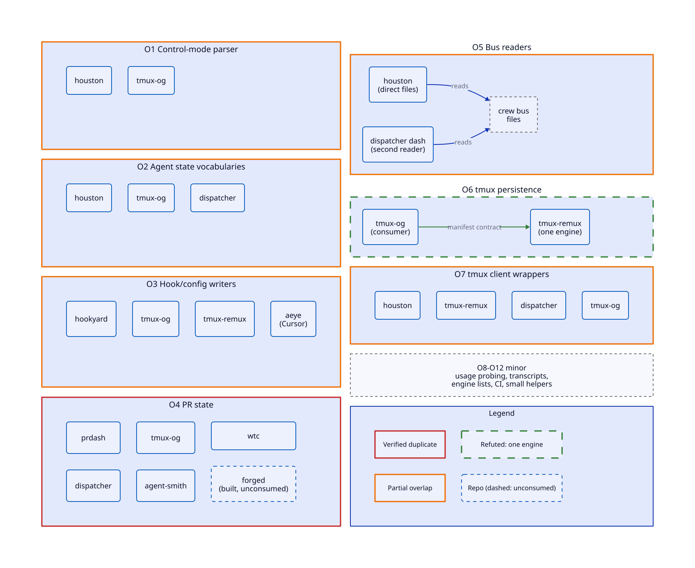
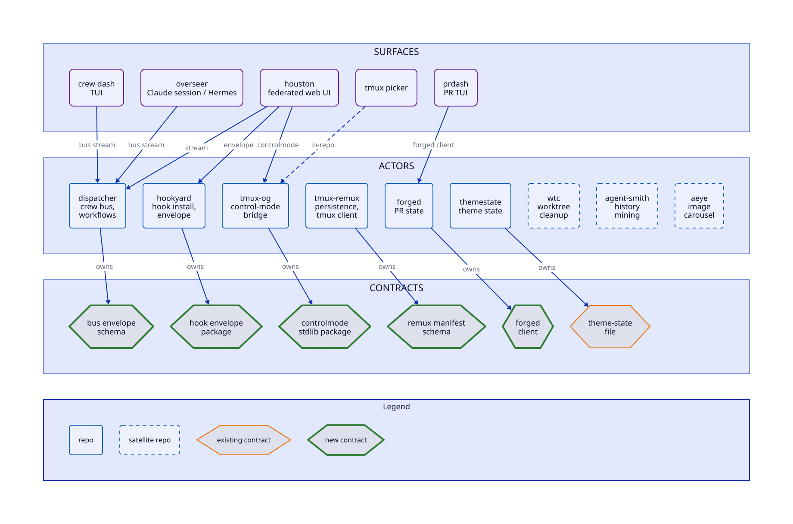
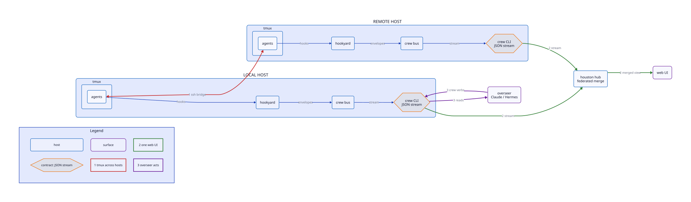

# Ecosystem ownership map

This map was pinned on 2026-11-24. Every statement about a repository, and every pointer of the form `<repo>:<path>@<sha8>`, is as of the pinned commits below. Nothing here describes later commits, and nothing was run against a live system.

| Repository  | Pinned commit | Notes                                                        |
| ----------- | ------------- | ------------------------------------------------------------ |
| dispatcher  | fe9bd05a      | read from the tracked tree of this repository                |
| houston     | 95cc422e      |                                                              |
| hookyard    | 8733d204      |                                                              |
| tmux-og     | e260380e      | the same repository as lazytmux; the map always says tmux-og |
| tmux-remux  | 96a85060      |                                                              |
| forged      | 9ce24aaa      |                                                              |
| aeye        | 2b7d5e2d      |                                                              |
| prdash      | 606b15f2      |                                                              |
| wtc         | 2b64687c      |                                                              |
| agent-smith | dcb6f227      |                                                              |
| themestate  | d0426d6d      |                                                              |
| nix-config  | 547696b4      | consumer and packaging only                                  |

All ten clones in the preflight step succeeded with no 404s (the ten are houston, hookyard, tmux-og, tmux-remux, forged, aeye, prdash, wtc, agent-smith and the lazytmux name, which resolved to the same commit as tmux-og). nix-config and themestate were cloned in addition. tmux-og and lazytmux are one repository: the preflight lists both names at commit e260380e.

How to read this document:

- Section 1 is one table of capabilities that cross a repository boundary, with the owner, the consumers, the contract and how explicit that contract is.
- Section 2 catalogues twelve overlaps (O1 to O12). O1 to O6 are the six suspected overlaps from the task, in the order they were given. O7 to O12 were found while auditing.
- Every overlap carries a verdict: VERIFIED (the duplication exists as suspected), PARTIAL (part of it exists, part does not) or REFUTED (the suspicion does not hold). Refuted suspicions are kept and say so.
- Pointers use the token `<repo>:<path>@<sha8>`. Function and type names follow the token in prose; they are never part of it.
- Where a behaviour was inferred from file names, headers or targeted greps and not from reading the whole code or running it, the text says "from names and greps". Sizes are line counts of non-test code, and each size is an upper bound on what extraction could remove.

## 1. Capability ownership table

The table lists 33 rows, merged from a 35-row inventory. Rows that exist only inside one repository are dropped. All rows that cross a repository boundary are kept, and so are all rows with no single owner.

Contract forms used: CLI, socket or daemon API, Go package, file schema, naming convention (tmux pane and window options), flake input, env var. Status values:

- explicit: a document, a version field or a typed API names the contract.
- implicit: the shape is pinned only by a fixture, a comment, a hand-kept copy or a shared string.
- no owner: more than one repository implements it, or none does, and none is the declared source.

No repository in the set ships a JSON Schema, `.proto`, `.cue` or OpenAPI file. The query was `git ls-files | rg -i 'schema.*\.json|\.schema|\.cue$|\.proto$|openapi'` in all eleven repositories, and every result was empty. Only themestate is imported as a Go module by other repositories (by aeye, prdash, tmux-remux and the tmux-og picker). Everything else crosses repositories by CLI, file, tmux option, ssh or flake input.

| #   | Capability                                                                                             | Owner                                                                                                                                                          | Consumers                                                                    | Contract                                                                                                                    | Contract form                         | Status   | Evidence                                                                                                                                               |
| --- | ------------------------------------------------------------------------------------------------------ | -------------------------------------------------------------------------------------------------------------------------------------------------------------- | ---------------------------------------------------------------------------- | --------------------------------------------------------------------------------------------------------------------------- | ------------------------------------- | -------- | ------------------------------------------------------------------------------------------------------------------------------------------------------ |
| 1   | Agent dispatch and crew bus (events, claims, roster, reap)                                             | dispatcher                                                                                                                                                     | houston, dispatcher dash, overseer, nix-config                               | `events.jsonl` row envelope plus `dispatch` and `crew` verbs                                                                | CLI, file schema                      | implicit | dispatcher:crew/internal/bus/bus.go@fe9bd05a, houston:crewfeed/fold.go@95cc422e                                                                        |
| 2   | Crew identity projected onto tmux options (`@crew_name`, `@crew_branch`, `@crew_role`, `@crew_chrome`) | dispatcher                                                                                                                                                     | tmux-og, houston                                                             | option names shared as strings in shell and Go                                                                              | naming convention                     | implicit | dispatcher:adapters/core/dispatch.sh@fe9bd05a, houston:tmux/options.go@95cc422e                                                                        |
| 3   | Remote worker relay (`dispatch --host`, `crew remote-run`, far fleet wire)                             | dispatcher                                                                                                                                                     | houston, overseer                                                            | allowlisted JSON request over ssh                                                                                           | CLI                                   | implicit | dispatcher:crew/internal/remote/remote.go@fe9bd05a, dispatcher:crew/internal/fleet/farwire.go@fe9bd05a                                                 |
| 4   | Peer dispatcher sync (claims, decisions between hosts)                                                 | dispatcher                                                                                                                                                     | peer dispatchers                                                             | peer snapshot and claims over ssh, design doc only                                                                          | file schema                           | implicit | dispatcher:crew/internal/peer/sync.go@fe9bd05a                                                                                                         |
| 5   | Overseer protocol (kinds `ask`, `request`, `capacity`, `notice`)                                       | dispatcher                                                                                                                                                     | the human, claude and pi engines                                             | `from` pinned to the overseer, `to` to the dispatcher, reply keyed on host, repo, crew identifier and `re`; `CREW_OVERSEER` | CLI, naming convention, env var       | explicit | dispatcher:adapters/claude-code/plugin/protocols/OVERSEER_PROTOCOL.claude.md@fe9bd05a, dispatcher:crew/internal/overseer/msg.go@fe9bd05a               |
| 6   | Hermes overseer                                                                                        | none                                                                                                                                                           | nix-config pins the upstream project as an input                             | no code, doc or adapter names Hermes                                                                                        | flake input                           | no owner | nix-config:flake.nix@547696b4                                                                                                                          |
| 7   | Hook routing and the normalized envelope                                                               | hookyard                                                                                                                                                       | dispatcher, tmux-og, aeye (manifests), houston (envelope reader), nix-config | `hookyard.json` manifest plus stdin envelope with `canonical_event`                                                         | file schema                           | implicit | hookyard:internal/envelope/envelope.go@8733d204, hookyard:internal/vocab/vocab.go@8733d204                                                             |
| 8   | Per-engine hook installation                                                                           | hookyard                                                                                                                                                       | nix-config; competing writers in houston, tmux-remux, tmux-og, aeye          | `hookyard install` rendering each engine's native config                                                                    | CLI                                   | implicit | hookyard:internal/render/render.go@8733d204, tmux-remux:internal/agenthook/codex.go@96a85060                                                           |
| 9   | Hook flow inspector and event stream                                                                   | hookyard                                                                                                                                                       | the human; no programmatic reader                                            | per-day JSONL stream plus HTTP and SSE                                                                                      | file schema, socket or daemon API     | implicit | hookyard:internal/serve/server.go@8733d204, hookyard:internal/record/record.go@8733d204                                                                |
| 10  | Cross-session memory (priors)                                                                          | hookyard                                                                                                                                                       | nix-config, agent sessions through hooks                                     | `priors` CLI over a SQLite store                                                                                            | CLI                                   | explicit | hookyard:cmd/priors/main.go@8733d204                                                                                                                   |
| 11  | Agent state detection                                                                                  | none (tmux-og, houston and dispatcher each derive it)                                                                                                          | tmux-og status and picker, houston UI, dispatcher watchdog                   | pane options `@claude_status`, `@agent_screen` plus five per-repo enums                                                     | naming convention, Go package         | no owner | tmux-og:picker/agentstate/agentstate.go@e260380e, houston:hook/state.go@95cc422e, dispatcher:crew/internal/stall/probe/probe.go@fe9bd05a               |
| 12  | Agent-state UI in tmux (status line, picker, session cards)                                            | tmux-og                                                                                                                                                        | the human, nix-config module                                                 | tmux options and status format strings, typed Nix options                                                                   | naming convention, flake input        | explicit | tmux-og:picker/statusline/main.go@e260380e, tmux-og:modules/home-manager.nix@e260380e                                                                  |
| 13  | Web fleet UI, browser terminal, Claude mod panel                                                       | houston                                                                                                                                                        | the human, nix-config                                                        | HTTP and SSE; reads bus rows and shells to `crew`                                                                           | socket or daemon API                  | implicit | houston:server/api.go@95cc422e, houston:server/pane_ws.go@95cc422e                                                                                     |
| 14  | Web federation across hosts                                                                            | houston                                                                                                                                                        | houston instances                                                            | SSE forwarding with houston's own peer config                                                                               | socket or daemon API                  | implicit | houston:peer/forward.go@95cc422e                                                                                                                       |
| 15  | Crew dash view (TUI and `crew dash --json --view overview`)                                            | dispatcher                                                                                                                                                     | the human, houston                                                           | JSON with `schema_version` 1, bounded in houston by `SchemaMin` and `SchemaMax`                                             | CLI                                   | explicit | dispatcher:dash/internal/view/view.go@fe9bd05a, houston:crewview/view.go@95cc422e                                                                      |
| 16  | PR state cache daemon                                                                                  | forged                                                                                                                                                         | nix-config only; no sibling repository calls it                              | versioned HTTP API on a unix socket, public Go client, `gh`-shaped CLI                                                      | socket or daemon API, Go package, CLI | explicit | forged:client/client.go@9ce24aaa, forged:internal/server/server.go@9ce24aaa                                                                            |
| 17  | PR state fetching by other tools                                                                       | none (prdash, tmux-og, dispatcher, agent-smith and wtc fetch their own)                                                                                        | prdash UI, tmux `@pr_*` options, dispatcher merge gate                       | `gh` CLI or GraphQL, three status vocabularies                                                                              | CLI, naming convention                | no owner | prdash:internal/gh/graphql.go@606b15f2, tmux-og:picker/prenrich/apply.go@e260380e, dispatcher:crew/internal/merge/merge.go@fe9bd05a                    |
| 18  | PR triage TUI                                                                                          | prdash                                                                                                                                                         | the human; tmux-og pins it as an input                                       | argv hand-off to `wt switch` documented in the README                                                                       | CLI, flake input                      | explicit | prdash:internal/action/handoff.go@606b15f2                                                                                                             |
| 19  | Worktree create and switch (`wt`)                                                                      | none in the org (external tool)                                                                                                                                | prdash, dispatcher, shared agent instructions                                | argv only                                                                                                                   | CLI                                   | no owner | prdash:internal/action/handoff.go@606b15f2, dispatcher:crew/internal/wtgit/wtgit.go@fe9bd05a                                                           |
| 20  | Worktree cleanup                                                                                       | wtc (owner) and dispatcher `cleanup` and `reap` (workers)                                                                                                      | nix-config                                                                   | two removers with different stale rules                                                                                     | CLI                                   | implicit | wtc:internal/git/stale.go@2b64687c, dispatcher:crew/internal/reap/stale.go@fe9bd05a                                                                    |
| 21  | tmux persistence (snapshot, restore, scrollback)                                                       | tmux-remux                                                                                                                                                     | tmux-og (reads the manifest over ssh), dispatcher (`dispatch-resume`)        | manifest JSON with a `v` field, `list --json`, `restore`                                                                    | CLI, file schema                      | implicit | tmux-remux:internal/snapshot/manifest.go@96a85060, tmux-og:picker/remote.go@e260380e                                                                   |
| 22  | Resume-on-restore stamp (`@remux_relaunch`)                                                            | none (tmux-remux for Claude, tmux-og scripts for Codex, Cursor and Pi)                                                                                         | tmux-remux restore                                                           | option names shared by string, command run by `sh -c`                                                                       | naming convention                     | no owner | tmux-remux:cmd/tmux-remux/relaunch_stamp.go@96a85060, tmux-og:scripts/codex-relaunch-stamp.sh@e260380e                                                 |
| 23  | tmux remote bridge (remote sessions as native windows)                                                 | tmux-og                                                                                                                                                        | the human                                                                    | ssh plus the tmux control-mode wire protocol, own daemon and ctl split                                                      | socket or daemon API                  | implicit | tmux-og:picker/remotebridge/wire/protocol.go@e260380e, tmux-og:picker/remotebridge/controlmode/parse.go@e260380e                                       |
| 24  | tmux config generation, doctor, picker, project registry                                               | tmux-og                                                                                                                                                        | the human, nix-config module                                                 | `og` CLI, TOML config, Nix module options                                                                                   | CLI, flake input                      | explicit | tmux-og:generator/doctor/checks.go@e260380e, tmux-og:picker/project/registry.go@e260380e                                                               |
| 25  | tmux client wrapper (list sessions, windows, panes, options)                                           | none (houston, tmux-remux, dispatcher, wtc and tmux-og scripts each have one)                                                                                  | each repository for itself                                                   | one Go package per repository                                                                                               | Go package                            | no owner | houston:tmux/client.go@95cc422e, tmux-remux:internal/tmux/client.go@96a85060                                                                           |
| 26  | Theme state (light or dark)                                                                            | themestate                                                                                                                                                     | aeye, prdash, tmux-remux, tmux-og picker; nix-config writes it               | `Detect` plus `theme-state.json`                                                                                            | Go package, file schema               | explicit | themestate:themestate.go@d0426d6d                                                                                                                      |
| 27  | Image carousel and D2 diagram viewer                                                                   | aeye                                                                                                                                                           | tmux-og (flake input), dispatcher (roster diagram), engine plugins           | CLI plus per-pane manifest files and per-engine hooks                                                                       | CLI, file schema                      | explicit | aeye:main.go@2b7d5e2d, aeye:adapters/core/manifest-extract.sh@2b7d5e2d                                                                                 |
| 28  | Session and history mining, rule propagation                                                           | agent-smith                                                                                                                                                    | nix-config, dispatcher worker settings                                       | extractor, analyst and applier binaries plus a Claude plugin                                                                | CLI                                   | explicit | agent-smith:cmd/extractor/main.go@dcb6f227                                                                                                             |
| 29  | Transcript reading (Claude transcript JSONL, a format the org does not own)                            | none (houston, hookyard priors and agent-smith each read it)                                                                                                   | each for itself                                                              | project directory encoding replicated per reader                                                                            | file schema                           | no owner | houston:chat/claude.go@95cc422e, hookyard:cmd/priors/internal/importer/claude.go@8733d204                                                              |
| 30  | Agent usage and quota windows                                                                          | none (dispatcher `refresh-budget.sh` and tmux-og `tmux-agent-usage-*`)                                                                                         | dispatcher dash budget panel, tmux-og status line                            | JSON from scripts; dispatcher calls a tmux-og script by name                                                                | CLI                                   | no owner | dispatcher:adapters/core/refresh-budget.sh@fe9bd05a, tmux-og:scripts/tmux-agent-usage-claude.sh@e260380e                                               |
| 31  | Guards and policy on tool calls (secret read, public leak, directive delivery)                         | dispatcher (scripts) with hookyard (execution)                                                                                                                 | all engines through hookyard registrations                                   | manifest entries plus shell scripts, each with its own envelope normalizer                                                  | file schema, CLI                      | implicit | dispatcher:adapters/core/secret-read-guard.sh@fe9bd05a, dispatcher:hookyard.json@fe9bd05a                                                              |
| 32  | Nix modules and packaging                                                                              | each repository for itself                                                                                                                                     | nix-config (7 inputs), tmux-og (4 inputs)                                    | `homeManagerModules.default` or packages; the spelling `homeModules` also exists in one repository                          | flake input                           | explicit | dispatcher:nix/hm-module.nix@fe9bd05a, nix-config:lib/overlays.nix@547696b4                                                                            |
| 33  | Engine adapters, plugin shapes, engine name lists and host registry                                    | none (dispatcher, aeye, tmux-og, tmux-remux and houston each ship plugin shapes; four repositories each declare engine names; three configs name remote hosts) | engines through plugin directories and marketplaces                          | per-repository plugin manifests; about 20 engine-name declarations in 3 spellings                                           | file schema, naming convention        | no owner | dispatcher:adapters/claude-code/plugin/.claude-plugin/plugin.json@fe9bd05a, hookyard:internal/vocab/vocab.go@8733d204, houston:peer/config.go@95cc422e |

Reading the table:

- Owner means the repository whose code defines the behaviour and whose maintainer would change the contract. It does not mean the repository has documented the contract; the status column says that.
- "Implicit" is the dominant status. Of the 33 rows, 13 are implicit, 11 are explicit and 9 have no single owner (rows 6, 11, 17, 19, 22, 25, 29, 30 and 33; row 33 bundles three smaller gaps, which section 2 splits again). Counts come from this table and can be re-derived by counting the status column.
- Explicit rows have a version field, a typed client or a protocol document. The strongest are forged's client package (row 16), dispatcher's `schema_version` on the dash view (row 15) and themestate (row 26).
- The row 1 envelope is the most expensive implicit contract. It is declared four times (two in dispatcher, two in houston), and houston's `crewfeed` pins it only with a fixture (houston:crewfeed/testdata/bus.jsonl@95cc422e).
- Row 6 is a negative finding. The org's `hermes-agent` repository is an unmodified public fork (0 commits ahead, 7132 behind upstream, from `gh api repos/noamsto/hermes-agent/compare/...`). dispatcher never mentions Hermes (an `rg -i hermes` over docs, adapters, crew and the README returned no file). The overseer today is the claude and pi overseer protocol in row 5.
- Row 19 is owned outside the org: `gh repo list` shows no repository for the `wt` tool.

Rows with no single owner:

- Row 6, Hermes overseer: no code exists.
- Row 11, agent state detection: five state enums in three repositories.
- Row 17, PR fetching beside forged: five independent fetchers and three status vocabularies.
- Row 19, `wt`: external.
- Row 22, the resume stamp: Go in tmux-remux and shell in tmux-og share option names by string.
- Row 25, tmux client wrapper: five repositories.
- Row 29, transcript reading: three readers of a format the org does not own.
- Row 30, usage windows: two implementations of the same endpoint probe.
- Row 33, plugin shapes, engine name lists and host registry.

## 2. Overlap catalogue



Twelve overlaps. The diagram shows which repositories carry each one.

| Id  | Title                           | Verdict           | Repos involved                                                  | Size                                            | Depends on                                            |
| --- | ------------------------------- | ----------------- | --------------------------------------------------------------- | ----------------------------------------------- | ----------------------------------------------------- |
| O1  | Remote tmux and control mode    | PARTIAL           | houston, tmux-og (dispatcher refuted)                           | standard (deep if houston mirrors remote hosts) | stdlib-only module boundary, recorded-stream fixtures |
| O2  | Agent state detection           | PARTIAL           | tmux-og, houston, dispatcher, hookyard                          | deep                                            | O3 envelope contract, hookyard stream contract        |
| O3  | Agent hook installation         | PARTIAL           | hookyard, tmux-og, tmux-remux, aeye, houston, dispatcher        | standard                                        | hook envelope and manifest contract                   |
| O4  | PR and forge state              | VERIFIED          | forged, prdash, dispatcher, tmux-og, agent-smith, wtc           | standard (deep for prdash)                      | forged read-model additions                           |
| O5  | Crew dashboards and bus readers | PARTIAL           | dispatcher, houston (tmux-og, aeye, hookyard refuted)           | standard                                        | bus schema                                            |
| O6  | tmux persistence                | REFUTED           | tmux-remux, tmux-og                                             | trivial                                         | public manifest package                               |
| O7  | tmux client wrappers            | PARTIAL           | houston, tmux-remux, dispatcher, wtc, tmux-og, aeye             | standard                                        | public tmux client package                            |
| O8  | Usage and quota probing         | VERIFIED          | dispatcher, tmux-og                                             | standard                                        | owner decision                                        |
| O9  | Transcript readers              | VERIFIED          | houston, hookyard, agent-smith                                  | standard                                        | owner decision                                        |
| O10 | Engine lists and plugin shapes  | VERIFIED          | dispatcher, houston, tmux-og, hookyard, aeye, tmux-remux        | trivial (lists), deep (plugin generator)        | hookyard vocabulary export                            |
| O11 | Shared CI boilerplate           | VERIFIED          | tmux-og, tmux-remux, aeye, wtc, agent-smith, prdash, dispatcher | trivial                                         | none                                                  |
| O12 | Minor duplications              | PARTIAL (per row) | see the table in O12                                            | trivial each                                    | none                                                  |

### O1: Remote tmux and control mode

Verdict: PARTIAL. Two independent control-mode parsers and reconnect loops exist (houston and tmux-og). The suspicion that dispatcher's remote layer also implements control mode is REFUTED.

| Repo       | Pointers                                                                                                                                                               | What it does                                                                                                                                                                                                                                                                                                                                |
| ---------- | ---------------------------------------------------------------------------------------------------------------------------------------------------------------------- | ------------------------------------------------------------------------------------------------------------------------------------------------------------------------------------------------------------------------------------------------------------------------------------------------------------------------------------------- | ------- | ------------------------------------------- |
| houston    | houston:tmux/control.go@95cc422e, houston:tmux/control_client.go@95cc422e, houston:tmux/control_manager.go@95cc422e                                                    | `ParseControlLine` parses 14 event kinds including flow control. `ControlClient` correlates commands and replies with a generation gate and reconnects with doubling backoff up to 10 seconds. It runs `tmux -CC attach-session` on a local PTY only; `rg '"ssh"'` over `tmux/` and `server/` is empty. Output goes to a browser websocket. |
| tmux-og    | tmux-og:picker/remotebridge/controlmode/parse.go@e260380e, tmux-og:picker/remotebridge/daemon/conn.go@e260380e, tmux-og:picker/remotebridge/daemon/backoff.go@e260380e | `ParseLine` is a byte-based, benchmarked parser with layout and `%begin` guard flags. The daemon attaches over `ssh -CC ... tmux -C attach-session`, with named backoffs for default, wake and restore, scrollback seeding, layout mirroring and size ownership. 78 non-test Go files under `remotebridge`.                                 |
| dispatcher | dispatcher:crew/internal/remote/remote.go@fe9bd05a, dispatcher:crew/internal/fleet/relays.go@fe9bd05a                                                                  | Not a terminal relay. It is an allowlisted RPC over ssh (`BatchMode`, one JSON request on stdin) for crew verbs plus bus event sync. "Relay" in fleet means a per-host event-sync lock and cursor. `rg -n 'control.mode                                                                                                                     | %output | %begin'`over`crew/`and`dash/` gave no hits. |

Duplicates vs differs:

- Duplicate: the parser of the `%`-notification grammar and its octal unescape, and the reconnect loop.
- Differs: transport (local PTY, ssh, ssh RPC), scrollback seeding and layout handling (tmux-og only), purpose (browser output, mirrored windows, remote crew verbs).
- Strict-sweep counts: control-mode code appears in exactly two repositories (houston 8 files, tmux-og about 80 including scripts and tests). aeye only renders through a "control-mode relay" flag, which is the tmux-og bridge; that was not read beyond a comment.

Most complete: tmux-og `controlmode` plus `daemon` (layout, flow, reconnect policy, ssh transport, tests and benchmarks). Houston's `ControlClient` is the better-factored command and reply client.

Single owner must expose: a Go package, not a daemon API. A `controlmode` package (parser, encoder, layout, and a connection over any `io.ReadWriteCloser`) with a pluggable dialer for local PTY or ssh argv. Its non-test files import no third-party package (stdlib-only, from an import grep), so lifting it into its own module is cheap. tmux-og keeps daemon, renderer and mirror logic on top. Houston becomes a library consumer.

Proposed consolidation: standard for the shared parser and client; deep if the goal is houston mirroring remote hosts (needs an ssh dialer, layout, seed and size ownership). Prerequisites: a module boundary in tmux-og, a shared corpus of recorded control streams (houston has `control_integration_test.go`, tmux-og has `parse_bench_test.go` and `reader_test.go`; merge them before swapping parsers), and a decision on the event model (houston `ControlEvent` versus tmux-og `Line` and `Kind`). Not worth merging into dispatcher. Behaviour claims come from names and greps; the flow-control and guard-flag logic of the two parsers was not diffed line by line.

### O2: Agent state detection

Verdict: PARTIAL. There are five independent state vocabularies and two duplicated cores, but several suspected files are consumers or sinks and not detectors.

| Repo       | Pointers                                                                                                                                                                                                           | What it does                                                                                                                                                                                                                                                             |
| ---------- | ------------------------------------------------------------------------------------------------------------------------------------------------------------------------------------------------------------------ | ------------------------------------------------------------------------------------------------------------------------------------------------------------------------------------------------------------------------------------------------------------------------ |
| tmux-og    | tmux-og:picker/agentdetect/main.go@e260380e, tmux-og:picker/agentdetect/manifest/manifests/codex.toml@e260380e, tmux-og:picker/agentstate/agentstate.go@e260380e, tmux-og:scripts/claude-status-update.sh@e260380e | Screen detector daemon with declarative per-engine TOML rules (processing and idle only), a priority list of eight states, and hook-written status for Claude, Codex and Cursor. Pi is screen only.                                                                      |
| houston    | houston:hook/state.go@95cc422e, houston:runs/state.go@95cc422e, houston:parser/parser.go@95cc422e, houston:hook/envelope.go@95cc422e                                                                               | Three signal sources: terminal scrape, hook state files and transcript inference. `hook.State` has eight values; `runs.State` reconciles three upstream vocabularies that its own comment says disagree. `canonicalEventMap` hand-maps 10 events.                        |
| dispatcher | dispatcher:crew/internal/frame/frame.go@fe9bd05a, dispatcher:crew/internal/stall/frame_detectors.go@fe9bd05a, dispatcher:crew/internal/panestate/panestate.go@fe9bd05a                                             | Regex frame classification for four engines (including quota, trust and Pi live-turn cases), stall detectors, and a publisher of `@crew_state`, `@crew_detail`, `@crew_source`. The stall and rolewatch code acts on state; panestate is a publish seam, not a detector. |
| hookyard   | hookyard:internal/envelope/envelope.go@8733d204, hookyard:internal/vocab/vocab.go@8733d204                                                                                                                         | Detects nothing. It reports six canonical events and a Pi `turn_outcome`. It is the cleanest event source and only its own web UI reads the stream.                                                                                                                      |

Duplicates vs differs:

- Duplicate: terminal-frame classification of busy, idle, permission prompt and question per engine. Claude, Codex, Cursor and Pi markers are encoded at least twice (tmux-og manifests and dispatcher `frame`); houston keeps a Claude and Amp parser.
- Duplicate: hook-event to coarse-state mapping, in houston and in the tmux-og status scripts.
- Differs: no two repositories declare an identical enum. Houston `hook.State` and tmux-og `Order` align on waiting, compacting and idle; thinking and tool-running map to processing. dispatcher `bus.State` is a worker lifecycle, not a turn state.
- Differs: dispatcher stall-watch decides liveness and escalation, rolewatch decides whether typing is safe. Their outputs are actions, so they stay in dispatcher and call the shared classifier.

Most complete: for frame classification, dispatcher `frame` (four engines), which is not importable because it sits under `crew/internal`. tmux-og's manifests are the better schema (declarative, replay fixtures) but cover two states. For hook-derived state, houston `hook` (eight states, flock-merged state files).

Single owner must expose:

- Go package: `Classify(engine, frame)` returning state and reason, with an engine registry that does not depend on tmux, and a hook-reduced `State(session)`.
- File schema: a per-session state document (houston's `SessionState` is nearest) and a declared enum with a mapping table to bus states.
- Event feed: consumers subscribe to hookyard's stream instead of each installing hooks.
- CLI: a `state --pane --json` form.

Proposed consolidation: deep overall, in four steps.

- Trivial, no prerequisite: publish one enum mapping table (houston `runs.State` already holds the reconciliation).
- Standard: houston and tmux-og consume hookyard's event stream or the same reducer. Prerequisite: the hookyard stream gets a documented consumer contract and a live tail (today HTTP UI only).
- Standard: extract dispatcher `frame` rules into a shared importable package, with tmux-og's TOML as interchange and both fixture sets as the test corpus. Prerequisite: an owner repository decision and a published module.
- Human decisions: which repository owns the classifier; whether dispatcher's bash-pinned bats tests may change.

### O3: Agent hook installation

Verdict: PARTIAL. Codex `config.toml` has three independent writers and the Cursor hooks file has three or four. Several suspected files are refuted as installers.

| Repo       | Pointers                                                                                                                                                                               | What it does                                                                                                                                                                                                                                                                           |
| ---------- | -------------------------------------------------------------------------------------------------------------------------------------------------------------------------------------- | -------------------------------------------------------------------------------------------------------------------------------------------------------------------------------------------------------------------------------------------------------------------------------------- |
| hookyard   | hookyard:internal/render/codex.go@8733d204, hookyard:internal/render/cursor.go@8733d204, hookyard:internal/render/pi.go@8733d204, hookyard:internal/doctor/doctor.go@8733d204          | The real multi-engine installer: four engines, deterministic render, doctor, trust handling (Codex `/hooks` trust, Pi block-or-nothing verdicts). 1446 lines in `internal/render`.                                                                                                     |
| tmux-remux | tmux-remux:internal/agenthook/codex.go@96a85060, tmux-remux:cmd/tmux-remux/install_hook.go@96a85060                                                                                    | `InstallCodex` marker-appends a SessionStart block to the Codex config. Its comment says it follows tmux-og's approach. Duplicate installer.                                                                                                                                           |
| tmux-og    | tmux-og:modules/home-manager.nix@e260380e, tmux-og:scripts/cursor-hooks-install.sh@e260380e, tmux-og:scripts/cursor-relaunch-hooks-install.sh@e260380e, tmux-og:hookyard.json@e260380e | Home Manager activation appends `[[hooks.*]]` blocks to the Codex config; two jq scripts upsert the Cursor hooks file. One Pi handler already uses hookyard, which is the intended pattern.                                                                                            |
| aeye       | aeye:adapters/cursor/install.sh@2b7d5e2d, aeye:adapters/pi/hookyard.json@2b7d5e2d                                                                                                      | `install.sh` merges hooks into the Cursor file with jq; the Pi manifest is a hookyard consumer.                                                                                                                                                                                        |
| houston    | houston:hook/install.go@95cc422e                                                                                                                                                       | Edits the Claude user settings file (`Install`, `Check`). Claude only; overlaps hookyard's Nix overlay without duplicating it.                                                                                                                                                         |
| dispatcher | dispatcher:hookyard.json@fe9bd05a, dispatcher:crew/internal/piagentdir/piagentdir.go@fe9bd05a                                                                                          | The manifest is a consumer. `seedSettings` writes a worker-scoped Pi settings file, which is the same file as hookyard's `WritePi` but a different scope (worker directory seeding). `adapters/*` ship plugin hook manifests generated by a script; they are not installers (REFUTED). |

Duplicates vs differs:

- Duplicate: "splice a managed block into the Codex config" (tmux-remux, tmux-og, hookyard, with different markers) and "upsert marked entries into the Cursor hooks file" (tmux-og twice, aeye, hookyard). The risk is collisions, not size. The ad hoc writers are not coordinated with hookyard and do not carry its trust handling.
- Refuted: tmux-og `generator/init`, `initcfg` and `doctor` (tmux-og:generator/init/main.go@e260380e) handle tmux-og's own config and involve no agent hooks.
- Differs: Claude plugin `hooks.json` files are the engine's plugin mechanism; four repositories hand-write their own sets. hookyard's `build` mode that would generate them is planned, not implemented (from the README).

Most complete: hookyard.

Single owner must expose:

- File schema: the `hookyard.json` manifest (handler id, exec, events from the six canonical names, engines, lane).
- CLI: `install`, `emit`, `build`, `validate`, `doctor`, `route` already exist. Missing is installing only a repository's own handlers without clobbering others.
- Envelope contract: stable and versioned, as a published Go package, because `render` sits in `internal/` and a Go consumer such as tmux-remux has no import path today.

Proposed consolidation: standard overall. Prerequisite: manifest entries for Codex and Cursor in each repository and a trust note in docs.

- Trivial: retire tmux-remux `InstallCodex` and the tmux-og Codex activation in favour of manifests.
- Trivial: retire tmux-og's two Cursor scripts and aeye `install.sh`; hookyard `WriteCursor` must migrate their legacy marker entries.
- Standard: pick one owner for Claude user-settings registration (houston `Install` or hookyard's overlay).
- Deep, optional: hookyard build mode (prior art: `dispatcher:scripts/gen-adapters.sh@fe9bd05a`).
- Human decision: whether machine-wide Codex and Cursor hooks are acceptable for users of tmux-remux and aeye who do not run Nix.

### O4: PR and forge state

Verdict: VERIFIED, with one correction. Six independent readers of PR state exist and the rollup fold is written five times. prdash does not shell out to `gh pr`; it talks GraphQL and REST directly.

| Repo        | Pointers                                                                                                                                                                                   | What it does                                                                                                                                                                                                                                                                             |
| ----------- | ------------------------------------------------------------------------------------------------------------------------------------------------------------------------------------------ | ---------------------------------------------------------------------------------------------------------------------------------------------------------------------------------------------------------------------------------------------------------------------------------------- |
| forged      | forged:forge/model.go@9ce24aaa, forged:client/client.go@9ce24aaa, forged:internal/server/server.go@9ce24aaa, forged:internal/ghcompat/run.go@9ce24aaa                                      | The intended owner: forge-agnostic `Provider`, typed `Change` and `Checks`, shared cache with batching, unix-socket HTTP API v1 including `/v1/watch`, importable client, and a `forged pr view` and `list` CLI compatible with `gh` for a fixed field table. Read-only and GitHub only. |
| prdash      | prdash:internal/gh/graphql.go@606b15f2, prdash:internal/gh/token.go@606b15f2                                                                                                               | GraphQL (`githubv4`) and REST with a token from `gh auth token`; 30+ fields, stacks, batching, mutations, job logs and reruns. The most complete reader.                                                                                                                                 |
| dispatcher  | dispatcher:crew/internal/gh/gh.go@fe9bd05a, dispatcher:crew/internal/fleet/gh.go@fe9bd05a, dispatcher:crew/internal/merge/merge.go@fe9bd05a, dispatcher:adapters/core/pr-watch.sh@fe9bd05a | 19 `pr`, 5 `api` and 13 `issue` argv sites through the `gh.Client` seam, a standalone bash `pr-watch` poller, and merge and issue writes.                                                                                                                                                |
| tmux-og     | tmux-og:picker/prenrich/fetch.go@e260380e, tmux-og:picker/prenrich/rollup.go@e260380e                                                                                                      | `gh pr list --head` per window with a file cache; `collapseRollup`. Go, not shell.                                                                                                                                                                                                       |
| agent-smith | agent-smith:internal/applier/reconcile.go@dcb6f227                                                                                                                                         | `gh pr view`, `list` and `create` for its own reconcile.                                                                                                                                                                                                                                 |
| wtc         | wtc:internal/git/stale.go@2b64687c                                                                                                                                                         | One `gh pr list --state merged` call for stale detection.                                                                                                                                                                                                                                |

Duplicates vs differs:

- Duplicate: reading PR state, and folding raw checks into pass, fail and pending in five places (fleet `checkState`, merge `check.result`, tmux-og `collapseRollup`, prdash `mapRollup`, forged `shapeRollup`). Three vocabularies exist: raw GitHub upper case, forged lower case, and tmux option words.
- Differs, legitimately: dispatcher also writes (`gh pr merge`, issue create and comment, labels) and prdash does mutations and Actions logs. agent-smith and wtc need only a terminal state.
- forged has zero code consumers. A search for `forged` as a command, socket or import across the other clones and the dispatcher tree hits only nix-config, which installs the service (nix-config:home/ai/forged/default.nix@547696b4). The repository had 2 commits at the pin, so it is not yet a proven dependency.

Most complete: prdash for breadth (reads, writes, Actions); forged for the owner design (cache, coalescing, stream, typed model).

Single owner must expose:

- Go package: `forged/client` (exists) plus a stable read model including rollup runs with check URLs and ids.
- Socket: the `/v1/watch` change stream (exists) to replace `pr-watch.sh` polling.
- CLI: `forged pr` compatibility for shell call sites.
- Additions: review threads and comments, Actions run and job lookup, linked-issue references, author-scoped lists. Writes either stay with `gh` and prdash or arrive as an explicit write interface (human decision).

Proposed consolidation:

- Trivial to standard: point the dispatcher `gh.Client` seam at `forged pr view` and `list` for reads only, with field coverage checked in forged's field table.
- Standard: replace the `pr-watch.sh` loop with `client.Subscribe`, keeping the script as fallback on `ErrUnavailable`.
- Trivial each: tmux-og prenrich, wtc and agent-smith call `forged pr list --head`.
- Standard: share one rollup fold through `forge.Rollup`, which adds a forged module dependency to dispatcher.
- Deep: move prdash reads to `forged/client`, only after forged covers prdash's surface.
- Overall size: standard, deep for prdash. Prerequisite: forged read-model additions and a running daemon.

### O5: Crew dashboards and bus readers

Verdict: PARTIAL. Refuted for tmux-og and aeye. For houston, worker state already goes through versioned JSON; only the activity feed and a pane and pid join read bus files directly.

| Repo       | Pointers                                                                                                                                                                                                | What it does                                                                                                                                                                                                                                                                                                  |
| ---------- | ------------------------------------------------------------------------------------------------------------------------------------------------------------------------------------------------------- | ------------------------------------------------------------------------------------------------------------------------------------------------------------------------------------------------------------------------------------------------------------------------------------------------------------- |
| dispatcher | dispatcher:dash/internal/view/view.go@fe9bd05a, dispatcher:dash/internal/data/digest.go@fe9bd05a, dispatcher:crew/internal/bus/bus.go@fe9bd05a, dispatcher:crew/internal/rosterrender/board.go@fe9bd05a | Owns the bus layout. Three presentations over one model: the TUI, the versioned `crew dash --json --view overview` and the roster SVG. `dash` is a separate Go module, so it re-implements the `events.jsonl` scan because `crew/internal/bus` cannot be imported. dispatcher has two bus readers of its own. |
| houston    | houston:crewfeed/fold.go@95cc422e, houston:crewview/view.go@95cc422e, houston:runs/crewsource.go@95cc422e, houston:runs/crewdispatch.go@95cc422e                                                        | `crewview` decodes dash JSON with schema bounds and refuses an unknown version. `crewfeed` tails `events.jsonl` directly (stdlib-only fold). `runs` reads `crews/<id>/pane`, `crews/<id>/pid` and an identity log directly.                                                                                   |
| tmux-og    | tmux-og:scripts/tmux-crew-dash.sh@e260380e                                                                                                                                                              | A launcher for `crew dash`; no rendering and no bus read (REFUTED).                                                                                                                                                                                                                                           |
| aeye       | aeye:gallery_render.go@2b7d5e2d                                                                                                                                                                         | An image carousel, not a crew dashboard (REFUTED).                                                                                                                                                                                                                                                            |
| hookyard   | hookyard:internal/serve/server.go@8733d204                                                                                                                                                              | A web UI over hookyard's own routed-call stream; no crew data. Not the same dataset as houston's UI.                                                                                                                                                                                                          |

Duplicates vs differs:

- Duplicate: event-line semantics (feed text and kind derivation in houston versus `dash/internal/view` and `data/digest.go`) and layout knowledge (paths, `crews/<id>/pane|pid`). The row envelope is declared four times with no schema file.
- Differs: hookyard serve and houston do not show the same data; the link between them is the hookyard envelope reaching houston, not UI to UI.
- Not proven: whether the roster SVG model and the dash roster view produce equal output. The two code paths were not diffed.
- Corrections to the CLI names in the suspicion: there is no `crew roster --json`, and `crew watch` is a blocking wait. The real machine surfaces are `crew dash --json --view overview [--watch]` (versioned), `crew fleet stream` and `crew fleet -table --json`.

Most complete: dispatcher `dash` for the TUI plus JSON plus actions; houston for the web surface.

Single owner must expose, as a combination of three options:

- File schema: freeze the `events.jsonl` record and `crews/<id>/{pane,pid,meta.json}`. Cheapest, but readers keep drifting.
- CLI: extend the versioned JSON with an events view and cursor stream, plus pane, liveness and identity in the overview. This lets houston drop `crewfeed` and the direct reads.
- Go package: move `bus` out of `crew/internal` into an importable module so `dash` stops duplicating the scan.

Proposed consolidation: standard, deep if the module split is chosen. Prerequisites: the schema file first; then a `schema_version` bump that houston's `SchemaMin` and `SchemaMax` gate already accommodates, with its "crew too old" fallback. Collapsing the two roster models needs an output diff first. A federated web UI where houston proxies or mounts hookyard `serve` is a separate standard step that needs a decision on bind and auth, not inspected beyond the route list.

### O6: tmux persistence

Verdict: REFUTED as duplication. One engine (tmux-remux) and one consumer (tmux-og). The real issue is an untyped coupling.

| Repo       | Pointers                                                                                                                                      | What it does                                                                                                                                                                                                                                                                                                 |
| ---------- | --------------------------------------------------------------------------------------------------------------------------------------------- | ------------------------------------------------------------------------------------------------------------------------------------------------------------------------------------------------------------------------------------------------------------------------------------------------------------ |
| tmux-remux | tmux-remux:internal/snapshot/manifest.go@96a85060, tmux-remux:internal/restore/apply.go@96a85060, tmux-remux:internal/store/store.go@96a85060 | The persistence owner: periodic snapshots, undo log, smart restore, scrollback files, relaunch stamp, a SQLite store. Manifest is versioned (`v`).                                                                                                                                                           |
| tmux-og    | tmux-og:picker/remote.go@e260380e, tmux-og:picker/remoteopen/remote.go@e260380e, tmux-og:flake.nix@e260380e                                   | Consumer only. It runs `tmux-remux list --json` over ssh, parses with a hand-copied struct (`remuxManifest`, `remuxEvent`), and restores a dead remote session through remote `tmux-remux restore`. `rg -i 'snapshot\|restore'` over `picker/` and `scripts/` finds only consumer paths and unrelated words. |
| dispatcher | dispatcher:crew/internal/status/status.go@fe9bd05a                                                                                            | Consumer of the `@remux_relaunch*` option names (`clearRelaunch`). No snapshot code.                                                                                                                                                                                                                         |
| houston    | none                                                                                                                                          | Not involved (`rg -i 'remux\|tmux-og'` outside `ui/` is empty).                                                                                                                                                                                                                                              |

Duplicates vs differs: nothing is duplicated. The coupling is fragile in three ways. The tmux-og struct is a hand copy and the `store.Event` it mirrors has no JSON tags, so it depends on Go's default capitalized key names; a change in tmux-remux breaks the tmux-og picker without a compile error. A remote path fallback is hard-coded. A CLI verb is used as the API. tmux-remux also knows tmux-og's `@bridge_host` and `@bridge_session` options, so mirrored windows are not snapshotted as local panes.

Most complete: tmux-remux, as the only implementation.

Single owner must expose:

- File schema: `Manifest` JSON with a `version` field, as an importable Go package or a documented schema.
- CLI: `list --json` and `restore` (present).
- Naming convention: `@bridge_host`, `@bridge_session`, `@bridge_placed`, `@remux_relaunch` documented as an interface.

Proposed consolidation: trivial. Move `snapshot.Manifest` out of `internal/` (or publish a thin `pkg/manifest`), add a golden `list --json` fixture, and add a contract test in tmux-og. Prerequisite: tmux-remux makes the package public.

### O7: tmux client wrappers

Verdict: PARTIAL. The list, format and parse code is duplicated between houston and tmux-remux. dispatcher's wrapper is an intentionally thin seam, and tmux-og's repeated raw `exec` is style debt more than a second implementation.

| Repo       | Pointers                                                                                                                             | What it does                                                                                                                                  |
| ---------- | ------------------------------------------------------------------------------------------------------------------------------------ | --------------------------------------------------------------------------------------------------------------------------------------------- |
| houston    | houston:tmux/client.go@95cc422e, houston:tmux/options.go@95cc422e                                                                    | A 862-line `Client` that execs `tmux` and parses `-F` formats into typed session, window and pane rows; `ServerMismatch`; `StripTmuxEscapes`. |
| tmux-remux | tmux-remux:internal/tmux/client.go@96a85060, tmux-remux:internal/tmux/parse.go@96a85060, tmux-remux:internal/tmux/layout.go@96a85060 | The most careful wrapper: context-aware, no-server detection, socket resolution, version gating and a layout grammar. 763 lines.              |
| dispatcher | dispatcher:crew/internal/tmux/tmux.go@fe9bd05a                                                                                       | A 54-line `Client` interface (`Run`, `Exec`, `Output`) with a test fake and 27 importers; parsing is redone by each caller.                   |
| wtc        | wtc:internal/tmux/tmux.go@2b64687c                                                                                                   | A 60-line wrapper plus a 48-line popup helper.                                                                                                |
| tmux-og    | tmux-og:picker/statusline/main.go@e260380e                                                                                           | No Go client package; 53 raw `exec.Command("tmux", ...)` sites in non-test Go plus many shell scripts. aeye has 11 such sites.                |

Duplicates vs differs:

- Duplicate: `list-sessions`, `list-windows` and `list-panes -F` formats and parsers, escape stripping (houston `StripTmuxEscapes` against remux `StripFormat`), server and socket selection, no-server detection. Window and pane ids are plain strings in all of them; only houston documents that a pane id is unique per server incarnation.
- Differs by design: dispatcher's interface for test seams, remux's layout and version gating, houston's UI-oriented fields.
- Counting query: `git grep -c -E 'exec\.Command(Context)?\([^"]*"tmux"' -- '*.go' ':!*_test.go'` per clone.

Most complete: tmux-remux `internal/tmux` for state reading; dispatcher's interface for the test seam.

Single owner must expose: a Go package (a `tmuxc` client). An interface like dispatcher's `Run`, typed `ListSessions`, `ListWindows` and `ListPanes`, `NormalizeLayout`, `SocketPath`, a no-server error value and the tmux version. No CLI or daemon is needed; tmux-og's shell scripts stay shell.

Proposed consolidation: standard. Prerequisites: tmux-remux makes `internal/tmux` public or moves it; both repositories agree one row schema (remux `PaneRow` against houston `Pane`) with a superset of format fields; dispatcher keeps its `Client` interface as the seam so fakes still work; tmux-og adoption can lag. The 500 to 800 line estimate of extractable code is a judgment, not a measurement.

### O8: Usage and quota probing

Verdict: VERIFIED. The same Claude OAuth usage endpoint is probed in two repositories, and dispatcher calls a tmux-og script by name.

| Repo       | Pointers                                                                                                                                              | What it does                                                                                                                                                                                                            |
| ---------- | ----------------------------------------------------------------------------------------------------------------------------------------------------- | ----------------------------------------------------------------------------------------------------------------------------------------------------------------------------------------------------------------------- |
| dispatcher | dispatcher:adapters/core/refresh-budget.sh@fe9bd05a, dispatcher:adapters/core/budget-gate.sh@fe9bd05a                                                 | 916-line script covering four engines: the Claude usage endpoint, Codex app-server rate limits, Pi through OpenRouter key info, and Cursor through `tmux-agent-usage-cursor --print`. The budget gate reads its output. |
| tmux-og    | tmux-og:scripts/tmux-agent-usage-claude.sh@e260380e, tmux-og:scripts/tmux-agent-usage-cursor.sh@e260380e, tmux-og:picker/statusline/usage.go@e260380e | Per-engine usage scripts (338 shell lines) and Go readers (612 lines) for the status line. Same Claude endpoint.                                                                                                        |

Duplicates vs differs: duplicate for the Claude probe and for two credential-file readers. Cursor is a cross-repository runtime dependency named only in a comment. What happens when the tmux-og script is missing was not verified. Engine name lists in both are also duplicated (see O10).

Most complete: dispatcher's `refresh-budget.sh` for breadth, tmux-og's Go readers for the status line.

Single owner must expose: a CLI that prints per-engine usage windows as JSON with a versioned schema (the existing scripts already do this informally), and a file schema for the cache. Not a Go package, since both sides are shell today.

Proposed consolidation: standard (judged 300 to 500 lines). Prerequisites: a human decision on the owner (the budget gate stays in dispatcher either way), and a JSON schema for the usage output.

### O9: Transcript readers

Verdict: VERIFIED. Three independent readers parse the Claude transcript JSONL, a format the org does not own.

| Repo        | Pointers                                                                                                                                        | What it does                                                                                                                                                           |
| ----------- | ----------------------------------------------------------------------------------------------------------------------------------------------- | ---------------------------------------------------------------------------------------------------------------------------------------------------------------------- |
| houston     | houston:chat/claude.go@95cc422e, houston:agents/claude/state.go@95cc422e, houston:hub/discovery.go@95cc422e, houston:hub/transcript.go@95cc422e | Chat view, state inference and discovery. The project directory encoding (`/` to `-`) is implemented in both directions, ambiguous when a directory name contains `-`. |
| hookyard    | hookyard:cmd/priors/internal/importer/claude.go@8733d204                                                                                        | Priors importer; walks the projects directory and decodes the path.                                                                                                    |
| agent-smith | agent-smith:internal/extractor/config.go@dcb6f227, agent-smith:internal/extractor/run.go@dcb6f227                                               | Extractor with a glob over the Claude projects transcript directory.                                                                                                   |

Duplicates vs differs: all three decode the same file layout for different purposes (chat rendering, memory import, rule mining). The shared part is path encoding, line decoding and message typing; the consumers' outputs differ. Query: `git grep -l -E '\.claude/projects|"projects"' -- '*.go' '*.sh' '*.ts'` in each clone.

Most complete: houston (311 and 603 line parsers).

Single owner must expose: a Go package (a `claudetranscript` reader: path encoding, line iterator, typed messages) with a fixture corpus. The owner is open; hookyard or houston are candidates, agent-smith is a consumer.

Proposed consolidation: standard (judged 300 to 600 lines). Prerequisites: an owner decision, and fixtures drawn from real transcripts with secrets removed. The format can change without notice because the org does not own it, so a contract test against a recorded sample is the main safeguard.

### O10: Engine lists and plugin shapes

Verdict: VERIFIED. About 20 declarations of engine names across four repositories in three spellings, and each repository ships its own plugin shape per engine.

| Repo       | Pointers                                                                                                                                            | What it does                                                                |
| ---------- | --------------------------------------------------------------------------------------------------------------------------------------------------- | --------------------------------------------------------------------------- |
| hookyard   | hookyard:internal/vocab/vocab.go@8733d204                                                                                                           | The canonical engine and event vocabulary (claude-code, codex, cursor, pi). |
| dispatcher | dispatcher:crew/internal/roster/roster.go@fe9bd05a, dispatcher:crew/internal/fleet/load.go@fe9bd05a, dispatcher:dash/internal/ui/budget.go@fe9bd05a | About 10 declarations including process names (`claude`, `cursor-agent`).   |
| houston    | houston:server/dispatch.go@95cc422e                                                                                                                 | 2 declarations.                                                             |
| tmux-og    | tmux-og:picker/statusline/usage.go@e260380e, tmux-og:claude-plugin/.claude-plugin/plugin.json@e260380e                                              | 7 declarations; also its own Claude plugin manifest.                        |
| aeye       | aeye:adapters/codex/plugin/.codex-plugin/plugin.json@2b7d5e2d                                                                                       | Its own per-engine plugin trees.                                            |
| tmux-remux | tmux-remux:claude-plugin/.claude-plugin/plugin.json@96a85060                                                                                        | Its own Claude plugin.                                                      |

Duplicates vs differs: identical membership, divergent spelling. Adding an engine means about 20 edits in four repositories. Plugin shapes (`.claude-plugin`, `.codex-plugin`, Pi extensions) are hand-kept in five repositories; dispatcher's `scripts/gen-adapters.sh` is the only generator and it is repository-local.

Most complete: hookyard's vocabulary for names; dispatcher's generator for plugin shapes.

Single owner must expose: a Go constant set exported by hookyard (engines, canonical events, process names), plus a lint or generated file in each consumer. For plugin shapes, a shared manifest generator, which is deep and speculative.

Proposed consolidation: trivial for engine names (export the constants or a JSON list, add a lint); deep for a shared plugin generator, which this map does not recommend starting. Prerequisite: the hookyard envelope package from O3.

### O11: Shared CI boilerplate

Verdict: VERIFIED, and it is template drift, not logic.

| Repo                                        | Pointers                                                                                                                                                                                                                                                           | What it does                                                            |
| ------------------------------------------- | ------------------------------------------------------------------------------------------------------------------------------------------------------------------------------------------------------------------------------------------------------------------ | ----------------------------------------------------------------------- |
| tmux-og, tmux-remux, aeye, wtc, agent-smith | tmux-og:.github/workflows/auto-assign.yml@e260380e, tmux-remux:.github/workflows/auto-assign.yml@96a85060, aeye:.github/workflows/auto-assign.yml@2b7d5e2d, wtc:.github/workflows/auto-assign.yml@2b64687c, agent-smith:.github/workflows/auto-assign.yml@dcb6f227 | Identical `auto-assign.yml` bytes (hash prefix 1f936c7e3e) in all five. |
| prdash, dispatcher                          | prdash:.github/workflows/auto-assign.yml@606b15f2, dispatcher:.github/workflows/auto-assign.yml@fe9bd05a                                                                                                                                                           | A second variant (hash prefix ea2a91b0dc).                              |

Duplicates vs differs: `auto-assign.yml` in 7 repositories with 2 variants; `dependabot-auto-merge.yml` in 5 repositories with 3 variants; `dependabot-vendor-hash.yml` in 3; the `nilaway` pre-commit hook in 7 flakes. Query: `sha256sum <clone>/.github/workflows/auto-assign.yml`. The dispatcher hash was not re-taken for this map; its membership in the second variant comes from the audit.

Most complete: not applicable; there is no logic.

Single owner must expose: a template repository or reusable workflows. This is the one overlap a monorepo would remove by construction, so it feeds the monorepo analysis.

Proposed consolidation: trivial. A reusable workflow or template repository, adopted one repository at a time. No prerequisite.

### O12: Minor duplications

Verdict: PARTIAL, rated per row. The rows below are small, were not in the task's list, and several are weak.

| Row | Duplication                                         | Repos                                             | Pointers                                                                                                                     | Judgment                                                                                                                                                                                                                                                                                                  |
| --- | --------------------------------------------------- | ------------------------------------------------- | ---------------------------------------------------------------------------------------------------------------------------- | --------------------------------------------------------------------------------------------------------------------------------------------------------------------------------------------------------------------------------------------------------------------------------------------------------- |
| a   | `relaunch-stamp` (resume command stamped on a pane) | tmux-remux, tmux-og                               | tmux-remux:cmd/tmux-remux/relaunch_stamp.go@96a85060, tmux-og:scripts/pi-relaunch-stamp.sh@e260380e                          | VERIFIED. Codex stamping exists in both; Claude only in tmux-remux, Pi and Cursor only in tmux-og; option names shared by string. About 385 Go and 299 shell lines. Fix: tmux-remux owns the option names and a `stamp` verb the tmux-og scripts call (judged 150 to 250 lines). Trivial to standard.     |
| b   | Atomic file write helper                            | hookyard (2 copies), plus inline rename elsewhere | hookyard:internal/atomicfile/atomicfile.go@8733d204, hookyard:cmd/priors/internal/atomicfile/atomicfile.go@8733d204          | VERIFIED. Two copies inside one repository differ by 13 diff lines (package clause and one comment). Inline temp-file-then-rename sites exist in the other repositories (counted with `git grep -c 'os\.Rename('`; not all are atomic writes). Trivial: one copy per repository, shared package optional. |
| c   | GitHub token resolution and GraphQL client          | forged, prdash                                    | forged:internal/github/token.go@9ce24aaa, prdash:internal/gh/token.go@606b15f2                                               | VERIFIED. Covered by O4 at the transport layer. Trivial for the token helper, deep for the client.                                                                                                                                                                                                        |
| d   | File locking (flock)                                | tmux-remux, aeye, dispatcher, houston, hookyard   | tmux-remux:internal/lockfile/lockfile.go@96a85060, aeye:flock_fd.go@2b7d5e2d, dispatcher:crew/internal/lock/lock.go@fe9bd05a | VERIFIED. Five implementations; aeye alone has a Windows branch; dispatcher's is the largest (295 lines). Low value; do not extract unless another reason arises.                                                                                                                                         |
| e   | ssh option sets                                     | dispatcher, tmux-og                               | dispatcher:crew/internal/remote/remote.go@fe9bd05a, tmux-og:picker/probekit/timeouts.go@e260380e                             | VERIFIED. Three timeouts (15, 5 and 2 seconds) for one operation, so a host reachable for tmux-og can be down for dispatcher. A documented policy, not code. Trivial.                                                                                                                                     |
| f   | Theme palettes keyed by themestate                  | aeye, prdash, tmux-remux, tmux-og                 | aeye:palette.go@2b7d5e2d, prdash:internal/ui/theme.go@606b15f2                                                               | REFUTED as duplication. Palettes differ by purpose. The real gap is that wtc and the dispatcher `dash` do not follow the shared theme state.                                                                                                                                                              |
| g   | Process-table parsing                               | tmux-og, dispatcher                               | tmux-og:picker/proctree/proctree.go@e260380e, dispatcher:crew/internal/proc/proc.go@fe9bd05a                                 | Weak. Same `ps` table, different questions; decide together with O2.                                                                                                                                                                                                                                      |
| h   | Host registry                                       | dispatcher, houston, tmux-og                      | houston:peer/config.go@95cc422e, tmux-og:picker/project/registry.go@e260380e                                                 | Not measured beyond the houston file. Three configs name the same machines with different keys. Open.                                                                                                                                                                                                     |
| i   | Hand-copied manifest and event structs              | tmux-remux, tmux-og                               | tmux-og:picker/remote.go@e260380e                                                                                            | Closed by O6.                                                                                                                                                                                                                                                                                             |

Checked and not duplicated: desktop or phone notification (dispatcher only; houston's hits are Claude's `Notification` hook event), worktree branch slug (both copies are inside dispatcher), the `type/id-desc` branch convention (lives in shared agent instructions, in no repository), and theme state itself (one declaration, a working contract).

### Consolidation order

These are proposals only; no issue has been filed. Each entry names the size, the repository that would own the change, and the overlaps it closes. The list is ordered so that no step depends on a later one: contracts first, then published packages, then adoption.

Contracts (schema files, golden fixtures, documents; none changes runtime behaviour):

1. Bus schema: a JSON Schema for the `events.jsonl` row and `crews/<id>/{pane,pid,meta.json}`, with a golden fixture shared with houston. Size trivial. Owner dispatcher. Closes the schema half of O5.
2. Hook envelope and hookyard manifest schema: JSON Schema for the envelope, the `hookyard.json` manifest and the event record, with a golden fixture. Size trivial. Owner hookyard. Prerequisite for O2, O3, O10.
3. tmux-remux snapshot manifest: move `Manifest` out of `internal/` (or add `pkg/manifest`), add a `version` field policy and a golden `list --json` fixture. Size trivial. Owner tmux-remux. Closes O6 on the producer side.
4. tmux option contract document: `@crew_*`, `@remux_relaunch*`, `@bridge_*`, `@pr_*` names, who writes and who reads. Size trivial. Owner dispatcher for `@crew_*` and tmux-remux for the rest. Closes the naming half of O6 and row a of O12.
5. Agent-state enum mapping table: publish houston's reconciliation as the shared reference. Size trivial. Owner hookyard (envelope side) with houston contributing the table. Closes the first step of O2.
6. Usage JSON schema for per-engine quota windows. Size trivial. Owner dispatcher. Prerequisite for O8.

Published packages (each needs its contract above):

7. Public hookyard envelope package, exported from hookyard instead of `internal/`, plus exported engine and canonical-event constants. Size standard. Owner hookyard. Needs step 2. Prerequisite for O3, O2 and the trivial part of O10.
8. tmux-og `controlmode` as a stdlib-only module with a merged recorded-stream fixture corpus. Size standard. Owner tmux-og. Prerequisite for O1.
9. Public tmux client package (the `tmuxc` of O7), seeded from tmux-remux `internal/tmux` with dispatcher's interface kept as the seam. Size standard. Owner tmux-remux. Prerequisite for O7.
10. Importable bus package, or an events view and cursor stream in `crew dash --json`. Size standard. Owner dispatcher. Needs step 1. Prerequisite for O5.
11. forged read-model additions: review threads and comments, Actions runs and jobs, linked issues, author-scoped lists, check URLs. Size standard. Owner forged. Prerequisite for O4.
12. Reusable workflows or a template repository for the auto-assign and dependabot files. Size trivial. Owner dispatcher for now (the map's home), moving to a meta repository later. Closes O11.

Adoption (consumers switch, then the old copies are deleted):

13. Retire the tmux-remux and tmux-og Codex installers and the tmux-og and aeye Cursor scripts in favour of hookyard manifests, with a legacy marker migration and a trust note. Size trivial per repository. Owners tmux-remux, tmux-og, aeye. Needs steps 2 and 7. Closes most of O3.
14. Houston consumes the hookyard envelope package and drops its hand-mapped event table. Size standard. Owner houston. Needs step 7. Closes the houston side of O2 and O3.
15. tmux-og replaces its hand-copied manifest struct with the public package and adds the contract test. Size trivial. Owner tmux-og. Needs step 3. Closes O6.
16. tmux-remux owns a `stamp` verb and the tmux-og scripts call it. Size standard. Owner tmux-remux. Needs step 4. Closes row a of O12.
17. Houston imports `controlmode` for its parser and client. Size standard; deep if it later mirrors remote hosts. Owner tmux-og (module) with houston as consumer. Needs step 8. Closes O1.
18. Houston, then tmux-remux and wtc, adopt the public tmux client package. Size standard. Owner tmux-remux. Needs step 9. Closes O7 (tmux-og adoption may lag and is optional).
19. Houston drops `crewfeed` and the direct pane and pid reads in favour of the versioned stream, and dash uses the shared bus package. Size standard. Owner dispatcher. Needs step 10. Closes O5.
20. Point the dispatcher `gh.Client` seam, `pr-watch`, tmux-og prenrich, wtc and agent-smith at forged. Size standard overall, trivial for tmux-og, wtc and agent-smith. Owner forged. Needs step 11. Closes O4 except prdash.
21. Engine-name lint or generated constants in dispatcher, houston and tmux-og. Size trivial. Owner hookyard. Needs step 7. Closes the list half of O10.
22. Shared usage probe: one owner for the Claude endpoint probe with the others calling its CLI. Size standard. Owner decided by a human; dispatcher or tmux-og. Needs step 6. Closes O8.
23. Shared frame classifier and hook-reduced state package; houston and tmux-og consume hookyard's stream. Size deep. Owner decided by a human (houston, tmux-og or a new module). Needs steps 5, 7 and 14. Closes O2.
24. Shared Claude transcript package. Size standard. Owner decided by a human. Closes O9.
25. Move prdash reads to `forged/client`. Size deep. Owner forged. Needs steps 11 and 20. Closes the last of O4. Optional until forged covers prdash's surface.

The shared plugin generator from O10 is deliberately not on this list: it is deep and speculative, and nothing here depends on it.

## 3. Monorepo analysis

### 3.1 Question and designs compared

The question: should the agent-infrastructure core (dispatcher with its crew module, hookyard, and houston's backend) live in one repository, or stay as separate repositories? The ecosystem has 11 public tool repos (dispatcher, houston, hookyard, tmux-og, tmux-remux, forged, aeye, prdash, wtc, agent-smith, themestate) plus nix-config as the integration sink. Section 2 shows the duplicated capabilities. This section asks whether a repo boundary is what causes them.

Designs:

- Design A, monorepo for the infra core: dispatcher (crew and dash modules), hookyard and houston's Go backend move into one repository. The other eight tool repos stay separate. Shared Go types become ordinary imports inside one module graph.
- Design B, separate repos plus versioned contract packages: every repo stays where it is. Each shared shape gets one owner, a JSON Schema, golden fixtures and a contract test in the consumer's CI. Where a Go consumer exists, the owner also publishes a small public Go package.
- Design C, hybrid: B everywhere, with a merge for one pair only if that pair shares a consumer library. Evidence section 3.7 examines the only candidate pair (hookyard and houston). The evidence does not favour C today. C is a conditional upgrade path, not a design to adopt now.

Method for every number below: each one states the query or points at a fenced query block in this section. Measurements ran on 2026-11-24 against the pinned SHAs listed in the preamble.

### 3.2 Lockstep measurement

Window: 2026-08-26 to 2026-11-24 (about 90 days). Population: every PR and issue created in the window in the 12 repos, fetched with the GitHub search API. Every fetched row count equals the response `total_count`, so nothing was truncated.

Headline numbers:

| Measure                                            | Result                           | How measured                                                                                       |
| -------------------------------------------------- | -------------------------------- | -------------------------------------------------------------------------------------------------- |
| PRs in window                                      | 2171                             | search API, `type:pr`, per repo, summed                                                            |
| PRs with a strong cross-repo reference             | 61 (2.8%)                        | regex over title and body: URL, `noamsto/<repo>` or `<repo>#N`                                     |
| Upper bound including weak matches                 | 238 of 2171 (11.0%)              | adds bare repo name on a line with a requirement word; mostly noise                                |
| Issues with a strong cross-repo reference          | 66 of 1914 (3.4%)                | same regex over issues                                                                             |
| Commits with a strong cross-repo reference         | 18 of 2188 (0.8%)                | same regex over commit subject and body                                                            |
| Coordinated merges                                 | 15 of 42 resolved PR pairs (36%) | both PRs merged, numbered strong reference, merge times within 24h                                 |
| Coordinated merges, copy-the-pattern pairs removed | about 13                         | agent-smith#63 and wtc#34 point at tmux-remux#121 as a pattern, not a dependency                   |
| Within 1h                                          | 8 of 42                          | same pair set, merge time difference at most 1h                                                    |
| nix-config commits bumping a noamsto tool input    | 44 of 134                        | parsed `flake.lock` at each commit and its parent, compared `locked.rev` of nodes owned by noamsto |
| tmux-og flake.lock commits bumping a sibling input | 63 of 83                         | same lock-diff method                                                                              |

The strong/weak heuristic:

- Strong: a GitHub URL to another noamsto repo, the text `noamsto/<repo>` (optionally with `#N`), or `<repo>#N`. Self-references are dropped. Only strong hits count as cross-repo references.
- Weak: a bare repo name (not `forged`, too generic) on a line that also holds one of `requires`, `depends on`, `bump`, `follows`, `companion`, `needs`, `pairs with`, `counterpart`, `upstream`, `pin`, `consum`, `lands in`, `after`, `before`. Counted only for items with no strong hit. 177 PRs were weak-only. Role names like `dispatcher` and `houston` appear as ordinary words, so the weak count is an upper bound, not lockstep.

Coupling is concentrated in a few pairs. Ordered strong pairs, PRs plus issues (source to referenced):

| Pair                     | Items |
| ------------------------ | ----- |
| dispatcher to tmux-og    | 14    |
| dispatcher to nix-config | 13    |
| tmux-og to aeye          | 12    |
| hookyard to nix-config   | 11    |
| tmux-og to tmux-remux    | 11    |
| houston to dispatcher    | 9     |
| tmux-og to themestate    | 6     |
| dispatcher to houston    | 5     |
| aeye to hookyard         | 5     |

Hubs:

- tmux-og is the hub. It takes aeye, prdash, tmux-remux and hookyard as flake inputs, and dispatcher and tmux-og reference each other most.
- nix-config is the integration sink. Dispatcher and hookyard point at nix-config issues and PRs for the install step.
- The themestate hits (tmux-og, prdash, aeye, tmux-remux to themestate) are adoption refactors with no PR number. They are real coupling but not merge-ordered.

Coordinated merges, the 15 (pair, hours apart, reason):

| Pair                             | Hours | Why                                                                  |
| -------------------------------- | ----- | -------------------------------------------------------------------- |
| tmux-og#388 to dispatcher#67     | 0.0   | tmux-og exposes a reflow script path option, dispatcher consumes it  |
| agent-smith#63 to tmux-remux#121 | 0.0   | CI change copied across repos (pattern copy)                         |
| wtc#34 to tmux-remux#121         | 0.0   | same (pattern copy)                                                  |
| nix-config#24 to dispatcher#1474 | 0.2   | flake-input bump right after the dispatcher fix                      |
| houston#201 to dispatcher#655    | 0.2   | houston opens a window with the tmux option dispatcher now stamps    |
| dispatcher#229 to hookyard#71    | 0.4   | dispatcher registers its notify handler on hookyard's new pi bridge  |
| aeye#229 to tmux-og#565          | 0.6   | aeye relay allows sixel after tmux-og relays it                      |
| tmux-og#702 to tmux-remux#151    | 1.0   | tmux-og ignores finger windows in tmux-remux's new close list        |
| dispatcher#804 to tmux-og#945    | 1.1   | dispatcher delegates cursor probe to a tmux-og usage script          |
| dispatcher#1459 to aeye#372      | 2.8   | roster SVG animation uses aeye class hooks                           |
| tmux-og#627 to aeye#249          | 3.4   | rename of the relay graphics env var on both sides                   |
| tmux-og#1237 to prdash#215       | 3.7   | feature split across two repos                                       |
| aeye#267 to hookyard#71          | 13.6  | aeye migrates to hookyard's build-mode handlers                      |
| tmux-og#703 to tmux-remux#153    | 14.0  | CI cache wiring across two repos                                     |
| tmux-og#597 to tmux-remux#120    | 19.7  | tmux-og bumps the tmux-remux pin to a commit that fixes close events |

Reading them: hookyard#71 pulled dispatcher#229 and aeye#267 within 14h, a three-way chain. tmux-og#627 and aeye#249 are a breaking environment variable rename (`LZTMUX_RELAY_GRAPHICS` to `OG_RELAY_GRAPHICS`) landed on both sides. Most of the 15 are a producer change plus a consumer pin or bump, which is a flake-input update. A monorepo would remove the bump PR for repos inside it. It would not remove the bump chain for nix-config, which stays a separate repo, and it would not remove the producer-then-consumer ordering.

Precision limits:

- Undercount: references without a repo qualifier (`#123` meaning another repo, "the fix in the dispatcher repo", short SHAs, links to commits or files) are invisible. The 15 is a floor: 14 numbered refs point at issues and 17 more targets were not in window (2 were pre-window PRs, the rest issues), so they cannot be paired.
- Overcount: URL matches include see-also links and background references. Merge within 24h does not prove one PR was blocked on the other.
- Commit counts (18 strong) are a subset of PR counts because squash messages carry only part of the PR body.
- The window includes the birth of hookyard, themestate and forged, so bootstrap PRs inflate cross-references for those repos. Dispatcher and tmux-og account for 61% of PRs (1326 of 2171), so the 2.8% rate is mostly their rate. Bot PRs (dependabot, Renovate) are in the denominator, so excluding them would raise the rate.
- Per-repo strong PR counts: tmux-og 22 of 468, dispatcher 12 of 858, tmux-remux 6 of 95, houston 3 of 196, hookyard 3 of 140, aeye 3 of 149, nix-config 3 of 118, prdash 3 of 68, agent-smith 3 of 36, wtc 2 of 36, themestate 1 of 5, forged 0 of 2.

Queries (copied from the measurement run; `$CLONES` is the clone directory with one folder per repo, `$DISP` the dispatcher checkout):

```fish
for r in dispatcher houston hookyard tmux-og tmux-remux forged prdash aeye wtc agent-smith themestate nix-config
  for t in pr issue
    gh api --paginate "search/issues?q=repo:noamsto/$r+created:>=2026-08-26+type:$t&per_page=100" \
      --jq '.items[]|{n:.number,title,body,state,created:.created_at,merged:.pull_request.merged_at,closed:.closed_at}' > $r.$t.jsonl
    gh api "search/issues?q=repo:noamsto/$r+created:>=2026-08-26+type:$t&per_page=1" --jq '.total_count' > $r.$t.total
    sleep 5
  end
end
```

```text
github\.com/noamsto/(REPO)/(pull|issues)/(\d+)
(?<![\w/.-])noamsto/(REPO)(#\d+)?(?![\w-])
(?<![\w/.-])(REPO)#(\d+)
github\.com/noamsto/(REPO)(?![\w/-])
```

```fish
git -C $CLONES/<repo> log --since=2026-08-26 --format='@@%h%x09%s%n%b'
git -C $CLONES/nix-config log --since=2026-08-26 --format='%h %s' -- flake.lock | wc -l
git -C $CLONES/nix-config log --since=2026-08-26 --format='%h %s' -- flake.lock | rg -c 'noamsto|dispatcher|houston|hookyard|tmux|forged|prdash|aeye|wtc|agent-smith|themestate'
gh api repos/noamsto/<r>/pulls/<N> --jq '[.merged_at,.title]|@json'
```

`REPO` is the twelve names plus the alias `lazytmux` (old name of tmux-og), longest-first so `tmux-og` and `tmux-remux` never match as `tmux`. The lock-diff step loads `flake.lock` at `<c>^` and `<c>` with `git show` and compares `locked.rev` of nodes whose `locked.owner` is `noamsto`, because anonymous "update N flake inputs" commits hide the tool name in the subject (23 of nix-config's 60 lock commits are anonymous).

Reading: lockstep is low and is dominated by version pins. The structural coupling that matters is not merge order but the undocumented shapes in 3.3.

### 3.3 Re-declared types and schemas

First finding: no repo ships a JSON Schema, `.proto`, `.cue` or OpenAPI file (query Q0 below, run over 10 repos and the dispatcher checkout; all empty). Every contract is an implicit Go struct, a jq or shell field read, or a TypeScript interface.

| Concept                            | Declarations                                                                                                 | Repos        | Class                                    | Evidence                                                                                                                                                                                          |
| ---------------------------------- | ------------------------------------------------------------------------------------------------------------ | ------------ | ---------------------------------------- | ------------------------------------------------------------------------------------------------------------------------------------------------------------------------------------------------- |
| Bus row envelope                   | 4 (2 dispatcher, 2 houston)                                                                                  | 2            | subset, houston adds fields              | dispatcher:crew/internal/bus/bus.go@fe9bd05a (Event), houston:crewfeed/fold.go@95cc422e (record), houston:runs/crewsource.go@95cc422e (crewRecord)                                                |
| Bus kinds                          | 3 sets: bus 11, houston fold handles 7, houston Entry kinds 8 (share 4 names)                                | 2            | divergent                                | same files                                                                                                                                                                                        |
| Bus states                         | 4 sets; `answered` emitted by dispatcher but missing from its const set; `migrated` falls to idle in houston | 3            | divergent                                | houston:runs/state.go@95cc422e (FromCrewState), tmux-og:scripts/tmux-apply-theme-colors.sh@e260380e                                                                                               |
| Crew dash view                     | 3 (dispatcher fleet, dispatcher dash module, houston)                                                        | 2            | houston is a subset                      | dispatcher:crew/internal/fleet/status.go@fe9bd05a, houston:crewview/view.go@95cc422e (Worker)                                                                                                     |
| Hook envelope                      | 1 canonical plus 3 readers (houston Go, aeye jq, dispatcher jq)                                              | 4            | subset                                   | hookyard:internal/envelope/envelope.go@8733d204, houston:hook/envelope.go@95cc422e                                                                                                                |
| Canonical event names              | 2 sets: 6 in hookyard, 10 in houston (hand map, snake_case vs PascalCase)                                    | 2            | divergent spelling                       | hookyard:internal/vocab/vocab.go@8733d204                                                                                                                                                         |
| Hook manifest                      | 1 struct, instances in 5 repos                                                                               | 5            | identical (single owner)                 | hookyard:internal/manifest/manifest.go@8733d204                                                                                                                                                   |
| Agent-state enums                  | 5 Go sets plus 1 shell consumer                                                                              | 3            | divergent by layer                       | dispatcher:crew/internal/bus/bus.go@fe9bd05a, houston:hook/state.go@95cc422e, houston:runs/state.go@95cc422e, houston:parser/parser.go@95cc422e, tmux-og:picker/agentstate/agentstate.go@e260380e |
| PR status and checks               | 8 declarations, 3 vocabularies (raw GitHub upper-case, forged normalized lower-case, tmux-og window options) | 5            | divergent                                | forged:forge/model.go@9ce24aaa, prdash:internal/gh/prs.go@606b15f2, dispatcher:crew/internal/merge/merge.go@fe9bd05a                                                                              |
| tmux manifest                      | 2 plus 1 event mirror                                                                                        | 2            | subset, hand-copied                      | tmux-remux:internal/snapshot/manifest.go@96a85060, tmux-og:picker/remote.go@e260380e (remuxManifest, remuxEvent)                                                                                  |
| tmux session, window, pane structs | about 15                                                                                                     | 4 plus remux | divergent projections                    | houston:tmux/client.go@95cc422e, tmux-remux:internal/tmux/parse.go@96a85060                                                                                                                       |
| Engine names                       | about 20 declarations, 3 spellings (`claude-code` vs `claude`, process names `cursor-agent`, `node`)         | 4            | identical membership, divergent spelling | hookyard:internal/vocab/vocab.go@8733d204, dispatcher:crew/internal/roster/roster.go@fe9bd05a                                                                                                     |
| Theme state                        | 1 reader, 1 shell writer                                                                                     | 5            | single owner, works                      | themestate:themestate.go@d0426d6d                                                                                                                                                                 |
| Branch slug                        | 2, both inside dispatcher                                                                                    | 1            | not cross-repo                           | dispatcher:crew/internal/cleanup/remove.go@fe9bd05a                                                                                                                                               |

Notes on rows:

- The houston `crewfeed` package imports only the standard library, so no import path ties it to the dispatcher struct. Its shape is pinned by a fixture, houston:crewfeed/testdata/bus.jsonl@95cc422e, not by a schema. No other repo reads the bus log file (queries below return nothing for tmux-og, aeye, forged, hookyard).
- The tmux-remux `Event` struct has no json tags, so tmux-og's copy depends on Go's default capitalized key names, a silent coupling.
- Same word, different meaning in the state enums: `done` in houston is a run outcome, in tmux-og it means "turn finished, unseen". `idle` and `done` appear in 4 sets, `blocked` and `compacting` in 3. Only the dispatcher-to-houston boundary is a true shared contract; the others are layers that translate by design.
- Pane identifiers are plain strings everywhere. Houston documents that a pane identifier is unique only per tmux server incarnation; tmux-remux stores identifiers "stable within a server lifetime"; no other repo records the caveat.

The "only themestate is a Go import" check. The claim: apart from themestate, no repo imports another noamsto repo's Go code. Result: true for Go modules among the 10 census repos and the dispatcher checkout, with two qualifiers:

- Four modules require themestate v0.1.0: aeye, prdash, tmux-remux and tmux-og's picker module. aeye additionally requires mermaid2d2 v0.7.0, an eleventh repo outside the census.
- tmux-og imports no Go code from siblings, but depends on aeye, hookyard, prdash and tmux-remux as flake inputs, and calls tmux-remux over ssh (`tmux-remux list --json`). The flake inputs are packaging dependencies and carry no schema. The ssh, CLI and file seams are where the duplicated types live.
- houston, hookyard, forged, wtc, agent-smith, themestate and dispatcher (crew, dash, tests/harness modules) import none.

Consequence: because nothing imports anything, there is no compile-time check on any of the shapes above. A monorepo would make an import possible but not necessary; the duplicated structs exist inside single repos too (dispatcher declares the crew dash view twice across its two modules).

Queries (`$A` is the clone root, `$D` the dispatcher checkout):

```sh
# Q0 schema files in every repo
for r in houston hookyard tmux-og tmux-remux forged aeye prdash wtc agent-smith themestate; do
  git -C $A/$r ls-files | rg -i 'schema.*\.json|\.schema|\.cue$|\.proto$|openapi'; done
git -C $D ls-files | rg -i 'schema.*\.json|\.schema|\.proto$|openapi'      # all empty
```

```sh
# Q1 bus kinds, states, row structs
rg -n 'type Kind|Kind +Kind =|State +State =' $D/crew/internal/bus/bus.go
rg -n 'json:"' $A/houston/crewfeed/fold.go ; rg -n 'type crewRecord' -A 25 $A/houston/runs/crewsource.go
rg -n 'json:"crew[_]id' $D/crew $D/dash --glob '*.go' --glob '!*_test.go'
rg -n 'events\.jsonl' $A/{houston,tmux-og,aeye,forged,hookyard} --glob '*.go' --glob '!*_test.go'
# Q2 hook envelope
rg -n 'canonical_event|CanonicalEvent' -l $A $D --glob '!*.md'
rg -n 'CanonicalEvents|SessionStart|PreTool' $A/hookyard/internal/vocab/vocab.go
rg -n 'canonicalEventMap|EventSessionStart' $A/houston/hook/{envelope,hook}.go
# Q3 agent state enums
rg -n 'State = |type State' $A/houston/runs $A/houston/hook $A/houston/parser
rg -n 'var Order' -A 3 $A/tmux-og/picker/agentstate/agentstate.go
rg -n 'STATE_GLYPH=' $A/tmux-og/scripts/tmux-apply-theme-colors.sh
```

```sh
# Q4 PR state
rg -n 'type (State|Mergeable|ReviewDecision|Rollup)' -A 6 $A/forged/forge/model.go
rg -n 'mergeStateStatus|StatusCheckRollup|ReviewDecision' $A/prdash/internal/gh/prs.go
rg -n '"(SUCCESS|NEUTRAL|SKIPPED|MERGEABLE)"|!= "' $D/crew/internal/merge/merge.go
rg -n 'pr_state|pr_check_state|pr_mergeable|pr_review' $A/tmux-og/scripts/tmux-reflow-windows.sh $A/houston/tmux/options.go
# Q5 tmux manifest
rg -n 'type (Manifest|Session|Window|Pane)\b' $A/tmux-remux/internal/snapshot/manifest.go
rg -n 'type remux(Manifest|ManifestSession|Event)' -B2 -A 8 $A/tmux-og/picker/remote.go
rg -n 'type (Session|Window|Pane|PaneInfo|WindowOptions) struct' $A/houston/tmux
# Q6 engines, theme, branch slug
rg -n '"claude"[^\n]{0,40}"codex"[^\n]{0,40}"(cursor|pi)"|"codex"[^\n]{0,30}"cursor"' $A/* $D/crew $D/dash --glob '*.go' --glob '!*_test.go'
rg -n 'themestate' $A/{aeye,prdash,tmux-remux,tmux-og} --glob '*.go' --glob '!*_test.go'
rg -n 'ReplaceAll\(.*"/"' $A/{wtc,houston,tmux-og} $D/crew --glob '*.go' --glob '!*_test.go'
# Q7 module and flake imports (recursive, tracked files only)
for r in houston hookyard tmux-og tmux-remux forged aeye prdash wtc agent-smith themestate; do
  for f in $(git -C $A/$r ls-files '*go.mod'); do grep -H 'github.com/noamsto/' $A/$r/$f; done; done
for f in $(git -C $D ls-files '*go.mod'); do grep -H 'github.com/noamsto/' $D/$f; done
for r in houston hookyard tmux-og tmux-remux forged aeye prdash wtc agent-smith themestate; do
  for f in $(git -C $A/$r ls-files '*flake.nix'); do rg -o 'github:noamsto/[A-Za-z0-9_.-]+' $A/$r/$f; done; done
```

### 3.4 Release and install coupling

Consumption modes (query Q8). Seven of the 11 repos are direct nix-config inputs (dispatcher, houston, hookyard, tmux-og, forged, wtc, agent-smith). Three reach the system only through tmux-og's own flake inputs (tmux-remux, aeye, prdash). themestate is a Go dependency only.

| Repo        | How the integration repo consumes it                                                                                                                                                            | Other public install modes                                                                                                                                                                                                            |
| ----------- | ----------------------------------------------------------------------------------------------------------------------------------------------------------------------------------------------- | ------------------------------------------------------------------------------------------------------------------------------------------------------------------------------------------------------------------------------------- |
| dispatcher  | flake input, Home Manager module, packages `crew` and `dispatch`, store-path script refs (nix-config:home/ai/claude-code/default.nix@547696b4, nix-config:home/ai/houston/default.nix@547696b4) | flake input snippet (dispatcher:README.md@fe9bd05a); Codex marketplace file (dispatcher:adapters/codex/.agents/plugins/marketplace.json@fe9bd05a); no tags, no releases                                                               |
| houston     | package plus two systemd units, pi extension by store path (nix-config:home/ai/houston/default.nix@547696b4)                                                                                    | no public `nix run`; opencode plugin is a manual copy (houston:README.md@95cc422e); no tags                                                                                                                                           |
| hookyard    | `homeModules.default` (nix-config:home/ai/hookyard/default.nix@547696b4); also pinned by tmux-og at a fixed rev                                                                                 | flake input snippet (hookyard:README.md@8733d204); no tags                                                                                                                                                                            |
| tmux-og     | `homeManagerModules.default`, plugin dir, reuses its `aeye` sub-input in 4 modules (nix-config:home/terminal/default.nix@547696b4)                                                              | `nix run github:noamsto/tmux-og`, `nix profile install` (tmux-og:README.md@e260380e); Claude marketplace (tmux-og:.claude-plugin/marketplace.json@e260380e); no tags                                                                  |
| tmux-remux  | transitive via tmux-og                                                                                                                                                                          | `nix run`, flake input, TPM entry, Claude marketplace, goreleaser plus release-please (tmux-remux:release-please-config.json@96a85060); 10 releases, 13 tags                                                                          |
| forged      | Home Manager module (Linux), agent skill by input path (nix-config:home/ai/forged/default.nix@547696b4)                                                                                         | `nix build`, `nix run` (forged:README.md@9ce24aaa); no tags                                                                                                                                                                           |
| aeye        | transitive via tmux-og                                                                                                                                                                          | `nix profile install`, `go install github.com/noamsto/aeye@latest`, `/plugin marketplace add noamsto/aeye` (aeye:README.md@2b7d5e2d); goreleaser plus release-please (aeye:release-please-config.json@2b7d5e2d); 59 releases, 58 tags |
| prdash      | transitive via tmux-og                                                                                                                                                                          | `nix run github:noamsto/prdash` (prdash:README.md@606b15f2); no tags                                                                                                                                                                  |
| wtc         | overlay (nix-config:lib/overlays.nix@547696b4)                                                                                                                                                  | flake input, `go install github.com/noamsto/wt/cmd/wtc@latest` (wtc:README.md@2b64687c); module path `wt` already relies on a GitHub rename redirect; 0 tags                                                                          |
| agent-smith | Home Manager module plus `extraKnownMarketplaces` github source (nix-config:home/ai/claude-code/settings.json@547696b4)                                                                         | `/plugin marketplace add noamsto/agent-smith` (agent-smith:README.md@dcb6f227); 5 releases                                                                                                                                            |
| themestate  | not a flake consumer                                                                                                                                                                            | Go module at tag v0.1.0, required by 4 consumers; 1 tag                                                                                                                                                                               |

Flake inputs in nix-config follow nixpkgs for only 2 of 7 tool inputs (houston, forged follow; the others carry their own pins, with comments citing cachix substitution).

What a monorepo breaks:

| Surface             | Required change                                                                                                                          | What breaks                                                                                                                                                        |
| ------------------- | ---------------------------------------------------------------------------------------------------------------------------------------- | ------------------------------------------------------------------------------------------------------------------------------------------------------------------ |
| Flake URL           | `github:noamsto/<mono>?dir=<tool>` (a `dir` flake sees only its subtree) or a root flake with per-package outputs                        | about 18 public install instructions (query Q8); every consumer `flake.lock` (nix-config holds 7 inputs, tmux-og holds 4); 3 per-repo cachix caches merge into one |
| Per-package outputs | one flake with `packages.<tool>` and `homeManagerModules.<tool>`                                                                         | the `default` attribute convention nix-config relies on; `#toggle` style fragments                                                                                 |
| Plugin marketplaces | `source` paths move; a repository has one root marketplace file, so the 4 existing ones (tmux-og, tmux-remux, aeye, agent-smith) collide | `/plugin marketplace add noamsto/<tool>` commands for all 4                                                                                                        |
| Release tags        | release-please switches to a multi-package manifest with per-path tags; goreleaser needs a tag prefix per project                        | existing tag history is not renamed (aeye 58, tmux-remux 13, agent-smith 5, themestate 1)                                                                          |
| Go modules          | subdirectory modules need `<dir>/vX.Y.Z` tags; themestate v0.1.0 would become `themestate/v0.1.0`                                        | `go install .../aeye@latest` and the `wt` path; go.mod of 4 consumers                                                                                              |

Design A, scoped to dispatcher plus hookyard plus houston, is narrower than the table: none of those three has tags or `nix run` instructions, and houston has no public nix instruction. The break is therefore mostly in the nix-config inputs (3 of 7) and in the flake input snippets in two READMEs. The wider the merge reaches (tmux-og, aeye, tmux-remux), the more public surface it breaks. That asymmetry is why A is cheap to start and costly to extend.

Queries:

```sh
# Q8 consumption modes and public install text
rg -n 'url = "github:noamsto' $A/nix-config/flake.nix
rg -n 'inputs\.(houston|hookyard|tmux-og|forged|agent-smith|wtc|dispatcher)\b' $A/nix-config --glob '*.nix'
for r in houston hookyard tmux-og tmux-remux forged aeye prdash wtc agent-smith themestate; do
  git -C $A/$r ls-files | rg '\.claude-plugin/|codex-plugin|marketplace\.json|release-please|goreleaser'
  rg -n 'github:noamsto|nix run|nix profile|go install|plugin marketplace|brew ' $A/$r/README.md
done
```

```sh
# Q9 tags, releases, identity
gh repo view noamsto/<r> --json stargazerCount,forkCount,isFork,parent,watchers
gh release list -R noamsto/<r> --limit 100 | wc -l
gh api repos/noamsto/<r>/tags --paginate --jq '.[].name' | wc -l
```

### 3.5 Costs

CI. Method: for each repo, `gh run list --limit 100` of the main CI workflow, completed and successful runs only, minutes from `startedAt` to `updatedAt`. Median is the lower middle element, p90 the ceiling-index element. Wall clock only: parallel jobs make billed minutes higher, and `updatedAt` moves on re-runs, so use medians, not maxima.

| Repo                       | Workflows | Job keys           | Median / p90 minutes (n runs) |
| -------------------------- | --------- | ------------------ | ----------------------------- |
| tmux-og                    | 4         | 5                  | 21.5 / 26.6 (31)              |
| dispatcher `ci`            | 3         | 10 (4 bats shards) | 13.3 / 27.9 (53)              |
| dispatcher `harness-bench` | (same 3)  |                    | 22.2 / 26.3 (29)              |
| hookyard                   | 1         | 3                  | 8.2 / 12.4 (83)               |
| houston                    | 1         | 3                  | 4.2 / 5.3 (94)                |
| aeye                       | 6         | 10                 | 4.2 / 4.4 (13)                |
| prdash                     | 2         | 2                  | 2.9 / 3.5 (66)                |
| tmux-remux                 | 6         | 10                 | 2.8 / 4.7 (30)                |
| wtc                        | 6         | 6                  | 1.5 / 1.9 (23)                |
| forged                     | 1         | 1                  | 1.4 / 1.6 (4)                 |
| agent-smith                | 4         | 7                  | 0.9 / 3.2 (29)                |
| themestate                 | 0         | 0                  | no CI                         |

Totals: 34 workflows, 57 job keys. Sum of medians is about 61 min (using dispatcher `ci` at 13.3). Five repos buy macOS runners and six use cachix. Without path filters a monorepo would run roughly that sum on every PR; with per-directory filters it returns to per-repo cost plus a filter job. For Design A only, the three merged repos' medians are 13.3 (dispatcher), 8.2 (hookyard) and 4.2 (houston), about 25.7 min without filters. Dispatcher's bats shards (40 `.bats` files, weights in `tests/shard-weights.tsv`) would gate hookyard and houston PRs unless filters are added. Where comparable CI already exists (tmux-og at 21.5), the filter work is real and ongoing.

Flake inputs and locks. Method: `stat -c %s flake.lock`, `jq '.nodes|length'`, and a `jq` selection of nodes whose original is NixOS/nixpkgs, per repo.

| Measure                        | Result                                                                                                                  |
| ------------------------------ | ----------------------------------------------------------------------------------------------------------------------- |
| Lock files across the 11 repos | 46048 bytes total, 100 nodes, 45 root inputs                                                                            |
| Locked nixpkgs nodes           | 13 nodes, 9 distinct revisions (tmux-og, tmux-remux, wtc, agent-smith share 2786a2a7; forged and prdash share 567a49d1) |
| Largest lock                   | tmux-og, 16109 bytes, 32 nodes                                                                                          |
| nix-config lock (reference)    | 88878 bytes, 170 nodes, 16 nixpkgs nodes, 13 revisions                                                                  |

A monorepo flake would collapse 13 nixpkgs nodes to 1 (9 revisions to 1). That is a real saving, but nix-config deliberately does not follow nixpkgs for 5 of 7 inputs to keep cachix substitution working, so the saving is partly cancelled by one cache that must cover every build.

Go versions and dependency skew. Method: `rg '^(go|toolchain) '` and the direct `require` block of every tracked go.mod, then repos per dependency.

- `go` lines range from 1.23 (houston, agent-smith, dispatcher's harness module) to 1.26.7 (tmux-remux, wtc). A single toolchain pin would raise houston from 1.23.0.
- bubbletea v2 is used by 5 repos on 5 different versions (2.0.2, 2.0.7, 2.1.1, 2.1.1, 2.1.2); lipgloss v2 likewise. Dispatcher's `dash` module is still on bubbletea v1.3.10, the only repo needing a major migration to share a version.
- No `go.work` exists. Dispatcher and tmux-og already run 3-module layouts inside one repo.
- A shared module graph would remove real version skew (low risk inside v2.x). Design B can reach the same result for the 5 TUIs with a dependency-update bot, no merge needed. For Design A the three affected repos are hookyard (1.26.0, 1 module), houston (1.23.0, 1 direct dependency) and dispatcher; the skew inside A is only houston's older `go` line.

Dispatcher workflow effects. The dispatcher workflow is keyed to one git repository (evidence):

- The crew bus lives under the git common directory (`.git/crew`), located by `git rev-parse --git-common-dir` (dispatcher:crew/internal/bus/bus.go@fe9bd05a).
- Crews can already span repos: layout 2 records the home repo and a `visiting` flag in crew metadata (dispatcher:crew/internal/bus/meta.go@fe9bd05a; design in dispatcher:docs/crew-bus-redesign.md@fe9bd05a).
- The machine-wide claim index is keyed `owner/repo` from the origin URL (dispatcher:adapters/core/dispatch.sh@fe9bd05a).
- Issue assignment is a per-repo workflow; the same auto-assign file exists in 7 repos.
- No `type/id-desc` branch rule exists in dispatcher code; the convention lives in shared agent instructions (query Q10).

Per-repo numbers: issues and PRs (all states) are dispatcher 915 and 890, tmux-og 533 and 730, houston 189 and 196, hookyard 165 and 140, and so on, totalling 2112 issues, 2679 PRs and 86 open issues in 11 repos, with 10 to 16 labels each (method: `gh label list`, `gh issue list --state all`, `gh pr list --state all`, each with `--limit 1000`). Effects of Design A on the three merged repos: one bus and one claim key replace three; existing issue numbers cannot merge (dispatcher 915, hookyard 165, houston 189 issues), so the old repos must stay for history and cross-references; every repo needs a `tool:<name>` label (none exists; labels are 10 to 16 per repo with no tool scope); branch names need a tool segment so fleet rows and window names stay readable; and a worktree of the merged repo checks out all three trees. For all 11 repos that is 2098 Go files and 615983 Go lines (375021 of tests), with no sparse checkout used anywhere today. For A's three repos the Go total is 215264 + 78100 + 73469 = 366833 lines (query Q11). A monorepo does remove some visiting-crew cases for these three, which is its one workflow gain; the visiting machinery stays for nix-config and the other repos either way.

Public identity. Method: `gh repo view` for stars and forks, `gh release list` and the tags API (query Q9).

| Repo                                 | Stars | Forks | Releases | Tags   |
| ------------------------------------ | ----- | ----- | -------- | ------ |
| aeye                                 | 11    | 1     | 59       | 58     |
| tmux-og                              | 8     | 0     | 0        | 0      |
| tmux-remux                           | 6     | 0     | 10       | 13     |
| dispatcher                           | 4     | 1     | 0        | 0      |
| houston                              | 4     | 0     | 0        | 0      |
| agent-smith                          | 4     | 0     | 5        | 5      |
| wtc                                  | 1     | 0     | 0        | 0      |
| hookyard, forged, prdash, themestate | 0     | 0     | 0        | 0 to 1 |
| Total                                | 38    | 2     | 74       | 77     |

GitHub does not transfer stars on merge, so a full merge risks at most 38 stars, 2 forks and 74 releases, 59 of them aeye's. For Design A's three repos the stake is 8 stars (dispatcher 4, houston 4, hookyard 0), 1 fork, and no releases or tags. Identity cost of A is therefore small; identity cost of an 11-repo monorepo is concentrated in aeye, tmux-og and tmux-remux.

Queries:

```sh
# Q10 dispatcher binding to a repo, and labels, issues, PRs
rg -n -i 'type/id|<type>/|branch.*(naming|convention)' $D/adapters/core $D/crew --glob '!*_test.go' --glob '!*.bats'   # no rule found
for r in dispatcher houston hookyard tmux-og tmux-remux forged aeye prdash wtc agent-smith themestate; do
  gh label list -R noamsto/$r --limit 100 --json name --jq length
  gh issue list -R noamsto/$r --state all --limit 1000 --json number --jq length
  gh pr list -R noamsto/$r --state all --limit 1000 --json number --jq length
done
```

```sh
# Q11 repo size
git -C $d ls-files '*.go' | wc -l
git -C $d ls-files -z '*.go' | xargs -0 -I{} cat "$d/{}" | wc -l
git -C $d ls-files -z '*_test.go' | xargs -0 -I{} cat "$d/{}" | wc -l
# CI durations (completed, successful runs; minutes from startedAt to updatedAt)
gh run list -R noamsto/<r> --limit 100 --json workflowName,status,conclusion,startedAt,updatedAt \
 | jq -r --arg wf "<ci workflow name>" '[.[]|select(.workflowName==$wf and .status=="completed" and .conclusion=="success")|((.updatedAt|fromdateiso8601)-(.startedAt|fromdateiso8601))/60]|sort|"n=\(length) median=\(.[((length-1)/2|floor)]) p90=\(.[((length-1)*0.9|ceil)]) max=\(.[-1])"'
# Go versions, direct dependencies, nixpkgs revisions in locks
for r in houston hookyard tmux-og tmux-remux forged aeye prdash wtc agent-smith themestate; do
  for f in $(git -C $A/$r ls-files '*go.mod'); do echo "$r $f"; rg -n '^(module|go|toolchain) ' $A/$r/$f; done; done
for r in houston hookyard tmux-og tmux-remux forged aeye prdash wtc agent-smith themestate; do
  stat -c %s $A/$r/flake.lock; jq '.nodes|length' $A/$r/flake.lock
  jq -r '[.nodes|to_entries[]|select(.value.original.owner=="NixOS" and .value.original.repo=="nixpkgs")|.value.locked.rev[0:8]]|unique|join(",")' $A/$r/flake.lock
done
```

### 3.6 Comparison: A against B (and C)

Ratings are Good, Mixed or Poor, each tied to the measurement named in the last column. They rate the scope in question (infra core for A; whole ecosystem for B).

| Criterion                                                                         | A: monorepo (dispatcher, hookyard, houston)                                                     | B: separate repos plus contracts                                                             | C: hybrid (B plus hookyard and houston merged) | Evidence                                                                        |
| --------------------------------------------------------------------------------- | ----------------------------------------------------------------------------------------------- | -------------------------------------------------------------------------------------------- | ---------------------------------------------- | ------------------------------------------------------------------------------- |
| Fixes undocumented re-declared types                                              | Mixed: only for the 2 repos that could then import each other; no schema is produced by merging | Good: schema, fixture and contract test per shape, applied to all 5 repos where shapes cross | Mixed                                          | 3.3: 0 schema files, 14 concept rows, only 1 Go import (themestate)             |
| Fixes divergence outside the core (PR vocabularies, tmux manifests, engine names) | Poor: those repos are outside the merge                                                         | Good: forged, tmux-remux and hookyard own their shapes                                       | Poor                                           | 3.3: PR status spans 5 repos, tmux manifest 2, engine names 4                   |
| Removes lockstep cost                                                             | Mixed: removes bump chains inside the core only; nix-config bump chain remains                  | Mixed: chains remain but contract tests catch breaks before the bump                         | Mixed                                          | 3.2: 15 coordinated merges, 8 within 1h; 44 of 134 nix-config commits are bumps |
| Public install and marketplace stability                                          | Mixed: the three repos have no tags and no `nix run` text; houston none                         | Good: no URL changes                                                                         | Mixed                                          | 3.4: 7 of 11 direct inputs; about 18 public instructions                        |
| Release and tag history                                                           | Good for the three (none to lose)                                                               | Good: untouched                                                                              | Good                                           | 3.4, 3.5: tags are aeye, tmux-remux, agent-smith, themestate                    |
| CI cost and wall clock                                                            | Mixed: about 25.7 min unfiltered, bats shards gate unrelated PRs                                | Good: per-repo medians stay 0.9 to 21.5 min; contract tests add seconds                      | Mixed                                          | 3.5 CI table                                                                    |
| Dispatcher workflow fit                                                           | Mixed: shared bus removes some visiting cases; needs tool labels, branch scope, sparse checkout | Good: bus per repo matches today; cross-repo crews exist (layout 2)                          | Mixed                                          | 3.5: claim key `owner/repo`; 2112 issues cannot merge                           |
| Cross-repo change atomicity                                                       | Good: one PR for a core-wide change                                                             | Mixed: a change spans a contract PR plus consumers                                           | Mixed                                          | 3.2: 15 coordinated merges, 36% of resolved pairs                               |
| Dependency and toolchain skew                                                     | Good inside A (one Go line, one lock)                                                           | Mixed: needs a bot to align versions                                                         | Good inside the pair                           | 3.5: 5 bubbletea versions, 9 nixpkgs revisions                                  |
| Public identity                                                                   | Mixed: at most 8 stars, 1 fork lost for the three                                               | Good: nothing lost                                                                           | Mixed                                          | 3.5 identity table                                                              |
| Fit to future owners (forged, hookyard, tmux-remux publish shapes)                | Poor: a monorepo does not tell outsiders which repo owns a shape                                | Good: one named owner per contract                                                           | Mixed                                          | 3.3 owners column                                                               |
| One-time effort                                                                   | Poor: URL, lock, label, tag and workflow migration                                              | Good: add files and tests to existing repos                                                  | Poor                                           | 3.4, 3.5                                                                        |

Design C: the evidence does not favour it today. The only pair that could share a consumer library is hookyard and houston, and houston today receives the envelope on stdin as a handler. 3.7 gives the condition under which C becomes worth reconsidering.

### 3.7 hookyard + houston

Why this pair is examined separately: hookyard is the hook router and normalizer; houston is a web fleet UI that reads hook events, among other sources.

Shared code. Both declare an envelope reader and an event list. hookyard holds the canonical `Envelope` (hookyard:internal/envelope/envelope.go@8733d204) and 6 canonical events (hookyard:internal/vocab/vocab.go@8733d204). Houston holds its own `input` struct (hookyard envelope subset, no `protocol` field) in houston:hook/envelope.go@95cc422e and a hand map from the 6 canonical names onto its 10 Claude-native names. The sets are in sync by hand only. The envelope lives under `internal/`, so houston cannot import it even in a monorepo-free world.

Shared data. The flow is: engine hook, hookyard normalizes to an envelope, houston's handler maps it into its state vocabularies (houston:hook/state.go@95cc422e has 8 states; houston:runs/state.go@95cc422e reconciles three upstreams). The envelope reaches houston on stdin as a bridge handler wired by nix-config (nix-config:home/ai/houston/default.nix@547696b4). Hook-side state files are written by houston, not read from hookyard's log. hookyard's own web UI log record (`PathLike`, hookyard:internal/serve/web/src/types.ts@8733d204) is a different dataset with the same field names; it is not the envelope.

Release coupling. hookyard is a static binary consumed by four engines and listed as a public flake input in nix-config, tmux-og and its README. Houston is a web application with an embedded Vite-built UI (houston:embed.go@95cc422e), a systemd-driven rebuild in nix-config, and no public install text. Neither has tags. Their release cadences are independent today. None of the 15 coordinated merges in 3.2 pairs a hookyard PR with a houston PR (hookyard#71 pulled dispatcher#229 and aeye#267), and the weak-only count for houston to hookyard is not in the top pairs.

Alternatives short of merging:

| Option            | What changes                                                                                                                        | Cost                                                    | Notes                                                                                |
| ----------------- | ----------------------------------------------------------------------------------------------------------------------------------- | ------------------------------------------------------- | ------------------------------------------------------------------------------------ |
| Shared Go package | hookyard moves the envelope and vocab out of `internal/` into a public package; houston imports it and drops its copy               | small; a go.mod require and a bump                      | first step; removes the 6-vs-10 hand map for the canonical names                     |
| Stream contract   | houston consumes hookyard's normalized envelope through a documented, versioned contract (JSON Schema plus the event stream format) | medium; schema, fixtures, contract test in both CI runs | target; also serves aeye and dispatcher jq readers, which cannot import a Go package |
| Merge             | one repository, one module                                                                                                          | high; see 3.4 and 3.5                                   | not needed for either of the above                                                   |
| Keep apart        | no change                                                                                                                           | zero                                                    | leaves the hand-kept 6-vs-10 mapping and 3 jq readers untested                       |

**Verdict:** Stream contract with a published envelope package, repos stay apart, because the shared surface is one struct and one enum list (not a library), hookyard serves four engines and three non-Go readers that a Go merge would not help, and the repos differ in release shape; this changes only if houston starts importing more than the envelope and canonical-event packages from hookyard (for example parsers or state reducers) and the two repos begin shipping in the same PR on a regular basis, at which point a hybrid merge of just these two should be reopened.

### 3.8 Recommendation

Design B is chosen. The deciding evidence comes from section 3.2, 3.3 and 3.4: lockstep is low (61 of 2171 PRs, 2.8%, and 15 coordinated merges, mostly flake-input bump chains that a monorepo would not remove from nix-config), the defect is undocumented divergent re-declarations (0 schema files, 5 divergent agent-state sets, 3 PR vocabularies) that merging repos does not fix, and a merge breaks public `github:noamsto/<tool>` users, 4 marketplaces and per-package release tags while adding CI of up to 21.5 min per repo.

**Recommendation:** Design B, separate repos plus versioned contract packages, because lockstep is 2.8% of PRs with 15 coordinated merges that a monorepo would mostly not remove, the defect is 0 schema files and divergent re-declarations that a merge does not fix, and a merge breaks public install, marketplace and tag surfaces and puts dispatcher's bats-heavy CI in front of unrelated repos; first steps: (1) publish hookyard's envelope and canonical events as a public Go package with a JSON Schema and golden fixtures, and add houston's contract test, (2) add a versioned schema for the crew bus envelope, kinds and states (adding `answered` and mapping `migrated`) in dispatcher with houston's bus fixture checked against it in CI, (3) add a schema for the tmux-remux snapshot manifest and `v` field, tested against tmux-og's copy in `picker/remote.go`.

Cost of B: three owned contracts, one schema file per owner repo, one contract test per consumer, plus a dependency-update bot for the five repos on different bubbletea versions. AI accelerates the schema and fixture generation from the existing structs; the human decisions are who owns each contract and whether to publish the Go packages publicly.

## 4. Enforcement proposals

The overlaps in section 2 grew because nothing stops a new copy. This section proposes checks that fail a pull request when a capability is re-implemented outside its owner. They are proposals: none of them exists today, and most would fail on the current trees. The table at the end of the section says which.

Config baseline, from the pinned trees. Every repo that lints Go pins `version: "2"` in its `.golangci.yml` (houston, tmux-og, tmux-remux, forged, hookyard, prdash, aeye, wtc, agent-smith, themestate). Dispatcher has one config for the `crew` module (`dispatcher:crew/.golangci.yml@fe9bd05a`, enables `exhaustive` only); its CI runs golangci-lint in `crew` and in `dash` (`dispatcher:.github/workflows/ci.yml@fe9bd05a`), and `dash` has no config of its own, so the `dash` module needs its own file before any rule below applies to it. The themestate config uses the key `enabled:` where the v2 schema key is `enable:`; whether golangci-lint rejects that was not tested. Run `golangci-lint config verify` against the pinned version before merging any snippet below.

### 4.1 golangci-lint rules (typed, v2 schema)

`forbidigo` matches identifiers, not string arguments, so it cannot tell `exec.Command("tmux", ...)` from `exec.Command("git", ...)`. It fits where the forbidden thing is a function: file replacement and file locking (O12). Rule L1:

```yaml
version: "2"
linters:
  enable:
    - forbidigo
  settings:
    forbidigo:
      analyze-types: true
      forbid:
        - pattern: "^Rename$"
          pkg: "^os$"
          msg: "write files through the shared atomicfile package (O12)"
        - pattern: "^Flock$"
          pkg: "^(syscall|golang.org/x/sys/unix)$"
          msg: "take locks through the shared lock package (O12)"
  exclusions:
    rules:
      - path: "internal/atomicfile/"
        linters: [forbidigo]
      - path: '_test\.go'
        linters: [forbidigo]
```

This fails today: 48 inline `os.Rename` sites in non-test Go across 9 repos, and five flock implementations (extra-overlaps, items 5 and 10). It can only be enabled with a baseline: run once with `--new-from-rev` pointing at the commit that introduces the rule, so only new code is checked, and burn the old sites down as the shared helper lands.

`depguard` fits dependency direction and "this package stays small". Rule L2 keeps the packages that other repos will import stdlib-only. tmux-og's `controlmode` already imports no non-stdlib package (overlap-tmux), and houston's `crewfeed` has a boundary test for the same property; this makes the property a lint rule that survives the move into a shared module:

```yaml
version: "2"
linters:
  enable:
    - depguard
  settings:
    depguard:
      rules:
        shared-stdlib-only:
          list-mode: strict
          files:
            - "**/controlmode/**"
            - "**/contracts/**"
            - "**/crewfeed/**"
            - "!$test"
          allow:
            - $gostd
```

The `$test` exclusion keeps test helpers free to import fixtures and `testify`-style libraries. This passes today for `controlmode` and `crewfeed` (stated in the findings; not re-run for this section) and is trivially true for `contracts/` because it does not exist yet. It can be enabled before any consolidation step, and it protects the extraction in O1 from growing a dependency on the product code it was lifted from.

Rule L3 states a direction that is true today and should stay true: dispatcher never imports houston, and no contract package imports a product. It costs one block and catches the first accidental cycle:

```yaml
version: "2"
linters:
  enable:
    - depguard
  settings:
    depguard:
      rules:
        no-product-imports:
          files:
            - "**/crew/**"
            - "**/dash/**"
          deny:
            - pkg: github.com/noamsto/houston
              desc: dispatcher is a producer; houston reads it through the CLI contract (O5)
```

Rule L4 closes the live `migrated` gap found in the census (houston maps `migrated` to idle through a `default` branch). `exhaustive` only checks enum types it can see, and houston cannot import the dispatcher's `bus.State` today, so it cannot flag the missing case. Once the bus contract package exists and houston imports its state type, houston must flip one setting (houston and tmux-og currently set `default-signifies-exhaustive: true`; the dispatcher already sets `false`):

```yaml
version: "2"
linters:
  settings:
    exhaustive:
      default-signifies-exhaustive: false
```

That flip will report every `switch` with a `default` that hides a missing case, in houston's other enums as well, so it needs a one-time pass. It can only be enabled after the bus contract package is public (the first contract step in section 6, Q7 and Q10).

### 4.2 Grep checks (shell, run in CI)

Typed lints cannot see shell scripts, Nix, TOML or string arguments. The remaining rules are `rg` checks with a per-repo allowlist file. One helper serves all of them; each rule below is a call to it. An allowlist entry is a path prefix; the allowlist is the burn-down list and may only shrink (CI also fails if an allowlisted path no longer matches, so stale entries are removed).

```sh
#!/bin/sh
# usage: forbid <rule-id> <regex> <allowlist-file> [rg args...]
forbid() {
  id=$1 pattern=$2 allow=$3
  shift 3
  hits=$(rg -n --no-heading -e "$pattern" "$@" . | grep -v -f "$allow" || true)
  if [ -n "$hits" ]; then
    printf 'rule %s violated:\n%s\n' "$id" "$hits" >&2
    return 1
  fi
  while read -r prefix; do
    [ -z "$prefix" ] && continue
    rg -q -e "$pattern" "$prefix" "$@" || printf 'rule %s: stale allowlist entry %s\n' "$id" "$prefix" >&2
  done <"$allow"
}
```

Each rule below passes the standard excludes `-g '!*_test.go' -g '!docs/**' -g '!*.md'`, written once here as `$X`.

R1, PR state (O4). Only the forged client may ask a forge for PR state. Runs in dispatcher, tmux-og, agent-smith, wtc, prdash, houston:

```sh
forbid R1 'gh", ?"(pr|api)"|gh (pr|api) ' .ci/allow/r1.txt $X
```

Allowlist at introduction: dispatcher's `gh.Client` seam (`dispatcher:crew/internal/gh/gh.go@fe9bd05a`), prdash's source seam, and the per-site files from the findings. This fails today: dispatcher has 19 `pr` and 5 `api` argv sites in Go plus 16 shell lines, tmux-og has 4 `gh pr` exec sites in `picker/prenrich`, agent-smith 3, wtc 1 (overlap-forge-dash, table D1). Writes (`gh pr merge`, `gh pr create`) are not PR-state reads; the first version scopes the pattern to `pr (view|list)` and `api .*(pulls|check-runs|actions/runs)` so the merge gate and `pr create` are not caught until forged has a write interface (Q4).

R2, tmux control mode (O1). Raw control-protocol parsing lives in one module:

```sh
forbid R2 'attach-session -t|"-CC"|%(begin|end|extended-output|layout-change|pane-mode-changed)' .ci/allow/r2.txt $X
```

Runs in houston, tmux-og, dispatcher, aeye. The allowlist starts with houston's `tmux/control*.go` and tmux-og's `picker/remotebridge/controlmode/`. It fails today in houston (own parser, `houston:tmux/control.go@95cc422e`) unless allowlisted; after the extraction the houston entry is deleted and the rule then fails on any new parser.

R3, hook config writers (O3). Native engine config for Codex and Cursor is written by hookyard only:

```sh
forbid R3 '\.codex/(config\.toml|hooks)|codex/config\.toml|\.cursor/hooks|cursor/hooks\.json' .ci/allow/r3.txt $X -g '!**/plugin/hooks/hooks.json'
```

Runs in tmux-og, tmux-remux, aeye, houston, dispatcher. The plugin-bundled `hooks.json` files are the engines' own plugin mechanism, not competing installers, so the glob excludes them. This fails today: `tmux-remux:internal/agenthook/codex.go@96a85060`, `tmux-og:modules/home-manager.nix@e260380e`, `tmux-og:scripts/cursor-hooks-install.sh@e260380e` and `aeye:adapters/cursor/install.sh@2b7d5e2d` match (overlap-state-hooks, section c). It can be enabled with those four paths allowlisted and removed one by one as each repo moves to a hookyard manifest entry.

R4, bus files (O5). Only the crew CLI and the dispatcher's own bus package read bus files:

```sh
forbid R4 'events\.jsonl|crews/[^"]*(pane|pid|meta\.json)|"crews"' .ci/allow/r4.txt $X
```

Runs in houston and in the `dash` module of dispatcher. Fails today: `houston:crewfeed/store.go@95cc422e`, `houston:runs/crewsource.go@95cc422e`, `houston:runs/crewdispatch.go@95cc422e`, and `dispatcher:dash/internal/data/digest.go@fe9bd05a` all read bus files (overlap-forge-dash, E2). The dash entries stay until the bus is importable; the houston entries go when houston moves to the CLI stream (Q6).

R5, engine-name lists (O10). The four engines are listed once, in the contract:

```sh
forbid R5 '"claude(-code)?".{0,40}"codex".{0,40}"(cursor|pi)"' .ci/allow/r5.txt $X -g '*.go' -g '*.sh' -g '*.nix' -g '*.ts'
```

Runs in dispatcher, houston, tmux-og. Fails today: the types census counts about 20 declarations in 4 repos; this regex catches the order lists (7 in Go) and some shell lists, but not the process-name maps (`cursor-agent`) or lists split across lines, so the first version undercounts. It is a ratchet, not a proof.

R6, usage-quota probes (O8):

```sh
forbid R6 'oauth/usage' .ci/allow/r6.txt $X
```

Runs in dispatcher and tmux-og. Fails today in both (`dispatcher:adapters/core/refresh-budget.sh@fe9bd05a`, `tmux-og:scripts/tmux-agent-usage-claude.sh@e260380e`). The allowlist holds one entry per side until the probe has a single owner (see Q14).

R7, raw tmux exec (O7). One tmux client package executes tmux; everything else imports it:

```sh
forbid R7 'exec\.Command(Context)?\([^"]*"tmux"' .ci/allow/r7.txt $X -g '*.go'
```

Runs in houston, tmux-remux, tmux-og, aeye, wtc, dispatcher. Fails today everywhere: raw sites are tmux-og 53, aeye 11, houston 4, wtc 3, tmux-remux 1, dispatcher 1 (extra-overlaps, item 1). tmux-og's sites are mostly inside daemons and would stay allowlisted for a long time, so this is a per-file count ratchet: the allowlist records the current count per file and CI fails if a count rises. The owner package and the dispatcher's `Client` interface are the only permanent entries.

R8, resume stamps (O12). Pane options that drive restore are written through one verb:

```sh
forbid R8 '@remux_relaunch' .ci/allow/r8.txt $X -g '*.sh' -g '*.go' -g '*.nix'
```

Runs in tmux-og, dispatcher. Fails today: the three tmux-og stamp scripts and dispatcher's `clearRelaunch` match (overlap-tmux, section f). The stamp scripts leave the allowlist when tmux-remux exposes a `stamp` verb that they call.

R9, transcript readers (O9):

```sh
forbid R9 '\.claude/projects|"projects"' .ci/allow/r9.txt $X -g '*.go' -g '*.sh' -g '*.ts'
```

Runs in houston, hookyard, agent-smith. Fails today in all three (extra-overlaps, item 8). Enable with three allowlist entries; the rule only becomes meaningful once a shared reader package exists, so it ships last.

R10, remux manifest copy (O6). A grep is the wrong tool here, because the problem is a silent shape drift, not a forbidden call. Use a contract test (section 4.3) and, once the test exists, ban the hand copy:

```sh
forbid R10 'type remux(Manifest|ManifestSession|Event) struct' .ci/allow/r10.txt $X -g '*.go'
```

Runs in tmux-og. Fails today at `tmux-og:picker/remote.go@e260380e`; the allowlist entry is removed in the same pull request that adds the contract test and the generated or imported type.

R11, ssh option sets (O12). The three timeout policies (15, 5 and 2 seconds) should come from one place:

```sh
forbid R11 'ConnectTimeout=[0-9]+' .ci/allow/r11.txt $X
```

Runs in dispatcher and tmux-og. Fails today at the three sites listed in extra-overlaps, item 11. Low value; keep it last.

R12, CI boilerplate drift (O11). Workflow copies must equal the template (or an allowlisted variant):

```sh
for f in auto-assign dependabot-auto-merge dependabot-vendor-hash; do
  [ -f ".github/workflows/$f.yml" ] || continue
  want=$(curl -fsSL "$TEMPLATE_BASE/$f.yml" | sha256sum | cut -d' ' -f1)
  have=$(sha256sum ".github/workflows/$f.yml" | cut -d' ' -f1)
  [ "$want" = "$have" ] || { echo "$f.yml differs from the template"; exit 1; }
done
```

Runs in the 7 repos that carry these files. Fails today: `auto-assign.yml` has 2 byte-variants across 7 repos and `dependabot-auto-merge.yml` has 3 variants across 5 repos (extra-overlaps, item 14). Needs a template home first (a reusable-workflow repo or the meta repo from Q1); until then the check has nothing to compare to.

### 4.3 Contract tests, golden fixtures and the schema drift job

Per contract, one fixture directory owned by the producer and consumed by every reader. The fixture is the thing a change has to update on both sides.

| Contract                                | Producer (owner)        | Golden fixture                                                                                                | Contract test lives in                                                                  |
| --------------------------------------- | ----------------------- | ------------------------------------------------------------------------------------------------------------- | --------------------------------------------------------------------------------------- |
| Crew bus rows, kinds, states            | dispatcher              | `contracts/bus/events.golden.jsonl` covering all 11 kinds and all 9 states (8 in `bus.State` plus `answered`) | dispatcher (writes it), houston (`crewfeed` decodes every row, `runs` maps every state) |
| Crew overview JSON (`schema_version` 1) | dispatcher              | `contracts/dash/overview.golden.json`                                                                         | dispatcher `dash`, houston `crewview`                                                   |
| Hook envelope and canonical events      | hookyard                | `contracts/envelope/*.json`, one per engine (claude-code, codex, cursor, pi)                                  | hookyard, houston `hook`, aeye and dispatcher shell readers (a `jq` test per script)    |
| tmux-remux manifest                     | tmux-remux              | output of `tmux-remux list --json` on a recorded snapshot                                                     | tmux-remux (writes it), tmux-og (decodes it)                                            |
| tmux control-mode stream                | tmux-og (`controlmode`) | recorded streams, merged from houston's `control_integration_test.go` corpus and tmux-og's reader tests       | the shared module; houston and tmux-og both replay it                                   |
| Forge change model                      | forged                  | `forge.Change` JSON from `/v1/changes`                                                                        | forged, dispatcher `gh.Client` adapter, tmux-og prenrich                                |

The existing evidence for why this works: houston's `crewfeed` already pins the bus shape with a fixture (`houston:crewfeed/testdata/bus.jsonl@95cc422e`) and fails if the fixture and decoder disagree. What is missing is that the producer never sees that fixture, so a producer change is only caught when houston is next built. The fix is to move the fixture to the producer and make the producer's CI validate it against its own types.

Contract test shape for O6, as an example the other contracts follow. It fails when tmux-remux adds a required field or renames a key, and it fails on an unversioned format change:

```go
func TestRemuxManifestContract(t *testing.T) {
	raw, err := os.ReadFile("testdata/remux-list.golden.json")
	if err != nil {
		t.Fatal(err)
	}
	var got remuxManifest
	dec := json.NewDecoder(bytes.NewReader(raw))
	dec.DisallowUnknownFields()
	if err := dec.Decode(&got); err != nil {
		t.Fatalf("manifest drifted from tmux-remux fixture: %v", err)
	}
	if got.V != supportedManifestVersion {
		t.Fatalf("manifest version %d, reader supports %d", got.V, supportedManifestVersion)
	}
}
```

`DisallowUnknownFields` makes an additive field a visible event instead of a silent one; whether that is too strict for consumers that want forward compatibility is part of Q9.

Drift job. Each owner publishes a JSON Schema next to its fixtures and stamps it with a version string. The job fails when a schema file changes without a version change. Proposed paths: `schema/bus-event.schema.json` in dispatcher, `schema/envelope.schema.json` in hookyard, `schema/manifest.schema.json` in tmux-remux. No schema files exist in any repo today (types findings, query Q0), so the job is vacuous until the first schema lands.

```sh
#!/bin/sh
# Fails when a *.schema.json changed against the merge base without a new x-contract-version.
base=$(git merge-base origin/main HEAD)
fail=0
for f in $(git diff --name-only --diff-filter=AM "$base" -- 'schema/*.schema.json'); do
  new=$(jq -r '."x-contract-version" // empty' "$f")
  old=$(git show "$base:$f" 2>/dev/null | jq -r '."x-contract-version" // empty')
  if [ -z "$new" ]; then
    echo "$f has no x-contract-version"
    fail=1
  elif [ -n "$old" ] && [ "$old" = "$new" ]; then
    echo "$f changed but x-contract-version is still $new"
    fail=1
  fi
done
exit $fail
```

The job needs a second half: golden fixtures must validate against the schema (for example with `check-jsonschema`), so a version bump cannot hide an incompatible fixture. Shellcheck applies to all scripts in this section before they are committed.

### 4.4 When each rule can be enabled

"Fails today" means the rule reports violations on the pinned trees without an allowlist. All greps were designed from the findings; none has been run for this document, so the first run will produce a real baseline and may change counts.

| Rule                                              | Repo where it runs                            | Overlap        | Enforcement form                 | Fails today                                     | Enable                                                                                    |
| ------------------------------------------------- | --------------------------------------------- | -------------- | -------------------------------- | ----------------------------------------------- | ----------------------------------------------------------------------------------------- |
| L1 forbidigo `os.Rename`, `Flock`                 | all Go repos                                  | O12            | golangci-lint                    | yes (48 rename sites)                           | now, with `--new-from-rev` baseline; burn down with the shared helper                     |
| L2 depguard stdlib-only shared packages           | tmux-og, houston, future contracts            | O1, O5         | golangci-lint                    | no                                              | now                                                                                       |
| L3 depguard no product imports                    | dispatcher                                    | O5             | golangci-lint                    | no                                              | now                                                                                       |
| L4 `exhaustive` strict defaults                   | houston                                       | O2, O5         | golangci-lint setting            | yes (needs the imported bus type first)         | after the bus contract package is public                                                  |
| R1 PR-state argv outside forged                   | dispatcher, tmux-og, agent-smith, wtc, prdash | O4             | rg check                         | yes (about 24 Go sites, 16 shell lines, others) | now with allowlist; entries removed as sites move to forged (first the dispatcher seam)   |
| R2 control-mode parsing outside the shared module | houston, tmux-og                              | O1             | rg check                         | yes in houston                                  | after the `controlmode` extraction; before that, allowlist both                           |
| R3 hook config writers outside hookyard           | tmux-og, tmux-remux, aeye, houston            | O3             | rg check                         | yes (4 writers)                                 | now with allowlist; shrink per repo as manifests replace scripts                          |
| R4 bus files outside the crew CLI                 | houston, dispatcher `dash`                    | O5             | rg check                         | yes (houston 3 files, dash)                     | houston entries after the CLI event stream exists; dash entries after `bus` is importable |
| R5 engine-name lists                              | dispatcher, houston, tmux-og                  | O10            | rg check, ratchet                | yes (about 20)                                  | after the engine const set exists in the contract                                         |
| R6 usage probes                                   | dispatcher, tmux-og                           | O8             | rg check                         | yes (2 owners)                                  | after a probe owner is chosen                                                             |
| R7 raw `exec.Command("tmux"`                      | six repos                                     | O7             | rg check, per-file count ratchet | yes (about 70 sites)                            | now as a ratchet; tightens as the client package lands                                    |
| R8 `@remux_relaunch` writers                      | tmux-og, dispatcher                           | O12            | rg check                         | yes                                             | after tmux-remux has a `stamp` verb                                                       |
| R9 transcript path readers                        | houston, hookyard, agent-smith                | O9             | rg check                         | yes (3 readers)                                 | after a shared reader package exists                                                      |
| R10 remux manifest copy                           | tmux-og                                       | O6             | contract test plus rg check      | yes (1 file)                                    | the contract test now; the grep in the same PR                                            |
| R11 ssh timeouts                                  | dispatcher, tmux-og                           | O12            | rg check                         | yes (3 sites)                                   | late, low value                                                                           |
| R12 workflow template drift                       | 7 repos                                       | O11            | hash compare                     | yes (2 and 3 variants)                          | after a template home exists                                                              |
| C1 golden fixtures per contract                   | owner and each consumer                       | O5, O3, O6, O1 | contract tests                   | n/a (new tests)                                 | per contract, with its first schema                                                       |
| C2 schema drift job                               | dispatcher, hookyard, tmux-remux              | O5, O3, O6     | CI job                           | vacuous (no schema files)                       | with the first schema file in each repo                                                   |

Rules that would not fail today: L2, L3 and the drift job (it has nothing to check). Everything else fails on the current trees and needs an allowlist; enabling an `rg` rule without one would block every pull request in the repo, which is how such checks usually get switched off. Counting `L1` to `L4`, `R1` to `R12`, `C1` and `C2`, this is 18 rules.

## 5. How the target design reaches the end goals

The target layers (who owns which capability, which contract package sits between owners) and the data flow for the three goals:



Source: [target-layers.d2](target-layers.d2)



Source: [end-goal-flow.d2](end-goal-flow.d2)

The design is Design B from section 3: separate repos, three small versioned contracts (crew bus, hook envelope, tmux-remux manifest), the enforcement in section 4. Consolidation steps are referred to by overlap id; section 2 gives their sizes and prerequisites, and where its order differs from the one recommended in Q10, section 2 states the dependency and Q10 states the preference.

### Goal 1: seamless local and remote control through tmux

Target path. tmux-og owns the control-mode bridge (`controlmode` becomes a stdlib-only module, O1). tmux-remux owns persistence and the public tmux client package (O7, O6), and publishes the snapshot manifest as a versioned contract. dispatcher keeps its ssh RPC for crew verbs (it is not a terminal relay, O1 verdict) and its `Client` interface as the test seam. hookyard owns hook installation so every engine reports state the same way (O3). Houston consumes the shared control-mode module and gains an ssh dialer.

What exists today:

- Remote windows as native local windows: the bridge over `ssh -CC ... tmux -C attach-session` with layout rebuild, scrollback seed and wake-aware reconnect (`tmux-og:picker/remotebridge/daemon/conn.go@e260380e`, `tmux-og:picker/remotebridge/controlmode/parse.go@e260380e`).
- Persistence and restore of remote sessions: tmux-og reads `tmux-remux list --json` over ssh and restores through the remote `tmux-remux restore` (`tmux-og:picker/remote.go@e260380e`, `tmux-og:picker/remoteopen/remote.go@e260380e`).
- Remote crew workers: allowlisted ssh RPC and event sync (`dispatcher:crew/internal/remote/remote.go@fe9bd05a`, `dispatcher:crew/internal/peer/sync.go@fe9bd05a`).
- A browser terminal for local panes: houston's own control-mode client (`houston:tmux/control_client.go@95cc422e`), local PTY only, no ssh.

Gaps:

- Two control-mode parsers and two reconnect loops (O1); houston cannot reach a remote pane.
- The manifest is read through a hand-copied struct that depends on Go default key names (O6, `tmux-og:picker/remote.go@e260380e`).
- Window and pane options (`@bridge_host`, `@bridge_session`, `@remux_relaunch`, `@crew_*`) are shared strings with no document that names them as an interface (capabilities, rows 2 and 22).
- Pane ids are only unique per server incarnation, and only houston records that caveat (types, section 5), which matters once ids cross hosts.
- Resume stamping is split between tmux-remux and tmux-og scripts (O12).

Follow-ups, in the order they unblock each other:

1. Export the manifest as a public package and add the contract test and golden fixture (O6, trivial; R10).
2. Document the tmux option contract next to the manifest (no code, one page).
3. Publish tmux-remux's tmux client package, then move houston's list and parse code onto it (O7, standard; R7 as a ratchet).
4. Extract `controlmode` into a stdlib-only module with the merged recorded-stream corpus, switch houston to it (O1, standard; R2, L2).
5. Add an ssh dialer to the shared client so houston can attach to remote sessions (O1, deep, and only if the web terminal for remote hosts is wanted; Q2 and Q5 decide that).

### Goal 2: a federated web UI (houston or a successor)

Target path. Houston is the web surface; it stops reading bus files and reads a versioned stream from the crew CLI (O5). It consumes hookyard's normalized envelope through a public package (O3, contract 2) instead of its own 10-event map. Hookyard's own inspector stays a separate, read-only localhost UI that houston may mount or proxy. PR data comes from forged (O4). Houston instances forward to each other over the peer link that already exists.

What exists today:

- Worker state arrives through the CLI contract: `crew dash --json --view overview --watch` with `schema_version` and a "crew too old" refusal (`houston:crewview/view.go@95cc422e`, `houston:crewview/stream.go@95cc422e`, `dispatcher:dash/internal/view/view.go@fe9bd05a`).
- The activity feed and pane/pid join are direct file reads (`houston:crewfeed/store.go@95cc422e`, `houston:runs/crewsource.go@95cc422e`).
- Cross-host forwarding is houston's own SSE forward with a per-peer flag config (`houston:peer/forward.go@95cc422e`, `houston:peer/config.go@95cc422e`), separate from dispatcher's ssh peer sync (`dispatcher:crew/internal/peer/sync.go@fe9bd05a`). The two share no schema (capabilities, row 14).
- Houston receives hookyard envelopes as a stdin handler (`houston:hook/envelope.go@95cc422e`); hookyard's event log has no programmatic reader other than its own UI (overlap-state-hooks).

What a federated houston needs from the bus. The current overview JSON is a snapshot per host; federation needs the following, none of which is a stable, documented contract today:

| Need                                  | What it means                                                                                                                               | Today                                                                                                                                                                                                                                    |
| ------------------------------------- | ------------------------------------------------------------------------------------------------------------------------------------------- | ---------------------------------------------------------------------------------------------------------------------------------------------------------------------------------------------------------------------------------------- |
| Per-host event stream                 | one ordered stream of feed entries per host, with stable entry ids and a resume cursor, so a reconnecting peer does not replay or miss rows | `crew fleet stream --follow` and the overview `--watch` exist (`dispatcher:crew/internal/stream/stream.go@fe9bd05a`); no feed-entry view and no cursor contract (O5 option A in overlap-forge-dash)                                      |
| Schema version                        | every stream line or the stream header carries a version; consumers refuse or degrade on unknown majors                                     | the overview has `schema_version` 1 with bounds in houston; `events.jsonl` rows have none                                                                                                                                                |
| Host identity                         | every row names its home host; entry ids are unique as the pair of host and local id, since crew identifiers are only unique within one bus | layout-2 `meta.json` records `home_host` (`dispatcher:crew/internal/bus/meta.go@fe9bd05a`); the overseer reply key already uses host, repo, crew and `re`; the overview `Worker` has `host` and `origin` fields but the feed rows do not |
| Liveness and pane facts in the stream | pane target, process liveness and identity so the join in `runs/` can go                                                                    | read from `crews/<id>/pane` and `crews/<id>/pid` today                                                                                                                                                                                   |
| Action contract                       | the verbs houston sends back (`merge`, `nudge`, `reply`, `where`) with their argv shape and a host selector                                 | argv allowlist in houston, remote execution through `crew remote-exec`                                                                                                                                                                   |

Gaps: a feed-entry view with cursor and host identity; houston still depends on bus file layout; two federation mechanisms (houston peer link and dispatcher peer sync) with no shared event schema; a decision on which process owns the web origin when hookyard's inspector is mounted (overlap-forge-dash, E3).

Follow-ups: freeze and document the `events.jsonl` and crew-dir schema (O5 step 1, trivial; C1, C2); add the events view with cursor, host identity and pane liveness to the CLI JSON and drop houston's direct reads (O5 step 2, standard; R4); publish hookyard's envelope as a public Go package and move houston's `hook/` types onto it (O3, standard; Q8); mount or proxy hookyard's `serve` in houston (standard, after hookyard documents bind and auth, which the findings did not inspect); move houston's PR links to forged once forged has consumers (O4).

### Goal 3: a long-lived overseer watching everything through the crew bus

Target path. The overseer is a long-lived agent that reads each host's bus through the CLI stream (not files), keeps memory across restarts, and answers workers through the existing protocol. Two candidates: a long-lived Claude session, or Hermes. Either implements the same bus protocol; the bus and CLI are the contract, which is why the contract work in goal 2 is also the overseer's prerequisite.

What exists today, stated plainly: the overseer is the claude/pi overseer protocol and nothing else. The protocol document names the overseer as a claude or pi session started with `dispatcher --overseer` (`dispatcher:adapters/claude-code/plugin/protocols/OVERSEER_PROTOCOL.claude.md@fe9bd05a`); the design spec lists engines claude and pi only (`dispatcher:docs/superpowers/specs/2026-11-02-overseer-design.md@fe9bd05a`). The bus convention is: `from` pinned to the overseer for a host, `to` pinned to a dispatcher, kinds `ask`, `request`, `capacity`, `notice`, and a reply key of host, repo, crew and `re` (`dispatcher:crew/internal/overseer/msg.go@fe9bd05a`, `dispatcher:adapters/core/overseer.sh@fe9bd05a`). The stream the overseer watches is `crew fleet stream --follow --overseer`. Its description in the findings is "stateless watcher", so restart means starting over.

Hermes, stated plainly: the org's `hermes-agent` is an untouched fork of the upstream project. Compared to upstream it is 0 commits ahead and 7132 behind (capabilities finding, section 2), and nix-config's flake input points at the upstream repository, not the fork (`nix-config:flake.nix@547696b4`). No file in dispatcher's docs, adapters, crew code or README mentions Hermes. So "Hermes as overseer" is a proposal with no code behind it; nothing in this document should be read as a status report on it.

Gaps:

- No adapter makes a non-Claude, non-Pi agent speak the overseer protocol (the protocol file exists as `.claude.md` only).
- "Stateless" conflicts with "long-lived": no cursor persists between overseer runs and no memory store is attached. hookyard's `priors` (cross-session memory with add, search, import; `hookyard:cmd/priors/main.go@8733d204`) is the nearest existing building block; the findings do not show it wired to the overseer.
- Reading depends on the same CLI stream gap as goal 2 (cursor, host identity, schema version), so a long-lived overseer would re-derive state on every reconnect.
- The overseer sees dispatcher state only. PR state, hook activity and tmux state are not on its stream, so "watching everything" holds only for what the bus carries.

Follow-ups: (1) the CLI stream contract from goal 2, with a resume cursor, which is what a long-lived overseer needs most; (2) a decision between Hermes and a Claude session (Q11), made with a small spike that runs the protocol against a recorded bus; (3) if Hermes: write the engine adapter and a protocol file for it, and bring the fork up to date or point the input at the chosen source; (4) wire memory (priors or the agent's own) and a persisted cursor, so a restarted overseer resumes instead of re-reading; (5) once forged has consumers, expose PR state to the overseer through it rather than through dispatcher's `gh` calls (O4).

## 6. Open decisions

Each question has a recommendation and the reason. The questions are numbered in dependency order where there is one.

**Q1.** Where does this map live?
Recommended: in this repo under `docs/ecosystem/`, with a plan to promote it to a small public meta repo once a second repo needs to edit it. Not nix-config.
Why: dispatcher holds the crew bus and the dispatch workflow that act on the map, so changes to the map and to the workflow can land together. nix-config is a consumer and integration sink; hosting the map there would make it look like the owner of contracts it only wires.

**Q2.** Merge the agent-infra core into a monorepo now?
Recommended: no. Keep separate repos and add versioned contract packages (Design B).
Why: strong cross-references are 61 of 2171 PRs (2.8%) and 15 coordinated merges in the window, mostly flake-input bump chains that a monorepo would not remove for nix-config. The measured defect is undocumented, divergent re-declaration, which a merge does not fix, while a merge breaks about 18 public install instructions, four plugin marketplaces and per-package tags. Revisit if the strong-reference rate rises well above its current level or hookyard and houston start sharing a consumer library.

**Q3.** Who owns the shared tmux client package?
Recommended: tmux-remux, by making `internal/tmux` public (or adding a thin public package), with dispatcher's `Client` interface kept as the test seam.
Why: tmux-remux's wrapper is the most careful one (no-server detection, version gating, layout grammar), and tmux-remux already owns persistence, so it has the incentive to keep the package stable. houston's 862-line client and tmux-og's raw call sites become adopters; tmux-og can lag because most of its sites are in shell or daemons.

**Q4.** Does forged gain a write interface (merge, approve, rerun), or do writes stay with `gh` and prdash?
Recommended: not yet. Adopt forged for reads first (dispatcher seam, tmux-og enrichment, wtc, agent-smith), then decide with real usage.
Why: forged has two commits and no code consumers today, so a write surface would be designed without a user. R1 can ship with writes excluded, so the read consolidation does not depend on this answer.

**Q5.** Does houston get remote tmux (an ssh dialer in the web terminal), or stay local-only?
Recommended: yes in the long run, but only after the shared `controlmode` module exists, and not as a precondition of anything else.
Why: houston's control-mode client is local PTY only, while the remote path is the part tmux-og already built. Importing the shared module gives houston the parser and reconnect policy for free; the dialer is the only new work. If remote terminals in the browser are not wanted, houston can stop at the shared parser and drop its own.

**Q6.** Does houston keep reading bus files, or move to a CLI stream?
Recommended: move to a versioned stream from the crew CLI (events view with cursor, host identity, pane liveness); keep the existing overview JSON.
Why: houston already refuses unknown overview schema versions, so half of its reads are a proper contract, and the remaining direct reads (`events.jsonl`, `crews/<id>/pane`, `pid`) are the ones that drift. Making the bus package public is the alternative, but it couples houston's build to dispatcher's Go version and release cadence.

**Q7.** Where do the contract packages live: in each owner repo, or in one `contracts` repo?
Recommended: in each owner repo (a `contracts/` or `schema/` directory, importable path, own version tag), at least for the first three contracts.
Why: the owner changes the producer and the schema in one pull request, which is what the drift job checks. A central repo adds a third repo to every contract change (the lockstep pattern this analysis found is already hub-and-spoke) and needs its own release process. Revisit if more than five contracts exist or two owners want to co-own one.

**Q8.** Is hookyard's envelope package public or `internal/`?
Recommended: public, with a semver tag, stdlib-only (rule L2), and the JSON Schema beside it for shell readers.
Why: houston, aeye and dispatcher read the envelope with their own copies today (one Go struct, jq reads in the others); an `internal/` package cannot be imported at all. The 6 canonical events versus houston's 10 hand-mapped ones is a drift that a published package removes. The cost is a compatibility promise from a repo that is only about two months old; keep the package to the envelope and the event list.

**Q9.** How strict are contract consumers about unknown fields?
Recommended: tolerant in production (ignore unknown fields, refuse unknown major versions), strict in contract tests (`DisallowUnknownFields` against the golden fixture).
Why: a producer adding a field must not break a deployed consumer, but must be noticed. The strict test turns an additive change into a one-line fixture update in the consumer's pull request; the version gate handles breaking changes.

**Q10.** In what order do the follow-ups run?
Recommended: (1) enforcement that is free now (L2, L3, R-checks with allowlists, ratchets); (2) manifest contract and test (O6); (3) bus schema and the CLI stream (O5); (4) hook envelope package and the Codex and Cursor writers moving to hookyard (O3); (5) tmux client package (O7) then `controlmode` extraction (O1); (6) forged read adoption (O4); (7) engine-name const set (O10); (8) the rest of O12 and O8, O9; O2 last.
Why: the first three are trivial to standard, remove silent breakage and unblock houston and the overseer. O2 (agent state) is rated deep and depends on the envelope stream (O3) and the owner decision in section 2, so it should not start earlier.

**Q11.** Is the overseer Hermes, a long-lived Claude session, or both?
Recommended: a long-lived Claude session first, as it speaks the protocol today; run Hermes as a time-boxed spike against the same recorded bus.
Why: the protocol and engine support exist only for claude and pi, while the Hermes fork is untouched and not wired anywhere. The spike answers whether another engine can implement ask, request, capacity and notice with a reply key; adopting it before that would invent the adapter and the persistence design at once.

**Q12.** What about users who do not run Nix and use tmux-remux or aeye hook installation?
Recommended: keep a documented `install-hook` path in tmux-remux and aeye that delegates to `hookyard install` when it is on `PATH`, and falls back to the current writers only until hookyard ships a static binary release for them.
Why: tmux-remux and aeye target non-Nix users (overlap-state-hooks), so deleting their installers outright strands those users, while R3 needs the allowlist to end. hookyard is a static binary used by four engines, so shipping it through GitHub releases removes the reason for the fallback. Decide whether non-Nix users are a supported audience before scheduling the deletion.

**Q13.** Does the enforcement ratchet block merges from day one?
Recommended: yes for L2, L3 and the drift job; for the allowlist rules, block on new violations only (allowlist may shrink, not grow), and review the allowlists monthly.
Why: a rule that fails today and blocks everything gets disabled; a ratchet blocks only regressions. The allowlist file is the visible burn-down list, so the cost of each unconsolidated overlap stays in view.

**Q14.** Who owns usage-quota probing (O8), and where does the Cursor probe live?
Recommended: dispatcher's `refresh-budget.sh` stays the owner for crew budget decisions; tmux-og's status line reads the same output instead of probing separately.
Why: both call the same Claude usage endpoint, and dispatcher already shells out to a tmux-og script for Cursor, a cross-repo runtime dependency named only in a comment. One probe, one cache file and a documented JSON shape make both sides consumers. The alternative (tmux-og as owner) puts a gate that blocks dispatch inside a status-line repo.

## Appendix: Write-up notes

Raw material for a later public post. Nothing here is a claim beyond what the sections above support.

The problem:

- A solo developer's agent tooling grew into about eleven public repos: a dispatcher for agent workers, a web UI, a hook router, tmux tooling, a PR cache, a PR dashboard, and small utilities.
- Each repo was built to solve its own problem, often by an agent. Over time several capabilities were built more than once, and the repos agree on shapes only by convention.
- The question that started it: should these become one monorepo, and who should own each capability before adding a federated web UI, remote tmux control and a long-lived overseer?

How it was measured:

- Capability inventory: 35 rows, each with an owner, consumers, contract form and a flag for implicit contracts. Sources were file reads, symbol searches and `rg` sweeps at pinned commits, so claims can be re-checked.
- Overlap candidates: 12 suspected overlaps, each classified VERIFIED, PARTIAL or REFUTED after a first broad sweep and a stricter second pass by matched line.
- Lockstep: a 90-day window (late August to late November), 2171 pull requests and 1914 issues across 12 repos from GitHub search. A strong cross-reference is a URL, `owner/repo` or `repo#N` to another repo of the set; weak matches (a bare repo name next to words like "requires") were counted separately and not used. Coordinated merges are numbered references where both PRs merged within 24 hours.
- Declarations census: how many times each cross-repo concept (bus row, hook envelope, state enums, PR vocabulary, manifest, engine names) is declared as a struct, enum or shell read.
- Release and CI cost: install paths in each README, flake inputs, marketplaces, tags and CI medians from the last 100 runs of each main workflow.
- Known limits: references without a repo qualifier are invisible to the lockstep query; bot PRs are in the denominator; behavioural claims about reconnect or flow control come from names and targeted greps, not from running the code.

Surprising findings:

- Several suspected overlaps were refuted or only partial. tmux persistence is one engine and one consumer, not two engines. The dispatcher's remote layer is an ssh RPC, not a terminal relay, so it does not overlap with tmux control mode. One tmux launcher and one image carousel were suspected dashboards and are neither. Hook installation was partial: some files that looked like installers only ship plugin hook manifests.
- PR state is read by at least six independent codepaths, with five separate rollup folds and three vocabularies (upper-case GitHub, lower-case normalized, and tmux option words). The tool that exists to be the single reader, a PR cache daemon, has no consumers except as an installed service.
- The lockstep rate was low: 2.8% of pull requests carried a strong cross-reference and 15 merges were coordinated, many of them flake-input bump chains. The coupling is real but sparse; it does not look like a codebase begging to be merged.
- The hook router has three or four competing writers of the same engine config files (Codex `config.toml`: three writers; Cursor `hooks.json`: three to four), each with different markers, while the router that is supposed to own that job is used by other repos only for Pi handlers.
- No repo contains a JSON Schema, `.proto`, `.cue` or OpenAPI file. Every contract is a Go struct, a `jq` read or a TypeScript interface. Five different agent-state enums exist in three repos; the same word means different things in each.
- One real bug fell out: a worker state called `migrated` renders as idle in the web UI because of a `default` branch that the linter's own setting treats as exhaustive.
- A hand-copied struct depended on Go's default capitalized key names for an upstream type with no JSON tags: a silent coupling that no compiler or test would flag.
- The suspected "AI overseer" integration did not exist: the overseer is a protocol with a Claude and a Pi adapter, and the fork of the other agent framework is unmodified and thousands of commits behind.

The decision:

- Do not build a monorepo now. It would break public install instructions, plugin marketplaces and per-package tags, and it would not fix the actual defect, which is undocumented duplicated shapes.
- Keep separate repos and add three small versioned contracts (bus events, hook envelope, tmux snapshot manifest), each with schema, golden fixtures and contract tests, owned by the producing repo.
- Consolidate by owner: hook installation to the hook router, PR state to the PR cache, bus reading to the dispatcher's CLI stream, persistence and the tmux client to the persistence tool, control mode to the tmux tooling.
- Stop new copies with CI: a few typed lint rules, a handful of grep checks with burn-down allowlists, contract tests, and a drift job that fails when a schema changes without a version bump.
- Revisit the monorepo question if the cross-reference rate rises or two repos start sharing a consumer library.
