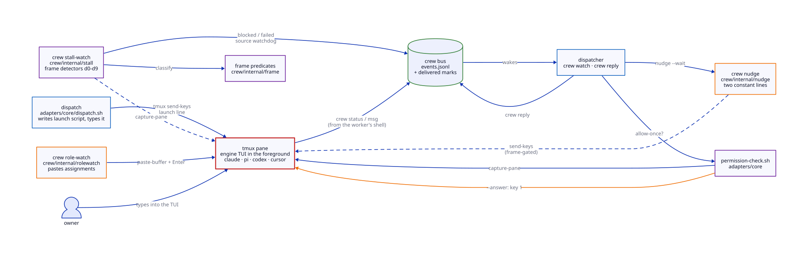
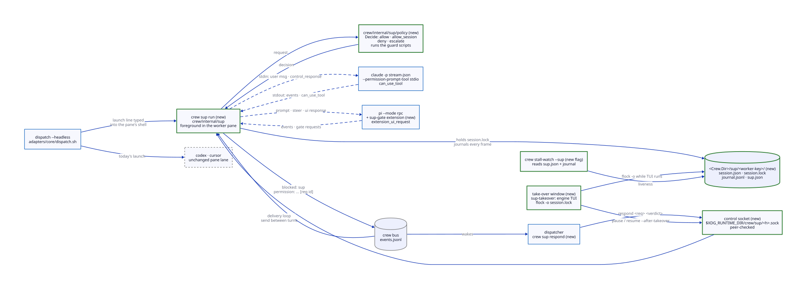

# Headless worker control: production design and migration

**Purpose.** Decide how dispatched workers move from an engine TUI in a tmux pane, which the dispatcher side reads and types
into, to a structured supervisor that drives the engine over its native request/response interface, and plan the migration
in phases that can each merge and revert alone. Issue: #1858, following the spike of #1853 (PR #1854).

**Status.** Proposal, not implemented. This document changes nothing outside `docs/`. Every command, flag, file, package
and setting it names that does not exist at the pin is a proposal. Proposals: the `crew sup` subcommand, the
`crew/internal/sup` package tree, `crew sup takeover`, `dispatch --headless`, and the per-worker supervisor directory
`<Crew.Dir>/sup/<worker-key>/`; from section 3: `crew sup run` with its flags `--crew`, `--worker`, `--engine`,
`--work`, `--session`, `--resume` and `--prompt-file`; the files `session.json`, `session.lock`, `sup.lock`,
`journal.jsonl` (with `journal.1.jsonl`) and `sup.json` in the supervisor directory; the control socket
`$XDG_RUNTIME_DIR/crew/sup/<h>.sock` and its fallback `${XDG_CACHE_HOME:-$HOME/.cache}/crew/sup/<h>.sock`; the
`crew stall-watch --sup <dir>` flag and its `dead: supervisor gone` detail; the child env marker `CREW_SUP=1`; the
production pi gate `adapters/pi/extensions/sup-gate/`; the policy package `crew/internal/sup/policy` with its `Decide`
entry point; and `crew sup` as an accepted launcher in the lead-launcher's fresh-seam check; from 3.7-3.10: the control
verbs `status`, `send`, `interrupt`, `respond`, `pause`, `resume` and `stop` with a protocol version field `v`, the
`takeover` argument of `pause` and the correlation token it returns, and their CLI twins `crew sup <verb> <worker>`,
including `crew sup respond <worker> <req> <verdict>` and `crew sup resume --after-takeover <token>`; the peer check on
the socket and the supervisor as child subreaper; the supervisor's request ids; the status source `sup` and its details
`permission: … [req <id>]`, `question: … [req <id>]`, `takeover: …`, `quota: <engine> <class>: …`, `auth: …` and
`unknown-request: …`; the journal row kinds `escalate`, `answer`, `refused` and `expired`; the supervisor's bus delivery
loop; verification gate `V7`; the pane's take-over key `C-t` and its banner; the take-over window `sup-takeover`; the
dash take-over action; the policy class `credentialed-web`; `dispatch --pane`, `dispatch resume --pane`, and a `lane`
field on the dispatch row, on the `resume` row and in `session.json`; the engine-pane helper `roster.PaneRunsEngine`,
its shell twin `crew engine-cmd <cmd> <pane pid> <sup stamp>` and the pane option `@crew_sup`; the take-over line
builder `dispatch resume --takeover-line`; the production gate's `ask_user` tool; P4's request path from a pi subagent
child to the lead's supervisor; the control verb `show` with its CLI twin `crew sup show <worker> <req>`, the request
digest it prints, the `digest` argument of `respond` (`--digest <d>` on the CLI) that every allow verdict carries, and the
`respond` refusals `digest mismatch` and `no human confirmation`; the CLI's interactive allow confirmation on the
controlling terminal and the dash action's equivalent; the server-set `send` origin (`bus`, `tty`, `cli`, `child`); a
fail-closed ancestry walk for the peer check (a new function beside `proc.AncestorsOf`) and the peer pinned at accept with
`SO_PEERPIDFD` or `pidfd_open`; a `CREW_SUP=1` rule set in the tmux-server guard and in the policy's lexical rules that
denies window-, pane- and session-creating tmux commands against the live server and `crew sup respond`, `resume` and
`show`; argv-prefix entries for `crew sup status` and `crew sup takeover` in `crew remote-run`'s allowlist, and no other
`sup` verb there; the policy's fail-closed guard hook runner; the claude child's `--setting-sources user` and its `Edit`
and `Write` deny rules on the worktree's `.claude/**` and `.mcp.json`; the protected targets `.claude/`, `.mcp.json` and
`.pi/` in the worktree; verification gate `V8`; open question 10's multi-token bash session rule; from sections 4-7: the
status detail
`sup: start <engine> <session id> pid <pid>@<host>[ prev <pid>@<host> <ended|gone>]` that `crew sup` posts when it
starts a child, with the supervisor record in `session.json` it reads `prev` from, the soak thresholds of 5.3, crew-go
build values naming the production gate's path and hash and the secret-read and tmux-server guard scripts, the embedded
help text for `crew sup`, a policy case table under `crew/internal/sup/policy/testdata/` shared by Go and bats tests,
the default-lane setting `workerLane` (`pane` or `headless`) that P5 flips, and the P7 refusal of the pane lane for
claude and pi by `dispatch --pane` and `dispatch resume --pane`.

**Pinned revision.** `7cefe953`. Every `path:line` citation is at this commit. Check one with
`git show 7cefe953:<path>` (for a range, pipe it to `sed -n 'A,Bp'`). Line numbers stay valid at the pin after `main`
moves; they do not track `main`.

**Conventions.** "Measured" means counted or read at the pin, with the method stated next to the number. "Estimated" means
projected from a measured base, with the method stated. "Inference" marks a claim that was not read in code or run. Citations
into other repos are unpinned and prefixed with the repo, for example `pi:docs/security.md:3` for the pi package. In a
paragraph or a table row, a bare `:N` continues the path cited just before it in that paragraph or row. Row ids (`L3`, `RD2`,
`T4`, `B1`, `G7`, `S5`, `K6`, `F2`) point at the inventory tables in section 1; later sections cite them instead of
repeating the code.

**Sources.** The code at the pin; the spike findings `docs/headless-workers-spike.md` and its prototype under
`spikes/headless-supervisor/`; the #1853 follow-up comment listing the findings the spike's final review round left open; and
four prior design docs this one must stay consistent with: `docs/crew-bus-redesign.md`, `docs/dispatch-redesign.md`,
`docs/crew-go-port.md` and `docs/crew-syscall-interfaces.md` (section 6). The task for #1858 lists four open findings; the
#1853 comment lists five, because the task's item 4 ("clean signal shutdown and `ask` matching fix") is two items there:
clean shutdown and the `ask` answer match. This document uses the comment's five-item numbering, `F1` to `F5` (1.7).

**Contents.**

- Diagrams (directly below): the current pane control path and the proposed supervisor control path.

1. Inventory: launch paths, pane readers, pane typists, bus delivery and waiting, permission posture and guards per engine,
   crew store paths, and the spike's reusable pieces and open findings.
2. Designs compared: a per-worker supervisor, a shared per-host daemon, and supervision folded into an existing crew process.
3. Recommendation (settled architecture): process model and lifecycle, engine adapters, permission mode and policy, the
   control surface, the bus and human mapping, take-over, residual cases and the fallback lane.
4. Security invariants, each with its enforcement point, proving test and landing phase.
5. Migration phases: the phase table, test strategy, soak criteria and the deletion schedule.
6. Consistency with prior docs.
7. Open questions, each with a recommended answer.

## Diagrams

Current control path (the engine TUI in a tmux pane, read by stall-watch and permission-check and typed into by nudge,
role-watch and permission-check) and the proposed headless path (`crew sup` in the pane driving the engine over stdio, with
new pieces in green). D2 sources sit beside the renders.

|          | Light                                                                                               | Dark                                                                                                          | Source                                                                                            |
| -------- | --------------------------------------------------------------------------------------------------- | ------------------------------------------------------------------------------------------------------------- | ------------------------------------------------------------------------------------------------- |
| Current  | [current.svg](diagrams/2026-11-27-feat-1858-design-production-headless-worker-contro-current.svg)   | [current-dark.svg](diagrams/2026-11-27-feat-1858-design-production-headless-worker-contro-current-dark.svg)   | [current.d2](diagrams/2026-11-27-feat-1858-design-production-headless-worker-contro-current.d2)   |
| Headless | [headless.svg](diagrams/2026-11-27-feat-1858-design-production-headless-worker-contro-headless.svg) | [headless-dark.svg](diagrams/2026-11-27-feat-1858-design-production-headless-worker-contro-headless-dark.svg) | [headless.d2](diagrams/2026-11-27-feat-1858-design-production-headless-worker-contro-headless.d2) |





## 1. Inventory

Facts only. Every `path:line` is at `7cefe953` and repo-relative. `<c>` is a repo's git common dir. In the shell scripts
`crew_dir` is always `<c>/crew`, derived from the cwd (`adapters/core/dispatch.sh:4400`), for both crew layouts; Go code
resolves a crew through `bus.Paths.Crew` (1.6). A claim not read in code is marked "inference". No row here recommends
anything.

### 1.1 Launch paths

Every engine launch is a shell command line that `dispatch` writes to a launch script and then types into the pane's shell.
The window is the unit `crew reap` removes.

| id  | what                            | where                                                                                                  | fact                                                                                                                                                                                                                                                                                                                                                                                                                 |
| --- | ------------------------------- | ------------------------------------------------------------------------------------------------------ | -------------------------------------------------------------------------------------------------------------------------------------------------------------------------------------------------------------------------------------------------------------------------------------------------------------------------------------------------------------------------------------------------------------------- |
| L1  | claude lead launch              | `adapters/core/dispatch.sh:6189`                                                                       | `claude --name … --model … --effort …` with `--settings $(claude_worker_plugin_settings …)`, `launch_dir_args claude` (G2), `--append-system-prompt-file WORKER_PROTOCOL.claude.md` and `--permission-mode auto`. The session id is pre-assigned and recorded (`adapters/core/dispatch.sh:6182`)                                                                                                                     |
| L2  | pi lead launch                  | `adapters/core/dispatch.sh:6136-6163`                                                                  | `PI_CODING_AGENT_DIR=<worker agent dir> pi --name … --model … --thinking … --append-system-prompt WORKER_PROTOCOL.pi.md --no-approve -e <subagent extension>` (`:6156` sets the extension path). The session id is recorded (`adapters/core/dispatch.sh:6155`)                                                                                                                                                       |
| L3  | codex and cursor lead launch    | `adapters/core/dispatch.sh:6106-6135`                                                                  | codex runs `--dangerously-bypass-approvals-and-sandbox` (`:6117`); cursor runs `cursor-agent --force --trust --approve-mcps` with a bare prompt that seeds its TUI (`:6121-6124`, `:6135`). Neither can pre-assign a session id, so the record is `-` (`:6114-6116`, `:6134`)                                                                                                                                        |
| L4  | the launch reaches the pane     | `adapters/core/launcher-common.sh:943-971`; `adapters/core/dispatch.sh:6191`, `:6233`                  | `write_launch_script` writes the command into `$crew_dir/launch/` (mode 0700, symlink refused); dispatch then runs `tmux send-keys -t "$pane" "$launch_line" Enter`, so the engine is the foreground child of the pane's shell                                                                                                                                                                                       |
| L5  | watchers spawned with the lead  | `adapters/core/dispatch.sh:6257`; `adapters/core/dispatch.sh:6222-6232`                                | `crew stall-watch <worker_id> --pane <pane> --engine <agent>` runs detached under `nohup`. A local lead's pane is stamped for tmux-remux restore with `dispatch resume --exec` when a remux command resolves; a remote-side pane is not (`:6226-6227`)                                                                                                                                                               |
| L6  | role panes                      | `adapters/core/dispatch.sh:2169-2211`                                                                  | `launch_role` builds per-engine lines: claude with `--permission-mode auto` and `GRID_PROTOCOL.md` (`:2198`), pi with `--no-approve` (`:2196`), codex bypass (`:2199`), cursor `--force` (`:2200`). It types `<launch> ; <exit script>` (`:2210`), whose continuation is `dispatch --role-exited` (`:2182`), so an engine that exits is reported and a reaped pane is silent (`:2173-2177`)                          |
| L7  | role watchers and delivery mode | `adapters/core/dispatch.sh:2164-2167`, `:2213-2235`                                                    | `role_delivery` is `pull` for cursor and `typed` otherwise. `watch_role` spawns `crew role-watch` (T3); `watch_role_prompts` spawns a `crew stall-watch role:<branch>:<role>`. Panes are split and the grid layout settled before any engine launches, because a TUI resized while drawing garbles (`adapters/core/dispatch.sh:6192-6200`, `:6216-6220`)                                                             |
| L8  | `dispatch resume`               | `adapters/core/dispatch-resume.sh:1-9`, `:878-898`, `:940-948`                                         | relaunches the worker of the current worktree. The lead's session comes from the record `$crew_dir/leads/<branch>` (`<engine> <id>`); claude resumes with `--resume <id>` only when that transcript exists, else it starts fresh with a reorient note                                                                                                                                                                |
| L9  | resume launch lines             | `adapters/core/dispatch-resume.sh:1363-1381`, `:1424`, `:1455`                                         | same engine flags as L1-L3, including claude `--permission-mode auto` (`:1381`) and pi `--no-approve` (`:1373`); spawns a new stall-watch (`:1424`) and types the launch line (`:1455`)                                                                                                                                                                                                                              |
| L10 | `dispatch migrate`              | `adapters/core/dispatch-migrate.sh:1-8`, `:431`, `:478`, `:528-584`                                    | quiesces a local worker (a `crew reply --no-nudge` migrate directive, then `crew migrate stop`), carries branch, uncommitted work, task settings and the claude or pi transcript in one bundle, and resumes it on the target host through `dispatch --host`. The receiving dispatch writes the transcript into place and launches claude with `--resume` (`adapters/core/dispatch.sh:6170-6179`)                     |
| L11 | remote `--host`                 | `adapters/core/dispatch.sh:2787-2790`, `:3181-3182`; `adapters/core/launcher-common.sh:273-279`        | the controller runs the remote's own `dispatch` through `crew remote-run` (the one place that builds ssh). A set `DISPATCH_TMUX_SESSION`, one of the env keys a remote-run request may carry (`crew/internal/remote/remote.go:56-62`), makes the remote side take the `remote` wire side; it then launches through the same L1-L4 path on its own tmux (inference: read from the shared code, not traced end to end) |
| L12 | fresh-seam relaunch             | `adapters/core/dispatch.sh:6061-6066`, `:6183-6185`; `adapters/core/lead-launcher.sh:1-12`, `:192-199` | an armed lead launches through `lead-launcher`, which loops `<engine> … --session-id <sid> <prompt>` in the same pane. The lead's inner `--fresh <execute or review>` writes a marker, sends SIGTERM, waits 10 s, then SIGKILL (`adapters/core/lead-launcher.sh:104-119`); the loop mints a new id, records it and appends a `relaunch` row (`:224-229`); a refused seam posts `failed` (`:216-221`)                 |
| L13 | teardown                        | `crew/internal/reap/reap.go:366`; `crew/internal/reap/remove.go:72`                                    | reap removes a worker's window with `tmux kill-window`; the engine ends with its pane (inference: no engine-specific stop was read on this path)                                                                                                                                                                                                                                                                     |

### 1.2 Pane readers

Every reader takes `tmux capture-pane` text (or a pane option) and classifies it. Stall-watch's detectors are split by the
signal they read.

| id   | what                                   | where                                                                                                                                                         | fact                                                                                                                                                                                                                                                                                                                                                                                                                                                                                                                                                                                                                                                                                                                                                                                                                                                                                                                                                                                                                                                                                                                                                                                                                                                                                                                                                                                                                                                                                                                                                                                                                                                                                                                |
| ---- | -------------------------------------- | ------------------------------------------------------------------------------------------------------------------------------------------------------------- | ------------------------------------------------------------------------------------------------------------------------------------------------------------------------------------------------------------------------------------------------------------------------------------------------------------------------------------------------------------------------------------------------------------------------------------------------------------------------------------------------------------------------------------------------------------------------------------------------------------------------------------------------------------------------------------------------------------------------------------------------------------------------------------------------------------------------------------------------------------------------------------------------------------------------------------------------------------------------------------------------------------------------------------------------------------------------------------------------------------------------------------------------------------------------------------------------------------------------------------------------------------------------------------------------------------------------------------------------------------------------------------------------------------------------------------------------------------------------------------------------------------------------------------------------------------------------------------------------------------------------------------------------------------------------------------------------------------------- |
| RD1  | `crew/internal/frame` predicates       | `crew/internal/frame/frame.go:1-8`, `:133-235`, `:361-441`, `:506`, `:694`; `crew/internal/frame/composer.go:101-166`                                         | classifies pane captures of all four engines: `IsPermissionPrompt`, `IsAddDirPrompt`, `IsWorkspaceTrustPrompt`, `IsPrompt`, `IsQuotaPrompt`, `IsQuotaSessionLimit`, `IsQuotaCursorLimit`, `IsBgWait`, `ClaudeIdleBox`, `PiLiveTurn`, `PiIdleBox`, `PiStopped`, `InterruptedAboveBox`, and the codex and cursor composer and idle-box checks                                                                                                                                                                                                                                                                                                                                                                                                                                                                                                                                                                                                                                                                                                                                                                                                                                                                                                                                                                                                                                                                                                                                                                                                                                                                                                                                                                         |
| RD2  | stall-watch sampling and pane liveness | `crew/internal/stall/probe/probe.go:229-257`; `crew/internal/stall/stall.go:174-231`                                                                          | each tick captures the pane (`capture-pane -p`, `-e` for colour). A failed capture counts toward a three-failure quorum before the watch exits (`crew/internal/stall/stall.go:202-207`); a worker-posted `blocked` suppresses the frame detectors because a held `crew await` leaves a static pane (`:225-227`). The watch exits on `exited`, `reaped` or `migrated` (`:194-195`)                                                                                                                                                                                                                                                                                                                                                                                                                                                                                                                                                                                                                                                                                                                                                                                                                                                                                                                                                                                                                                                                                                                                                                                                                                                                                                                                   |
| RD3  | frame detectors (pane frame)           | `crew/internal/stall/frame_detectors.go:90-97`                                                                                                                | `frameDetect` runs d1, d2, d1b, d7, d3, d0 and d9 on the tick's frame. d1 prompt and quota (`:100-189`), d1b quota session limit (`:281-286`), d2 dead turn (`:202-204`), d7 runaway output (`:325-332`), d3 quiet pane (`:425-430`), d0 startup silence (`:451-455`), d9 stopped pi turn (`:475-484`). All read the captured frame                                                                                                                                                                                                                                                                                                                                                                                                                                                                                                                                                                                                                                                                                                                                                                                                                                                                                                                                                                                                                                                                                                                                                                                                                                                                                                                                                                                 |
| RD4  | d1 permission detail                   | `crew/internal/stall/frame_detectors.go:168-187`, `:783-785`                                                                                                  | a tool-permission frame posts `blocked` with detail `prompt: permission — <tool>: <request>` (or `(unparsed)`); an add-dir trust frame and a quota frame post their own `prompt:` and `quota:` details                                                                                                                                                                                                                                                                                                                                                                                                                                                                                                                                                                                                                                                                                                                                                                                                                                                                                                                                                                                                                                                                                                                                                                                                                                                                                                                                                                                                                                                                                                              |
| RD5  | probe detectors (not frame)            | `crew/internal/stall/probe_detectors.go:37-46`, `:137-141`, `:188-195`, `:248-262`, `:329-340`; `crew/internal/stall/stall.go:231`                            | d4 host load reads the host, not the pane; d8 engine budget reads the bus and the budget cache; d5 launch-not-started reads the pane's current command (`roster.IsEngineCmd`), not its frame; d6 unread reads the bus and delivered marks, then may auto-nudge (T2)                                                                                                                                                                                                                                                                                                                                                                                                                                                                                                                                                                                                                                                                                                                                                                                                                                                                                                                                                                                                                                                                                                                                                                                                                                                                                                                                                                                                                                                 |
| RD6  | `permission-check.sh`                  | `adapters/core/permission-check.sh:1-35`, `:219-221`, `:229-245`, `:443-482`, `:583-588`                                                                      | dispatcher-side checker for one claude dialog shape. It captures the pane, parses the frame, binds it to the single pending Bash call of a depth-1 subagent in the lead's own transcript, and allows only a read grammar (`cat`, `head`, `tail`, `wc`, `grep`, `rg`, `ls`) over allowed roots; output is `allow-once` or `human: <reason>`. Edit and Write dialogs never match, so they go to the human (`:16-19`)                                                                                                                                                                                                                                                                                                                                                                                                                                                                                                                                                                                                                                                                                                                                                                                                                                                                                                                                                                                                                                                                                                                                                                                                                                                                                                  |
| RD7  | role-watch capture                     | `crew/internal/rolewatch/loop.go:85-88`; `crew/internal/rolewatch/frames.go:29-40`                                                                            | `paneReady` is the only gate before typing: it fails closed on a dialog, prompt, quota stop, live turn or any frame not positively the engine's empty composer                                                                                                                                                                                                                                                                                                                                                                                                                                                                                                                                                                                                                                                                                                                                                                                                                                                                                                                                                                                                                                                                                                                                                                                                                                                                                                                                                                                                                                                                                                                                                      |
| RD8  | idle checks outside stall-watch        | `crew/internal/reap/release.go:276-283`; `crew/internal/reap/candidate.go:352-362`; `crew/internal/stall/release.go:76-96`; `crew/internal/fleet/panes.go:17` | reap and the finished-worker release read pane idleness (`PaneIdleReason`, `PiIdleReason`, prompt checks) before acting; fleet reads `ClaudeUnsentInput`                                                                                                                                                                                                                                                                                                                                                                                                                                                                                                                                                                                                                                                                                                                                                                                                                                                                                                                                                                                                                                                                                                                                                                                                                                                                                                                                                                                                                                                                                                                                                            |
| RD9  | overseer trust reader                  | `crew/internal/overseer/trust.go:77-86`                                                                                                                       | captures a pane and requires `IsWorkspaceTrustPrompt` (refusing an add-dir trust frame) before T5 types                                                                                                                                                                                                                                                                                                                                                                                                                                                                                                                                                                                                                                                                                                                                                                                                                                                                                                                                                                                                                                                                                                                                                                                                                                                                                                                                                                                                                                                                                                                                                                                                             |
| RD10 | `crew/internal/panestate`              | `crew/internal/panestate/panestate.go:1-18`; `crew/internal/stall/post.go:158`; `crew/internal/status/status.go:282`                                          | a writer, not a reader: publishes `@crew_state`, `@crew_detail` (40 runes) and `@crew_source` pane options for the border, called by stall-watch and `crew status`                                                                                                                                                                                                                                                                                                                                                                                                                                                                                                                                                                                                                                                                                                                                                                                                                                                                                                                                                                                                                                                                                                                                                                                                                                                                                                                                                                                                                                                                                                                                                  |
| RD11 | engine-pane checks by command name     | `crew/internal/roster/roster.go:26-28`, `:198-211`; `adapters/core/local-models.sh:22-29`; `adapters/core/dispatch-notify.sh:67-74`                           | a pane counts as running an engine only when its `#{pane_current_command}` (or a process's command name) is in the engine table: `roster.IsEngineCmd` in Go, `_is_engine_cmd` or `crew engine-cmd` (`crew/internal/entry/enginecmd.go:25`) in shell. Callers at the pin: roster's live-pane fold (`crew/internal/roster/roster.go:153`); reap's `enginePanes` and `idleEngines` (`crew/internal/reap/candidate.go:258-278`, `:294-295`), used by gone-pane, stale and discard (`crew/internal/reap/gonepane.go:79`; `crew/internal/reap/stale.go:83`; `crew/internal/reap/discard.go:61`), and reap's occupants (`crew/internal/reap/occupants.go:64`); stall-watch's d5 and role end-of-life (`crew/internal/stall/probe_detectors.go:261`, `:300`), its dead-engine evidence (`crew/internal/stall/post.go:169`) and its process-tree walk (`crew/internal/stall/probe/probe.go:327`); the nudge anchor (`crew/internal/nudge/nudge.go:500`); overseer trust (`crew/internal/overseer/trust.go:124`); adopt's reattach (`crew/internal/adopt/reattach.go:56`); migrate's engine pane (`crew/internal/migrate/migrate.go:201`); fleet load and local models (`crew/internal/fleet/load.go:213`; `crew/internal/fleet/localmodels.go:34`); `_chrome_holders` (`adapters/core/dispatch.sh:1342`); `_local_holders` (`adapters/core/local-models.sh:41`); `dispatch resume` (`adapters/core/dispatch-resume.sh:232`, `:736`, `:811`, `:872`); `dispatch migrate`'s `_engine_live` (`adapters/core/dispatch-migrate.sh:330`); dispatch-notify's ancestor count and turn-end check (`adapters/core/dispatch-notify.sh:87`, `:127`); the dispatcher's relaunch guard on its own pane (`adapters/core/dispatcher.sh:563`) |

### 1.3 Pane typists

| id  | what                              | where                                                                                                                                      | fact                                                                                                                                                                                                                                                                                                                                                                                                                    |
| --- | --------------------------------- | ------------------------------------------------------------------------------------------------------------------------------------------ | ----------------------------------------------------------------------------------------------------------------------------------------------------------------------------------------------------------------------------------------------------------------------------------------------------------------------------------------------------------------------------------------------------------------------- |
| T1  | launch typing                     | `adapters/core/dispatch.sh:6233`, `:2210`; `adapters/core/dispatch-resume.sh:1455`                                                         | every lead and role launch is typed into the pane's shell (L4, L6, L9)                                                                                                                                                                                                                                                                                                                                                  |
| T2  | `crew nudge` (`nudge.Pane`)       | `crew/internal/nudge/nudge.go:1-15`, `:170-182`, `:354-358`                                                                                | types one of two constant lines, `crew inbox "$CREW_WORKER_ID"` or the d9 continue line, into a provably idle empty box after a frame gate and an anchor gate, then Enter. Callers: `crew nudge`, d6's auto-nudge (`crew/internal/stall/probe_detectors.go:72`, `:406`), d9 (`crew/internal/stall/frame_detectors.go:475-484`), `crew reply`'s detached `crew nudge --wait` (`crew/internal/reply/nudge_wait.go:11-16`) |
| T3  | `crew role-watch` typed delivery  | `crew/internal/rolewatch/rolewatch.go:1-7`; `crew/internal/rolewatch/loop.go:372-392`, `:310-320`; `crew/internal/rolewatch/gates.go:5-19` | admits only the role's lead or the crew's dispatcher, refuses C0 bytes, pastes `Assignment: <body>` through `load-buffer`/`paste-buffer`, re-captures to confirm, then sends Enter with bounded retries; `C-u` clears its own unsent text. Not used for cursor roles, which pull (L7)                                                                                                                                   |
| T4  | `permission-check --answer`       | `adapters/core/permission-check.sh:918-933`                                                                                                | after a settle interval and an unchanged re-capture, sends the single key `1` to the dialog                                                                                                                                                                                                                                                                                                                             |
| T5  | overseer trust accept             | `crew/internal/overseer/trust.go:52`, `:62-68`, `:87`                                                                                      | sends Enter on a claude workspace-trust dialog, only when the owner enabled `overseer.acceptTrust`                                                                                                                                                                                                                                                                                                                      |
| T6  | `pane-injection` skill            | `adapters/core/skills/pane-injection/SKILL.md:8-19`                                                                                        | protocol text: nothing types into an engine pane but the two constant lines of T2; permission dialogs go through T4 only; anything else is a human running `tmux send-keys` as a last resort                                                                                                                                                                                                                            |
| T7  | directive delivery (not a typist) | `adapters/core/directive-delivery.sh:1-24`; `hookyard.json:85-91`                                                                          | a pi-only `post_tool` hook that returns unread `dispatcher:<crew>` messages as `additionalContext` on the next tool result, raising the delivered marks through `crew inbox --undelivered`. It types nothing. The claude plugin registers no such hook (`adapters/claude-code/plugin/hooks/hooks.json:1-133`)                                                                                                           |
| T8  | dash actions                      | `dash/internal/ui/actions.go:22-31`, `:92`                                                                                                 | jump (`tmux switch-client`), open PR, reply, nudge, peek, merge, relaunch. No take-over action exists                                                                                                                                                                                                                                                                                                                   |
| T9  | dispatch pane guards              | `adapters/core/dispatch.sh:1977-1995`, `:2302`, `:2465`, `:2531`; `docs/dispatch-redesign.md:390-392`                                      | `_pane_is_ancestor` requires that a `%id` pane's pid be an ancestor of the calling process before `--spawn-role`, `--reap-roles` and `--role-exited` act; it fails closed in a pid-namespaced sandbox                                                                                                                                                                                                                   |

### 1.4 Bus delivery and waiting

| id  | what                   | where                                                                                    | fact                                                                                                                                                                                                                                                                                                              |
| --- | ---------------------- | ---------------------------------------------------------------------------------------- | ----------------------------------------------------------------------------------------------------------------------------------------------------------------------------------------------------------------------------------------------------------------------------------------------------------------- |
| B1  | `crew await`           | `crew/internal/await/await.go:1-8`; `adapters/core/protocols/WORKER_PROTOCOL.md:290-300` | blocks until a msg answers one agent and prints it. The worker protocol has a worker post `blocked`, send its question, then hold `crew await --timeout 300` from its shell tool, re-stamping `blocked … (cycle K of 24)` on each timeout                                                                         |
| B2  | delivered marks        | `crew/internal/marks/marks.go:1-12`, `:48-76`                                            | one JSON object per crew and session, `{sender: ts of the newest msg handed}`, read and raised by `inbox`, `await`, `nudge` and stall-watch d6 under a per-file flock. The file name is the key `<crew>-<me>` with every byte outside `[A-Za-z0-9._-]` mapped to `_`, plus the POSIX cksum of the unsanitized key |
| B3  | `crew inbox`           | `crew/internal/inbox/inbox.go:1-3`; `adapters/core/protocols/WORKER_PROTOCOL.md:226-232` | prints every msg to one agent and raises its marks; the worker protocol's peek is one pass, not a held wait                                                                                                                                                                                                       |
| B4  | `crew reply`           | `crew/internal/reply/reply.go:1-14`; `crew/internal/reply/nudge_wait.go:11-16`           | the dispatcher's in-band answer, a `msg` from `dispatcher:<crew>`; a branch-only target resolves to the newest session, so a directive is never inherited by a successor session. By default it starts a detached `crew nudge --wait` (T2)                                                                        |
| B5  | unread scan            | `crew/internal/unread/unread.go:1-4`                                                     | the fold over the log and the marks that d6 runs every fourth tick and `crew nudge` runs per call                                                                                                                                                                                                                 |
| B6  | role delivery protocol | `adapters/core/protocols/GRID_PROTOCOL.md:38-42`, `:68-71`                               | a `typed` role ends its turn and is typed each assignment by role-watch (T3); a `pull` role holds `crew await`                                                                                                                                                                                                    |
| B7  | dispatcher wake        | `adapters/core/protocols/DISPATCHER_PROTOCOL.md:247`, `:251`                             | `crew watch` wakes on a worker `blocked`, `pr_open`, `done`, `failed`, a first `exited`, or a question msg; a `status` with `source: "watchdog"` was posted by stall-watch on the worker's behalf                                                                                                                 |
| B8  | sender check           | `crew/internal/sender/sender.go:1-12`                                                    | the bus write paths check a row's self-asserted `from`; it is a tripwire, not authentication, since every session runs as the same uid                                                                                                                                                                            |

### 1.5 Permission posture and guards

"Fires headless?" says whether the guard would still run for an engine child started as in the spike (`-p` stream-json for
claude, `--mode rpc` for pi). Nothing in this column was run at the pin, so every entry is inference unless it cites code.

| id  | what                                  | where                                                                                                                                                                    | fact                                                                                                                                                                                                                                                                                                                                                                                               | fires headless?                                                                                                                                                                                                                                                  |
| --- | ------------------------------------- | ------------------------------------------------------------------------------------------------------------------------------------------------------------------------ | -------------------------------------------------------------------------------------------------------------------------------------------------------------------------------------------------------------------------------------------------------------------------------------------------------------------------------------------------------------------------------------------------- | ---------------------------------------------------------------------------------------------------------------------------------------------------------------------------------------------------------------------------------------------------------------- |
| G1  | claude permission mode                | `adapters/core/dispatch.sh:6189`, `:2198`; `adapters/core/dispatch-resume.sh:1381`                                                                                       | every claude lead, role and resume runs `--permission-mode auto`                                                                                                                                                                                                                                                                                                                                   | a flag, so it carries to any child launched with it; the spike adds `--permission-mode` only when set (`spikes/headless-supervisor/internal/claude/claude.go:51-52`). How auto mode decides under `-p` with `--permission-prompt-tool stdio`: inference          |
| G2  | claude working dirs and `Edit` denies | `adapters/core/launcher-common.sh:1297-1330`, `:1331-1381`                                                                                                               | `--add-dir` for the protocol, skills, reviewers and critics dirs, each with an `Edit(//<dir>/**)` deny rule through `--disallowedTools` (`:1345-1346`, `:1377-1380`); the branch artifacts dir (`:1348-1355`); and each grant line of `$crew_dir/grants/<branch>` that passes `_add_dir_ok` (`:1356-1365`). Reads in an added dir are prompt-free; edits follow the permission mode (`:1302-1303`) | flags, so they carry the same way (inference)                                                                                                                                                                                                                    |
| G3  | claude worker settings                | `adapters/core/claude-worker-settings.sh:28-50`; `adapters/core/launcher-common.sh:1216-1228`                                                                            | a `--settings` layer that disables seven plugins, denies `mcp__<server>__*` for each `workerDeniedMcpServers` entry plus Claude in Chrome, and sets the Code Mode env for a `--code-mode` lead; `claude_lean_env` drops claude.ai connectors and prompt suggestions                                                                                                                                | a flag (inference). The spike's child instead runs `--setting-sources local --strict-mcp-config` (`spikes/headless-supervisor/internal/claude/claude.go:42`)                                                                                                     |
| G4  | pi posture                            | `adapters/core/launcher-common.sh:1328-1330`; `adapters/core/dispatch.sh:6163`; `crew/internal/piagentdir/piagentdir.go:120-125`                                         | pi has no tool-permission layer; workers run `--no-approve`. The worker agent dir registers hookyard's generated bridge extension, the only route by which pi workers run hooks                                                                                                                                                                                                                    | extensions run in `--mode rpc` (the spike's gate is one). The spike's child passes `--no-extensions` (`spikes/headless-supervisor/internal/pi/pi.go:79`), so whether the bridge loaded there is inference                                                        |
| G5  | codex posture                         | `adapters/core/dispatch.sh:6117`; `adapters/codex/plugin/hooks/hooks.json:3-28`                                                                                          | `--dangerously-bypass-approvals-and-sandbox`; the codex plugin registers `PreToolUse` Bash secret-read and public-leak guards and the `SessionEnd` notify                                                                                                                                                                                                                                          | stays on the pane lane (no structured control at the pin)                                                                                                                                                                                                        |
| G6  | cursor posture                        | `adapters/core/dispatch.sh:6121-6124`, `:6135`; `adapters/core/dispatch-notify.sh:8-16`                                                                                  | `--force --trust --approve-mcps` make cursor unattended (the comment calls it the codex bypass analog); cursor has no session-end event, so its notify runs on `stop` per turn. Where cursor's hooks are registered is outside this repo (inference)                                                                                                                                               | stays on the pane lane                                                                                                                                                                                                                                           |
| G7  | secret-read guard                     | `adapters/core/secret-read-guard.sh:1-38`; `adapters/claude-code/plugin/hooks/hooks.json:3-12`; `hookyard.json:10-17`                                                    | blocks commands and reads that would print a secret into the transcript; one script for claude, codex, pi (through hookyard) and cursor, recognising each caller's event shape                                                                                                                                                                                                                     | claude: plugin `PreToolUse` command hooks under `-p` (inference; the spike ran with `--setting-sources local`). pi: only if the bridge loads (G4)                                                                                                                |
| G8  | tmux-server guard                     | `adapters/core/tmux-server-guard.sh:1-30`; `adapters/claude-code/plugin/hooks/hooks.json:31-39`; `hookyard.json:34-41`; `adapters/core/claude-worker-settings.sh:90-109` | for a session with `CREW_WORKER_ID`, denies tmux calls that reach the live server (`kill-server`, `kill-session`, global `set`, `source-file`) and deletes at or around `$XDG_RUNTIME_DIR`; workers also get a private `TMUX_TMPDIR` per worktree                                                                                                                                                  | same as G7 (inference). The spike strips `TMUX`, `TMUX_PANE` and `CREW_WORKER_ID` from the child (`spikes/headless-supervisor/internal/claude/claude.go:71`), and the guard skips a session without `CREW_WORKER_ID` (`adapters/core/tmux-server-guard.sh:8-11`) |
| G9  | grant check                           | `adapters/core/grant-check.sh:1-9`, `:367`; `adapters/core/launcher-common.sh:1359`; `adapters/core/permission-check.sh:678-686`                                         | `_add_dir_ok` is the one validator for `--add-dir` grants, sourced by dispatch, dispatch-resume and permission-check; it walks symlink chains component by component and fails closed                                                                                                                                                                                                              | runs at launch and in permission-check, not inside the engine                                                                                                                                                                                                    |
| G10 | `exited` backstop (dispatch-notify)   | `adapters/core/dispatch-notify.sh:1-36`, `:198-208`; `adapters/claude-code/plugin/hooks/hooks.json:86-95`; `hookyard.json:3-9`                                           | on claude/codex `SessionEnd` and pi `session_shutdown`, posts `exited` for a worker that stopped without a terminal status, skipping in-process session switches (`new`, `resume`, `fork`, `reload`, `clear`); the lead-launcher's relaunch marker suppresses it (`adapters/core/lead-launcher.sh:216-218`)                                                                                        | claude `SessionEnd` under `-p`: inference. A supervisor that outlives its child would need its own `exited` (inference)                                                                                                                                          |
| G11 | in-process subagents                  | `adapters/claude-code/plugin/hooks/hooks.json:40-49`; `adapters/core/permission-check.sh:443-445`; `adapters/pi/extensions/subagent/index.ts:313-314`, `:378-383`        | claude Task/Agent calls fire `subagent-notify`, and a claude subagent's Bash dialog shows in the lead's pane, which is what permission-check binds to. pi's subagent extension spawns a separate `pi --mode json -p --no-session --no-approve` child with `CREW_SUBAGENT=1`                                                                                                                        | whether a claude subagent's tool calls reach `can_use_tool` on the parent's control channel, and whether a pi subagent child loads any gate: inference                                                                                                           |
| G12 | standing owner policy                 | `crew/internal/policy/policy.go:1-8`                                                                                                                                     | the existing package `crew/internal/policy` is the repo owner's standing per-repo policy, read by a dispatcher with provenance; its record lives under the user's state dir, outside the git common dir, worktrees and every `--add-dir` root                                                                                                                                                      | not a tool gate                                                                                                                                                                                                                                                  |

### 1.6 Crew store paths

| id  | what                        | where                                                                                                                              | fact                                                                                                                                                                                                                                               |
| --- | --------------------------- | ---------------------------------------------------------------------------------------------------------------------------------- | -------------------------------------------------------------------------------------------------------------------------------------------------------------------------------------------------------------------------------------------------- |
| S1  | crew resolution             | `crew/internal/bus/resolve.go:53-76`                                                                                               | `Paths.Crew(id)` returns layout 2 when `<state>/crews/<id>/meta.json` exists (`:62-63`), refuses archived and index-only ids (`:65-70`), and otherwise returns layout 1 (`:75`)                                                                    |
| S2  | `Crew.Dir` per layout       | `crew/internal/bus/layout2.go:12-26`; `crew/internal/bus/resolve.go:31-34`, `:63`, `:75`                                           | layout 2: `StoreDir(state, id)` = `<state>/crews/<id>`, with `state` = `${XDG_STATE_HOME:-$HOME/.local/state}/crew`. Layout 1: `CrewDir(id)` = `<c>/crew/crews/<id>`, repo-local inside the git common dir                                         |
| S3  | `Crew` fields               | `crew/internal/bus/resolve.go:36-46`                                                                                               | `Log`, `Dir`, `RepoDir` (the repo-local dir for artifacts, grants and repo locks), `State` (root of crew-scoped stores: the repo's bus dir on layout 1, `Dir` on layout 2) and `Layout`                                                            |
| S4  | crew id charset             | `crew/internal/bus/bus.go:261-264`                                                                                                 | `ValidCrewID` refuses empty, `.`, `..` and a leading `-`                                                                                                                                                                                           |
| S5  | repo-local per-branch files | `adapters/core/dispatch.sh:4400`; `adapters/core/launcher-common.sh:945`, `:1348`, `:1356`; `adapters/core/dispatch-resume.sh:894` | the shell's `crew_dir` is `<c>/crew` for both layouts, so launch scripts (`launch/`), the artifacts dir (`artifacts/<branch>`), grants (`grants/<branch>`) and the lead session record (`leads/<branch>`) are repo-local                           |
| S6  | id-to-filename precedent    | `crew/internal/marks/marks.go:48-65`                                                                                               | ids containing `:`, `/` and `#` become file names by mapping bytes outside `[A-Za-z0-9._-]` to `_` and appending the cksum of the raw key, so ids that sanitize alike do not collide                                                               |
| S7  | worker id shape             | `crew/internal/rolewatch/gates.go:5-13`                                                                                            | a lead session is `worker:<branch>#s<session>`; the dispatcher is `dispatcher:<crew>`                                                                                                                                                              |
| S8  | socket-path precedents      | `adapters/core/claude-worker-settings.sh:67-72`, `:90-109`                                                                         | the agent-browser socket path caps at 103 bytes, so session names use a short slug; the worker `TMUX_TMPDIR` is `${XDG_CACHE_HOME:-$HOME/.cache}/dispatcher/tmux/<8 hex>`, created 0700 with a symlink refused, keeping the tmux socket path short |
| S9  | the spike's state dir       | `spikes/headless-supervisor/internal/supervisor/control.go:24-41`, `:188-197`, `:278-306`                                          | holds `ctl.sock`, `session.lock` and `session.json` (engine, session id, work dir, binary, model; pi session dir and gate). The dir must be a real 0700 directory owned by the caller; the socket is chmod 0600                                    |

### 1.7 Spike reusable pieces and open findings

All under `spikes/headless-supervisor/`, which is not wired into `dispatch` or `crew`
(`docs/headless-workers-spike.md:13-27`).

| id  | piece                     | where                                                                                                                                               | fact                                                                                                                                                                                                                                                                                                                                                                |
| --- | ------------------------- | --------------------------------------------------------------------------------------------------------------------------------------------------- | ------------------------------------------------------------------------------------------------------------------------------------------------------------------------------------------------------------------------------------------------------------------------------------------------------------------------------------------------------------------- |
| K1  | event model               | `spikes/headless-supervisor/internal/event/event.go:15-28`, `:55-99`                                                                                | engine-neutral kinds (`init`, `turn_start`, `text`, `tool_start`, `tool_result`, `permission`, `turn_end`, `retry`, `error`, `exit`), `Request`, `Decision` (`allow_once`, `allow_session`, `deny`, `answer`), the `Engine` interface (`Start`, `Events`, `Send`, `Interrupt`, `Respond`, `SessionID`, `Close`, `Kill`, `Wait`) and `Options.Inherit` for extra fds |
| K2  | claude adapter            | `spikes/headless-supervisor/internal/claude/claude.go:29-52`, `:63-81`, `:225-236`; `spikes/headless-supervisor/internal/claude/respond.go:111-144` | `-p --input-format stream-json --output-format stream-json --permission-prompt-tool stdio`, `--resume` or `--session-id`; `ChildEnv` strips crew, tmux and Claude Code session variables; an unsupported `control_request` subtype is answered with an error so the child does not block; `ruleContent` scopes `allow_session` rules                                |
| K3  | pi adapter                | `spikes/headless-supervisor/internal/pi/pi.go:1-3`, `:67-103`, `:105-120`                                                                           | `--mode rpc` with `--no-extensions --no-skills --no-prompt-templates --no-context-files`; the gate is loaded last so no later `tool_call` handler can change an approved call (`:88-92`); same env strip as K2                                                                                                                                                      |
| K4  | `gate.ts`                 | `spikes/headless-supervisor/pi/gate.ts:18-28`, `:155-185`, `:187-208`                                                                               | on `tool_call`, a call it does not auto-allow becomes `ctx.ui.select` with `allow_once`, `allow_session`, `deny`; a deny asks for a reason and returns `{block: true, reason}`; the session-allow set lives in the extension; `ask_user` is the question tool. It auto-allows a lexical read-only bash subset (`SAFE_BASH`) and in-cwd reads                        |
| K5  | run loop and default deny | `spikes/headless-supervisor/internal/supervisor/run.go:98-122`                                                                                      | a request with no policy is denied; a failed respond falls back to one deny; every decision is noted in the transcript with id, tool, command, path, verdict and reason                                                                                                                                                                                             |
| K6  | control server            | `spikes/headless-supervisor/internal/supervisor/control.go:73-91`, `:118-165`, `:167-198`, `:232-263`                                               | one JSON line per request on `ctl.sock`; verbs `pause`, `resume`, `send`, `status`, `stop`. There is no `respond` or `interrupt` verb and no peer check on the socket. An unconfigured server policy denies (`:159-162`); shutdown grace defaults to 15 s (`:131`, `:156-158`)                                                                                      |
| K7  | liveness                  | `spikes/headless-supervisor/internal/supervisor/liveness.go:20-24`, `:75-78`                                                                        | a turn is stale when no event arrives for the silence limit while it is open                                                                                                                                                                                                                                                                                        |
| K8  | session lock              | `spikes/headless-supervisor/internal/lock/lock.go:1-39`; `spikes/headless-supervisor/internal/supervisor/control.go:324`                            | non-blocking `flock(LOCK_EX)` compatible with flock(1); the child inherits the lock fd, and `Release` closes without `LOCK_UN` so the lock lives while any holder does                                                                                                                                                                                              |
| K9  | transcript and scrubber   | `spikes/headless-supervisor/internal/transcript/transcript.go:1`; `spikes/headless-supervisor/internal/transcript/scrub.go:16-45`, `:91-122`        | one scrubbed JSONL frame per line; path rules replace absolute prefixes with placeholders on a path boundary; secret-value, bearer, env-line and email patterns are redacted                                                                                                                                                                                        |
| K10 | take-over script          | `spikes/headless-supervisor/takeover.sh:44-46`, `:84-86`, `:96-117`                                                                                 | `hsup ctl pause`; a `flock -n` probe; a new tmux window that unsets the parent markers and runs `flock -o -n session.lock <engine resume>`; `tmux wait-for`; `hsup ctl resume`                                                                                                                                                                                      |

The five open findings from the #1853 follow-up comment, each re-read at the pin:

| id  | finding                                                     | where                                                                                                                                                                | fact at the pin                                                                                                                                                                                                                                                                                                                                                                        |
| --- | ----------------------------------------------------------- | -------------------------------------------------------------------------------------------------------------------------------------------------------------------- | -------------------------------------------------------------------------------------------------------------------------------------------------------------------------------------------------------------------------------------------------------------------------------------------------------------------------------------------------------------------------------------- |
| F1  | pi gate read-only auto-allow is bypassable                  | `spikes/headless-supervisor/pi/gate.ts:43-95`, `:52-66`, `:84-89`, `:128-129`                                                                                        | `normalizePath` strips `@` and resolves lexically (`path.resolve` collapses `..`) before `real` realpaths; `real` falls back to the nearest existing parent, so a dangling link is keyed at the link's own location; the session key is the first word, so `FOO=1 cmd` keys as `bash:FOO=1`. The comment's suggestion: auto-allow nothing and send every `tool_call` to the supervisor |
| F2  | claude file-tool `allow_session` through a symlinked parent | `spikes/headless-supervisor/internal/claude/respond.go:135-139`                                                                                                      | the rule is built from `filepath.Dir(filepath.Clean(p))`, the lexical dir, with no `EvalSymlinks`; the glob-character set checked is `*?[]{}`, without `\`                                                                                                                                                                                                                             |
| F3  | transcript scrubber boundaries                              | `spikes/headless-supervisor/internal/transcript/scrub.go:35-40`, `:95`, `:113-119`                                                                                   | a path rule matches only when the previous byte is not a path character (`/` is one, so `//abs` and `file:///abs` stay unscrubbed) and the next byte is `/` or the end (so pi's multi-line `<cwd>` frame shows `$TMP/tmp.<rand>/work` in the comment's example); secret prefixes anchor at a word start, missing URL-encoded forms such as `%3Dsk-ant-…`                               |
| F4  | clean signal shutdown reported as an error                  | `spikes/headless-supervisor/internal/claude/claude.go:157`; `spikes/headless-supervisor/internal/acp/acp.go:227`; `spikes/headless-supervisor/internal/pi/pi.go:171` | each sets `cmd.Cancel = stdin.Close`; a nil return lets `os/exec` replace a clean exit with `ctx.Err()`. The suggested fix returns `os.ErrProcessDone` from `Cancel`                                                                                                                                                                                                                   |
| F5  | `ask` case may match the answer inside the question text    | `spikes/headless-supervisor/internal/cases/permission.go:356`                                                                                                        | the oracle passes when the lower-cased tool result contains `teal` anywhere, and claude's result repeats `"<question>"="<answer>"`; the fix matches the answer value only                                                                                                                                                                                                              |

## 2. Designs compared

Every design below has to do the same five things: own the engine child's stdin and stdout for its whole life, persist the
session id it can resume, hold the session lock (K8) while a child or a take-over TUI writes the session, expose a control
surface to the dispatcher side, and end cleanly when the worker ends. The designs differ in which process does this and where
that process lives. This section compares; section 3 settles.

### 2.1 Topology A: a per-worker `crew sup` in the worker pane

One supervisor process per worker, a `crew` subcommand in Go ported from the spike, which is already one server owning one
engine child at a time (`spikes/headless-supervisor/internal/supervisor/control.go:134-135`). `dispatch` starts it where it
starts the engine today (L1, L2, L4): it is the pane's foreground process, and the engine runs as its child over pipes. The
tmux window stays the unit that reap removes (L13) and that dash jumps to (T8). The child still descends from the pane's
shell, now through the supervisor, so the ancestry checks dispatch and the lead-launcher make (T9;
`adapters/core/lead-launcher.sh:81`) still find the pane above the engine. A supervisor crash takes down one worker.

### 2.2 Topology B: one shared supervisor daemon per host

One long-lived process per host (a user service, like the PR-event listener weighed in
`docs/crew-bus-redesign.md:606-612`) owns every engine child on the host behind one socket. `dispatch` asks it to start a
worker, and the pane, if any, shows a client view. The engine is the daemon's child, not a descendant of the pane, so the
ancestry checks of T9 and of the lead-launcher (`adapters/core/lead-launcher.sh:81-92`) fail for every headless worker.
`tmux kill-window` (L13) no longer ends the engine: reap and `crew migrate stop`
(`crew/internal/migrate/migrate.go:208-222`) would need a daemon call, or leave the child running until the leftover sweep
signals it by cwd (`crew/internal/reap/remove.go:183-199`). A daemon crash or upgrade touches every worker on the host. An
upgrade across a home-manager switch would need the self-exec roster-render carries (`docs/crew-go-port.md:802-806`), and an
exec cannot keep the children's pipes without an fd hand-off (inference). Every host that runs workers, including each
`--host` remote (L11), needs the service installed and running.

### 2.3 Topology C: supervision folded into an existing crew process

Two candidates exist. `crew stall-watch` is already per worker and long-lived (`crew/internal/stall/stall.go:1-3`), spawned
detached under `nohup` next to each pane (L5). Folding the supervisor into it makes the watchdog and the process it watches
one process, so a hung supervisor has no watchdog, and stall-watch's exit rules (it exits on `exited`, `reaped`, `migrated`
and after three failed captures, RD2) would end the engine with it. As a detached process it is outside the pane's ancestry
too, so it shares B's T9 and reap problems at one worker's scale. `crew watch` is the dispatcher's park, a command that exits
once an event qualifies (`crew/internal/watch/watch.go:1-5`); it has no lifetime to host a child, and making it long-lived
would tie every worker's engine to the dispatcher's session (B7).

### 2.4 Criteria

`+` better, `0` neutral, `−` worse, against today's pane lane.

| criterion                                    | A: per-worker `crew sup`                                                                                  | B: per-host daemon                                                                                                                                                                                                                                | C: in stall-watch or `crew watch`                                                               |
| -------------------------------------------- | --------------------------------------------------------------------------------------------------------- | ------------------------------------------------------------------------------------------------------------------------------------------------------------------------------------------------------------------------------------------------- | ----------------------------------------------------------------------------------------------- |
| failure isolation                            | `+` a crash ends one worker                                                                               | `−` a crash or an upgrade stops every worker on the host                                                                                                                                                                                          | `0` stall-watch is per worker, but the watchdog dies with what it watches; `−` for `crew watch` |
| restart and resume                           | `+` `dispatch resume` starts one supervisor on the worker's `session.json` (3.2)                          | `0` the daemon restarts children; after its own restart it can re-adopt only what survived it (inference)                                                                                                                                         | `0` as A, but a watchdog restart restarts the engine                                            |
| remote hosts and migrate                     | `+` the remote's own `dispatch` runs the same command (L11); state is per worker and moves with it (3.2)  | `−` a service on every remote; migrate pulls one worker out of a shared process                                                                                                                                                                   | `0` as A for stall-watch                                                                        |
| trust boundary                               | `+` one socket per worker; the child's ancestry runs through its own supervisor, so a peer check is local | `−` one socket for every worker on the host: a child that reaches it can address other workers unless every verb is scoped per worker                                                                                                             | `0` as A                                                                                        |
| tmux, reap, dash and FleetView               | `+` the window stays the lifecycle unit; ancestry intact (T9, L13, T8)                                    | `−` `kill-window` no longer stops the engine; ancestry broken                                                                                                                                                                                     | `−` stall-watch is detached: ancestry broken, `kill-window` does not reach it                   |
| consistency with `docs/crew-bus-redesign.md` | `+` no daemon, as that doc settles (`docs/crew-bus-redesign.md:1016-1018`)                                | `−` Design D's costs carry over (`docs/crew-bus-redesign.md:595-599`, outcome `:977-985`): a supervised per-host service, a single point of failure, a same-uid server check; here on every worker's execution path instead of the bus write path | `0` no new process                                                                              |
| migration cost                               | `0` one new subcommand; dispatch writes a different launch line                                           | `−` service packaging for NixOS and nix-darwin on top of A's work                                                                                                                                                                                 | `−` restructures the watchdog and its tests                                                     |

**Outcome.** A is better than B and C on every criterion except migration cost, where it is neutral: one new subcommand and
a different launch line. B's one gain, a single place that sees every worker on a host, is already available from the bus and from
per-worker `status` replies (3.7). C saves a process at the cost of the watchdog's independence. Section 3 adopts A.

### 2.5 Native interfaces versus ACP

The spike drove both engines through ACP adapters as well as through their native interfaces and recommends native
(`docs/headless-workers-spike.md:164-185`): under ACP the deny reason never reaches the model (`:169-170`), base ACP has no
mid-turn inject (`:171-172`), and each adapter adds per-agent quirks and another process and version to track. All three
topologies run the native interfaces: claude stream-json with `--permission-prompt-tool stdio` (K2), pi `--mode rpc` with a
gate extension (K3, K4). The spike's ACP adapter (`spikes/headless-supervisor/internal/acp/acp.go:227` is one of F4's sites)
is not ported in P1; it stays the reference for a third-party engine with no native structured interface (3.6, section 7).

## 3. Recommendation

### 3.1 Decision

Adopt topology A: one `crew sup` process per worker, a `crew` subcommand in Go whose code lives in `crew/internal/sup` (ported
from K1-K9 with F1-F5 fixed), started by `dispatch` as the worker pane's foreground process in place of the engine TUI. It
drives the engine over its native interface (2.5) and decides every permission request that reaches it through one Go policy
package (3.5). Reasons, from 2.4: per-worker failure isolation; the tmux window stays the lifecycle unit for reap, dash and
FleetView; the process ancestry existing guards rely on (T9) is kept; a remote host needs nothing new; and no daemon, as
`docs/crew-bus-redesign.md` settled for the bus.

What does not change: the bus and its trust model (B8), `dispatch` as the only launcher, the window and pane layout, and the
codex and cursor lanes (3.6). The lane is opt-in per dispatch until the default flip (section 5). Claims below about engine
behaviour that the spike did not run are marked inference and become verification gates `V1`-`V7`: `V1`-`V5` in the table at
the end of 3.4, `V6` in the prerequisite list of 3.6 (no table and no phase until a codex or cursor CLI meets it), and `V7`
in the table at the end of 3.8. Each one that has a phase is owned by that phase in section 5.

### 3.2 Process model and lifecycle

**Start command line.** `dispatch` builds the engine's argv exactly as L1 and L2 do, minus the positional prompt, and wraps
it:

```text
<today's env prefix> crew sup run --crew <crew id> --worker 'worker:<branch>#s<n>' --engine claude \
  --work <worktree> --session <uuid> [--resume] --prompt-file <file> -- \
  claude --name … --model … --effort … --settings … <launch_dir_args> \
  --append-system-prompt-file <protocol dir>/WORKER_PROTOCOL.claude.md --permission-mode auto
```

The line goes into the launch script under `$crew_dir/launch/` as today (L4, S5), and dispatch types the script's invocation
into the pane's fresh shell (T1). That keystroke reaches a shell, not an engine, so T1 stays. `crew sup run` appends the flags
it owns and refuses an argv that already carries one: for claude `-p --input-format stream-json --output-format stream-json
--verbose --permission-prompt-tool stdio` and `--session-id` or `--resume` (as the spike builds them,
`spikes/headless-supervisor/internal/claude/claude.go:39-50`); for pi `--mode rpc`, `--session-id` and the production gate as
the last `-e` (`spikes/headless-supervisor/internal/pi/pi.go:76-95`). The prompt is sent as the first user message on stdin,
not as an argument (`spikes/headless-supervisor/internal/claude/claude.go:299-305`). The env prefix (git env, browser env,
`TMUX_TMPDIR`, the lean env, `CREW_WORKER_ID`, `CREW_ID`, the pi agent dir) is set on `crew sup` and inherited by the child
with the changes in 3.3.

**Per-worker directory.** `<Crew.Dir>/sup/<worker-key>/`, with `Crew.Dir` from `bus.Paths.Crew` (S1, S2): on layout 2
`<state>/crews/<id>/sup/<worker-key>/`, on layout 1 `<c>/crew/crews/<id>/sup/<worker-key>/`. Both layouts are supported rather
than refusing `--headless` on layout 1, because:

- at the pin the layout-2 default has already shipped: crew-bus phase 4 (`docs/crew-bus-redesign.md:1656`) merged as #1804
  (commit `47b555f8`), and `crewLayout` defaults to 2 (`adapters/core/defaults.json:439`). Layout-1 crews created before
  that flip still run and resume, so refusing layout 1 would strand them;
- supporting both costs nothing: the resolver already hides the layout from Go callers (S1), so `crew sup` has one code
  path;
- on layout 1 the dir is repo-local inside the git common dir, beside the repo-local `<c>/crew` that already holds every
  worker's launch scripts, artifacts dir, grants and lead record on both layouts (S5). Both layouts are writable by the same uid, so layout 1 adds no exposure layout 2 lacks;
  the policy denies file-tool calls that target any sup dir on either layout (3.5), and pi bash stays at today's trust level
  on both;
- `dispatch migrate` recreates the dir from the bundle on either layout (below).

`crew sup` creates `sup/` and the worker dir 0700, owner-checked, refusing symlinks, as the spike's `PrepareState` and
`CheckState` do (`spikes/headless-supervisor/internal/supervisor/control.go:281-305`).

**Worker key.** The session-free worker id: `worker:<branch>` for a lead (the `#s<n>` suffix dropped), `role:<branch>:<role>`
for a role (S7). It is encoded as the delivered marks encode their key (S6): every byte outside `[A-Za-z0-9._-]` becomes `_`,
then `.` and the POSIX cksum of the raw id, so ids that sanitize alike (`feat/a-b`, `feat_a-b`) never share a dir. The key
drops the session because `dispatch resume` mints a new worker id (`adapters/core/dispatch-resume.sh:1134`) and a fresh seam
starts a new engine session under the same worker id (L12). One dir per worker slot makes resume, fresh seams and take-over
meet on one `session.lock`, so two sessions of one branch never run at once.

| file            | content                                                                                                                                                                                                                                                                                                                                                                                                                                                                                                                 | writer                                                                                                                              | mode and checks                                                                                                                  |
| --------------- | ----------------------------------------------------------------------------------------------------------------------------------------------------------------------------------------------------------------------------------------------------------------------------------------------------------------------------------------------------------------------------------------------------------------------------------------------------------------------------------------------------------------------- | ----------------------------------------------------------------------------------------------------------------------------------- | -------------------------------------------------------------------------------------------------------------------------------- |
| `session.json`  | engine, worker id, launch session id, latest child-reported session id, work dir, binary, model, effort, the engine argv, pi gate path and hash, and the supervisor record (its own pid@host and start token, and `ended` after a clean exit, 5.3). **Advisory**: the child can write it (pi bash runs at today's trust, 3.4), so only the session id, model and effort are ever read back, each checked against a strict shape, and it is never the source of a binary, settings, an add-dir or a gate path (3.3, 3.9) | `crew sup` holding `sup.lock`, at start, on each `init`, at pause and at stop                                                       | 0600 regular file, read with `O_NOFOLLOW` and an owner check (`spikes/headless-supervisor/internal/supervisor/control.go:42-71`) |
| `session.lock`  | empty; the session's `flock` target                                                                                                                                                                                                                                                                                                                                                                                                                                                                                     | taken by `crew sup` after `sup.lock`, inherited by the child, released at pause; taken by a take-over TUI with `flock -o` (K8, K10) | 0600; symlink refused; inode checked after the lock (below)                                                                      |
| `sup.lock`      | empty; the supervisor's `flock` target                                                                                                                                                                                                                                                                                                                                                                                                                                                                                  | held by `crew sup` from start to exit, paused or not; opened close-on-exec and never passed to the child                            | 0600; symlink refused; inode checked after the lock (below)                                                                      |
| `journal.jsonl` | one scrubbed row per event and per decision (K1, K5; scrubbed by K9 with F3 fixed), each with worker id, engine session id and request id; a heartbeat row on an interval                                                                                                                                                                                                                                                                                                                                               | `crew sup` only                                                                                                                     | 0600, size-capped with one rotated predecessor `journal.1.jsonl`                                                                 |
| `sup.json`      | the supervisor's pid and start token (`crew/internal/proc/proc.go:20`), the protocol version, the absolute socket path                                                                                                                                                                                                                                                                                                                                                                                                  | `crew sup` holding `sup.lock`, at start; removed by the same holder on a clean exit                                                 | 0600; the socket pointer every client reads                                                                                      |

**Two locks.** `session.lock` guards the engine session, and a paused supervisor must release it so a take-over TUI can
take it: the spike's `pause` closes its handle (`spikes/headless-supervisor/internal/supervisor/control.go:424-430`). On
that lock alone, a second `crew sup run` for the same worker (a `dispatch resume` while the first is paused) would
start, bind the same `<h>.sock` and overwrite `sup.json`, and the two supervisors would clobber each other. `sup.lock`
closes that gap. `crew sup run` takes it, non-blocking, before `session.lock`, holds it until it exits, paused or not,
and refuses to start when it is held ("supervisor running", naming the pid in `sup.json`). It is opened close-on-exec
and is never one of the child's inherited files; the spike passes only the session lock
(`spikes/headless-supervisor/internal/supervisor/control.go:316-324`), so a grandchild can keep `session.lock` held (K8)
but never `sup.lock`. Only the holder of `sup.lock` binds or unlinks `<h>.sock` and writes or removes `sup.json`. **Lock
identity.** After each `flock` succeeds, `crew sup` compares `fstat` of its fd with `stat` of the path (device and
inode); on a mismatch it closes the fd and retries once, then refuses. Without it, a same-uid `rm` and re-create of the
lock file between two openers hands each its own inode, and both hold "the" lock; the spike's `Acquire` makes no such
check (`spikes/headless-supervisor/internal/lock/lock.go:16-29`). The check catches a file replaced between open and
lock. A same-uid process that unlinks the path while a holder keeps the old inode still splits the lock; that is the
same-uid limit of 3.7, and the sup-target deny (I6) is what keeps the child's file tools off the dir.

**Socket placement.** A unix socket path must fit `sun_path`: 108 bytes on Linux and 104 on macOS, terminator included. The
sup dir does not fit (measured: arithmetic for this task's branch). The worker key for
`worker:feat/1858-design-production-headless-worker-contro` is 57 bytes plus `.` and up to 10 cksum digits; on layout 2 under
`/home/noams/.local/state/crew/crews/` (36 bytes) the socket path is 118 bytes plus the crew id, before any longer home or a
layout-1 repo path. Recommendation: `$XDG_RUNTIME_DIR/crew/sup/<h>.sock`, where `<h>` is the first 16 hex digits of SHA-256
over `Crew.Dir`, a NUL byte and the worker key (45 bytes under `/run/user/1000`). Reasons: short; per-user and 0700 on a
systemd host; cleared at logout and reboot, when the socket is meaningless anyway; never inside a repo or a synced dir. When
`XDG_RUNTIME_DIR` is unset or is not an absolute 0700 dir owned by the uid (macOS has none; inference for each host), fall back
to `${XDG_CACHE_HOME:-$HOME/.cache}/crew/sup/<h>.sock`, the root the worker `TMUX_TMPDIR` uses for the same length reason (S8;
50 bytes under `/Users/noams`). A chosen path over 100 bytes makes `crew sup` refuse to start, naming the path. `crew/` and
`crew/sup/` are created 0700 with a symlink refused (the S8 precedent). `crew sup` deletes only its own `<h>.sock`, and only
while it holds `sup.lock`, as the spike removes its own stale socket after taking the lock
(`spikes/headless-supervisor/internal/supervisor/control.go:174`, `:189`). It never deletes `$XDG_RUNTIME_DIR` or the `crew`
dirs under it; the tmux-server guard already denies workers deletes there (G8). Clients find the socket only through
`sup.json` and check the socket's owner and its dir's mode before connecting.

**`dispatch resume`.** Takes the engine from the lead record as today (L8) and the latest session id from
`session.json`, shape-checked and advisory (the table above), falling back to the lead record's id when the file is
missing, for a worker that ran on the pane lane before. It launches `crew sup run … --session <id> --resume`; the child
gets `--resume <id>` on claude and `--session-id <id>` on pi (K2, K3). L8's rule stays: no transcript on disk means a
fresh session with the reorient note. `crew sup` takes `sup.lock`, then `session.lock`, both non-blocking: a held
`sup.lock` (a live supervisor, running or paused) makes the resume refuse with "supervisor running", and a held
`session.lock` (a take-over TUI, a grandchild still holding the fd, K8) with "session busy". The `resume` row
`dispatch resume` already writes, with its new `worker_id` (`adapters/core/dispatch-resume.sh:1241-1253`), gains `lane`,
as the dispatch row does (3.10). A new stall-watch is spawned as today (L9).

**`dispatch migrate`.** Today the cooperative path posts the migrate directive with `crew reply --no-nudge` and waits with
`crew nudge --wait` (`adapters/core/dispatch-migrate.sh:431-434`); `crew migrate stop` then kills the windows and every
process rooted in the worktree (`crew/internal/migrate/migrate.go:208-222`). Headless, the directive reaches the child through
the supervisor's bus delivery (3.8), so no nudge is typed. Once the worker posts `migrated`, dispatch calls the supervisor's
`stop` verb (3.7), which drains: interrupt an open turn, wait for `turn_end`, persist `session.json`, stop the child
gracefully, release both locks, and post nothing terminal, since the worker already did. `crew migrate stop` stays as the
backstop. The bundle already carries the engine transcript and the session id (`adapters/core/dispatch-migrate.sh:584`,
`:637-639`); it gains the durable fields of `session.json` (engine, session id, model, effort, gate hash). The locks, the
socket, `sup.json` and the journal never travel: they are host-local, and the journal stays on the source host for audit. The
receiving `dispatch` creates `<Crew.Dir>/sup/<worker-key>/` under its own resolver (layout 1: the remote clone's git common
dir; layout 2: the remote's state dir), writes the transcript into place as today (`adapters/core/dispatch.sh:6166-6179`) and
launches `crew sup run … --resume`. "The sup dir travels" therefore means it is recreated from the bundle, on either layout.

**Fresh-seam relaunch.** A new child under the same supervisor on the same locks, not a new supervisor. `crew sup` takes
over the lead-launcher's outer loop (L12). It exports the lead-launcher variables with its own pid as
`CREW_LEAD_LAUNCHER_PID`, so the lead's inner `--fresh` keeps all of its checks and still finds the engine as the child
on the chain (`adapters/core/lead-launcher.sh:81`); its launcher-identity check (`:83-92`) gains `crew sup` as an
accepted launcher. When the child exits with a restart marker, `crew sup` applies the outer loop's rules (`:201-221`:
marker age, seam refusal, `failed` on a refusal), mints and records a new session id (`:225`), appends the `relaunch`
row (`:226-229`), rewrites `session.json` and starts the next child with the seam's prompt. Neither lock is released
between the two children, so no take-over or resume can slip into the seam, and the pane, socket and watchers stay.

**Remote `--host`.** The remote runs its own `dispatch` (L11), which writes the same launch line, so `crew sup` runs on the
remote with the remote's dir and socket. Control from the controller goes through `crew remote-run`, like every remote action
today (L11), for the verbs that cannot settle or resume a request (`status`, `takeover`); `respond`, `resume` and `show`
run in a shell on the remote host (3.7), and take-over is in 3.9. L11 itself is inference past the shared code, so P3 tests the remote
path end to end.

**Stall-watch.** `dispatch` spawns it as today (L5) with a new `--sup <dir>` flag. With it, the frame detectors (RD3) and d5
are off, since there is no TUI frame; d4 and d8 stay (RD5); d6's auto-nudge is replaced by supervisor delivery (3.8). The new
check reads `sup.json`: the supervisor is alive when its pid exists with the same start token (`crew/internal/proc/proc.go:17-25`)
and the journal's newest row (event or heartbeat) is within a limit. Turn-level liveness moves into the supervisor (K7: a turn
silent past the limit is interrupted, as the spike measured, `docs/headless-workers-spike.md:196-199`), keeping today's
exemptions: silence counts only with no tool call in flight, and a worker-posted `blocked` suppresses it as stall-watch does
(`crew/internal/stall/stall.go:225-226`), because a worker in `crew await` is one long tool call. A supervisor gone without
`exited` gets the watchdog's existing `failed "dead: …"` treatment (`crew/internal/stall/frame_detectors.go:662`, `:679`) with
a `dead: supervisor gone` detail.

**Reap, teardown and one `exited`.** On SIGTERM, on SIGHUP (reap's `kill-window`, L13; that tmux delivers SIGHUP to the
pane's foreground job is inference) or on the `stop` verb, `crew sup` refuses new decision verbs and stops the child per
engine: claude by closing stdin (K2), pi by `abort` then closing stdin
(`spikes/headless-supervisor/internal/pi/pi.go:408-428`), then a grace (the spike's default is 15 s, K6) and SIGKILL.
With F4 fixed, a graceful exit reports clean. It releases `session.lock` by closing the fd (a grandchild still holding
it keeps the lock held, which fails safe, K8), removes its socket and `sup.json`, marks its record in `session.json`
`ended`, journals an `exit` row, posts `exited` once, unless the worker's own last status is terminal, the rule
dispatch-notify applies (`adapters/core/dispatch-notify.sh:188-190`), and closes `sup.lock` last. Only a lead's
supervisor posts `exited`; a role's never does (below). The child's own `SessionEnd` backstop (G10) skips when
`CREW_SUP=1` is in its env, so a planned child exit (pause, fresh seam, take-over) never posts `exited` and the
supervisor is the only poster. The child runs in its own process group with no controlling tty, so signals from the pane
reach only `crew sup`, which decides what they mean. Reap's leftover sweep can still SIGTERM the child by cwd
(`crew/internal/reap/remove.go:183-199`); the supervisor treats any unplanned child exit as an `exit` event and tears
down.

**Role supervisors.** A role pane carries the lead's `CREW_WORKER_ID` plus its own `CREW_ROLE_ID`
(`adapters/core/dispatch.sh:2012`), and dispatch-notify skips a role for exactly that reason: an `exited` under the
lead's id would strand or reclaim a live worker (`adapters/core/dispatch-notify.sh:49-53`). A role's `crew sup`
therefore takes its identity from `--worker role:<branch>:<role>`, which `launch_role` fills from the role's
`CREW_ROLE_ID`, never from `CREW_WORKER_ID`. Every bus row it posts (escalations and their re-stamps, `working`,
`sup: start`) is from `role:<branch>:<role>`. It never posts `exited`: the `--role-exited` continuation still follows
the launch in the role's pane (L6) and reports a role engine that died before its verdict as a `blocked` row under the
role id (`adapters/core/dispatch.sh:2546`). Its escalations are settled on its own socket:
`crew sup respond role:<branch>:<role> <req> …` resolves the role's sup dir (worker key `role:<branch>:<role>`), never
the lead's.

**Engine-pane checks.** Every RD11 caller decides "an engine runs here" from the pane's command name alone, and under A
the pane's command is `crew`. Each would read a live headless worker as no engine: reap would treat its pane as gone and
its branch as reclaimable, `_chrome_holders` and `_local_holders` would free its Chrome and local-model slots,
`dispatch resume` and `dispatch migrate` would act beside it, the nudge anchor and overseer trust would refuse it, and
d5 would report launch-not-started. `IsEngineCmd(cmd)` cannot be widened to `crew`, because a command name carries no
pid and every `crew` verb would count. P2 adds one helper and switches every worker-pane caller of RD11 to it:
`roster.PaneRunsEngine(cmd, panePID, supStamp)` in Go and its shell twin `crew engine-cmd <cmd> <pane pid> <sup stamp>`.
It is true when `cmd` is an engine, as today, or when `cmd` is `crew`, the pane carries a `@crew_sup` option (the
absolute path of the worker's `sup.json`, which `crew sup` stamps on its own pane at start, as it publishes
`@crew_state`), that `sup.json` passes 3.2's owner and mode checks, its pid is alive with the recorded start token
(`crew/internal/proc/proc.go:17-25`), and that pid's parent is the pane's `#{pane_pid}`. The launch script `exec`s its
line (`adapters/core/launcher-common.sh:985`), so `crew sup` is the pane shell's direct child, and a `@crew_sup` copied
onto another pane fails the parent check. Each caller's `list-panes` format gains `#{pane_pid}` and `#{@crew_sup}`.
Three RD11 callers need no switch: the process-tree walk (`crew/internal/stall/probe/probe.go:327`) and
dispatch-notify's ancestor count (`adapters/core/dispatch-notify.sh:87`) see the engine child itself below `crew sup`
(inference: neither stops at a non-engine), and the dispatcher's relaunch guard (`adapters/core/dispatcher.sh:563`)
reads the dispatcher's own pane, which stays a pane-lane engine. dispatch-notify's turn-end check
(`adapters/core/dispatch-notify.sh:127`) never runs headless, because P2's `CREW_SUP=1` skip comes first in that script.
P2's parity tests run each switched caller over a fixture pane per case (an engine command, a live `crew sup` stamp, a
stale one, a stamp copied onto another pane) and assert today's answer for the first, "engine" for the second and "no
engine" for the last two; two cases are named end to end: `_chrome_holders` counts a headless lead holding Chrome, and
reap's idle re-check (`crew/internal/reap/candidate.go:288-295`) keeps a headless worker whose `status` shows an active
turn or a pending request on either sample and reclaims one idle on both. The idle checks of reap, release and fleet
(RD8) ask the supervisor's `status` instead of reading the frame.

**Upgrades.** `crew sup` does not self-exec mid-session, unlike roster-render (`docs/crew-go-port.md:802-806`), because an
exec would drop the child's pipes. A running supervisor finishes its worker on its own build; new workers start on the new
build. `sup.json` and every reply carry the protocol version, and a client refuses an unknown major version.

**The pane.** The pane shows a rendered, scrubbed view of the journal: turns, tool calls, decisions, escalations with their
request ids, and liveness. `crew sup` publishes `@crew_state` and `@crew_detail` on its own pane for the border, as panestate
does (RD10). What the owner's keystrokes in this pane do is settled in 3.8; nothing typed there approves a permission.

### 3.3 Engine adapters

| concern                     | claude                                                                                                                                                                                                                                                                                                         | pi                                                                                                                                                                                                                                                          |
| --------------------------- | -------------------------------------------------------------------------------------------------------------------------------------------------------------------------------------------------------------------------------------------------------------------------------------------------------------- | ----------------------------------------------------------------------------------------------------------------------------------------------------------------------------------------------------------------------------------------------------------- |
| flags `crew sup` adds       | `-p --input-format stream-json --output-format stream-json --verbose --permission-prompt-tool stdio`, `--session-id` or `--resume` (`spikes/headless-supervisor/internal/claude/claude.go:39-50`); `--setting-sources user` and the worktree settings denies (3.4)                                             | `--mode rpc`, `--session-id`, the production gate as the last `-e` (`spikes/headless-supervisor/internal/pi/pi.go:76-95`)                                                                                                                                   |
| flags kept from today       | all of L1, including `--settings`, `launch_dir_args` (G2, G3) and `--permission-mode auto` (3.4); not the spike's `--setting-sources local --strict-mcp-config` (`spikes/headless-supervisor/internal/claude/claude.go:42`), whose `local` source loads the child-writable `.claude/settings.local.json` (3.4) | all of L2, including `--no-approve`, the subagent extension and the skills; not the spike's `--no-extensions` family (`spikes/headless-supervisor/internal/pi/pi.go:79`)                                                                                    |
| permission requests         | `control_request` `can_use_tool`, decoded to a `Request` (`spikes/headless-supervisor/internal/claude/frames.go:190-198`)                                                                                                                                                                                      | the gate's select arrives as `extension_ui_request`, decoded to a `Request` (`spikes/headless-supervisor/internal/pi/frames.go:229-230`)                                                                                                                    |
| questions and plan approval | `AskUserQuestion` and `ExitPlanMode` through `can_use_tool`, answered with `updatedInput.answers` (`spikes/headless-supervisor/internal/claude/respond.go:87-99`)                                                                                                                                              | the `ask_user` tool and a plan select (`spikes/headless-supervisor/internal/pi/frames.go:231-242`)                                                                                                                                                          |
| mid-turn inject             | a second user message, folded into the running turn (`spikes/headless-supervisor/internal/claude/claude.go:299-305`)                                                                                                                                                                                           | `steer` while streaming, `prompt` otherwise (`spikes/headless-supervisor/internal/pi/pi.go:311-319`)                                                                                                                                                        |
| interrupt                   | `control_request` `interrupt` (`spikes/headless-supervisor/internal/claude/claude.go:307-313`)                                                                                                                                                                                                                 | `abort_bash` when a bash call runs, then `abort` (`spikes/headless-supervisor/internal/pi/pi.go:321-331`)                                                                                                                                                   |
| resume                      | `--resume <id>`                                                                                                                                                                                                                                                                                                | `--session-id <id>`                                                                                                                                                                                                                                         |
| graceful stop               | close stdin                                                                                                                                                                                                                                                                                                    | `abort`, then close stdin                                                                                                                                                                                                                                   |
| unknown request             | an unhandled `control_request` subtype is answered with an error so the child does not block (`spikes/headless-supervisor/internal/claude/frames.go:59-77`; `spikes/headless-supervisor/internal/claude/claude.go:227-236`); it becomes `unknown-request` (3.10)                                               | a select, confirm, input or editor request whose title is not the gate's (`spikes/headless-supervisor/internal/pi/frames.go:243-246`) is cancelled and becomes `unknown-request` (3.10); `notify`, `setStatus` and the like are journaled only (`:214-218`) |
| SDK hook channel            | not registered: `can_use_tool` is the one decision channel, and the spike's `hook_callback` registration (`spikes/headless-supervisor/internal/claude/claude.go:191-206`) is not ported                                                                                                                        | n/a                                                                                                                                                                                                                                                         |

**claude.** The child runs today's `claude` command line plus the flags above. Two spike choices are dropped on purpose. The
spike ran the binary behind the PATH wrapper, with `--setting-sources local --strict-mcp-config`, so that the owner's settings,
hooks, plugins and allow rules stayed out of its cases (`spikes/headless-supervisor/README.md:111-115`). Production wants that
layer: it carries the worker settings and the guard hooks (G3, G7, G8), and the owner's allow rules are listed in the bypass
set (3.4) instead of silently removed. It drops only the layers the child can write, the worktree's project and local
settings, with `--setting-sources user` (3.4). Whether stream-json works through the wrapper is inference; if it does not, `crew sup`
resolves the wrapped binary as the spike does (`spikes/headless-supervisor/internal/claude/claude.go:85-118`) and passes the
worker settings explicitly (V1).

**pi.** Today's `pi` line (L2) plus `--mode rpc`, `--session-id` and the production gate. The spike passed `--no-extensions`;
production must load the worker agent dir's hookyard bridge (G4) and the subagent extension. The spike loads the gate last so
that no later `tool_call` handler can change an approved call (`spikes/headless-supervisor/internal/pi/pi.go:88-92`); whether
extensions registered by the agent dir load before a command-line `-e`, keeping the gate last, is inference (V4).

**The production gate decides nothing.** It keeps the spike gate's transport (K4) and drops every decision, which closes F1 by
construction:

- Every `tool_call`, for every tool except `ask_user`, becomes one `ctx.ui.select` whose title carries the tool name,
  the full input and the cwd. There is no read-only list (`spikes/headless-supervisor/pi/gate.ts:18`), no in-cwd read
  pass (`:140`), no path normalization and no session-allow set (`:156`, `:162`).
- The choices are `allow` and `deny`; a deny's reason travels through the existing follow-up input, so the model sees it (K4).
  `allow_session` is decided and cached in Go (3.5); the extension never keys a session rule.
- A missing or unknown choice blocks the call, as the spike's gate already does (`spikes/headless-supervisor/pi/gate.ts:184`).
- `ask_user` is not one of pi's own tools: the spike's gate registers it
  (`spikes/headless-supervisor/pi/gate.ts:187-209`) and exempts its calls from the permission select (`:125`). The
  production gate does the same: it registers `ask_user`, a new tool for headless pi workers, exempts it from the
  permission select, and the tool's own question select reaches the Go policy as an answer-class request (3.5).
- The gate comes from the dispatcher install, never from the worktree. Its path and hash are crew-go build values, baked
  in as `budgetGateLib` is (`flake.nix:120`); `crew sup` hashes the file and refuses to start a child when the hash
  differs from the build value. `session.json` records the hash for audit only, since the child can write that file
  (3.2).

It lives at `adapters/pi/extensions/sup-gate/`, beside the subagent extension.

**Child environment.** Today's worker env, minus the Claude Code session markers the spike strips (K2;
`docs/headless-workers-spike.md:246-252`), plus `CREW_SUP=1`. Unlike the spike, the child keeps `CREW_WORKER_ID`, `CREW_ID`
and the lead-launcher variables: the worker protocol and the fresh seam need them, and the pi wrapper switches to pi-bolt when
`CREW_WORKER_ID` is unset (`spikes/headless-supervisor/README.md:112-113`). It keeps `TMUX` and `TMUX_PANE` at parity: with the
private `TMUX_TMPDIR`, `$TMUX` is what routes a worker's own tmux calls, such as `dispatch --spawn-role`, to the live server
(`adapters/core/claude-worker-settings.sh:90-95`). The consequence is that the child can still type into its own pane, which
3.8 makes harmless by never letting pane input approve anything. The take-over TUI's environment is scrubbed separately (3.9).

**In-process subagents.** claude Task and Agent subagents run inside the lead's process (G11); whether their tool calls
arrive as `can_use_tool` on the lead's control channel is inference (V3). pi's subagent extension starts a separate
`pi --mode json -p` child (G11) that loads no gate, so its tool calls reach no gate at all. Until V3 settles both,
subagent calls are in the bypass set (3.4) and run at today's trust level; 3.8 maps the surface. pi's half is owned by
P4: it builds a request path from the subagent child back to the lead's supervisor, so the child's gate selects reach
the lead's `Decide` (5.1). pi's default does not flip in P5 until that path passes V3's pi half.

### 3.4 Permission mode, bypass set and policy baseline

The headless claude child keeps a permission mode; the gate sees only the calls that mode sends to `can_use_tool`. Two modes are
candidates.

| criterion                       | keep `--permission-mode auto`                                                                                                                                                             | `default` mode                                                                                                                |
| ------------------------------- | ----------------------------------------------------------------------------------------------------------------------------------------------------------------------------------------- | ----------------------------------------------------------------------------------------------------------------------------- |
| what reaches the gate           | the residue that today becomes a pane dialog (RD4): outside-working-dir file calls, calls the classifier sends to ask, questions, plan approval                                           | every call that is not on claude's read-only fast path or covered by a settings rule (`docs/headless-workers-spike.md:79-81`) |
| parity with today               | `+` the same classifier, working dirs and rules as every pane-lane claude worker (G1, G2)                                                                                                 | `−` the Go policy replaces the classifier, so decisions differ from today in both directions                                  |
| owner authorization             | `+` unchanged: the classifier reads the launch prompt's owner authorization from the user turns (`adapters/core/protocols/WORKER_PROTOCOL.claude.md:260`)                                 | `−` a static policy cannot read `--owner-auth` text; a gated action escalates every time                                      |
| verified at the pin             | `−` not run: every spike case ran without `--permission-mode` (`spikes/headless-supervisor/internal/claude/claude.go:51-52`) except plan (`docs/headless-workers-spike.md:48`)            | `+` the spike's claude matrix ran in this mode                                                                                |
| what Go must decide             | `+` a small residue; outcomes are allow, deny or escalate                                                                                                                                 | `−` every ordinary edit and bash call, including the ones today's classifier allows or denies on judgement                    |
| audit                           | `0` classifier decisions bypass the gate, but each call still shows as a `tool_start` in the journal (K1)                                                                                 | `+` every non-fast-path call has a Go decision row                                                                            |
| failure if the assumption fails | an ask in auto mode might be auto-denied under `-p` instead of reaching `can_use_tool`, as the TUI's dialog auto-denies on a countdown (`crew/internal/stall/frame_detectors.go:128-137`) | none new                                                                                                                      |

**Recommendation: keep `--permission-mode auto`, with the Go policy deciding every call that reaches `can_use_tool`.** It is
the only option at parity with today (same classifier, same working dirs, same owner-authorization path), and it keeps the Go
policy's claude surface to the residue that today interrupts a worker. Its assumption, that auto mode under `-p` with
`--permission-prompt-tool stdio` routes its asks to `can_use_tool` instead of denying them, is inference and is verification
gate V1 in P2.

**Fallback: `default` mode with the claude baseline below, applied to every call.** Triggered when V1 fails. It is verified at
the pin but loses the classifier: claude bash would run at pi's baseline (today's pi trust level), which is looser than auto
mode on judgement calls, and owner-authorized actions would escalate every time. Because it loosens bash, taking the fallback
needs the owner's explicit sign-off at the P2 gate; without it, claude stays on the pane lane and pi moves alone.

**Bypass set under the recommended mode.** Calls in these classes never reach the gate. Each is listed so that the default-deny
invariant (section 4) is stated honestly.

| class                                | what bypasses                                                                                                                                                                                                                                                                                   | where it is set                                                                                                                                                                                                                                                             | direction                       | evidence                                                                      |
| ------------------------------------ | ----------------------------------------------------------------------------------------------------------------------------------------------------------------------------------------------------------------------------------------------------------------------------------------------- | --------------------------------------------------------------------------------------------------------------------------------------------------------------------------------------------------------------------------------------------------------------------------- | ------------------------------- | ----------------------------------------------------------------------------- |
| read-only fast path                  | claude's built-in read-only calls (for example `echo`)                                                                                                                                                                                                                                          | claude itself (`docs/headless-workers-spike.md:79-81`)                                                                                                                                                                                                                      | allow                           | observed in default mode; under auto, inference                               |
| working dirs                         | reads in the worktree and each `--add-dir` dir; edits there "follow the permission mode, which auto allows"                                                                                                                                                                                     | `launch_dir_args` (`adapters/core/launcher-common.sh:1302-1303`), G2                                                                                                                                                                                                        | allow                           | read in code                                                                  |
| settings rules                       | the `Edit(//<dir>/**)` denies on the protocol dirs (G2), the `mcp__<server>__*` denies (G3), and the owner's own allow rules the PATH wrapper injects                                                                                                                                           | `adapters/core/launcher-common.sh:1345-1346`; `adapters/core/claude-worker-settings.sh:28-50`; `spikes/headless-supervisor/README.md:111-115`                                                                                                                               | deny; allow                     | read in code; the owner's rules are outside this repo                         |
| project and local settings (claude)  | allow rules, hooks and MCP servers in the worktree's `.claude/settings.json`, `.claude/settings.local.json` and `.mcp.json`, which the child can write: an edit inside the worktree follows auto mode and never reaches the gate, and the next fresh seam, resume or take-over loads the result | claude itself. No worker launch restricts setting sources (`rg -n 'setting-sources' adapters/core` finds nothing at the pin) or passes `--strict-mcp-config` (`adapters/core/dispatch.sh:6189`); only the dispatcher's own launch does (`adapters/core/dispatcher.sh:1431`) | allow; any hook                 | read in code; that claude loads them under `-p`, inference (V4). Closed below |
| project extensions (pi)              | `.pi/extensions/`, `.pi/settings.json` and `.pi/mcp.json` in the worktree, which pi loads only for a trusted project (`pi:docs/security.md:37-55`, `pi:docs/extensions.md:127`)                                                                                                                 | every pi worker line passes `--no-approve`, which ignores them (`adapters/core/launcher-common.sh:1385-1389`; `adapters/core/dispatch.sh:6163`; `pi:docs/cli.md:241-242`); the headless child keeps it (3.3)                                                                | none while `--no-approve` holds | read in code for the flag; that it holds under `--mode rpc`, inference (V4)   |
| session rules the supervisor granted | rules the Go policy itself returned with `allow_session` (K2), scoped by F2's fix                                                                                                                                                                                                               | `spikes/headless-supervisor/internal/claude/respond.go:70-86`                                                                                                                                                                                                               | allow                           | read in code                                                                  |
| auto-mode classifier                 | the classifier's allow and deny decisions                                                                                                                                                                                                                                                       | `--permission-mode auto` (G1); `adapters/core/protocols/WORKER_PROTOCOL.claude.md:257`                                                                                                                                                                                      | allow; deny                     | inference under `-p` (V1)                                                     |
| engine hooks                         | plugin `PreToolUse` guards that deny before the permission check (G7, G8)                                                                                                                                                                                                                       | `adapters/claude-code/plugin/hooks/hooks.json:3-12`, `:31-39`                                                                                                                                                                                                               | deny                            | inference that they fire under `-p` and in this order (V4)                    |
| in-process subagents                 | a claude Task subagent's calls, if they do not reach the parent's channel; every call of a pi subagent child                                                                                                                                                                                    | G11                                                                                                                                                                                                                                                                         | allow or deny                   | inference (V3)                                                                |
| tools that need no permission        | claude tools that never ask (for example a to-do list tool)                                                                                                                                                                                                                                     | claude itself                                                                                                                                                                                                                                                               | allow                           | inference                                                                     |

pi has no permission mode (G4): the production gate sees every `tool_call` of the lead, so pi's bypass set is the hookyard
bridge's denies, which run before the gate (deny only, V4), and the subagent child (V3).

**Child-writable settings.** The project-settings row is a real escalation path: the child writes an allow rule or a hook
into `.claude/settings.local.json` and then triggers a fresh seam, a resume or a take-over that loads it. Two fixes were
compared.

| option                                                                                                                                                                                               | closes                                                                                                                                                                                                                                                                                   | cost                                                                                                                     |
| ---------------------------------------------------------------------------------------------------------------------------------------------------------------------------------------------------- | ---------------------------------------------------------------------------------------------------------------------------------------------------------------------------------------------------------------------------------------------------------------------------------------- | ------------------------------------------------------------------------------------------------------------------------ |
| `Edit` and `Write` deny rules on `//<worktree>/.claude/**` and `//<worktree>/.mcp.json` through `--disallowedTools`, as G2 does for the protocol dirs (`adapters/core/launcher-common.sh:1345-1346`) | file-tool writes to those files                                                                                                                                                                                                                                                          | none for work; a bash write (`echo … >> .claude/settings.local.json`) is still decided by the auto-mode classifier       |
| `--setting-sources user` beside the `--settings` layer (G3)                                                                                                                                          | every route: project and local settings never load, whoever wrote them. That claude still loads the `--settings` layer and the user's plugins (so G7 and G8), and does not load project `.mcp.json` servers without an approval from a project or local settings file, is inference (V4) | a target repo's committed `.claude/settings.json` stops applying to its headless workers (this repo has none at the pin) |

**Recommendation: both on the headless claude child.** `--setting-sources user` closes the class for the headless child;
the deny rules, and the policy's protected targets (3.5), keep a file-tool write from planting settings that a take-over TUI
or a `dispatch resume --pane` launch (both pane-lane lines, which load project settings) would read. `--strict-mcp-config`
is not added: it would also drop the user-scope MCP servers the pane lane loads (inference). For pi, `--no-approve` already
closes the class, and the policy protects `.pi/` too. **Parity:** the pane lane has the same exposure today; applying the
same flags to pane-lane claude lines is the owner's call and outside this design.

**Policy baseline per engine.** "Allow" is a Go decision returned without asking anyone; "escalate" posts to the dispatcher
and holds the call (3.8); "deny" returns the reason to the model.

| call class                                                                                                     | claude (auto: the residue only)                                                                                                                                                                                             | pi (every call)                                                                                                    | codex, cursor        |
| -------------------------------------------------------------------------------------------------------------- | --------------------------------------------------------------------------------------------------------------------------------------------------------------------------------------------------------------------------- | ------------------------------------------------------------------------------------------------------------------ | -------------------- |
| target in a sup dir, a sup socket dir, the take-over lock, or the worktree's `.claude/`, `.mcp.json` or `.pi/` | deny                                                                                                                                                                                                                        | deny for file tools; for bash a lexical deny of a command naming those paths, which is best effort, not a boundary | pane lane, unchanged |
| edit under a protocol dir (G2)                                                                                 | deny (the settings rule fires first)                                                                                                                                                                                        | deny                                                                                                               | pane lane, unchanged |
| secret read, tmux-server reach (G7, G8)                                                                        | deny with the guard's reason                                                                                                                                                                                                | deny with the guard's reason                                                                                       | pane lane, unchanged |
| read                                                                                                           | allow inside the permission-check roots (RD6, G9), else escalate                                                                                                                                                            | allow anywhere, as today (pi reads anything at the pin)                                                            | pane lane, unchanged |
| edit or write                                                                                                  | allow inside the worktree, the artifacts dir and validated grants (G2), else escalate                                                                                                                                       | the same; an edit outside them escalates, the one intended tightening for pi, measured by V2                       | pane lane, unchanged |
| bash                                                                                                           | allow the permission-check read grammar over its roots (RD6), except a classifier ask or a call after a recent classifier denial, which escalate to the human (3.5 step 4); else escalate (today these become pane dialogs) | allow ordinary bash (`go test`, `git commit`, builds), at today's trust level; deny only the guard rules above     | pane lane, unchanged |
| web fetch or search                                                                                            | escalate                                                                                                                                                                                                                    | allow plain fetches as today; the credential-bearing pi-web-access providers escalate (3.10)                       | pane lane, unchanged |
| MCP tool                                                                                                       | escalate (settings rules decide the rest first)                                                                                                                                                                             | allow the servers the worker's config enables, as today                                                            | pane lane, unchanged |
| question, plan approval                                                                                        | escalate as an answer request                                                                                                                                                                                               | escalate as an answer request                                                                                      | pane lane, unchanged |
| unknown tool                                                                                                   | escalate                                                                                                                                                                                                                    | escalate                                                                                                           | pane lane, unchanged |

"The gate decides nothing" means `gate.ts` makes no decision; it does not mean the Go policy denies normal work. pi bash stays
at today's trust level: a shell can reach any file, socket or process the uid can, so the sup-dir and guard rules bound pi's
file tools, not its shell's side effects. The fallback claude baseline (default mode) is the pi column, with claude's
working-dir rules for reads and edits.

**Expected escalation rate and how it is measured.** Measured base: the #1853 task counted about 46 `prompt:` episodes, 34 of
them unparsed (`docs/headless-workers-spike.md:271-274`). Estimated: under auto mode, headless claude escalations per run are at
most today's `prompt: permission` episodes per run (RD4), less the share permission-check allows today (RD6), which the Go
policy now allows in-process; questions and plan approvals, which today show as generic `prompt:` frames
(`crew/internal/stall/frame_detectors.go:168`), become answer requests. pi shows no permission dialogs today, so its base is
zero; estimated headless escalations come only from outside-tree edits, credential-bearing web and unknown tools, expected
rare (inference). Worker-authored `permission:` blocks after a classifier denial
(`adapters/core/protocols/WORKER_PROTOCOL.claude.md:257-259`) continue unchanged under auto mode and are counted separately.
The rate is read from the crew log (the `Log` of S3) per lead session and per engine (the engine from the lead record, L8):

```sh
# today: watchdog permission episodes per lead session
jq -c 'select(.kind == "status" and .body.source == "watchdog" and .body.state == "blocked"
  and ((.body.detail // "") | startswith("prompt: permission"))) | .from' <crew log> | sort | uniq -c
# both lanes: worker-authored permission blocks (classifier denials)
jq -c 'select(.kind == "status" and .body.source != "watchdog" and .body.state == "blocked"
  and ((.body.detail // "") | startswith("permission:"))) | .from' <crew log> | sort | uniq -c
```

The headless count uses the supervisor's escalation rows, whose shape 3.8 defines, in place of the first query.

**Verification gates raised in 3.2-3.5.** Each runs in its phase against a throwaway worktree, never a live worker; a failed
gate blocks the phase's merge or takes the stated fallback.

| gate | phase              | checks                                                                                                                                                                                                                                                                                                                                                                                                                                                                                                                                                                                                                                                                                                                        | on failure                                                                                                                                                                                                                                                                                            |
| ---- | ------------------ | ----------------------------------------------------------------------------------------------------------------------------------------------------------------------------------------------------------------------------------------------------------------------------------------------------------------------------------------------------------------------------------------------------------------------------------------------------------------------------------------------------------------------------------------------------------------------------------------------------------------------------------------------------------------------------------------------------------------------------- | ----------------------------------------------------------------------------------------------------------------------------------------------------------------------------------------------------------------------------------------------------------------------------------------------------- |
| V1   | P2                 | claude under `-p` stream-json with `--permission-prompt-tool stdio`, through today's PATH command and worker settings, runs in auto mode: an outside-worktree write reaches `can_use_tool`; a pending request is not auto-denied while it waits; a classifier denial arrives as a tool error; a classifier ask that reaches `can_use_tool` is marked by its `decision_reason` (the field is in the recorded frames, `spikes/headless-supervisor/transcripts/claude-hang.jsonl:5`, with value `other` in default mode; its value for a classifier ask is inference); a write through a symlink planted, after an `allow_session` grant, inside the granted dir and pointing at a protected target still reaches `can_use_tool` | default mode with the claude fallback baseline, on the owner's sign-off; else claude stays on the pane lane. A missing classifier marker: `Decide` escalates every claude Bash request. A symlink write that bypasses the gate: every claude file `allow_session` is downgraded to `allow_once` (3.5) |
| V2   | P2                 | policy parity: over a soak of opt-in runs per engine, escalations per lead session are at most today's base, and no escalated call is of a class that runs unattended on the pane lane (queries above); the read-grammar allows `Decide` gives the lead's own Bash calls, which permission-check never answered (3.5 step 4), are counted and sampled                                                                                                                                                                                                                                                                                                                                                                         | widen the baseline for the class found, or keep that engine on the pane lane                                                                                                                                                                                                                          |
| V3   | P2; P4 (pi re-run) | in-process subagent calls: a claude Task subagent's non-fast-path call reaches the lead's `can_use_tool`; a pi subagent child's calls reach a gate; a subagent's write through a symlink planted inside a session-granted dir reaches the lead's `can_use_tool`, as V1 checks for the lead                                                                                                                                                                                                                                                                                                                                                                                                                                    | list them in the bypass set; for pi, P4 builds the subagent child's request path to the lead's supervisor, and pi's P5 flip waits for it                                                                                                                                                              |
| V4   | P2                 | engine hooks fire headless: claude plugin `PreToolUse` guards under `-p` (G7, G8); pi's hookyard bridge under `--mode rpc` with the gate still the last `tool_call` handler (G4); `CREW_SUP=1` suppresses the child's `exited` backstop (G10); under `--setting-sources user` the `--settings` layer and the user's plugins load, and an allow rule, a hook and an MCP server planted in the worktree's `.claude/settings.local.json`, `.claude/settings.json` and `.mcp.json` take no effect; pi under `--mode rpc --no-approve` loads no planted `.pi/extensions/` file                                                                                                                                                     | fix the load order or the hook registration before P2 merges; if `--setting-sources user` drops the `--settings` layer or the plugins, keep only the deny rules and list bash-written worktree settings in the bypass set                                                                             |
| V5   | P2                 | bypass audit: every journaled `tool_start` with no decision row falls into one class of the bypass table, including a run with planted worktree settings and pi extensions in which no `tool_start` is allowed by a planted rule                                                                                                                                                                                                                                                                                                                                                                                                                                                                                              | add the class to the table, or route it to the gate                                                                                                                                                                                                                                                   |

### 3.5 The permission policy package

The decision point is one Go package, `crew/internal/sup/policy`. It is distinct from the existing standing owner-policy
package `crew/internal/policy` (G12), which holds the owner's words for a dispatcher to read and is not a tool gate. The tool
policy does not need the standing policy to decide: an escalated call reaches the dispatcher, which reads the standing policy
as it does today. The standing policy's record dir is added to the protected targets, since it already lies outside every
worker root (`crew/internal/policy/policy.go:5-8`).

**One decision point.** `crew sup` calls `policy.Decide(request, worker context) → allow_once | allow_session(scope) |
deny(reason) | escalate(class, detail)` for every request, on both engines. An unconfigured policy denies, as the spike's
server does (`spikes/headless-supervisor/internal/supervisor/control.go:159-162`), and a failed respond falls back to one deny
(K5). The worker context is built once per child start: worktree, artifacts dir, grants re-validated from `grants/<branch>`
(G2, G9), protocol dirs, the sup dir and socket dir, and the engine.

**Order of evaluation.**

1. Normalize. Paths are resolved with `filepath.EvalSymlinks` before any decision, with no lexical `..` collapse first
   (finding F1's root cause). A dangling link resolves its parent and treats the leaf as unresolvable: a write through it
   escalates. Each path is judged by its resolved form; the lexical form is journaled beside it.
2. Protected targets: sup dirs, sup socket dirs, `session.lock`, `sup.lock`, the standing policy's record dir, edits under
   the protocol dirs, and writes to the worktree's `.claude/`, `.mcp.json` and `.pi/`, which hold settings, hooks and
   extensions the engine loads (3.4) → deny. For pi bash the match is lexical, best effort (3.4).
3. Guard rules: the secret-read rules (`adapters/core/secret-read-guard.sh:1-38`) and the tmux-server rules
   (`adapters/core/tmux-server-guard.sh:1-30`) → deny with the guard's reason. In P1 `Decide` runs the two existing scripts
   through their hook interface rather than porting them, with their paths baked into crew-go as the public-leak guard's path
   already is (`crew/main.go:1818-1826`, set by `flake.nix:120`). It runs them through a new general hook runner in
   `crew/internal/sup/policy`, not through `retro.ExecGuard`: that function builds only a `gh issue create` payload for the
   public-leak guard and gives no verdict (`ok=false`, no denial) on an empty path, a failed run or a skipped scan
   (`crew/internal/retro/issuetext.go:240-290`), which a gate must never read as a pass. The runner builds a `PreToolUse`
   event for the request, in the shape `ExecGuard` sends (`crew/internal/retro/issuetext.go:270-275`), runs the script under
   a timeout and fails closed: an error, a timeout, a non-zero exit, stdout that is not a verdict, or empty stdout with
   anything on stderr is a deny whose reason names the guard and the failure. Only empty stdout with exit 0 and empty stderr
   passes, the guards' own allow shape (`adapters/core/tmux-server-guard.sh:53`); the tmux-server guard, for one, exits 1
   with "guard NOT enforcing" when `jq` is missing (`adapters/core/tmux-server-guard.sh:78-80`), which the runner denies.
   Go builds the event, reads the verdict and denies, so the decision point stays Go and each rule set keeps one copy and
   its bats. A Go port is optional later (7.6). permission-check's `secret_path` (`adapters/core/permission-check.sh:663`)
   is part of the read grammar and is ported with it in step 4.
4. Engine baseline allows (3.4), including permission-check's read grammar (`adapters/core/permission-check.sh:484-653`) over
   its roots (`:726-768`), with grants judged by a Go port of `_add_dir_ok` (G9). For claude, `Decide` also carries over
   permission-check's two refusals outside the grammar. A request whose `decision_reason` marks a classifier ask escalates
   to the human, the watchdog skill's rule that classifier escalations always go to the human
   (`adapters/core/skills/watchdog/SKILL.md:26-28`); the field is in the recorded frames
   (`spikes/headless-supervisor/transcripts/claude-hang.jsonl:5`), and its value for a classifier ask is inference, part of
   V1. A Bash request escalates when one of the session's last five tool results, read from the journal, is a classifier
   denial, as permission-check refuses (`adapters/core/permission-check.sh:435-436`). One loosening remains, stated here:
   permission-check answers only the single pending Bash call of a depth-1 subagent (`adapters/core/permission-check.sh:401-402`,
   `:415`, `:443-445`), and sends the lead's own dialogs to the human, while `Decide` applies the grammar to the lead's Bash
   calls too. It is gated on V2: if V2 finds a grammar allow on a lead call that should have reached the human, the grammar
   narrows to subagent calls, as today.
5. Questions and plan approvals → escalate as an answer request.
6. Everything else → escalate.

**Session rules (finding F2).** `allow_session` is decided in Go and, for claude, returned as a session rule (K2). A file rule
is built from the resolved dir: `EvalSymlinks` first, then `//<abs dir>/**`; a dir containing `\` or any glob character
(`*?[]{}`) is rejected; and when the lexical and resolved dirs differ the grant is downgraded to `allow_once`, closing
`spikes/headless-supervisor/internal/claude/respond.go:135-139`. Such a rule is still resolved once. A symlink the child
plants inside the granted dir later (`dir/s -> ~/.claude`) leaves the rule matching the written path, and whether claude
matches a session rule on the written path or on its target is inference, checked by V1 and V3. If a write through a
planted link does not reach `can_use_tool`, every claude file `allow_session` is downgraded to `allow_once`. pi's file
session set lives in Go and is re-judged on the resolved path at every call, since the gate sends every call (3.3).

**No bash session rules.** Every bash `allow_session`, on both engines, is applied as `allow_once` from P2. A rule keyed on
the first word, as the spike builds it (`spikes/headless-supervisor/internal/claude/respond.go:117-120`), grants arbitrary
bash once the word is `bash`, `sh`, `env`, `xargs`, `find`, `python3`, `node`, `nix` or `git`, and no first-word filter
fixes that. An exact multi-token prefix rule with interpreters and wrappers refused is open question 10. claude's
WebFetch `domain:` rules and per-tool MCP rules stay as the spike builds them (`:121-127`, `:140-141`).

**Answer-time re-check.** Before `respond` applies an allow, `crew sup` re-resolves the request's paths and re-runs steps
1-3, so a link planted while the request waited is judged on its target, and an allow whose target is now protected is
refused and journaled `refused`. The window between the answer and the engine's own write remains; I2 and I3 state it.

**Engine-native hooks stay registered: defense in depth for gated calls, the only enforcement for the bypass set.** The
secret-read and tmux-server hooks (G7, G8), the hookyard bridge (G4) and the protocol-dir deny rules (G2) stay registered on
headless children, so a policy bug still meets them. For a call that reaches the gate the Go policy is the boundary: what it
denies is denied whether or not a hook fired. A call in the bypass set (3.4) never reaches `Decide`, so for it the hooks and
the settings rules are the only enforcement, and V4's check that they fire headless is a precondition of P2.
The shell scripts stay in place for the pane lanes until section 5's deletion schedule removes the pieces no lane needs; while
`Decide` runs the two guard scripts, their bats suites test both lanes' rules, and a later Go port (7.6) would run the same test
cases as the scripts until they are deleted.

### 3.6 codex and cursor coexistence

codex and cursor stay on the pane lane, unchanged. Neither has structured control in this repo at the pin: codex runs
`--dangerously-bypass-approvals-and-sandbox` (L3, G5) and cursor runs `--force --trust --approve-mcps` (L3, G6), so neither
raises a permission request a supervisor could answer. `dispatch --headless` refuses both engines with a message naming the
pane lane. Their pane paths are kept by name in the deletion schedule (section 5): the codex and cursor composer and idle-box
frame checks (RD1), cursor's `pull` role delivery through `crew await` (L7, B6), cursor's per-turn notify (G6) and the codex
plugin hooks (G5).

Before either engine can move, its CLI must offer, verified by running it (gate V6, no phase until then):

- a structured permission request carrying the tool and its full input, answerable with allow or with a deny whose reason
  reaches the model;
- a mid-turn inject, or at least a between-turn send that does not need a TTY;
- a resume id the supervisor can persist and relaunch with.

Any claim that the current codex or cursor CLI has these (for example a JSON event mode or an app-server protocol) is inference:
nothing in this repo drives them that way. If one offers ACP but no native interface, the spike's ACP adapter is the starting
point, with the deny-reason loss of 2.5 accepted explicitly (section 7).

### 3.7 Control surface

`crew sup` listens on the socket of 3.2, found only through `sup.json`. The wire stays the spike's: one JSON request line,
one JSON reply line, then close (`spikes/headless-supervisor/internal/supervisor/control.go:73-91`, `:221-230`). Every
request and reply gains a protocol version `v`, and a reply to a refused request carries `ok: false` and an `error` text, as
the spike's does (`:256-262`). The spike's server has `pause`, `resume`, `send`, `status` and `stop` only; it has no
`respond`, `interrupt` or `show` verb and no peer check (K6). Production adds the three verbs and the check. Each verb has a
CLI twin, `crew sup <verb> <worker> [args]`, which resolves the worker to its sup dir (3.2), reads `sup.json`, checks the
socket's owner and mode, and calls the socket. For a remote worker, `status` and `takeover` run on its host through
`crew remote-run`, as `crew reply` and `permission-check` are routed today (`adapters/core/skills/remote-host/SKILL.md:13`);
the other verbs run in a shell on that host, since `remote-run` is not widened to carry them (below).

| verb        | arguments                                                                                                                                                                                                                                                                                                                 | reply                                                                                                                                                                                                                                                                                                                                                                                                                                                                             | who may call                                                                                                                                                                                                        | peer check                                                                                                                                                                                                                                                                                                                                                                                                                      |
| ----------- | ------------------------------------------------------------------------------------------------------------------------------------------------------------------------------------------------------------------------------------------------------------------------------------------------------------------------- | --------------------------------------------------------------------------------------------------------------------------------------------------------------------------------------------------------------------------------------------------------------------------------------------------------------------------------------------------------------------------------------------------------------------------------------------------------------------------------- | ------------------------------------------------------------------------------------------------------------------------------------------------------------------------------------------------------------------- | ------------------------------------------------------------------------------------------------------------------------------------------------------------------------------------------------------------------------------------------------------------------------------------------------------------------------------------------------------------------------------------------------------------------------------- |
| `status`    | none                                                                                                                                                                                                                                                                                                                      | `state` (`running`, `paused`, `takeover`, `stopping`), `turn` (`idle`, `active`, `stale`), engine, session id, work dir, age of the newest journal row, and `pending`: one entry per open escalation with its request id, class, tool, summary and age                                                                                                                                                                                                                            | any same-uid peer: stall-watch (3.2), the idle checks of reap, release and fleet (3.2), dash, the dispatcher, the human                                                                                             | uid only                                                                                                                                                                                                                                                                                                                                                                                                                        |
| `send`      | `text`; optional `wait`. No `origin`: `crew sup` sets it (peer check column)                                                                                                                                                                                                                                              | `delivered` (`between-turn` or `mid-turn`) and the origin applied, as soon as the engine accepted the write; with `wait`, the turn's text at `turn_end`, as the spike's `send` returns (`spikes/headless-supervisor/internal/supervisor/control.go:460-477`)                                                                                                                                                                                                                      | any same-uid peer, the child included                                                                                                                                                                               | uid only, and the origin comes from the check, never from the caller: `cli` for a peer that passes the descendant check below, `child` for the child and its descendants; `bus` and `tty` are set only in-process, by the delivery loop and the pane reader (3.8). Text never approves anything (3.8); if V7 fails, a `child` send is refused unless its text is one of the constant lines (the inbox line, d9's continue line) |
| `interrupt` | none                                                                                                                                                                                                                                                                                                                      | the `turn_end` that follows, or an error after a grace                                                                                                                                                                                                                                                                                                                                                                                                                            | any same-uid peer                                                                                                                                                                                                   | uid only: it only stops work. Open escalations of the interrupted turn are answered deny and journaled `expired` (3.8)                                                                                                                                                                                                                                                                                                          |
| `show`      | `req`                                                                                                                                                                                                                                                                                                                     | the request's class, tool, full input and its resolved and lexical paths (3.5), scrubbed of secrets only (K9's secret rules, not its path rules) and never truncated, and the request digest: SHA-256 over the engine's request id, the tool and the exact input bytes the engine sent, so the digest names what the engine will run and the shown text cannot stand in for it                                                                                                    | any same-uid peer; the CLI's and dash's allow path calls it first                                                                                                                                                   | uid only: it changes nothing, and the digest is not a secret; the human confirmation of an allow is the guard (3.8)                                                                                                                                                                                                                                                                                                             |
| `respond`   | `req` (the supervisor's request id); `verdict` (`allow_once`, `allow_session`, `deny`, `answer`); `digest` (required for `allow_once` and `allow_session`: the digest `show` printed); `confirmed` (set by the CLI or dash only after the human confirmed, 3.8); `reason` (required for `deny`); `answers` (for `answer`) | the decision as applied (an `allow_session` may come back downgraded to `allow_once`, 3.5), or a refusal: `unknown request`, `already answered` (with the verdict and time from the journal), `expired`, `verdict not valid for this class`, `digest mismatch`, `no human confirmation` (an allow without `confirmed`, or from a peer with no controlling terminal, 3.8), `peer refused`; an allow is refused, too, when the answer-time re-check of 3.5 finds a protected target | a deny or an answer to a question: the dispatcher or the human. An allow: only the human, through the dash action or the CLI's confirmation on a controlling terminal (3.8); the dispatcher relays and never allows | **decision-changing**: refused for the child and its descendants                                                                                                                                                                                                                                                                                                                                                                |
| `pause`     | optional `takeover` (true for the take-over flow of 3.9)                                                                                                                                                                                                                                                                  | `state: paused`, the session id and a note, as the spike's pause does: interrupt an open turn, stop the child, persist the session, release `session.lock` (`spikes/headless-supervisor/internal/supervisor/control.go:386-432`); `sup.lock` stays held (3.2). With `takeover`: `state: takeover` and a fresh correlation token, which `resume` with `after_takeover` must present; refused with `takeover open` while one is open and `already paused` while paused              | any same-uid peer, the child included, and the pane's take-over key (3.8)                                                                                                                                           | uid only: it only stops work, and every way back (`resume`) is peer-checked                                                                                                                                                                                                                                                                                                                                                     |
| `resume`    | optional `after_takeover` with the take-over's correlation token (3.9)                                                                                                                                                                                                                                                    | `state: running` and the session id, or `session busy` when the lock is held, the spike's refusal (`spikes/headless-supervisor/internal/supervisor/control.go:442-449`)                                                                                                                                                                                                                                                                                                           | the take-over window's hand-back (3.9), the human, the dispatcher                                                                                                                                                   | **decision-changing**: refused for the child and its descendants                                                                                                                                                                                                                                                                                                                                                                |
| `stop`      | optional `drain` (wait for `turn_end` first, used by `dispatch migrate`, 3.2); optional `grace` (default 15 s, K6)                                                                                                                                                                                                        | `ok` once the child is stopped, the lock released and the terminal post of 3.2 made                                                                                                                                                                                                                                                                                                                                                                                               | `dispatch migrate`, reap's teardown, the human, any same-uid peer                                                                                                                                                   | uid only: it ends work, as a SIGTERM to `crew sup` (which any same-uid process can send) already does                                                                                                                                                                                                                                                                                                                           |

`send` maps to the engine as 3.3 lists. Between turns it starts a turn: a claude user message, a pi `prompt`. Mid-turn it is
folded into the running turn: claude takes a queued user message into the turn, pi takes a `steer`
(`spikes/headless-supervisor/internal/claude/claude.go:299-305`; `spikes/headless-supervisor/internal/pi/pi.go:311-319`;
both measured in the spike, `docs/headless-workers-spike.md:189-192`). While the session is paused or taken over, `send` with
origin `tty`, `cli` or `child` is refused, and the bus delivery loop (3.8) holds its messages on the bus until `resume`. No verb in
P1-P5 changes the policy: grants are re-read at child start (3.5). A later verb that widens policy counts as
decision-changing and is peer-checked like `respond`.

**Peer check.** On every connection `crew sup` reads the peer's credentials: `SO_PEERCRED` on Linux (pid and uid),
`LOCAL_PEERPID` with `getpeereid` on macOS. A uid other than its own is refused for every verb, behind the 0600 socket in a
0700 dir (3.2). For the decision-changing verbs (`respond`, `resume`, and any future policy verb) it also refuses a peer
that is the engine child or one of its descendants. The check fails closed: a peer it cannot place is refused.

- the walk: a new fail-closed function, not `proc.AncestorsOf` as it is. `AncestorsOf` stops after 32 steps and at the first
  failed `Parent` read and returns the partial set (`crew/internal/proc/proc.go:40-53`), so a 33-deep subshell chain, or a
  peer that writes its request and exits before the walk, reads as "not a descendant". The new walk refuses when any
  `Parent` or `Start` read fails, when it meets a pid twice (a cycle), and when it does not reach pid 1 (or a pid whose
  parent is 0) within its bound. Otherwise `crew sup`'s own pid in the chain means the peer descends from the supervisor, so
  from the child, since the child is the only process `crew sup` starts; a peer in the child's process group (the child runs
  in its own, 3.2) is refused as well;
- pinning: on Linux `crew sup` takes a pidfd for the peer at accept, with `SO_PEERPIDFD` or else `pidfd_open` on the
  `SO_PEERCRED` pid, and checks after the walk that it still refers to a live process, so a peer that exits after writing is
  refused rather than read through a recycled pid. Which worker-host kernels offer each is inference, checked in P1. macOS
  has neither (inference); there the start-token check below is the pin, and an exited peer fails the walk's reads;
- orphans: on Linux `crew sup` makes itself the child subreaper (`PR_SET_CHILD_SUBREAPER`), so a descendant that
  double-forks is reparented to `crew sup`, not to init, and stays inside the walk. macOS has no equivalent (inference), so
  there a daemonized descendant leaves the walk;
- pid reuse: the peer's start token (`crew/internal/proc/proc.go:20`) is read before and after the walk and the request is
  refused when it changed;
- the legitimate callers are never descendants: the dispatcher's pane, dash, a human's shell, stall-watch (detached by
  `dispatch`, L5), the take-over window (a child of the tmux server, 3.9) and a human's shell on a remote host.

Every call of a decision-changing verb, refused or not, is journaled with the peer's pid, start token, command name and
command line (`crew/internal/proc/proc.go:20-23`).

**The same-uid limit, stated plainly.** The check stops the child, any tool it runs, and a prompt-injected model that runs
`crew sup respond` from its own shell. It does not stop a same-uid process the child starts outside its own ancestry, and
some of those are one tool call away. The child keeps `$TMUX` (3.3), and the tmux-server guard denies only server-wide
commands and passes everything else (`adapters/core/tmux-server-guard.sh:13-17`, `:530-532`), so
`tmux new-window 'crew sup respond …'` or a `tmux run-shell` starts a shell the tmux server parents, not the child. A role
pane from `dispatch --spawn-role`, `systemd-run --user` and ssh to the same host do the same, and on a remote host a command
arriving through `crew remote-run` is an sshd child. Such a process passes the check. Nor does the check stop pi bash, which
runs at today's trust level (3.4), from reading or writing the sup dir. This is the limit `docs/crew-bus-redesign.md`
states for a same-uid server check (`docs/crew-bus-redesign.md:593-600`): a real boundary needs a second uid or a sandbox,
which this design does not add. Three measures narrow it; the third is the backstop.

- **tmux and lexical denies.** For `CREW_SUP=1` sessions the tmux-server guard and the policy's lexical rules also deny, for
  a tmux call with no `-L` or `-S` of its own (the live server), `new-window`, `split-window`, `run-shell`, `respawn-pane`,
  `respawn-window`, `display-popup` and `new-session`, and any command line naming `crew sup respond`, `crew sup resume` or
  `crew sup show`. Both are speed bumps over the command string: the guard lists what it cannot classify, such as a quoted
  payload or a command word built from a variable (`adapters/core/tmux-server-guard.sh:56-62`). V8 (3.8) checks that the
  rules break no worker workflow.
- **`remote-run` stays narrow.** Its allowlist admits `dispatch`, `permission-check` and the `crew` subcommands in
  `CrewSubcommands` (`crew/internal/remote/exec.go:435-446`; `crew/internal/remote/remote.go:74-75`), which has no `sup`. P3
  adds argv-prefix entries for `crew sup status` and `crew sup takeover` only, matched the way `HostArgv` is
  (`crew/internal/remote/remote.go:77-80`); `respond`, `resume` and `show` are never added. A remote worker's escalation is
  relayed to the human, who answers in a shell on that host, or it expires as a deny (3.8).
- **An allow needs a human.** `respond` applies an allow only with the digest `show` printed and only through the dash
  action or the CLI's confirmation on a controlling terminal (3.8). The peer check keeps the child from answering from its
  own process tree; this requirement is what keeps a process it reaches through tmux, ssh or `remote-run`, and the
  dispatcher's model, which reads child-controlled text, from approving.

The check buys two things: the child cannot settle a request from its own process tree, and an approval from an unexpected
process is visible in the journal.

### 3.8 Bus, permissions and humans

**Bus delivery loop.** Each `crew sup` runs, for its worker id, the same unread fold over the log and the delivered marks that
d6 runs (B2, B5), on d6's interval. It replaces d6's auto-nudge and the typing of T2: when a dispatcher or role message is
overdue and no `crew await` is open (an open `tool_start` of a Bash call whose command begins `crew await`, read from the
journal, K1), it calls `send` with origin `bus` and the constant inbox line T2 types today (`crew inbox "$CREW_WORKER_ID"`).
The worker then reads the content with `crew inbox` (B3), which raises the marks, exactly as after a nudge today. Sending the
line, not the content, is deliberate. A bus reply today reaches the model as tool output, which claude's auto-mode classifier
does not read (`adapters/core/protocols/WORKER_PROTOCOL.claude.md:260`), and bus `from` is self-asserted (B8). Content sent
as a user message would become a user turn the classifier reads, so bus text could pass for owner authorization. Delivering
content directly (lower latency, one tool call fewer, and the precondition of P6) waits on gate V7 below. The loop applies
role-watch's admission rules to what it delivers (only the role's lead or the crew's dispatcher, no C0 bytes,
`crew/internal/rolewatch/gates.go:5-19`), and holds while the session is paused or taken over.

**Escalation flow.** A request the policy answers `escalate` (3.5) runs as follows.

1. **Id.** `crew sup` gives the request an id: 8 lowercase hex digits from `crypto/rand`, unique within the supervisor and
   never the engine's own id. The engine's id is journaled beside it: claude's `request_id`
   (`spikes/headless-supervisor/internal/claude/frames.go:195-196`), pi's `extension_ui_request` id
   (`spikes/headless-supervisor/internal/pi/frames.go:227`). The engine call is held. Unlike the spike, which answers inside
   its event pump (`spikes/headless-supervisor/internal/supervisor/run.go:69-76`), production answers asynchronously, so other
   events and other requests keep flowing while one waits.
2. **Journal row.** `escalate`, with time, worker id, engine session id, request id, engine id, class (`permission`,
   `question` or `plan`), tool, the full scrubbed input, the resolved and lexical paths (3.5) and the policy's reason.
3. **Bus row.** `crew sup` posts a `status` on the worker's behalf, with the id it was started with (`--worker`, 3.2: the
   lead's session id, or `role:<branch>:<role>` for a role supervisor, never the lead's id) and `source: "sup"`:

   ```json
   {
     "kind": "status",
     "from": "worker:<branch>#s<n>",
     "body": {
       "state": "blocked",
       "source": "sup",
       "detail": "permission: Bash git push --force origin HEAD [req 3f9a2c41]"
     }
   }
   ```

   The detail is `permission: <tool> <summary> [req <id>]` for a tool call and `question: <summary> [req <id>]` for a
   question or a plan approval; one line, at most 160 characters like the watchdog's relay hint
   (`adapters/core/skills/watchdog/SKILL.md:11-13`), scrubbed by K9 with F3 fixed. With several requests open it names the
   oldest and appends `(+N pending)`. `crew watch` wakes on it as on any worker `blocked` (B7). `source: "sup"` tells it
   apart from a worker-authored `permission:` block (`adapters/core/protocols/WORKER_PROTOCOL.claude.md:257-259`) and from a
   watchdog row. While the request waits, `crew sup` re-stamps the row every 300 s with `(cycle K of 24)`, as a worker holding
   `crew await` does (B1), so `age_s` stays fresh.

   The row is a wake-up signal only, never the source of what anyone decides. Its `from` is self-asserted (B8), so the child
   can post a row of this shape with `source: "sup"`, a benign summary and the id of a real pending request; the summary is
   for routing, and every decision reads the request itself through `show` (step 4).

4. **Answer.** The answerer first runs `crew sup show <worker> <req>`, which prints the full request, scrubbed of secrets
   only, and its digest (3.7). The dispatcher or the human then runs
   `crew sup respond <worker> <req> <verdict> [--digest <d>] [--reason …] [--answer …]`, which calls `respond` (3.7). An
   allow carries the digest and is refused on a mismatch (`digest mismatch`), so an approval names the request the engine
   holds, not a summary. An allow is accepted only through a human path: the dash action, which shows the `show` output
   and takes a key press on the dash's own terminal, or the CLI on a controlling terminal, which opens `/dev/tty`, prints
   the full input and the digest, and reads a typed confirmation before it sends `confirmed`. `crew sup` also reads the
   peer's controlling terminal (on Linux the `tty_nr` field of `/proc/<pid>/stat`; inference on macOS) and refuses an allow
   from a peer with none (`no human confirmation`). Both checks rest on what a same-uid client shows, so a process that
   speaks the socket directly can forge them (3.7's limit). They keep the allow out of the dispatcher's tool calls, which
   are expected to have no terminal they can confirm on (inference, V8), and out of the child's one-call routes, which
   3.7's denies narrow. `crew sup` refuses an id it never issued (`unknown request`), an id already answered
   (`already answered`, with the verdict, time and peer from the journal) and an expired id (`expired`); it refuses a peer
   that fails the check (3.7) and a verdict that does not fit the class (`answer` only for a question or plan). An
   `allow_session` goes through the policy's scoping (3.5, F2) and may be downgraded to `allow_once`; a request the policy
   denied was never escalated, so it cannot be approved. The applied decision is journaled as `answer` with the peer's
   identity; a refusal is journaled as `refused`. When no other request is open, `crew sup` posts `working` with
   `source: "sup"`.
5. **Bus messages never approve, and the dispatcher never allows.** A `crew reply` saying "approved" is delivered as text
   (above) and changes nothing; only `respond` settles a request. The dispatcher's rule carries over and tightens: today
   tool-permission dialogs are answered only by the checker or the human (`adapters/core/skills/watchdog/SKILL.md:11-22`),
   `permission-check --answer` allows only inside its read grammar, and classifier escalations always go to the human
   (`adapters/core/skills/watchdog/SKILL.md:26-28`). The checker's allow set now lives inside the policy, with its
   classifier refusals carried over (3.5 step 4), so every escalation is one the checker would have sent to the human. The
   dispatcher, a model that reads child-controlled text, relays it to the human; it may deny it, or answer a plain question
   itself, as it answers worker questions today (B4), and it never sends an allow. Step 4's human path enforces that in
   code as far as a same-uid socket can, and the journal records which process answered.
6. **Timeout.** A request is held for the budget of a held `crew await`: 24 cycles of 300 s, about 2 h
   (`adapters/core/protocols/WORKER_PROTOCOL.md:300-301`). At the end `crew sup` answers deny with the reason "no answer
   within the escalation budget", journals `expired` and posts `working`; the worker continues and may raise its own
   question. An open request counts as work in flight, so neither K7's silence limit nor stall-watch fires on it (3.2).
   Whether an engine bounds a pending request itself: claude under `-p` is part of V1; pi's gate awaits its select with no
   timeout (`spikes/headless-supervisor/pi/gate.ts:169-173`), and pi's RPC side is inference. An engine-side expiry is
   journaled `expired`, and a later `respond` is refused.
7. **Interrupt, pause, stop, take-over, child exit.** Every open request is answered deny ("supervisor paused" or the like)
   before the child stops, and journaled `expired`. A request never outlives its child; after `resume` the engine asks again
   if the model retries the call.

The headless escalation count that 3.4 defers to is one row per distinct request id:

```sh
# headless: supervisor escalations per lead session (re-stamps share the request id)
jq -r 'select(.kind == "status" and .body.source == "sup" and .body.state == "blocked"
  and ((.body.detail // "") | startswith("permission:")))
  | [.from, (.body.detail | capture("\\[req (?<id>[0-9a-f]{8})\\]").id)] | @tsv' <crew log> \
  | sort -u | cut -f1 | uniq -c
```

**Mapping.** One row per surface the pane lane has today.

| surface                                   | today                                                                                                                                                                                         | headless                                                                                                                                                                                                                                                                                                                                                                                                                                                                                                                                                                                                                                                     | phase                  |
| ----------------------------------------- | --------------------------------------------------------------------------------------------------------------------------------------------------------------------------------------------- | ------------------------------------------------------------------------------------------------------------------------------------------------------------------------------------------------------------------------------------------------------------------------------------------------------------------------------------------------------------------------------------------------------------------------------------------------------------------------------------------------------------------------------------------------------------------------------------------------------------------------------------------------------------ | ---------------------- |
| `crew msg` / `crew reply` to a worker     | a `msg` row; `crew reply` then starts a detached `crew nudge --wait` that types the inbox line (B4, T2; `crew/internal/reply/nudge_wait.go:11-16`)                                            | the row is unchanged. The reply's nudge step finds a live `sup.json` for the worker and calls `send` with the inbox line instead of typing; with `--no-nudge`, the delivery loop delivers it once overdue                                                                                                                                                                                                                                                                                                                                                                                                                                                    | P2                     |
| directive delivery                        | T7: a pi-only `post_tool` hook returns unread dispatcher messages as tool context and raises the marks; claude has none                                                                       | kept on headless pi, since the hookyard bridge still loads (V4); the marks arbitrate, so the delivery loop sends the inbox line only for what T7 has not delivered. Headless claude gets the loop                                                                                                                                                                                                                                                                                                                                                                                                                                                            | P2 (kept; 5.4 decides) |
| `crew nudge`                              | T2: a frame gate and an anchor gate, then one of two constant lines typed into the pane                                                                                                       | for a headless worker, `crew nudge` calls `send` with the same constant line (the inbox line or d9's continue line) and no frame or anchor gate: the engine accepts a message at any point, starting a turn between turns and queuing it mid-turn. The pane lane keeps T2                                                                                                                                                                                                                                                                                                                                                                                    | P2                     |
| stall-watch d6 auto-nudge                 | RD5, T2: an overdue unread message gets one auto-nudge per newest reason (`crew/internal/stall/probe_detectors.go:329-338`)                                                                   | the delivery loop above. `crew stall-watch --sup` drops d6's nudge half and keeps its unread report                                                                                                                                                                                                                                                                                                                                                                                                                                                                                                                                                          | P2                     |
| worker-side `crew await`                  | B1: a held shell call of up to 300 s, 24 cycles                                                                                                                                               | kept: an awaited reply still reaches the model as tool output, and the delivery loop stays out while an await is open. P6, optional: the worker ends its turn instead and `crew sup` delivers the reply as the next user message, which needs V7. P7 deletes the path only for engines with no pane lane left; codex and cursor keep it (3.6)                                                                                                                                                                                                                                                                                                                | P2 (kept); P6; P7      |
| `crew inbox`                              | B3: prints a worker's messages and raises its marks                                                                                                                                           | unchanged; it stays how a worker reads message content                                                                                                                                                                                                                                                                                                                                                                                                                                                                                                                                                                                                       | P2 (unchanged)         |
| `permission-check`                        | RD6, T4: captures the pane, binds the dialog to the single pending Bash call, allows a read grammar over its roots, answers `1`                                                               | absorbed into the policy (3.5): its grammar and roots are allow rules inside `Decide`, run before anything escalates. Nothing captures a headless pane. The script stays for the claude pane lane                                                                                                                                                                                                                                                                                                                                                                                                                                                            | P1 (port); P2; P7      |
| the dispatcher's permission answer        | `permission-check --answer` (T4) or the human in the pane (`adapters/core/skills/watchdog/SKILL.md:11-22`)                                                                                    | `crew sup show`, then `crew sup respond` (3.7): peer-checked, journaled, refusing unknown, answered and expired ids and a wrong digest. The dispatcher relays, denies and answers questions; an allow comes only from the human, through dash or the CLI's terminal confirmation (flow step 4). The bus row is a wake-up, and bus messages never approve                                                                                                                                                                                                                                                                                                     | P2                     |
| role panes and their watcher              | T3, B6: a `typed` role ends its turn and role-watch pastes `Assignment: <body>` once the pane is ready; a `pull` role (cursor) holds `crew await`                                             | each claude or pi role runs under its own `crew sup` (worker key `role:<branch>:<role>`, 3.2). Its delivery loop sends each assignment as a between-turn `send` with role-watch's admission rules; role-watch is not spawned for it. A role's escalation goes straight to the human, as a role's dialog does today (`adapters/core/skills/watchdog/SKILL.md:33`); it is posted from `role:<branch>:<role>`, never the lead's id, and settled with `crew sup respond role:<branch>:<role> <req> …` on the role's own supervisor. A role supervisor never posts `exited`; the `--role-exited` continuation reports a dead role (3.2). cursor roles keep `pull` | P4                     |
| in-process subagents                      | G11: a claude Task subagent's dialog shows in the lead's pane, where permission-check binds it; pi's subagent extension starts a separate `pi --mode json -p --no-approve` child with no gate | claude: if V3 shows subagent calls arrive as `can_use_tool` on the lead's channel, the same `Decide` answers them, journaled with a subagent marker; otherwise they are in the bypass set at today's trust (3.4). pi: the subagent child gets a gate only once its requests have a path back to the lead's supervisor (inference: a print-mode child has no UI channel, so a gate there would block every call); P4 builds that path and re-runs V3's pi half, and pi's P5 flip waits for it (3.3)                                                                                                                                                           | P2 (V3); P4 (pi path)  |
| dash take-over                            | T8: jump, open PR, reply, nudge, peek, merge, relaunch; no take-over                                                                                                                          | a new dash action that runs `crew sup takeover <worker>` and jumps to the window it opens (3.9)                                                                                                                                                                                                                                                                                                                                                                                                                                                                                                                                                              | P3                     |
| `crew status` liveness and `exited`       | RD2 pane captures; G10 posts `exited` on `SessionEnd`; B7 wakes the dispatcher; roster counts a pane only when its command is an engine (3.2)                                                 | `crew stall-watch --sup` reads `sup.json`'s pid and start token and the journal's recency; `crew sup` posts `exited` once and `CREW_SUP=1` silences the child's backstop (3.2, V4); roster counts a pane whose foreground is the live supervisor                                                                                                                                                                                                                                                                                                                                                                                                             | P2                     |
| the owner typing into the supervisor pane | typing into the engine TUI                                                                                                                                                                    | a line of input becomes `send` with origin `tty`; one key, `C-t`, starts take-over (3.9); nothing typed approves anything. A banner lists open escalations with the `crew sup respond` line to run from another shell                                                                                                                                                                                                                                                                                                                                                                                                                                        | P2 (input); P3 (key)   |

**The supervisor pane's input.** Three options were weighed. Ignoring input with a banner is the safest, but takes away the
owner's way to steer a worker, which the pane lane has. Mapping line input to `send` keeps that. A key that starts take-over is
needed anyway, because some work needs the real TUI (3.9, 3.10). The recommendation is both: a line becomes `send`, framed as
pane input, and `C-t` starts take-over. Nothing typed in the pane approves a permission or answers an escalation; the banner
points to `crew sup respond`, run from another shell, where the peer check applies.

The pane is not a trusted approver, because the child can reach it. It keeps `$TMUX` and `$TMUX_PANE` (3.3), and the
tmux-server guard lets pane-scoped calls such as `send-keys` through (`adapters/core/tmux-server-guard.sh:13-17`). A line the
child types becomes a user message in its own session; the pane lane allows the same today, since a child can type into its
own TUI pane. A `C-t` the child types pauses it and opens a take-over window with no human in it: work stops, nothing is
approved, the TUI sits at its composer holding the lock, and the `takeover:` row (3.9) shows it. That is acceptable because
the key only pauses: the way back, `resume` after take-over, is peer-checked, as is every `respond`. The worst the child can
do is stop its own work, which it can already do by exiting. Owner authorization keeps its one channel, a fresh launch with
`--owner-auth` (`adapters/core/skills/blocked-replies/SKILL.md:16`); whether claude's classifier treats pane input or bus text
sent as a user message as authorization is checked by V7.

**Verification gates raised in 3.7 and 3.8.** They run like V1-V6: in their phase, against a throwaway worktree, never a
live worker.

| gate | phase | checks                                                                                                                                                                                                                                                                                                                                                                                                                                          | on failure                                                                                                                                                                                                                                                                                  |
| ---- | ----- | ----------------------------------------------------------------------------------------------------------------------------------------------------------------------------------------------------------------------------------------------------------------------------------------------------------------------------------------------------------------------------------------------------------------------------------------------- | ------------------------------------------------------------------------------------------------------------------------------------------------------------------------------------------------------------------------------------------------------------------------------------------- |
| V7   | P2    | user-turn text is not owner authorization: under auto mode, a message sent through `send` (origin `bus` and origin `tty`) that claims owner authorization for an action the classifier denies does not get that action allowed; the same text in a `crew await` reply is the control case                                                                                                                                                       | the delivery loop keeps sending only the inbox line; pane input is reduced to the banner and the take-over key; P6 does not start; socket `send` from a `child` peer carries only the constant lines (3.7)                                                                                  |
| V8   | P2    | the `CREW_SUP=1` denies of 3.7 break no worker workflow: the parity cases per engine (5.2) and a grid run with `dispatch --spawn-role` hit none of them, and tmux tests on a private server (`-L` or `-S`) pass; `crew sup respond … allow_once` run from a dispatcher's Bash tool call (claude and pi) and from a child's tool call is refused `no human confirmation`, and the same line run by a human on a terminal after `show` is applied | narrow a deny a workflow needs and name the workflow in 3.7; if a tool call passes the terminal check, the CLI also refuses an allow from inside an engine's tool shell, detected by the engine's env markers (inference which), a speed bump, and the dispatcher protocol carries the rule |

### 3.9 Take-over

Take-over hands a running headless session to its real TUI and back, under the session lock (K8, K10). It is run as
`crew sup takeover <worker>` from any shell in the owner's tmux, by the dash action (3.8) or by the pane's `C-t` (3.8),
which all run the same code. For a remote worker it runs on the worker's host through `crew remote-run` and the window opens
in that host's tmux, reached through the mirror window as other remote panes are today (inference until P3 tests it, as L11
is).

1. **Resolve.** Worker → sup dir → `sup.json`; the dir and socket are checked as the spike's `CheckState` checks its state
   dir (`spikes/headless-supervisor/internal/supervisor/control.go:289-306`).
2. **Pause.** Call `pause` with `takeover` (3.7); the reply carries the correlation token. `crew sup` moves to state
   `takeover` (it keeps `sup.lock` and releases `session.lock`, 3.2), answers every open escalation deny (3.8), stops
   its delivery loop, journals the take-over with the caller's identity, and posts
   `blocked "takeover: <window> since <time>"` with `source: "sup"`. A second take-over while one is open is refused;
   the spike instead accepted "already paused" (`spikes/headless-supervisor/takeover.sh:44-46`).
3. **Session.** Only the session id, model and effort come from `session.json` (with the engine and work dir from the
   `status` reply), and each is checked against a strict shape before it reaches an argv, as the spike does
   (`spikes/headless-supervisor/takeover.sh:66-82`). `session.json` is advisory, since the child can write it (3.2); the
   spike also read its binary and gate path from that file (`spikes/headless-supervisor/takeover.sh:59`, `:62`), which
   production never does.
4. **Probe.** `flock -n -E 75 session.lock true`; a held lock refuses the take-over and the worker stays paused
   (`spikes/headless-supervisor/takeover.sh:84-86`). The usual holder is a grandchild of the paused child that kept the
   inherited fd (K8).
5. **Window.** `tmux new-window -n sup-takeover -c <work dir>` runs a wrapper that sets an `EXIT` trap, unsets the environment
   below, and runs `flock -o -n -E 75 session.lock <TUI argv>`, as the spike's window does
   (`spikes/headless-supervisor/takeover.sh:93-106`). The trap signals `tmux wait-for -S <channel>` and calls
   `crew sup resume <worker> --after-takeover <token>`, so hand-back does not depend on the CLI or dash surviving.
   - **Argv:** rebuilt at take-over time by a fresh dispatcher-side resolution, never read from `session.json`.
     `crew sup takeover` runs `dispatch resume --takeover-line <branch>`, which runs the builder of `dispatch resume`'s
     own L9 line (`adapters/core/dispatch-resume.sh:1363-1381`) from the dispatcher install and dispatch config: binary,
     `--settings`, `launch_dir_args` (G2), MCP args, skills and the pi agent dir, as for a resume. It keeps L9's flags
     (claude `--permission-mode auto`; pi `--no-approve` and its usual extensions, without the supervisor's gate, since
     on the pane lane pi has no permission layer, G4), puts the session id from `session.json` behind the engine's
     resume flag as L9 does (pi takes `--session-id <id>`, `adapters/core/dispatch-resume.sh:1372-1373`), and drops L9's
     positional prompt. The pi PATH wrapper switches to pi-bolt when `CREW_WORKER_ID` is unset
     (`spikes/headless-supervisor/README.md:110-112`), so the builder resolves the real pi binary from the wrapper, as
     the spike's `ResolveBin` does (`spikes/headless-supervisor/internal/pi/pi.go:34-59`). Whether the claude TUI runs
     through the PATH command or the resolved binary follows V1's finding (3.3). The builder writes the line into a
     launch script under `$crew_dir/launch/` (L4) and prints its path; the wrapper runs that script.
   - **Environment:** `tmux new-window` starts the window from the tmux server's environment, not from the caller's
     (inference: tmux's documented behaviour, not read in code), so the needed env travels in the line's own prefix, as
     L9's does: git env, `TMUX_TMPDIR` (`worker_tmux_env`, `adapters/core/claude-worker-settings.sh:97`), browser env,
     the lean env, and `PI_CODING_AGENT_DIR` for pi (`adapters/core/dispatch-resume.sh:1373`, `:1381`). The builder
     leaves `CREW_WORKER_ID=` and `CREW_ID=`, which L9's prefix sets, out of the take-over line, so the line never
     re-sets a variable the wrapper unsets. The wrapper unsets the spike's list: `CLAUDECODE`,
     `CLAUDE_CODE_CHILD_SESSION`, `CLAUDE_CODE_ENTRYPOINT`, `CLAUDE_CODE_SESSION_ID`, `CLAUDE_CODE_EXECPATH`,
     `CLAUDE_CODE_SUBAGENT_EFFORT`, `CLAUDE_CODE_SSE_PORT`, `CREW_WORKER_ID`, `CREW_ID`, every `CREW_LEAD_*`, `TMUX` and
     `TMUX_PANE` (`spikes/headless-supervisor/takeover.sh:100`; `docs/headless-workers-spike.md:246-252`, where an
     inherited `CLAUDE_CODE_CHILD_SESSION` turned transcript saving off and lost the TUI's turn), plus `CREW_SUP`. No
     credential is added, and section 4's secrets rule applies. With `CREW_WORKER_ID` unset, the guard hooks skip the
     TUI session (`adapters/core/tmux-server-guard.sh:8-11`), the treatment a human at a prompt already gets, which is
     what take-over is.
6. **Wait.** The CLI waits on `tmux wait-for <channel>` (`spikes/headless-supervisor/takeover.sh:109`) and prints progress;
   dash returns at once and shows the worker's state.
7. **Hand-back.** When the TUI exits, the trap calls `resume`. The window's shell is a child of the tmux server, not of
   `crew sup`, so it passes the peer check (3.7); the token ties the resume to this take-over, so a stale window cannot
   resume a later pause. The token correlates; it is not a secret, and the peer check is the guard. Exit status 75 (the
   TUI could not take the lock) skips the resume and leaves the worker paused
   (`spikes/headless-supervisor/takeover.sh:111-114`). `resume` takes `session.lock` non-blocking (it never let go of
   `sup.lock`), starts a child with the engine's resume flag on the latest session id, posts `working` and restarts the
   delivery loop. The TUI's turns are in the same session; the spike showed the headless turn recalling a codeword added
   in the TUI, with the session id unchanged (`docs/headless-workers-spike.md:227-230`).

**Hand-back failure modes.**

| case                                       | what happens                                                                                                                                                                                                                                                                                                                                                                                                                                        | recovery                                                                                                                                                                           |
| ------------------------------------------ | --------------------------------------------------------------------------------------------------------------------------------------------------------------------------------------------------------------------------------------------------------------------------------------------------------------------------------------------------------------------------------------------------------------------------------------------------- | ---------------------------------------------------------------------------------------------------------------------------------------------------------------------------------- |
| the TUI crashes or its window is killed    | the `EXIT` trap still signals and resumes (`spikes/headless-supervisor/takeover.sh:93-99`). If the session is damaged and the new child exits at start, `crew sup` stays paused and posts `blocked "takeover: resume failed: <scrubbed error>"`. The paused supervisor still holds `sup.lock` (3.2), so a `dispatch resume` run now refuses with "supervisor running" instead of starting a second supervisor on the same `<h>.sock` and `sup.json` | the human takes over again to inspect, or the dispatcher runs `crew sup resume <worker>` or stops the supervisor (`crew sup stop`) and re-dispatches                               |
| a grandchild holds the lock                | before the window: the probe refuses (step 4). The TUI's own children never hold it, because `-o` keeps the lock off them (`docs/headless-workers-spike.md:227`). After the TUI exits, a holder from before the pause makes `resume` fail with the spike's "a TUI owns this session" (`spikes/headless-supervisor/internal/supervisor/control.go:445-446`). Either way the worker stays paused: it fails safe (K8)                                  | the `blocked` detail names the lock; the human ends the holder and runs `crew sup resume`                                                                                          |
| the supervisor dies during take-over       | the TUI is unaffected: it holds `session.lock`. The dead supervisor's `sup.lock` is freed with its fds. The trap's `resume` finds no socket and the window prints the `dispatch resume <branch>` line. Stall-watch sees the supervisor gone and posts `failed "dead: supervisor gone"` (3.2)                                                                                                                                                        | `dispatch resume` starts a new supervisor, which takes the freed `sup.lock`, then refuses with "session busy" while the TUI holds `session.lock` (3.2) and succeeds after it exits |
| the human leaves the TUI open              | the worker stays paused. `crew sup` re-stamps its `takeover:` row every 300 s with `(cycle K of 24)`, as B1 does; nothing ever kills the TUI, since the human may be mid-edit. After 24 cycles it sends one `msg` to the dispatcher naming the window, and keeps waiting. Bus messages stay unread until hand-back                                                                                                                                  | the dispatcher asks the human, as for any held `blocked`                                                                                                                           |
| a workspace-trust dialog in the TUI        | not expected in a dispatched worktree, which dispatch pre-trusts for claude (3.10); the spike saw the dialog only for its fresh throwaway dirs (`docs/headless-workers-spike.md:240-242`; inference that pre-trust covers take-over). If it shows, its default "No, exit" ends the TUI, which hands back cleanly                                                                                                                                    | the human answers it in the TUI; `crew sup` never answers it and never stamps trust (3.10)                                                                                         |
| a bare `claude --resume` outside take-over | the lock is advisory, so a session opened by hand bypasses it (`docs/headless-workers-spike.md:234-235`)                                                                                                                                                                                                                                                                                                                                            | none in code; the pane lane has the same exposure. The protocol tells humans to use `crew sup takeover`                                                                            |
| the child pressed `C-t` (3.8)              | a take-over window opens with no human in it; the TUI idles at its composer and holds the lock. During take-over the session is on pane-lane trust: whoever can type into that window can answer its dialogs, as on the pane lane today                                                                                                                                                                                                             | the `takeover:` row shows it; closing the window hands back                                                                                                                        |

### 3.10 Residual cases and the fallback lane

Each case below is one the pane lane answers with a human at the TUI today, and one the spike listed as still needing a human
(`docs/headless-workers-spike.md:254-268`). None is answered with an invented keystroke. Each posts a `blocked` with
`source: "sup"` and a reserved prefix, so the dispatcher's existing handling of that prefix applies, and each detail passes
through the scrubber (K9, F3) before it reaches the bus.

**Provider quota, rate limit and credit.** Today a quota frame becomes a `quota:` block (RD3, RD4;
`crew/internal/stall/frame_detectors.go:177-179`), and the dispatcher never re-dispatches one
(`adapters/core/protocols/DISPATCHER_PROTOCOL.md:271`). Headless, both engines report these errors structured: claude as
`system/api_retry`, a non-`allowed` `rate_limit_event` and a `result` with `is_error`
(`spikes/headless-supervisor/internal/claude/frames.go:94-114`); pi as `auto_retry_start` and `auto_retry_end` and an error
`stopReason`, settled only at `agent_settled` (`spikes/headless-supervisor/internal/pi/frames.go:106-116`, `:134-144`,
`:200-205`). The engines retry transient errors themselves (`docs/headless-workers-spike.md:71-78`); `crew sup` never
interrupts a retrying turn, and retry events count as liveness. When a turn ends in error, `crew sup` classifies the
scrubbed error:

- overload or rate limit (5xx, 429): a bounded auto-retry. After a backoff `crew sup` sends d9's constant continue line (T2),
  at most three times per episode (the numbers are proposals). When the engine reports a reset time it waits for it, the rule
  the spike recorded (`spikes/headless-supervisor/internal/cases/errors.go:54`); whether claude's `rate_limit_event` carries
  a reset time is inference, since the spike decodes only its status
  (`spikes/headless-supervisor/internal/claude/frames.go:32-34`);
- credit, plan usage or session limit (claude's "Credit balance is too low", `docs/headless-workers-spike.md:71-75`): no
  retry.

After the retry budget, or at once for the second class, `crew sup` posts `blocked "quota: <engine> <class>: <reason>"` and
stays running and idle, holding the lock. The dispatcher handles it as any `quota:` block, under its budget-hold rules; the
worker resumes in place through `crew reply` or `crew sup send` once the quota frees, never through a re-dispatch. `crew sup`
never switches the model: model choice is `dispatch`'s.

**claude workspace trust.** `dispatch` stamps workspace trust for the claude worktree it creates
(`adapters/core/dispatch.sh:5285-5301`), for the protocol, artifacts and grant dirs (`adapters/core/launcher-common.sh:1371`,
the writer at `:1248-1256`) and again on resume (`adapters/core/dispatch-resume.sh:1164`), because `--permission-mode auto`
does not bypass the dialog (`adapters/core/dispatch.sh:5289-5290`). Those stamps stay, unchanged, on both lanes, so the
headless child and a take-over TUI see the same trust. Headless, `-p` shows no dialog (inference: the spike's headless cases
ran in fresh dirs and passed, while its TUI showed the dialog, `docs/headless-workers-spike.md:240-242`). What `-p` does in a
dir without a stamp (refuses work, or runs untrusted) is inference, checked with V1 in a fresh unstamped dir; any refusal it
produces arrives as a turn error and takes the unknown path below. `crew sup` never answers a trust dialog and never writes
`~/.claude.json`: a trust stamp is the owner's config, and the only automatic stamps stay `dispatch`'s, for paths it created
or validated. The overseer's opt-in Enter on the dialog (T5) types into a TUI and has no headless counterpart. In take-over
the human answers it (3.9).

**OAuth and login expiry.** An expired login shows as an authentication error: on claude a `result` with `is_error` or an
`api_retry` with a 401 status, on pi an error `stopReason` (inference for both: the spike's error case covered 429, 529 and a
credit 400 only, `spikes/headless-supervisor/internal/cases/errors.go:23-25`, `:110-115`). No retry, since a retry cannot fix
a login. `crew sup` posts `blocked "auth: <engine>: <reason>"` and stays running and idle with the lock. The human logs in out
of band, in their own terminal, and the worker resumes through `crew reply` or `crew sup send`. `crew sup` never starts a
login flow and never reads or copies credentials. A take-over TUI would share the same expired login (inference), so it is
not a login path. The scrubber matters here: an auth error can echo a token prefix, the case F3's URL-encoded prefixes cover.

**pi-web-access credentialed providers.** pi-web-access is one of the worker-required pi packages
(`docs/superpowers/specs/2026-09-11-pi-dispatch-engine-design.md:71-72`, `:137`). Its last-resort provider can read the
owner's credentials, so the spike stood a stub in for it (`docs/headless-workers-spike.md:65-70`). The policy gives it a class
of its own, `credentialed-web`: a call to the package's web tools (the spike gate's `web_search` and `fetch_content`,
`spikes/headless-supervisor/pi/gate.ts:21`) that would use a credential-bearing provider. Default deny unattended: the class
is never in a baseline allow and never takes `allow_session`; each call escalates as
`permission: credentialed-web <provider> [req <id>]`, and an unanswered one is denied at the end of its budget (3.8), never
allowed. Which provider a call will use is visible to the policy only if the call's input names it; the package picks its
provider inside the extension, after the gate (inference). Until P2 finds such a field, every call of the package escalates,
and V2 measures what that costs. Plain fetches with no credential stay allowed (3.4).

**Unknown requests.** A request no adapter knows fails closed:

- claude: a `control_request` subtype other than `can_use_tool` (production registers no `hook_callback`, 3.3) is answered
  with an error response, as the spike already does
  (`spikes/headless-supervisor/internal/claude/frames.go:59-76`; `spikes/headless-supervisor/internal/claude/claude.go:227-236`);
- pi: an `extension_ui_request` with a dialog method (`select`, `confirm`, `input`, `editor`) whose title is neither the
  gate's nor `ask_user`'s is answered `cancelled`, the shape pi's adapter already sends
  (`spikes/headless-supervisor/internal/pi/pi.go:358`). The spike decoded it as kind `other` and passed it to the policy
  (`spikes/headless-supervisor/internal/pi/frames.go:243-247`); production does not. A method outside both the dialog set and
  the known display-only set (`notify`, `setStatus` and the like, `:214-219`) is journaled and, when it carries an id, also
  answered `cancelled`.

Either way `crew sup` journals the whole scrubbed frame and posts
`blocked "unknown-request: <engine> <subtype or method>: <title, at most 100 characters>"`. The request is already answered, so
nothing waits on it; the turn goes on with the model seeing an error or a cancel, and the row clears at the next turn that
ends without error. The human path is take-over (3.9), where a human is present by definition. A request that recurs is a new
adapter case for the next phase, not a policy allow.

**Dropping one task back to the pane lane.** The lane is chosen per dispatch (3.1) and recorded as `lane` on the
dispatch row, on every `resume` row (`dispatch resume` writes its own `kind:"resume"` row with a new `worker_id`,
`adapters/core/dispatch-resume.sh:1251-1252`) and in `session.json`. A worker cannot switch lanes itself; it asks the
dispatcher with an ordinary question (B1).

- At dispatch: `dispatch` without `--headless` until the default flip, `dispatch --pane` after it. codex and cursor are always
  pane (3.6).
- For a running headless worker: `dispatch resume <branch> --pane` calls `stop` with `drain` (3.7), then launches the
  engine's pane-lane resume line (L8, L9) on the session id from `session.json`, wrapped in `flock -o -n session.lock`, so it
  cannot run beside a leftover supervisor or TUI; a held lock refuses with "session busy", as 3.2's resume does. Stall-watch
  is respawned without `--sup`. The sup dir stays for its journal; `session.json` records `lane: pane`.
- Back to headless: `dispatch resume <branch>` without `--pane`.

This is an explicit per-task action by the dispatcher or the human, available from P3, which adds resume support; no phase
moves a running worker between lanes by itself. For one stretch of TUI work, take-over (3.9) is the lighter path: it keeps
the supervisor and hands back.

## 4. Security invariants

Each invariant names the code that enforces it, the test that proves it and the phase that lands it. The enforcement points
are the proposals of section 3; the tests are proposals too, and each runs isolated as 5.2 requires. Where an invariant has a
known limit, the limit is stated in its row.

| id  | invariant                                                                                                                                                                                                                                                                                                                                                                                                                                                                                                                                                                                                                                                                                                                                                                                                                                                                                                                                                                                                                                                                                                                                                                                                                                                                                                                                                                                                                                                                                                                                                                                                                                                                                                                                                                                     | enforcement point                                                                                                                                                               | proving test                                                                                                                                                                                                                                                                                                                                                                                                                                                                                                                                                                                                                                                                                                                                                                                                                                                                                                                        | phase                                     |
| --- | --------------------------------------------------------------------------------------------------------------------------------------------------------------------------------------------------------------------------------------------------------------------------------------------------------------------------------------------------------------------------------------------------------------------------------------------------------------------------------------------------------------------------------------------------------------------------------------------------------------------------------------------------------------------------------------------------------------------------------------------------------------------------------------------------------------------------------------------------------------------------------------------------------------------------------------------------------------------------------------------------------------------------------------------------------------------------------------------------------------------------------------------------------------------------------------------------------------------------------------------------------------------------------------------------------------------------------------------------------------------------------------------------------------------------------------------------------------------------------------------------------------------------------------------------------------------------------------------------------------------------------------------------------------------------------------------------------------------------------------------------------------------------------------------- | ------------------------------------------------------------------------------------------------------------------------------------------------------------------------------- | ----------------------------------------------------------------------------------------------------------------------------------------------------------------------------------------------------------------------------------------------------------------------------------------------------------------------------------------------------------------------------------------------------------------------------------------------------------------------------------------------------------------------------------------------------------------------------------------------------------------------------------------------------------------------------------------------------------------------------------------------------------------------------------------------------------------------------------------------------------------------------------------------------------------------------------- | ----------------------------------------- |
| I1  | **Default deny, stated with its bypass set.** Every request that reaches the gate gets a `Decide` result (3.5). The production pi gate decides nothing itself (3.3). An unconfigured policy denies, and a failed respond falls back to one deny, as the spike does (`spikes/headless-supervisor/internal/supervisor/control.go:159-162`; `spikes/headless-supervisor/internal/supervisor/run.go:98-122`). An unknown request is answered with an error or a cancel (3.10). **Bypass set (3.4): calls that never reach the gate and are therefore not default-denied:** claude's read-only fast path; reads, and edits under auto mode, in the worktree and the `--add-dir` dirs; settings rules (the protocol-dir `Edit` denies, the MCP denies, the owner's allow rules); session rules the policy itself granted; auto-mode classifier decisions; engine-hook denies; in-process subagent calls until V3 settles them; tools that never ask; the worktree's claude project and local settings and `.mcp.json` until `--setting-sources user` and the deny rules close them (3.4, V4); pi project extensions, which `--no-approve` closes while it holds. For a call in the bypass set the engine hooks and settings rules are the only enforcement (3.5). The guard scripts run through a fail-closed hook runner: an error, a timeout, a non-zero exit, output that is not a verdict, or empty stdout with stderr is a deny (3.5 step 3)                                                                                                                                                                                                                                                                                                                                                   | the request path of `crew sup` into `Decide` in `crew/internal/sup/policy`; the gate in `adapters/pi/extensions/sup-gate/`; the guard hook runner in `crew/internal/sup/policy` | fake-child tests: with no policy configured every request is denied; a gate test asserts that every `tool_call` other than `ask_user` becomes exactly one permission select, that an `ask_user` call becomes no permission select and exactly one question select from the gate's own `ask_user` tool, and that a missing choice blocks the call; an unknown claude `control_request` subtype and an unknown pi dialog method are answered and posted as `unknown-request:`. hook-runner cases with a stub guard that exits non-zero, sleeps past the timeout, prints a non-verdict, prints only to stderr, or is missing: each is a deny, and a trust pin mutates the runner's fail-closed branch; policy cases writing the worktree's `.claude/settings.local.json`, `.mcp.json` and `.pi/extensions/x.ts` are denied. V5 (3.4) audits the set: every journaled `tool_start` with no decision row must fall into one bypass class | P1; V5 in P2                              |
| I2  | **Paths are judged resolved.** Every path is resolved with `filepath.EvalSymlinks` before any rule runs, with no lexical `..` collapse first. A dangling link resolves its parent and the leaf counts as unresolvable, so a write through it escalates. The lexical form is journaled beside the resolved one (3.5). This closes F1's lexical normalization (`spikes/headless-supervisor/pi/gate.ts:43-95`). **Limit:** resolution is a point in time. `respond` re-resolves and re-judges an escalated path at answer time (3.5), but the window between a decision and the engine's own write remains, and a claude file session rule is matched by claude itself (I3)                                                                                                                                                                                                                                                                                                                                                                                                                                                                                                                                                                                                                                                                                                                                                                                                                                                                                                                                                                                                                                                                                                                      | step 1 of `Decide`                                                                                                                                                              | table tests over a temp tree: a symlinked parent pointing outside the worktree, `link/../x` where `link` points elsewhere, a dangling link, a link loop and an `@`-prefixed path; each is judged by its target; a link swapped to point at a protected target between the escalation and the answer makes the allow refused                                                                                                                                                                                                                                                                                                                                                                                                                                                                                                                                                                                                         | P1                                        |
| I3  | **Session rules are scoped to resolved dirs (F2), and bash has none.** A file `allow_session` rule is built from the resolved dir as `//<abs dir>/**`; a dir containing `\` or a glob character is rejected; a grant whose lexical and resolved dirs differ is downgraded to `allow_once`. Every bash `allow_session`, on both engines, is applied as `allow_once`, since a first-word key grants arbitrary bash for `bash`, `env`, `python3` or `git` (`spikes/headless-supervisor/internal/claude/respond.go:117-120`); claude's WebFetch `domain:` and per-tool MCP rules stay. pi's session set lives in Go and is re-judged at every call (3.5). This closes `spikes/headless-supervisor/internal/claude/respond.go:135-139`. **Limit:** a claude file rule is resolved once, so a symlink planted later inside the granted dir is judged by claude's matching, which V1 and V3 check; if a write through one bypasses the gate, every claude file `allow_session` becomes `allow_once`                                                                                                                                                                                                                                                                                                                                                                                                                                                                                                                                                                                                                                                                                                                                                                                                  | the session-rule builder in `crew/internal/sup/policy`                                                                                                                          | the spike's rule-scope test (`spikes/headless-supervisor/internal/claude/claude_test.go:454`) ported and extended with a symlinked parent, a dir containing `\`, and each glob character; a bash `allow_session` for `bash`, `sh`, `env`, `xargs`, `find`, `python3`, `node`, `nix` and `git` comes back `allow_once` with no rule; WebFetch `domain:` and MCP session rules are unchanged                                                                                                                                                                                                                                                                                                                                                                                                                                                                                                                                          | P1                                        |
| I4  | **Only the owner reaches the socket.** The socket is 0600 in a 0700 dir owned by the uid, created with symlinks refused, and the sup dir is a real 0700 dir owned by the uid, as the spike checks its state dir (`spikes/headless-supervisor/internal/supervisor/control.go:192-196`, `:291-306`). Clients check the socket's owner and its dir's mode before connecting. A peer of another uid is refused for every verb (3.7). A socket path over 100 bytes makes `crew sup` refuse to start (3.2)                                                                                                                                                                                                                                                                                                                                                                                                                                                                                                                                                                                                                                                                                                                                                                                                                                                                                                                                                                                                                                                                                                                                                                                                                                                                                          | `crew sup` start and every accepted connection; the `crew sup <verb>` client                                                                                                    | temp `XDG_RUNTIME_DIR` cases: an existing `crew/sup` with mode 0755, a symlinked `crew/sup`, a dir owned by another uid (through the owner-check seam) and an over-long path each make `crew sup` refuse; a client refuses a socket whose mode was widened                                                                                                                                                                                                                                                                                                                                                                                                                                                                                                                                                                                                                                                                          | P1                                        |
| I5  | **The engine child cannot approve its own requests.** `respond`, `resume` after take-over and any future policy verb refuse a peer that is the child or one of its descendants, and the check fails closed. It uses a new ancestry walk, not `proc.AncestorsOf`, which stops after 32 steps and at a failed read and returns a partial set (`crew/internal/proc/proc.go:40-53`): the walk refuses on any failed `Parent` or `Start` read, on a cycle, and when it does not reach pid 1 within its bound. With it: a check of the child's process group; the peer pinned at accept by a pidfd on Linux (`SO_PEERPIDFD` or `pidfd_open`; kernel support is inference) and its start token read before and after the walk (`crew/internal/proc/proc.go:20`); and on Linux the supervisor as child subreaper (3.7). **Limit, stated plainly:** every session runs as one uid, so a same-uid process the child starts outside its own ancestry passes the check, and some are one tool call away: `tmux new-window` or `run-shell` on the live server, which the tmux-server guard passes today (`adapters/core/tmux-server-guard.sh:13-17`), `systemd-run --user`, ssh to the same host, and `crew remote-run` on a remote one; so does a process in an engine sandbox that hides the host process tree (`docs/crew-bus-redesign.md:597-600`). The `CREW_SUP=1` tmux and lexical denies narrow the tmux route (3.7, V8), `remote-run` never carries `respond`, `resume` or `show`, and the backstop is I8's human-only allow. macOS has no subreaper and no pidfd, so a double-forked descendant leaves the walk there (inference). The check keeps the child from settling a request from its own process tree and makes an unexpected approver visible in the journal; it is not a uid boundary | the peer check on the socket (3.7)                                                                                                                                              | ancestry decisions over a fake process table (`crew/internal/proc/proctest`): a peer whose chain reaches the supervisor's pid is refused, a peer in the child's process group is refused, a changed start token is refused, a descendant 40 levels below the child is refused, a chain with a failed `Parent` or `Start` read part way and a chain with a cycle are refused, a peer that writes its request and exits before the walk is refused, and the chains of a dispatcher pane, stall-watch and a take-over window are accepted; one real-socket test in which a re-exec helper started by the supervisor under test calls `respond` and is refused; tmux-server guard bats cases with `CREW_SUP=1` deny `new-window`, `split-window`, `run-shell`, `respawn-pane`, `respawn-window`, `display-popup` and `new-session` against the live server and pass them with `-L`, and deny a line naming `crew sup respond`           | P1; the `CREW_SUP=1` denies in P2         |
| I6  | **The policy denies supervisor targets.** File-tool calls that target a sup dir, a sup socket dir, `session.lock`, `sup.lock` or the standing-policy record dir are denied on both layouts, judged on resolved paths (I2), and so are edits under the protocol dirs (3.5, step 2). A grant cannot cover a sup dir either: `_add_dir_ok` refuses a grant inside or above `$crew_dir` and inside or above `${XDG_STATE_HOME}/crew` (`adapters/core/grant-check.sh:385-391`), which hold the sup dir on layout 1 and layout 2. For pi bash the deny is a lexical match on the command line, best effort and not a boundary (3.4)                                                                                                                                                                                                                                                                                                                                                                                                                                                                                                                                                                                                                                                                                                                                                                                                                                                                                                                                                                                                                                                                                                                                                                 | step 2 of `Decide`; `_add_dir_ok` (G9) and its Go port                                                                                                                          | policy table cases on a layout-1 and a layout-2 fixture: a write to `session.json`, a read of `sup.json`, an edit through a symlink into a sup dir, a write into the socket dir, and a grant line naming a sup dir                                                                                                                                                                                                                                                                                                                                                                                                                                                                                                                                                                                                                                                                                                                  | P1                                        |
| I7  | **The pane is not an approver, and bus text never approves.** A line typed into the supervisor pane becomes `send` with origin `tty`; `C-t` only pauses and opens take-over; nothing typed settles an escalation (3.8). A bus message is delivered as text, until V7 only the inbox line (3.8), and never changes a decision: only `respond`, peer-checked, settles a request. Whether text in a user turn counts as owner authorization to the auto-mode classifier is V7. The `escalate` bus row is a wake-up only; nothing decides from its text (3.8 step 3). `send`'s origin is set by `crew sup` from the peer check, never by the caller, and if V7 fails a `child` send carries only the constant lines (3.7)                                                                                                                                                                                                                                                                                                                                                                                                                                                                                                                                                                                                                                                                                                                                                                                                                                                                                                                                                                                                                                                                         | the pane input reader and the delivery loop in `crew sup`; `respond` as the only settle path; the origin assignment in `send`                                                   | with an escalation open: typing `y`, `1`, `allow` or a whole `crew sup respond` line into the pane leaves it open and yields `send` rows only; a `crew reply` saying "approved" yields no `answer` row; `C-t` sent by a re-exec helper standing in for the child pauses the session and answers nothing; a `send` asking for origin `tty` from a re-exec helper standing in for the child is applied and journaled as `child`; with V7 marked failed, a `child` send of any text other than the constant lines is refused                                                                                                                                                                                                                                                                                                                                                                                                           | P2 (input, delivery, V7); P3 (`C-t`)      |
| I8  | **Every decision is attributable and settles once.** An escalation carries a supervisor-issued request id. `respond` refuses an unknown, an already answered or an expired id, and a verdict that does not fit the class. An `allow_session` passes the policy's scoping and may come back as `allow_once`. A request the policy denied was never escalated, so it cannot be approved. Every applied or refused answer is journaled with the peer's pid, start token and command line (3.7, 3.8). An allow verdict carries the digest `show` printed over the held request's exact input and is refused on a mismatch, and it is accepted only through the human path, with the confirmation and from a peer with a controlling terminal (3.8 step 4), after the answer-time re-check of 3.5. The dispatcher may deny and answer questions, never allow. **Limit:** the confirmation and the terminal are what a same-uid client shows, so a process that speaks the socket directly can forge them (I5)                                                                                                                                                                                                                                                                                                                                                                                                                                                                                                                                                                                                                                                                                                                                                                                      | the escalation table in `crew sup`; `show` and the allow path of the CLI and dash                                                                                               | `respond` twice (the second is refused `already answered`); a random id (`unknown request`); an answer after the budget (`expired`); `answer` on a permission request (refused); each with its journal row; an allow with a stale digest (`digest mismatch`); an allow without `confirmed`, and one from a peer with no controlling terminal (`no human confirmation`); a forged `source: "sup"` bus row with a benign summary and a real request id changes nothing, and `show` prints the real input                                                                                                                                                                                                                                                                                                                                                                                                                              | P1 (verb, journal); P2 (bus rows)         |
| I9  | **One supervisor per worker, one writer per session.** `crew sup` takes `sup.lock`, then `session.lock`, each with a non-blocking `flock`, before it starts a child (3.2). It holds `sup.lock` from start to exit, paused or not, close-on-exec and never passed to the child, so a second `crew sup run` for the same worker refuses with "supervisor running", and only the holder binds or unlinks `<h>.sock` and writes or removes `sup.json`. The child inherits the `session.lock` fd (`spikes/headless-supervisor/internal/lock/lock.go:1-39`; `spikes/headless-supervisor/internal/supervisor/control.go:324`), which `pause` releases. After each `flock`, `crew sup` compares `fstat` of the fd with `stat` of the path and retries once, then refuses, on a device or inode mismatch. The locks stay held across a fresh seam (3.2). A take-over TUI and a `dispatch resume --pane` launch run under `flock -o -n`, so their own children never hold `session.lock` (3.9, 3.10). A grandchild that kept the fd keeps `session.lock` held, and every later start refuses with "session busy", which fails safe (K8). **Limit:** the locks are advisory, so a bare `claude --resume` run by hand bypasses them, as on the pane lane today (3.9); and a same-uid process that unlinks a lock file while a holder keeps the old inode splits that lock, which the inode check cannot see (3.2)                                                                                                                                                                                                                                                                                                                                                                                         | `crew sup` start, resume and fresh seam; `sup.lock` at start; the take-over wrapper's probe (`spikes/headless-supervisor/takeover.sh:84-86`)                                    | the spike's lock test that takes the lock from an external process, ported (`spikes/headless-supervisor/README.md:255-256`); a fake child that forks a grandchild holding the fd and exits, after which `resume` refuses; a seam test asserting neither lock is free between the two children; a second `crew sup run` against a paused supervisor's dir refuses with "supervisor running" and leaves `<h>.sock`, `sup.json` and `session.json` unchanged; a fake child's inherited fds never include `sup.lock`; a lock file replaced between open and `flock` (through a test seam) is detected and refused; in the soak, zero lock violations (5.3)                                                                                                                                                                                                                                                                              | P1 (lock); P3 (seam, take-over, `--pane`) |
| I10 | **Environments are scrubbed by rule.** The child gets today's worker env minus the Claude Code session markers, plus `CREW_SUP=1` (3.3). The spike's strip list is the base (`spikes/headless-supervisor/internal/claude/claude.go:66-81`), with `CREW_WORKER_ID`, `CREW_ID`, `TMUX`, `TMUX_PANE` and the lead-launcher variables kept for parity (3.3). The take-over window unsets the spike's list plus `CREW_SUP` (`spikes/headless-supervisor/takeover.sh:100`; 3.9), and its line is rebuilt by the dispatcher-side builder of `dispatch resume` with no `CREW_WORKER_ID=` or `CREW_ID=` in its prefix and no positional prompt; `session.json`, which the child can write, feeds it only a shape-checked session id, model and effort, never a binary, settings, an add-dir or a gate path (3.9). The production gate's hash is checked against the crew-go build value, not against `session.json` (3.3). `crew sup` adds no credential, reads none, and never writes an env value to the journal, the pane or the bus; the worker protocol's secrets rule (`adapters/core/protocols/WORKER_PROTOCOL.md:346`) binds its output                                                                                                                                                                                                                                                                                                                                                                                                                                                                                                                                                                                                                                                        | `ChildEnv` in each adapter; the take-over wrapper and `dispatch resume --takeover-line`; the gate-hash check at child start                                                     | a table test over a planted environment (the spike's env test, `spikes/headless-supervisor/internal/claude/claude_test.go:248`, extended for the kept keys and `CREW_SUP`); a test that runs the generated take-over wrapper with a stub TUI and asserts every listed variable is unset; a journal test in which a planted secret-shaped env line is redacted; a take-over line test that feeds a `session.json` naming another binary, settings file, add-dir and gate path and asserts the line carries the dispatcher's own, with pi's `--session-id`, no `CREW_WORKER_ID=` or `CREW_ID=` in its prefix and no prompt; a gate file whose hash differs from the build value makes `crew sup` refuse to start, whatever `session.json` records                                                                                                                                                                                     | P1 (child, gate hash); P3 (take-over)     |
| I11 | **Nothing leaves the host unscrubbed (F3).** Every journal row, every bus detail, the pane's rendered log and every `status` reply passes the scrubber (K9) with F3 fixed: a path rule also matches after `/`, so `//abs` and `file:///abs` are scrubbed; secret prefixes match URL-encoded forms such as `%3Dsk-ant-`; the work dir is scrubbed inside multi-line frames such as pi's `<cwd>` block (`spikes/headless-supervisor/internal/transcript/scrub.go:35-40`, `:95`, `:113-119`). The journal stays on its host (3.2); the migrate bundle carries the engine's own transcript, as it does today, and never the journal                                                                                                                                                                                                                                                                                                                                                                                                                                                                                                                                                                                                                                                                                                                                                                                                                                                                                                                                                                                                                                                                                                                                                               | the journal writer, the bus poster and the `status` reply in `crew sup`                                                                                                         | scrubber table cases for each F3 shape; a test that posts every detail kind of 3.8 and 3.10 through a fake bus and asserts that each passed the scrubber                                                                                                                                                                                                                                                                                                                                                                                                                                                                                                                                                                                                                                                                                                                                                                            | P1                                        |
| I12 | **A graceful stop reports clean, and `exited` is posted once (F4).** Each adapter's `cmd.Cancel` closes stdin and returns `os.ErrProcessDone`, so `os/exec` does not replace a clean exit with `ctx.Err()` (`spikes/headless-supervisor/internal/claude/claude.go:157`; `spikes/headless-supervisor/internal/pi/pi.go:171`). `crew sup` posts `exited` once unless the worker's own last status is terminal, and `CREW_SUP=1` silences the child's backstop (3.2). This is test-oracle correctness as much as runtime behaviour: without it, parity runs report graceful stops as failures                                                                                                                                                                                                                                                                                                                                                                                                                                                                                                                                                                                                                                                                                                                                                                                                                                                                                                                                                                                                                                                                                                                                                                                                    | the engine adapters; teardown in `crew sup`; the `CREW_SUP` check in `adapters/core/dispatch-notify.sh`                                                                         | a fake child that exits 0 on stdin EOF, whose `Wait` returns nil after a cancel; SIGTERM to a supervisor under test yields exactly one `exited` row; a dispatch-notify bats case with `CREW_SUP=1` posts nothing; V4 checks the backstop on live engines                                                                                                                                                                                                                                                                                                                                                                                                                                                                                                                                                                                                                                                                            | P1; the backstop and V4 in P2             |
| I13 | **Parity oracles match the answer, not the question (F5).** The `ask` case passes only when the tool result's answer value is the chosen option, not when the option's text appears anywhere in a result that repeats the question (`spikes/headless-supervisor/internal/cases/permission.go:356`)                                                                                                                                                                                                                                                                                                                                                                                                                                                                                                                                                                                                                                                                                                                                                                                                                                                                                                                                                                                                                                                                                                                                                                                                                                                                                                                                                                                                                                                                                            | the parity case oracles (5.2)                                                                                                                                                   | an oracle unit test whose result repeats a question containing `teal` while the answer is `red`: the case fails                                                                                                                                                                                                                                                                                                                                                                                                                                                                                                                                                                                                                                                                                                                                                                                                                     | P1                                        |
| I14 | **Bus trust stays as `docs/crew-bus-redesign.md` 3.3 defines it.** Rows keep a self-asserted `from`, checked by a tripwire, not authenticated (`crew/internal/sender/sender.go:1-12`; `docs/crew-bus-redesign.md:1378-1381`). `crew sup` posts under the worker's own id with `source: "sup"`, no more trusted than any worker row. A bus message can at most deliver text to a worker. It cannot pause, resume or approve: those are socket verbs (3.7), and an approval needs `respond` and the peer check (I5, I8). The delivery loop applies role-watch's admission rules (`crew/internal/rolewatch/gates.go:5-19`)                                                                                                                                                                                                                                                                                                                                                                                                                                                                                                                                                                                                                                                                                                                                                                                                                                                                                                                                                                                                                                                                                                                                                                       | the delivery loop; no verb is reachable from the bus                                                                                                                            | fake-bus tests: a row from an id the admission rules refuse is not delivered; a forged `dispatcher:` row with approval text is delivered as the inbox line only and changes no request; V7 on live engines                                                                                                                                                                                                                                                                                                                                                                                                                                                                                                                                                                                                                                                                                                                          | P2                                        |

**What the invariants do not cover.** pi bash stays at today's trust level. The pi baseline allows ordinary bash as the pane
lane does (3.4), and a shell can reach any file, socket or process the uid can, so I2, I3 and I6 bound pi's file tools, not
its shell's side effects; the sup-target deny for pi bash is a lexical best effort. claude bash under auto mode is decided by
the classifier, as today (I1's bypass set). The design adds no second uid and no sandbox, so a same-uid process outside the
child's ancestry is as trusted as it is today (I5). In-process subagent calls stay in the bypass set until V3 settles them,
and a take-over session runs at pane-lane trust while it lasts (3.9).

## 5. Migration phases

Seven phases, `P1` to `P7`, take claude and pi workers from the pane lane to `crew sup`. Each phase is one or a few PRs
that merge and revert on their own, and nothing is on by default before P5. No phase moves a running worker between
lanes: the lane is chosen at dispatch and recorded as `lane` on the dispatch row, on each `resume` row and in
`session.json` (3.10); the default flip of P5 applies to new dispatches only; and the one switch of a running task is
the explicit `dispatch resume --pane` of 3.10, available from P3. codex and cursor stay on the pane lane throughout.
Their move needs V6 (3.6) and would be phases of its own, not numbered here. P6 is optional. The verification gates of
section 3 sit in the phase that runs them: V1 to V5, V7 and V8 in P2, with V3's pi half re-run in P4 once pi subagent calls
have a request path; V6 has no phase until a codex or cursor CLI meets it.

### 5.1 Phase table

Sizes are changed lines (insertions plus deletions, tests included) and are estimated. Method, as in
`docs/crew-bus-redesign.md:1632-1633`: count what a phase must touch at the pin, then compare with merged PRs of similar
shape, measured read-only with `git log --oneline --shortstat 7cefe953`; per-directory counts come from
`git show --numstat --format= <commit>`.

| reference PR                                     | shape                                                                  | measured size                                                                                                                                                            |
| ------------------------------------------------ | ---------------------------------------------------------------------- | ------------------------------------------------------------------------------------------------------------------------------------------------------------------------ |
| #1854 the headless supervisor spike              | the prototype P1 ports: Go packages, live cases, transcripts, the docs | 109 files, +12,892 / -0; Go 5,863 non-test and 3,180 test lines; the six packages P1 ports (`event`, `supervisor`, `claude`, `pi`, `lock`, `transcript`) 2,979 and 2,311 |
| #1852 dash events view and `crew init`           | one dash view plus a crew verb                                         | 28 files, +1,370 / -24                                                                                                                                                   |
| #1765 crew bus phase 1                           | one resolver seam across many callers                                  | 113 files, +2,736 / -424                                                                                                                                                 |
| #1776 crew bus phase 2                           | a new store behind an opt-in setting, Go and shell                     | 107 files, +5,264 / -264                                                                                                                                                 |
| #1790 crew bus phase 3b                          | overseer, reap, rate and adopt moved onto the new layout               | 50 files, +3,318 / -108                                                                                                                                                  |
| #1804 crew bus phase 4                           | a default flip plus protocol text                                      | 43 files, +579 / -83                                                                                                                                                     |
| #1777 `crew reply` starts the lead's nudge wait  | one delivery path changed across Go, shell and protocol                | 32 files, +819 / -70                                                                                                                                                     |
| #1848 the pi lead session carried across migrate | migrate and resume carry one more session record                       | 6 files, +133 / -18                                                                                                                                                      |

Inputs measured at the pin with `wc -l`: the shell sources the policy absorbs, `adapters/core/permission-check.sh` (937
lines, with 1,796 lines in `tests/permission-check.bats`), `adapters/core/secret-read-guard.sh` (1,828, with 4,310 in
`tests/secret-read-guard.bats`) and `adapters/core/tmux-server-guard.sh` (1,389, with 720 in `tests/tmux-server-guard.bats`);
the launch lines that gain a headless arm, L1, L2, L6 and L9, in two scripts.

| id  | goal                                                                        | changes by area                                                                                                                                                                                                                                                                                                                                                                                                                                                                                                                                                                                                                                                                                                                                                                                                                                                                                                                                                                                                                                                                                                                                                                                                                                                                                                                                                                                                                                                             | tier                                       | size (est.)                                                                                                                                                                                                          | depends on                                        | rollback                                                                                                                                                                                                            | deletion it unlocks                                                          |
| --- | --------------------------------------------------------------------------- | --------------------------------------------------------------------------------------------------------------------------------------------------------------------------------------------------------------------------------------------------------------------------------------------------------------------------------------------------------------------------------------------------------------------------------------------------------------------------------------------------------------------------------------------------------------------------------------------------------------------------------------------------------------------------------------------------------------------------------------------------------------------------------------------------------------------------------------------------------------------------------------------------------------------------------------------------------------------------------------------------------------------------------------------------------------------------------------------------------------------------------------------------------------------------------------------------------------------------------------------------------------------------------------------------------------------------------------------------------------------------------------------------------------------------------------------------------------------------- | ------------------------------------------ | -------------------------------------------------------------------------------------------------------------------------------------------------------------------------------------------------------------------- | ------------------------------------------------- | ------------------------------------------------------------------------------------------------------------------------------------------------------------------------------------------------------------------- | ---------------------------------------------------------------------------- |
| P1  | `crew sup` core and the tool policy, with F1-F5 fixed; nothing wired        | Go: `crew/internal/sup`, ported from K1-K9 (event model, claude and pi adapters, lock, scrubber) plus the journal, `session.json`, `sup.json`, `sup.lock` and `session.lock` with the inode check (3.2), the socket with every verb of 3.7 and its peer check, and request ids; `crew/internal/sup/policy` with `Decide` (3.5: normalization, protected targets, guard rules by running the existing secret-read and tmux-server scripts through a fail-closed hook runner, as 7.6 recommends, baselines, session rules, a Go `_add_dir_ok`); `crew sup run` and the CLI twins as kong commands with embedded help (`docs/crew-go-port.md:622-625`). TS: the production gate `adapters/pi/extensions/sup-gate/`. Nix: crew-go learns the gate's path and hash and the two guard scripts' paths as it learns `budgetGateLib` and `publicLeakGuard` (`flake.nix:120`). Shell, protocol, dash: none. Tests: fake children, recorded transcripts, the policy case table (5.2)                                                                                                                                                                                                                                                                                                                                                                                                                                                                                                   | deep (two PRs: core, then policy)          | 7,000-10,000: the six spike packages measured at 5,290 changed lines with tests, plus 2,000-4,000 for the policy, peer check, journal and CLI; 3,000-5,000 more if the shell guards are ported rather than run (7.6) | none                                              | revert; nothing calls it                                                                                                                                                                                            | none                                                                         |
| P2  | opt-in headless lane for claude and pi leads                                | Shell: `dispatch --headless` writes the `crew sup run` line for L1 and L2 (3.2) and records `lane` on the dispatch row; it refuses codex and cursor (3.6), `--host` and an armed lead-launcher (fresh seams are off by default, `adapters/core/defaults.json:438`), the last two until P3; dispatch keeps writing the lead record (L8); every worker-pane caller of RD11 switches to `crew engine-cmd <cmd> <pane pid> <sup stamp>` (3.2), among them `_chrome_holders` and the resume and occupancy checks (`adapters/core/dispatch.sh:1342`, `:5006`; `adapters/core/dispatch-resume.sh:872`); `adapters/core/dispatch-notify.sh` skips when `CREW_SUP=1`. Go: `roster.PaneRunsEngine` and the switch of every Go caller of RD11, `crew sup` stamping `@crew_sup`, and the RD11 parity tests, `_chrome_holders` and reap's idle re-check by name (3.2); `crew stall-watch --sup`; roster and the idle checks of reap, release and fleet ask `status` (3.2); `crew reply` and `crew nudge` call `send` for a headless worker; the delivery loop and the escalation flow (3.8); `crew sup` posts `sup: start` (5.3). Protocol: the dispatcher's `crew sup respond`, and the `sup` source in the watchdog and blocked-replies skills. Dash: none. Headless claude line: `--setting-sources user` and the worktree settings denies (3.4). Guard: the `CREW_SUP=1` tmux and `crew sup` denies in `adapters/core/tmux-server-guard.sh` (3.7). Gates: V1, V2, V3, V4, V5, V7, V8 | deep                                       | 2,500-4,500: between #1777 and #1776, one new delivery path plus an opt-in lane across shell, Go and protocol                                                                                                        | P1                                                | stop passing `--headless`. A running headless worker finishes on the build it started with (3.2); once its supervisor exits, today's `dispatch resume` relaunches its session on the pane lane from the lead record | none: the frame detectors are off for headless panes, but nothing is deleted |
| P3  | take-over, resume, migrate, fresh seams, remote hosts and the fallback lane | Go: `crew sup takeover` and its window (3.9), `resume --after-takeover`, the pane's `C-t`, the fresh-seam outer loop inside `crew sup` (3.2). Shell: `dispatch resume` from `session.json` with `lane` on its `resume` row, `dispatch resume --pane` (3.10) and the take-over line builder `dispatch resume --takeover-line` (3.9); `dispatch migrate` drains through `stop` and carries `session.json`'s durable fields (3.2); the lead-launcher accepts `crew sup` as its launcher (`adapters/core/lead-launcher.sh:83-92`); `--headless` with `--host` and with fresh seams. Go: `crew remote-run`'s argv entries for `crew sup status` and `crew sup takeover` only (3.7). Dash: the take-over action (T8). Tests: the remote path end to end (L11); take-over on a private tmux server (5.2)                                                                                                                                                                                                                                                                                                                                                                                                                                                                                                                                                                                                                                                                           | deep                                       | 2,000-3,500: #1852's dash scale plus #1848's migrate scale, and the spike's 117-line take-over script made production                                                                                                | P2                                                | revert. Take-over and `--pane` go away; a supervisor already running keeps its build and hands back through its window's trap                                                                                       | none                                                                         |
| P4  | headless role panes                                                         | Shell: `launch_role` writes the `crew sup run` line for the claude and pi roles of a headless grid (L6) and does not spawn role-watch for them (L7). Go: the delivery loop sends each assignment as a between-turn `send` under role-watch's admission rules (3.8); a role supervisor posts as `role:<branch>:<role>`, never as the lead and never `exited`, and `crew sup respond` on a role id reaches the role's own supervisor (3.2). pi subagents: the request path from a pi subagent child back to the lead's supervisor, so the child loads the production gate and its selects reach the lead's `Decide`; V3's pi half re-runs on it (3.3). Protocol: the grid text tells a headless role to end its turn, as a `typed` role does (`adapters/core/protocols/GRID_PROTOCOL.md:38-42`). cursor roles keep `pull`                                                                                                                                                                                                                                                                                                                                                                                                                                                                                                                                                                                                                                                     | standard                                   | 800-1,800: role launch and delivery reuse P2's loop; 500-1,500 more for the pi subagent request path (estimated: one more transport beside K4's)                                                                     | P2                                                | launch roles on the pane lane again; role-watch is spawned as before; pi subagent calls go back to the bypass set, and pi's P5 flip waits                                                                           | none                                                                         |
| P5  | soak, then the default flip for claude and pi                               | Soak: the criteria of 5.3, per engine, leads first. Flip: `workerLane` defaults to `headless` for claude and pi leads (`dispatch --pane` opts out, 3.10); the role default flips separately once P4 meets the same criteria (section 7). Protocol: text that tells workers or the dispatcher to act on a pane (nudge, `pane-injection`, permission answers) gains the headless path. pi's flip needs P4's subagent request path with V3's pi half passed (3.3)                                                                                                                                                                                                                                                                                                                                                                                                                                                                                                                                                                                                                                                                                                                                                                                                                                                                                                                                                                                                              | trivial in code; the soak is calendar time | 150-600: #1804's flip shape                                                                                                                                                                                          | P3; P4 (pi's subagent path, and the role default) | set `workerLane` back to `pane`; running workers keep their recorded lane                                                                                                                                           | the P7 gate becomes reachable (5.4)                                          |
| P6  | optional: workers end their turn instead of holding `crew await`            | Protocol: the claude and pi worker, grid and review variants replace the held wait (B1; `adapters/core/protocols/WORKER_GRID.md:35`; `adapters/core/protocols/WORKER_REVIEW.md:55`) with "end your turn". Go: the delivery loop delivers the reply's content as the next user message (3.8). Gate: V7 passed, else P6 does not start                                                                                                                                                                                                                                                                                                                                                                                                                                                                                                                                                                                                                                                                                                                                                                                                                                                                                                                                                                                                                                                                                                                                        | standard                                   | 300-900: #1777's shape                                                                                                                                                                                               | P5; V7                                            | revert the protocol text; the loop goes back to the inbox line                                                                                                                                                      | the held-wait text in the claude and pi protocols (5.4)                      |
| P7  | delete what no claude or pi lane uses                                       | Per 5.4: per engine, retire the claude and pi pane lane (`dispatch --pane` and `dispatch resume --pane` refuse it), then delete the claude- and pi-only pane code: `permission-check.sh`, the lead-launcher outer loop, d9, the claude dialog and pi frame predicates, their branches in nudge, role-watch and the idle checks, the matching tests and trust pins, and the protocol text. Everything codex and cursor still use stays                                                                                                                                                                                                                                                                                                                                                                                                                                                                                                                                                                                                                                                                                                                                                                                                                                                                                                                                                                                                                                       | standard, one PR per 5.4 row group         | 4,000-7,000, nearly all deletions; measured part: `permission-check.sh` and its bats, 2,733 lines                                                                                                                    | P5; P6 for the `crew await` row                   | revert; no data is deleted                                                                                                                                                                                          | every claude and pi row of 5.4                                               |

### 5.2 Test strategy for every phase

- **Go.** `go test ./...` in `crew/` runs locally and in CI with `CREW_DRIFT_REQUIRED=1` (`.github/workflows/ci.yml:34-35`).
  `nix flake check` builds crew-go from `src = ./crew` (`flake.nix:110-123`), so a `crew/internal/sup` test that reads a file
  outside `crew/` (the production gate, the shell guards, `permission-check.sh`) is a drift guard through `crew/internal/drift`
  (`crew/internal/drift/drift.go:1-17`). `exhaustive` stays on (`docs/crew-go-port.md:1238`).
- **Fake children and recorded transcripts.** The spike's fake children, re-exec helpers that speak each engine's protocol
  (`spikes/headless-supervisor/README.md:255-256`), port with the code; no Go test starts a live engine. The decoder tests
  keep the recorded frames of `spikes/headless-supervisor/internal/claude/testdata/` and
  `spikes/headless-supervisor/internal/pi/testdata/`, copied under `crew/internal/sup`. The committed scrubbed transcripts
  (`spikes/headless-supervisor/transcripts/`, 34 files) become replay tests: a fake child replays the engine side of a
  transcript and the test asserts the supervisor's side (decisions, journal rows, bus rows).
- **Parity cases per engine.** The spike's matrix (`docs/headless-workers-spike.md:38-57`) is the parity list. Every claude and
  pi row except the ACP row (2.5) and the two spike-only claude mechanisms that production does not use (`bash-deny-hook` and
  `bash-deny-mcptool`, 3.3) re-runs against `crew sup` in P2 on live engines in a throwaway worktree, with F5's oracle fix
  (I13). The owner runs them on demand, since claude runs draw the owner's subscription
  (`docs/headless-workers-spike.md:297-301`); their results are P2 evidence, and CI runs the fake-child versions.
- **Policy parity.** One case table under `crew/internal/sup/policy/testdata/` is read by the Go `Decide` tests and by a bats
  case in `tests/permission-check.bats`, so the Go port and the script stay in step (3.5) until P7 deletes the script. The
  same holds for the secret-read and tmux-server rules if they are ported later (7.6).
- **bats.** Workers run only the files `scripts/bats-affected.sh` selects. `launcher-common.sh`, `grant-check.sh`,
  `defaults.json` and `flake.nix` are shared sources that select the full suite (`scripts/bats-affected.sh:64-65`), so P1
  (nix), P2 and P5 (launch lines and the default) name their targeted files by hand and leave the full run to CI. A new file
  under `adapters/pi/` maps through its existing row (`scripts/bats-affected.sh:110`) and Go under `crew/` through `:117`; a
  new shell script needs a map row, or the tool falls back to the full suite (`:120`).
- **Trust pins.** Each phase adds a row to `tests/trust-pins.tsv` per new check. `scripts/trust-mutate.sh` mutates each site
  and accepts Go test rows (`scripts/trust-mutate.sh:14-18`); CI runs it when a pinned path changes
  (`.github/workflows/ci.yml:165-186`). New pins: in P1 the default deny, the peer refusal, the unknown-id refusal, the
  sup-target deny, the gate-hash refusal, the guard runner's fail-closed deny, the peer walk's fail-closed refusal, and
  the `digest mismatch` and `no human confirmation` refusals; in P2 the four `--headless` refusals, the `CREW_SUP` skip in
  `adapters/core/dispatch-notify.sh` and the `CREW_SUP=1` tmux denies; in P3 the `flock -o -n` wrappers of take-over and `--pane`. P2's new launch lines in
  `dispatch.sh` can shift the `nth` of rows such as the three `_pane_is_ancestor` pins (`tests/trust-pins.tsv:42-44`); P7 drops the permission-check
  rows (`tests/trust-pins.tsv:60-61`) with the script.
- **Isolation, fail closed.** Every test that writes crew state, a sup dir, a socket or a journal sets `HOME`,
  `XDG_STATE_HOME`, `XDG_RUNTIME_DIR` and `XDG_CACHE_HOME` to fresh temp dirs, as the standing-policy tests do for theirs
  (`crew/internal/policy/policy_test.go:29-35`), and the shared test helper refuses to run unless all four resolve under the
  test's temp root, so setting one override and forgetting another fails instead of reaching a real path. `crew sup`'s own
  path resolution refuses when neither the XDG variable nor `HOME` is set, as `policy.Dir` does
  (`crew/internal/policy/policy.go:112-117`). Signal tests signal only fake children the test started. Take-over tests run
  tmux on a private socket under the temp dir, the way the spike's wrapper addresses its server with `-S`
  (`spikes/headless-supervisor/takeover.sh:99`), never the live server.
- **Protocol text** goes through `scripts/gen-adapters.sh`, whose idempotence `tests/adapters.bats:176-178` checks.

### 5.3 Soak criteria

P5 flips an engine's default only when that engine meets every criterion below over the soak window. The thresholds are
proposals, estimated against the spike task's event counts (78 directive nudges, 116 `unread:` blocks, about 46 `prompt:`,
`docs/headless-workers-spike.md:271-274`); P5 records the values it used. Every criterion is read from the crew log, one crew
at a time, with `log=$(crew where --log --crew <id>)` (`crew/internal/entry/texts/where.txt:1`, `:8`), summed over the crews
the window covered.

Two row shapes the queries need are new. First, `lane` is recorded on the `resume` row as well as on the dispatch row
(3.2, 3.10): `dispatch resume` writes its own `kind:"resume"` row with a new `worker_id`
(`adapters/core/dispatch-resume.sh:1251-1252`), so every query below builds its session set from both kinds, and a
resumed session counts as one. Second, when `crew sup` takes its locks and starts a child, it posts `working` with
`source: "sup"` and detail `sup: start <engine> <session id> pid <pid>@<host>[ prev <pid>@<host> <ended|gone>]`. The pid
is `crew sup`'s own, never the child's, so a fresh seam's or a resume's start row repeats it. `prev` comes from the
supervisor record the previous `crew sup` for the worker key left in `session.json` (3.2): `ended` when it marked a
clean exit, `gone` when its pid is not alive with the recorded start token, the case after a crash, an OOM kill or a
host reboot. A pid reused after a reboot carries another start token: on Linux the token holds the boot id and the start
ticks (`crew/internal/proc/proc.go:111-120`), elsewhere the process's `lstart` (`:122`). A start row closes the open
supervisor it names as `prev`. A start row with another pid, for a key whose open supervisor it does not name and which
has posted no terminal row, is a lock violation. `prev` is as advisory as `session.json`; Q3 is a soak measure, not a
control.

| criterion             | threshold, per engine (claude, pi)                                                                                                                                                                                          | read by           |
| --------------------- | --------------------------------------------------------------------------------------------------------------------------------------------------------------------------------------------------------------------------- | ----------------- |
| run counts            | at least 14 days and 40 headless lead sessions ending `pr_open`, `done` or `failed`; among them at least 3 on a remote host, 3 migrated, 3 resumed after a kill, and 5 fresh-seam runs when seams are on                    | Q1                |
| lost directives       | zero watchdog `unread:` episodes on headless sessions; zero confirmed Q2b candidates                                                                                                                                        | Q2a, Q2b          |
| lock violations       | zero                                                                                                                                                                                                                        | Q3                |
| unexplained `blocked` | zero Q4 rows other than `unknown-request:`; every `unknown-request:` episode has an issue naming its subtype or method; zero `dead: supervisor gone` not traced to a host reboot or an OOM kill                             | Q4a, Q4b          |
| escalation rate       | claude: headless escalations per session at most the pane lane's `prompt: permission` episodes per session over the same window; pi: at most 0.2 per session; no escalated class that runs unattended on the pane lane (V2) | Q5, 3.4's queries |
| take-over round trips | at least 5 per engine; every take-over handed back or closed by a human's choice; every `takeover: resume failed` resolved                                                                                                  | Q6                |

```sh
# Q1: sessions per engine and lane, by each session's last state (dispatched or resumed)
jq -cs '
  (map(select(.kind == "dispatch" or .kind == "resume"))
    | map({key: .worker_id, value: {engine, lane: (.lane // "pane")}}) | from_entries) as $d
  | map(select(.kind == "status" and $d[.from] != null)) | group_by(.from)
  | map($d[.[0].from] + {last: (max_by(.ts).body.state)})
  | group_by([.engine, .lane, .last]) | map(.[0] + {runs: length}) | .[]' "$log"

# Q2a: watchdog unread episodes on headless sessions (d6's report stays on under --sup)
jq -s '
  (map(select((.kind == "dispatch" or .kind == "resume") and .lane == "headless") | .worker_id)) as $h
  | map(select(.kind == "status" and (.from | IN($h[])) and .body.source == "watchdog"
      and ((.body.detail // "") | startswith("unread:")))) | length' "$log"

# Q2b: dispatcher msgs newer than the session's last own row (candidates, checked against the journal)
jq -cs '
  (map(select((.kind == "dispatch" or .kind == "resume") and .lane == "headless") | .worker_id)) as $h | . as $all
  | $h[] as $w
  | ([$all[] | select(.from == $w) | .ts] | max // 0) as $last
  | [$all[] | select(.kind == "msg" and (.from | startswith("dispatcher:"))
      and (.to == $w or .to == ($w | sub("#s[^#]*$"; ""))) and .ts > $last)]
  | select(length > 0) | {session: $w, unanswered: length}' "$log"

# Q3: lock violations: a second supervisor started for a worker key before the first ended
# (pid@host is crew sup's own; a start row naming the open supervisor as prev, ended or gone, closes it)
jq -rs '
  map(select(.kind == "status" and ((.from // "") | startswith("worker:") or startswith("role:"))))
  | group_by(.from | sub("#s[^#]*$"; "")) | .[]
  | reduce sort_by(.ts)[] as $r ({open: null, bad: []};
      if $r.body.source == "sup" and (($r.body.detail // "") | startswith("sup: start")) then
        ($r.body.detail | capture("pid (?<p>[0-9]+@[^ ]+)").p) as $p
        | (($r.body.detail | capture(" prev (?<q>[0-9]+@[^ ]+) (ended|gone)").q) // null) as $prev
        | (if .open != null and .open != $p and .open != $prev
           then .bad += ["\($r.from) \($p) while \(.open)"] else . end)
        | .open = $p
      elif ($r.body.state | IN("done", "failed", "exited", "reaped", "migrated")) then .open = null
      else . end)
  | .bad[]' "$log"

# Q4a: watchdog and supervisor blocks on headless sessions with no known prefix
jq -rs '
  (map(select((.kind == "dispatch" or .kind == "resume") and .lane == "headless") | .worker_id)) as $h
  | map(select(.kind == "status" and .body.state == "blocked" and (.from | IN($h[]))
      and (.body.source | IN("watchdog", "sup"))))
  | map(select((.body.detail // "") as $d
      | ["permission:", "question:", "takeover:", "quota:", "auth:", "load:", "budget:"]
      | any(. as $p | $d | startswith($p)) | not))
  | .[] | [.from, .body.source, .body.detail] | @tsv' "$log"

# Q4b: supervisors that died without exited
jq -r 'select(.kind == "status" and .body.state == "failed"
  and ((.body.detail // "") | startswith("dead: supervisor gone"))) | [.ts, .from] | @tsv' "$log"

# Q5: headless escalations per engine (one per request id; divide by Q1's headless sessions)
jq -cs '
  (map(select((.kind == "dispatch" or .kind == "resume") and .lane == "headless"))
    | map({key: .worker_id, value: .engine}) | from_entries) as $e
  | map(select(.kind == "status" and .body.source == "sup" and .body.state == "blocked" and $e[.from] != null
      and ((.body.detail // "") | test("^(permission|question):"))))
  | map({engine: $e[.from], from, id: (.body.detail | capture("\\[req (?<id>[0-9a-f]{8})\\]").id)})
  | unique_by([.from, .id]) | group_by(.engine) | map({engine: .[0].engine, escalations: length}) | .[]' "$log"

# Q6: take-over round trips per session (a takeover: block followed by a supervisor working row)
jq -cs '
  map(select(.kind == "status" and .body.source == "sup")) | group_by(.from) | .[]
  | reduce sort_by(.ts)[] as $r ({from: .[0].from, trips: 0, failed: 0, open: false};
      if $r.body.state == "blocked" and (($r.body.detail // "") | startswith("takeover:")) then
        .open = true | if ($r.body.detail | contains("resume failed")) then .failed += 1 else . end
      elif .open and $r.body.state == "working" then .trips += 1 | .open = false
      else . end)' "$log"
```

The queries were checked against a synthetic log of the row shapes above (the dispatch row's top-level `worker_id`,
`engine` and `branch`, `adapters/core/dispatch.sh:5427`, and the resume row's,
`adapters/core/dispatch-resume.sh:1251-1252`; the status body's `state` and `detail`,
`crew/internal/status/status.go:152-158`), not against a live crew. Q2b matches branch-only targets to every session of
the branch, so it lists candidates; each is checked against the session's journal before it counts.

### 5.4 Deletion schedule

One row per row of the spike's "Deletable once wired" table (`docs/headless-workers-spike.md:276-289`, re-read at the pin),
whose `crew await` row is the worker-side wait, plus two rows section 3 schedules for P7. "Still used by" is the gate: a path
goes only when no lane of any engine still uses it. The claude and pi pane lanes count as users until P7 retires them per
engine (section 7), so most rows delete only their claude and pi branches in P7 and the rest when codex and cursor move (V6).

| path (spike row)                                                                                                                                    | still used by (gate)                                                                                                                                                                                                                                                                                                                                                                                                                                 | callers to remove                                                                                                                                                                                                                                                                             | tests that go                                                                                                                                                                           | phase                                                  |
| --------------------------------------------------------------------------------------------------------------------------------------------------- | ---------------------------------------------------------------------------------------------------------------------------------------------------------------------------------------------------------------------------------------------------------------------------------------------------------------------------------------------------------------------------------------------------------------------------------------------------- | --------------------------------------------------------------------------------------------------------------------------------------------------------------------------------------------------------------------------------------------------------------------------------------------- | --------------------------------------------------------------------------------------------------------------------------------------------------------------------------------------- | ------------------------------------------------------ |
| `crew/internal/stall/frame_detectors.go`: d1 prompt and quota (`crew/internal/stall/frame_detectors.go:100-189`)                                    | codex and cursor panes (`IsPrompt`'s codex branch, `crew/internal/frame/frame.go:193-195`); claude and pi only on the pane lane, since `--sup` turns frame detectors off (P2)                                                                                                                                                                                                                                                                        | the claude branches: the permission-dialog and add-dir details (`crew/internal/stall/frame_detectors.go:168-187`) and the auto-blocked dialog (`:137`); the quota branch stays while a pane engine can show it                                                                                | the claude cases of `crew/internal/stall/prompt_watch_test.go` and `crew/internal/stall/quota_watch_test.go`                                                                            | P7 (claude); the rest with V6                          |
| same file: d1b quota session limit (`crew/internal/stall/frame_detectors.go:281-286`)                                                               | claude's session-limit text (`crew/internal/frame/frame.go:220-225`; claude by its wording, inference) and cursor's monthly limit (`:228-231`)                                                                                                                                                                                                                                                                                                       | the claude session-limit check; cursor's stays                                                                                                                                                                                                                                                | the claude cases of `crew/internal/stall/quota_watch_test.go`                                                                                                                           | P7 (claude); cursor's with V6                          |
| same file: d0, d2, d3 (`crew/internal/stall/frame_detectors.go:451-455`, `:202-204`, `:425-430`)                                                    | engine-neutral; codex and cursor panes                                                                                                                                                                                                                                                                                                                                                                                                               | none for claude and pi: `--sup` already skips them (P2)                                                                                                                                                                                                                                       | none                                                                                                                                                                                    | with V6                                                |
| same file: d7 runaway (`crew/internal/stall/frame_detectors.go:325-332`)                                                                            | engine-neutral; codex and cursor panes                                                                                                                                                                                                                                                                                                                                                                                                               | none for claude and pi (P2 skips it)                                                                                                                                                                                                                                                          | none                                                                                                                                                                                    | with V6                                                |
| same file: d9 pi auto-continue (`crew/internal/stall/frame_detectors.go:475-484`)                                                                   | the pi pane lane only; it reads pi's stopped frame (`crew/internal/frame/frame.go:506`)                                                                                                                                                                                                                                                                                                                                                              | d9 and its state fields (`crew/internal/stall/frame_detectors.go:32-37`); its constant continue line moves to `crew sup` (3.10)                                                                                                                                                               | the d9 cases of `crew/internal/stall/frame_detectors_test.go` and `crew/internal/stall/watch_run_test.go`                                                                               | P7 (pi)                                                |
| `crew/internal/frame/frame.go` predicates                                                                                                           | claude only: `IsPermissionPrompt` and `IsAddDirPrompt` (`crew/internal/frame/frame.go:133-136`, `:152-155`); pi only: `PiLiveTurn`, `PiWorkingRow`, `PiIdleBox`, `PiStopped` (`:408`, `:427`, `:441`, `:506`); shared with codex and cursor: `IsPrompt`, `IsQuotaPrompt`, `InterruptedAboveBox` (`:192`, `:215`, `:694`); cursor: `IsQuotaCursorLimit` (`:228`); `IsWorkspaceTrustPrompt` (`:175`) is also the overseer's for dispatcher panes (RD9) | each claude-only and pi-only predicate once `rg` finds no caller outside its tests; callers today: stall-watch, nudge, role-watch, reap, release, fleet and the overseer (RD7, RD8, RD9; `crew/internal/fleet/panes.go:17`)                                                                   | the matching cases in `crew/internal/frame/frame_test.go` and `crew/internal/frame/pi_idle_test.go`, with their `testdata/` frames                                                      | P7 per engine; the shared ones with V6                 |
| `crew/internal/stall/probe_detectors.go`: d5 launch-not-started (`crew/internal/stall/probe_detectors.go:248-262`) and d6's auto-nudge (`:329-340`) | d5: every pane engine; `--sup` skips it (P2). d6's nudge half: every pane lane; `--sup` drops it (P2). d6's unread report is kept on every lane (below)                                                                                                                                                                                                                                                                                              | none for claude and pi beyond P2's `--sup` switch                                                                                                                                                                                                                                             | none                                                                                                                                                                                    | with V6                                                |
| `crew/internal/nudge/` (`crew/internal/nudge/nudge.go:1-15`)                                                                                        | codex and cursor panes; for a headless worker `crew nudge` and `crew reply` call `send` from P2 (3.8)                                                                                                                                                                                                                                                                                                                                                | the claude and pi cases of `nudge.Pane`'s frame gate (`crew/internal/nudge/nudge.go:9`)                                                                                                                                                                                                       | the claude and pi cases of `crew/internal/nudge/nudge_test.go` and `crew/internal/nudge/arm_test.go`                                                                                    | P7 (claude, pi); the package with V6                   |
| `crew/internal/rolewatch/` typed delivery                                                                                                           | codex roles, which are `typed` (`adapters/core/dispatch.sh:2167`); claude and pi roles stop using it in P4                                                                                                                                                                                                                                                                                                                                           | the claude and pi branches of `paneReady` and of the submit-state checks (`crew/internal/rolewatch/frames.go:37-38`, `:43-44`, `:98-141`)                                                                                                                                                     | the claude and pi cases of `crew/internal/rolewatch/frames_test.go` and `crew/rolewatch_script_test.go`; the role-watch trust pins stay with the package (`tests/trust-pins.tsv:91-95`) | P7 (claude, pi); the package with V6                   |
| `adapters/core/skills/pane-injection/SKILL.md`                                                                                                      | codex and cursor workers, and the dispatcher's rules for them                                                                                                                                                                                                                                                                                                                                                                                        | P5 adds the headless path (`crew sup send`, `crew sup respond`, take-over); P7 narrows the text to codex and cursor; the generated copies under `adapters/claude-code/plugin/skills/`, `adapters/codex/plugin/skills/` and `adapters/cursor/skills/` follow through `scripts/gen-adapters.sh` | none (text; the generator check, `tests/adapters.bats:176-178`)                                                                                                                         | P5 (text); P7 (narrowed); deleted with V6              |
| worker-side `crew await` (`crew/internal/await/await.go:1-8`)                                                                                       | every engine at the pin: blocked questions (`adapters/core/protocols/WORKER_PROTOCOL.md:294`), grid verdicts (`adapters/core/protocols/WORKER_GRID.md:35`), review gates (`adapters/core/protocols/WORKER_REVIEW.md:55`), cursor `pull` roles (`adapters/core/protocols/GRID_PROTOCOL.md:38`); headless claude and pi keep it unless P6 lands (3.8)                                                                                                  | after P6, the held-wait text in the claude and pi variants of those protocols; the command stays for codex, cursor and `pull` roles                                                                                                                                                           | none while the command stays; `crew/internal/await/await_test.go` and `crew/await_cli_test.go` go with V6                                                                               | P7 (claude and pi text, after P6); the command with V6 |
| pane-readiness and `_pane_is_ancestor` guards in dispatch                                                                                           | `_pane_is_ancestor` guards `--spawn-role`, `--reap-roles` and `--role-exited` on every lane (T9), and A keeps the pane in the child's ancestry (2.1); the engine-pane checks (`adapters/core/dispatch-resume.sh:872`; `adapters/core/dispatch.sh:5006`) learn the supervisor in P2 instead of going                                                                                                                                                  | none: kept (below)                                                                                                                                                                                                                                                                            | none; the three `_pane_is_ancestor` trust pins stay (`tests/trust-pins.tsv:42-44`)                                                                                                      | not deleted                                            |
| `adapters/core/permission-check.sh` and `--answer` (RD6, T4; from 3.8)                                                                              | the claude pane lane only, since it binds a claude dialog (`adapters/core/permission-check.sh:16-19`); headless, its allow set lives in `Decide` from P1 (3.5)                                                                                                                                                                                                                                                                                       | the script; its mentions in the watchdog and remote-host skills (`adapters/core/skills/watchdog/SKILL.md:11-22`; `adapters/core/skills/remote-host/SKILL.md:13`); its `bats-affected.sh` rows (`scripts/bats-affected.sh:53`, `:92`, `:115`)                                                  | `tests/permission-check.bats`; its two trust-pin rows (`tests/trust-pins.tsv:60-61`); the bats reader of the shared policy case table                                                   | P7 (claude)                                            |
| lead-launcher outer loop (L12; from 3.2)                                                                                                            | claude and pi pane leads with fresh seams; headless leads run the loop inside `crew sup` from P3. The inner `--fresh` mode stays, since a headless lead runs it too                                                                                                                                                                                                                                                                                  | the outer mode (`adapters/core/lead-launcher.sh:192-229`) and dispatch's armed launch (`adapters/core/dispatch.sh:6061-6066`, `:6183-6185`)                                                                                                                                                   | the outer-loop cases of `tests/lead-launcher.bats`; the lead-record trust pin (`tests/trust-pins.tsv:59`) stays while the lead record is written                                        | P7                                                     |

**Kept, with reasons.**

- d4 host load and d8 engine budget (`crew/internal/stall/probe_detectors.go:137-141`, `:188-195`): host and bus signals, not
  pane state, as the spike already says (`docs/headless-workers-spike.md:291`); they run under `--sup` on every lane.
- d6's unread report: a fold over the bus and the marks (B5), not a pane read; Q2a reads it.
- The bus and its readers and writers: the log, the delivered marks, `crew inbox`, `crew reply`, `crew status` and
  `crew stall-watch` itself (B2-B5); the supervisor delivers and reports through them (3.8).
- Launch typing (T1): it types into a fresh shell, not into an engine (3.2).
- `_pane_is_ancestor` (T9): a trust check whose premise, the pane above the engine, topology A keeps (2.1).
- Directive delivery (T7): it is a hook, not a pane path. On headless pi it delivers at the next tool result, earlier than the
  delivery loop, and the marks keep the two from delivering twice (3.8 left this row to 5.4).
- The overseer's trust reader and accept (RD9, T5) and `IsWorkspaceTrustPrompt`: they act on dispatcher panes, which stay
  TUIs; this design covers workers only.
- panestate (RD10): `crew sup` publishes the same pane options (3.2).
- The secret-read and tmux-server guards (G7, G8): defense in depth on every lane (3.5), and the policy's rule source, since
  `Decide` runs them (3.5, 7.6).
- The claude and pi TUIs and their pane-lane resume lines (L9): take-over runs them (3.9).
- Every codex and cursor pane path until V6 passes for that engine: the composer and idle checks (RD1), d0-d3, d5, d7, the
  shared frame predicates, `nudge.Pane`, codex role-watch typing, cursor `pull` roles, `crew await`, the codex plugin hooks
  (G5), cursor's per-turn notify (G6) and the `pane-injection` text (3.6).

## 6. Consistency with prior docs

**`docs/crew-bus-redesign.md`.** Layout paths: the sup dir sits under `Crew.Dir`, which is `crews/<id>/` of that doc's data
model on layout 2 and the legacy `<c>/crew/crews/<id>/` it keeps "until phase 6" on layout 1
(`docs/crew-bus-redesign.md:1033-1068`, `:1066`); `crew sup` reaches either through the resolver (S1), as that doc's
consumers do. Trust model: 3.3 of that doc is unchanged (I14), and its statement that a same-uid server check is a tripwire
unless a second uid owns the store (`docs/crew-bus-redesign.md:593-600`) is the limit I5 states for the socket's peer check.
No broker daemon (`:1016-1018`): topology A adds a process per worker and no host service (2.4). Phase state: that doc's
phase 4, the layout-2 default (`docs/crew-bus-redesign.md:1656`), has shipped at the pin (#1804), and `crewLayout` defaults
to 2 (`adapters/core/defaults.json:439`). A crew keeps the layout it was created with, so crews created before #1804 or with
`crewLayout` set to 1 stay on layout 1, whose paths exist until that doc's phase 6; 3.2 supports both layouts for that
reason, consistent with that doc. One disagreement, named and resolved: that doc keeps per-branch worker state repo-local in `<c>/crew/` (`docs/crew-bus-redesign.md:1482-1484`),
while the sup dir is per worker but crew-scoped. Resolution: sup state is runtime state of one crew's worker, read through the
resolver like the delivered marks, which that doc moves under the crew dir (`docs/crew-bus-redesign.md:1350`); the repo-local
records stay where they are (the lead record, grants, launch scripts), and grant-check refuses both roots (I6). Retention: that doc's phase 7 (`crew gc`, not at the pin) archives and prunes
crew dirs (`docs/crew-bus-redesign.md:1310-1311`); the sup dir goes with its crew dir, and section 7 recommends what the
archive keeps.

**`docs/dispatch-redesign.md`.** That doc keeps the dispatch main flow in bash and moves only processes with a clean boundary
to Go (`docs/dispatch-redesign.md:203`, `:440`), as role-watch moved (`:461-463`). The headless lane follows it: `dispatch`
stays the only launcher and writes a different launch line (3.2), and the long-running per-worker process is Go. Its trust
boundary method, naming each check and pinning each invocation by mutation (`docs/dispatch-redesign.md:285-297`), is the
method 5.2 applies to the new checks. One disagreement, with the spike rather than that doc: the spike lists the
`_pane_is_ancestor` guards of that doc's trust-boundary rows (`docs/dispatch-redesign.md:390-392`) as deletable
(`docs/headless-workers-spike.md:289`). Resolution: they stay (5.4), because topology A keeps the pane in the child's
ancestry and the guarded verbs run on every lane. Role-watch's sender and stamp gates, which that doc moved into Go, carry
into the delivery loop's admission rules (3.8) and stay in role-watch for codex roles.

**`docs/crew-go-port.md`.** `crew sup` is a kong typed command whose help is embedded like every other screen
(`docs/crew-go-port.md:606-625`). The output contract holds: exit codes, usage and refusal lines (`session busy`,
`unknown request`, `already answered`) are exact, and the socket's JSON is value-equal (`:914-920`). One disagreement:
roster-render re-execs itself when the installed `crew` changes, so a home-manager switch reaches a long-lived process
(`docs/crew-go-port.md:802-806`). Resolution: `crew sup` does not, because an exec would drop the child's pipes; a running
supervisor finishes its worker on its own build, and the protocol version in `sup.json` and every reply guards client and
server skew (3.2). The suite rules carry over unchanged: `go test`, `go vet`, `golangci-lint` with `exhaustive`
(`docs/crew-go-port.md:1236-1238`), and `crew/*` mapped to the crew bats files (`:1247`).

**`docs/crew-syscall-interfaces.md`.** `crew sup` takes the shared seams that doc defines: `tmux.Client` for its pane options
and the take-over window (`docs/crew-syscall-interfaces.md:61`), `proc.Table` for the peer check's ancestry and start token
(`:64`; `Start` was added to the table after that doc, `crew/internal/proc/proc.go:20`), `clock.Clock` for timestamps (`:65`)
and `Getenv` for env (`:66`), so its tests use the existing fakes. Its sup and socket paths are pure functions of the resolved
crew and `Getenv`, the shape that doc chose for env. Its waits (re-stamp cycles, grace, the escalation budget) are wall-clock
waits, which that doc keeps off `CREW_CLOCK` (`docs/crew-syscall-interfaces.md:65`), so tests shorten them by option. Two
process conventions apply. Only the new package execs the new binaries, `claude` and `pi`, as each slice checks
(`docs/crew-syscall-interfaces.md:215-219`). Peer credentials (`SO_PEERCRED`, `LOCAL_PEERPID`) are a socket read, not a
process-table read; like the process-group kills that doc leaves outside the interfaces (`:113-116`), they stay in the socket
layer, and the decision over them runs on a `proc.Table`, so the fake covers it. No disagreement.

## 7. Open questions

1. **Socket path.** 3.2 recommends `$XDG_RUNTIME_DIR/crew/sup/<h>.sock`, falling back to
   `${XDG_CACHE_HOME:-$HOME/.cache}/crew/sup/<h>.sock`. Open: hosts without a runtime dir (macOS, inference) and a cache dir on a
   filesystem that refuses sockets. **Recommendation:** keep 3.2 with no third fallback; a socket that cannot be created
   makes `crew sup` refuse to start with the path named, and the worker is dispatched on the pane lane. P3's remote test runs
   on a macOS host to confirm the fallback.
2. **Roles headless before or after the default flip.** **Recommendation:** after, and separately. Leads flip in P5 without
   waiting for P4, since a headless lead works with pane roles (role-watch types into role panes on its own, T3). The role
   default flips once P4 has met 5.3's criteria on roles, measured apart from leads, because a role's escalation goes straight
   to the human (`adapters/core/skills/watchdog/SKILL.md:33`) and adds human-facing load the lead soak does not show.
3. **When to remove worker-side `crew await`.** **Recommendation:** never remove the command while codex, cursor or `pull`
   roles use it (V6). Remove the held-wait text from the claude and pi protocols only in P7, after P6 has soaked; P6 needs V7.
   If V7 fails, the held wait stays on every engine and the delivery loop keeps sending only the inbox line.
4. **codex and cursor structured adapters.** **Recommendation:** no work until a CLI meets V6's three prerequisites (3.6),
   verified by running it. Then that engine gets a P2-shaped opt-in and a P5-shaped soak of its own, and only after that do
   5.4's rows gated "with V6" delete for it.
5. **ACP as a third-party fallback.** **Recommendation:** not for claude or pi, which have native interfaces (2.5). For an
   engine that offers ACP and no native interface, port the spike's ACP adapter with F4 fixed
   (`spikes/headless-supervisor/internal/acp/acp.go:227`) behind the same policy, and accept explicitly that the deny reason
   does not reach the model (`docs/headless-workers-spike.md:169-170`).
6. **Port the shell guards or run them.** 3.5 puts the secret-read and tmux-server rules inside `Decide`. Measured at the pin:
   1,828 and 1,389 lines of shell, with 4,310 and 720 lines of bats (5.1), the largest single cost in P1. **Recommendation:** in
   P1, `Decide` runs the two scripts through their hook interface, with their paths baked into crew-go as the public-leak guard
   already is (`crew/main.go:1818-1826`). They run through a new general hook runner, not through `retro.ExecGuard`
   (`crew/internal/retro/issuetext.go:248`), which builds only a `gh issue create` payload and returns no verdict on an
   error; the runner denies on any error, timeout, non-zero exit, non-verdict output, or empty stdout with stderr (3.5 step
   3), with a test and a trust pin on that branch (I1). The decision point stays Go: Go builds the event, reads the verdict
   and denies, so 3.5's boundary holds, and each rule set keeps one copy and its bats. The cost is one exec per gated call, the cost those scripts already have as hooks. Port them later only if P2 measures that
   cost as a problem. 3.5's step 3 follows this recommendation; porting later is the owner's call.
7. **Retiring the claude and pi pane lane (P7's precondition).** **Recommendation:** retire it per engine in P7, after that
   engine's default flip and 30 days with no `--pane` dispatch or resume of it in any crew log (Q1 grouped by lane). Take-over
   (3.9) stays the human path. The cost, stated: after P7, an engine release that breaks its structured interface stops new
   workers of that engine until a fix or a revert of P7, while the dispatcher routes tasks to another engine.
8. **Claims section 3 leaves as inference without a gate.** **Recommendation:** check each in the phase named; none blocks P1.

   | claim                                                                                         | where      | check                                                                                    | phase |
   | --------------------------------------------------------------------------------------------- | ---------- | ---------------------------------------------------------------------------------------- | ----- |
   | tmux delivers SIGHUP to the pane's foreground job on `kill-window`                            | 3.2        | a test with a fake supervisor on a private tmux server                                   | P2    |
   | macOS has no child-subreaper equivalent                                                       | 3.7        | none; I5 states the limit                                                                | none  |
   | pi's RPC side bounds a pending `extension_ui_request` (or does not)                           | 3.8 step 6 | hold a gate select past the escalation budget, alongside V4                              | P2    |
   | a pi-web-access call's input names its provider                                               | 3.10       | read the package's tool schema; until then every call escalates and V2 measures the cost | P2    |
   | `-p` in a dir without a workspace-trust stamp                                                 | 3.10       | part of V1, in a fresh unstamped dir                                                     | P2    |
   | claude's `rate_limit_event` carries a reset time                                              | 3.10       | read a recorded frame when one occurs; until then the bounded retry applies              | P2    |
   | the remote path (L11) and take-over through the mirror window                                 | 3.2, 3.9   | the remote test of P3                                                                    | P3    |
   | a take-over TUI shares an expired login                                                       | 3.10       | none needed: login is out of band either way                                             | none  |
   | worker hosts offer `SO_PEERPIDFD` or `pidfd_open`; macOS has neither                          | 3.7        | a P1 test of the pidfd pin on each Linux host class; I5 states the macOS limit           | P1    |
   | the peer's controlling terminal is readable as `tty_nr` on Linux and by another call on macOS | 3.8 step 4 | part of V8                                                                               | P2    |

9. **What the archive keeps of a sup dir.** **Recommendation:** when crew-bus phase 7's `crew gc` archives a crew, it
   keeps `journal.jsonl` and `journal.1.jsonl` beside the archived log as the audit record and drops `session.json`,
   `sup.json`, `session.lock` and `sup.lock`, which mean nothing after the crew ends. Until `crew gc` exists, the
   journal's size cap (3.2) bounds it.

10. **A narrower bash session rule.** 3.5 applies every bash `allow_session` as `allow_once`. Open: an exact multi-token
    prefix rule (for example `go test ./crew/...`), keyed on the parsed words of a plain command with no `=`, `/`, quoting,
    expansion or redirection, and refused for interpreters and wrappers (`bash`, `sh`, `env`, `xargs`, `find`, `python3`,
    `node`, `nix`, `git`, `sudo`, `timeout` and the like). **Recommendation:** not before P5. Revisit only if V2's soak shows
    repeated escalations of the same bash command within a session, and then only with a policy case table that lists each
    refused word.
