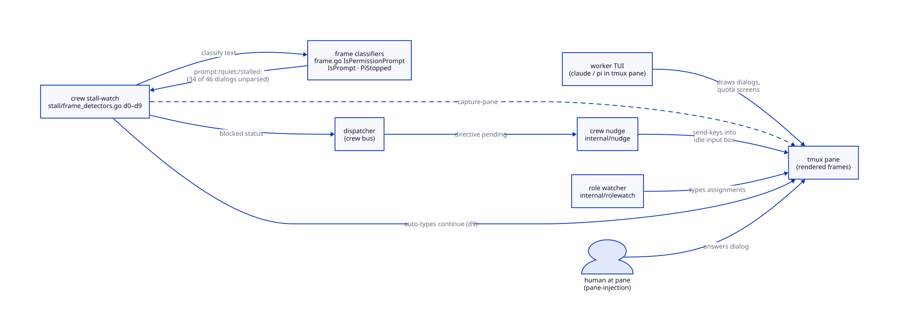
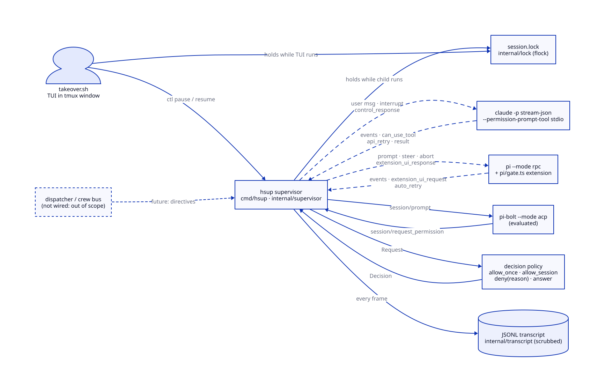

# Headless structured worker control: spike findings (#1853)

<picture>
  <source media="(prefers-color-scheme: dark)" srcset="diagrams/2026-11-27-feat-1853-spike-headless-structured-worker-control-issue-dark.svg">
  
</picture>

<picture>
  <source media="(prefers-color-scheme: dark)" srcset="diagrams/2026-11-27-feat-1853-spike-headless-structured-worker-control-plan-dark.svg">
  
</picture>

## Summary and recommendation

Every case that needs keystrokes in a worker pane today (permission dialogs,
questions, plan approval, interrupts, mid-turn directives, hang recovery,
provider errors, session resume) resolved as a structured request/response on
both claude and pi, with one exception: pi web-fetch is partial (the deny path
is verified, the allow path is not). Recommendation: use the native interfaces,
not ACP. For claude, the stream-json control protocol with
`--permission-prompt-tool stdio`, answering `can_use_tool`. For pi,
`--mode rpc` plus a small gate extension that turns `tool_call` into a UI
select the supervisor answers. Reasons: native keeps the deny reason the model
sees, has a mid-turn inject, exposes the full request detail, and adds no
adapter process; ACP lost the deny reason, has no standard mid-turn inject, and
needs per-agent quirks on top. The prototype is `spikes/headless-supervisor/`
(Go, not wired into dispatch). Take-over to the real TUI and hand-back works on
both engines under a session lock.

## Matrix

Reproduce any cell with `./run.sh <case> <engine>` from
`spikes/headless-supervisor/` (`claude` or `pi`; the ACP cell uses `pi-acp` or
`claude-acp`). Status is verified, partial, or n/a; the link is the committed
scrubbed transcript. Evidence is the PASS line each run printed (lead runs,
2026-11-27).

| Case              | claude mechanism                                                                                 | claude                                                                                | pi mechanism                                                                                | pi                                                                                |
| ----------------- | ------------------------------------------------------------------------------------------------ | ------------------------------------------------------------------------------------- | ------------------------------------------------------------------------------------------- | --------------------------------------------------------------------------------- |
| bash-allow        | `can_use_tool` Bash, allow once                                                                  | [verified](../spikes/headless-supervisor/transcripts/claude-bash-allow.jsonl)         | gate `tool_call` -> `ctx.ui.select`                                                         | [verified](../spikes/headless-supervisor/transcripts/pi-bash-allow.jsonl)         |
| bash-deny         | `can_use_tool` deny + message; error result carries reason                                       | [verified](../spikes/headless-supervisor/transcripts/claude-bash-deny.jsonl)          | second `input` dialog -> `{block, reason}`                                                  | [verified](../spikes/headless-supervisor/transcripts/pi-bash-deny.jsonl)          |
| bash-session      | allow + `updatedPermissions` (`addRules`, destination `session`)                                 | [verified](../spikes/headless-supervisor/transcripts/claude-bash-session.jsonl)       | session-allow set inside the extension                                                      | [verified](../spikes/headless-supervisor/transcripts/pi-bash-session.jsonl)       |
| outside-write     | `can_use_tool` Write; `decision_reason_type` `workingDir` + `addDirectories` suggestion          | [verified](../spikes/headless-supervisor/transcripts/claude-outside-write.jsonl)      | gate classifies `write`/`edit` path                                                         | [verified](../spikes/headless-supervisor/transcripts/pi-outside-write.jsonl)      |
| outside-read      | `can_use_tool` Read; `workingDir` reason + `addRules …/**` suggestion                            | [verified](../spikes/headless-supervisor/transcripts/claude-outside-read.jsonl)       | gate classifies `read`/`ls`/`grep`/`find` path                                              | [verified](../spikes/headless-supervisor/transcripts/pi-outside-read.jsonl)       |
| mcp               | `can_use_tool` `mcp__echo__*`, server in detail                                                  | [verified](../spikes/headless-supervisor/transcripts/claude-mcp.jsonl)                | gate on MCP tool; needs `-e builtin:mcp`                                                    | [verified](../spikes/headless-supervisor/transcripts/pi-mcp.jsonl)                |
| web               | `can_use_tool` WebFetch, `domain:<host>` rule; needs `--tools Bash,WebFetch`                     | [verified](../spikes/headless-supervisor/transcripts/claude-web.jsonl)                | gate on `fetch_content`/`web_search`; stub tool stood in                                    | [partial](../spikes/headless-supervisor/transcripts/pi-web.jsonl)                 |
| ask               | `AskUserQuestion` via `can_use_tool`, `updatedInput.answers` (Red/Blue/Teal, answers Teal)       | [verified](../spikes/headless-supervisor/transcripts/claude-ask.jsonl)                | spike `ask_user` tool -> `ctx.ui.select` (Red/Blue/Teal, answers Teal)                      | [verified](../spikes/headless-supervisor/transcripts/pi-ask.jsonl)                |
| plan              | `ExitPlanMode` via `can_use_tool` under `--permission-mode plan`; asserts the approved write ran | [verified](../spikes/headless-supervisor/transcripts/claude-plan.jsonl)               | plan-mode example extension `--plan`, select with 3 options; asserts the approved write ran | [verified](../spikes/headless-supervisor/transcripts/pi-plan.jsonl)               |
| error             | `system/api_retry` + `result` with `is_error`                                                    | [verified](../spikes/headless-supervisor/transcripts/claude-error.jsonl)              | `auto_retry_start/end` + `stopReason error`; wait for `agent_settled`                       | [verified](../spikes/headless-supervisor/transcripts/pi-error.jsonl)              |
| midturn           | second stream-json user message folded into the running turn                                     | [verified](../spikes/headless-supervisor/transcripts/claude-midturn.jsonl)            | `steer`                                                                                     | [verified](../spikes/headless-supervisor/transcripts/pi-midturn.jsonl)            |
| interrupt         | `control_request` `interrupt`, then a new user message                                           | [verified](../spikes/headless-supervisor/transcripts/claude-interrupt.jsonl)          | `abort`, then `steer`/prompt                                                                | [verified](../spikes/headless-supervisor/transcripts/pi-interrupt.jsonl)          |
| hang              | silence limit, then interrupt                                                                    | [verified](../spikes/headless-supervisor/transcripts/claude-hang.jsonl)               | silence limit, then abort                                                                   | [verified](../spikes/headless-supervisor/transcripts/pi-hang.jsonl)               |
| kill-resume       | SIGKILL, `-p --resume <id>` keeps the id                                                         | [verified](../spikes/headless-supervisor/transcripts/claude-kill-resume.jsonl)        | SIGKILL, `--session <id>`                                                                   | [verified](../spikes/headless-supervisor/transcripts/pi-kill-resume.jsonl)        |
| takeover          | `flock` + `claude --resume` in tmux                                                              | [verified](../spikes/headless-supervisor/transcripts/claude-takeover.jsonl)           | `flock` + `pi --session` in tmux                                                            | [verified](../spikes/headless-supervisor/transcripts/pi-takeover.jsonl)           |
| bash-deny-hook    | SDK `PreToolUse` `hook_callback` registered in `initialize`                                      | [verified](../spikes/headless-supervisor/transcripts/claude-bash-deny-hook.jsonl)     | n/a                                                                                         | n/a                                                                               |
| bash-deny-mcptool | `--permission-prompt-tool mcp__echo__permission_prompt`                                          | [verified](../spikes/headless-supervisor/transcripts/claude-bash-deny-mcptool.jsonl)  | n/a                                                                                         | n/a                                                                               |
| acp-bash-allow    | claude-agent-acp `session/request_permission` (`claude-acp`)                                     | [verified](../spikes/headless-supervisor/transcripts/claude-acp-acp-bash-allow.jsonl) | pi-bolt `--mode acp` (`pi-acp`)                                                             | [verified](../spikes/headless-supervisor/transcripts/pi-acp-acp-bash-allow.jsonl) |

Notes on cells:

- claude web: `WebFetch` is not in this install's default tool set (the model
  is told to use a web-fetch subagent), so the case runs with
  `--tools Bash,WebFetch`. Allow-for-session on `example.com` then covered a
  second fetch with no new request.
- pi web: partial. The permission arrives with the domain and deny reaches the
  model. Allow was not exercised: pi-web-access reads its config from pi's
  credential dir and its last-resort gemini provider can read owner
  credentials, so a stub `fetch_content` tool stood in.
- pi mcp: `--no-extensions` also drops pi's built-in MCP extension, so the
  case passes `-e builtin:mcp` with a project `.pi/mcp.json` and `--approve`.
- claude error: the stub returned 429, 529, then 400 (credit). Only the 529
  produced `system/api_retry`; the 429 was consumed without a frame. The final
  `result` had subtype `success` with `is_error` true ("Credit balance is too
  low"). The case ran under `--bare` with a stub API key so no OAuth token
  reached the stub.
- pi error: three Retry events, then a terminal `rate_limit_error`. Each failed
  attempt also emits an error `message_end` before `auto_retry_start`, so a
  supervisor must wait for `agent_settled`, not stop at the first error.
- claude read-only commands (for example `echo`) never prompt; only
  non-read-only ones reach `can_use_tool`. A standalone long `sleep N` is
  refused by claude's Bash tool, so slow tools run through a script.
- claude outside-write/outside-read: the request is identified by
  `decision_reason_type: "workingDir"` ("Path is outside allowed working
  directories"), with an `addDirectories` (write) or `addRules …/**` (read)
  session suggestion. It is not `blocked_path`.
- Transcripts recorded before the scrubber fix show the outside dir as `$WORK`;
  the re-recorded pi outside-\* transcripts use `$OUTSIDE`.
- plan: both plan transcripts were re-recorded and now assert the approved
  write ran. claude: "permission plan options [] → allow_once → Write ran ok
  after the plan Permission, plan.txt exists". pi: "permission plan options
  [Execute the plan (track progress) Stay in plan mode Refine the plan] →
  allow_once → write ran ok after the plan Permission, plan.txt exists".
- ask: both engines offer Red/Blue/Teal and answer Teal: "permission ask
  options [Red Blue Teal] → answered Teal → ask tool result carries Teal".

## Claude mechanisms compared

| Mechanism                                                          | Result                                                                                     | Detail available                                                         | Notes                                                                                                                                                                                   |
| ------------------------------------------------------------------ | ------------------------------------------------------------------------------------------ | ------------------------------------------------------------------------ | --------------------------------------------------------------------------------------------------------------------------------------------------------------------------------------- |
| Control protocol `can_use_tool` (`--permission-prompt-tool stdio`) | Recommended. One channel for permissions, questions, plan approval, interrupt and messages | Tool, input, `blocked_path`, `permission_suggestions`, `decision_reason` | Session rules come back in the answer via `updatedPermissions` (destination `session`), scoped by the supervisor (see below); `AskUserQuestion` and `ExitPlanMode` are answered in-band |
| SDK `PreToolUse` `hook_callback` (registered in `initialize`)      | Works; the deny reason reaches the model                                                   | Tool and input only; no `permission_suggestions`                         | A second channel beside the control protocol; gates only tools that fire `PreToolUse`                                                                                                   |
| `--permission-prompt-tool mcp__<server>__<tool>`                   | Works in 2.1.332                                                                           | Tool and input                                                           | Needs an MCP server process; the answer is a JSON text block; no structured session rules back to the host                                                                              |

Session scoping: `allow_session` scopes Write/Edit/Read to `//<abs dir>/**`
(claude's absolute-path rule syntax; a single `/` is project-relative), Bash to
`<first word>:*`, WebFetch to `domain:<host>` and mcp per tool. A tool with no
derivable scope downgrades to `allow_once`, and the transcript notes it; so
does a file target directly under `/` or one whose directory has glob
characters. No live case exercises file-tool `allow_session` (the transcripts
hold only Bash and WebFetch session rules), so that scoping is unit-tested
only.

## pi mechanism

pi has no core approval prompt (`docs/security.md:3` in the pi package), so
the gate is an extension.

- `gate.ts` subscribes to `tool_call` and classifies the call (bash, write,
  read, mcp, web, other). Calls it lets through pass; the rest call
  `ctx.ui.select`, which RPC mode forwards as an `extension_ui_request`. The
  supervisor answers with `extension_ui_response`.
- Options are `allow_once`, `allow_session`, `deny`. The session-allow set
  lives in the extension.
- Bash: a simple command (none of ``; & | < > $ ` ( ) { }`` or a newline) is
  auto-allowed only if its first word is on the read-only list (`echo`, `ls`,
  `pwd`, `cat`, `true`; not `date`, which reads files with `-f`), every word
  matches `^[A-Za-z0-9._/@%+=,-]+$`, options match `^--?[A-Za-z0-9-]+$` (no
  attached values) and every non-option argument realpaths inside the cwd.
  Anything with quotes, backslashes, `~`, globs or metacharacters asks and is
  never session-cached. Other plain commands ask. The session cache keys on
  the first word and applies only after an explicit `allow_session` on a
  simple command, mirroring claude's `Bash(touch:*)` prefix rule. So
  `allow_session` on `cat <outside path>` also covers later `cat` of other
  paths, exactly like claude's `Bash(cat:*)`. Compound commands always ask
  and are never session-cached.
- Paths are normalized like pi's own tools (`@`, `~`, `file://`) and
  realpath'd before the inside/outside decision. The permission `path` and the
  session keys use the realpath; the lexical path is sent as `requested`.
  Write/edit always ask; read/ls/grep/find pass inside the cwd and ask outside
  it.
- `ask_user` passes (it is the question channel); every other tool not named
  above, including unknown ones, asks. Web calls check the host of every URL.
- The gate loads last in the `-e` order, so a later `tool_call` handler cannot
  mutate an approved call.
- The gate demonstrates the mechanism; it is not a sandbox, and pi has none.
  The final review round still found ways past the read-only auto-allow, left
  open in the spike: a symlink inside the cwd plus `..` (`resolve()` collapses
  `..` before realpath, the kernel does not), `@`-prefixed words and words
  after `--` (bash keeps them, the gate normalizes them as tool paths),
  `ls -L`/`-R -L` following links out of the cwd, writes through a dangling
  symlink (realpath falls back to the link's own location), and an
  assignment prefix (`FOO=1 cmd`) becoming the session key. A lexical bash
  allowlist keeps leaking like this. For production the extension should
  auto-allow nothing and send every `tool_call` to the supervisor, where the
  policy is Go code with tests and sees the full command.
- Deny follows up with a second `input` dialog for the reason; the extension
  returns `{block: true, reason}` and the model sees the reason.
- A spike `ask_user` tool covers questions (select with options). pi's own
  plan-mode example extension covers plan approval with a select.
- Errors surface as `auto_retry_start`/`auto_retry_end` events and an
  assistant message with `stopReason` error. Wait for `agent_settled`.
- Mid-turn directives are `steer`; interrupt is `abort`.

## Native versus ACP

ACP worked for both engines (`pi-acp`: pi-bolt 1.3.1 `--mode acp`;
`claude-acp`: nixpkgs claude-agent-acp 0.100.0). Both cases passed. The costs:

- The deny reason cannot reach the model: the outcome is only a selected
  `optionId` or cancelled.
- Base ACP has no mid-turn inject. claude-agent-acp advertises a custom
  `_session/steering`; pi-bolt has none, so the message queues.
- Per-agent quirks. claude-agent-acp starts in mode `auto` (never asks) and
  honours the owner's `~/.claude` allow rules unless `session/new` passes
  `_meta.claudeCode.options.settingSources: ["project","local"]`; it defaults
  to the "default" model (Opus) unless `session/set_config_option` sets
  `model=haiku`; it offers no allow-always for Bash (options were Yes and No).
  pi-bolt maps `allow_session` to kind `allow_once` and puts only the gate's
  title (its JSON) in `request_permission`; the detail had to be recovered from
  the preceding `tool_call` update.
- More moving parts: a node adapter for claude, a forked runtime (pi-bolt) for
  pi, each with its own version to track.

Recommend native. Keep ACP as an option only if a third-party agent that has no
native structured interface must be driven.

## Directives and liveness

- Mid-turn: injected on both engines. claude folds a queued user message into
  the running turn (the injected `touch` started before the turn's first
  `result`); pi uses `steer` (the injected `touch` started before the first
  `agent_settled`).
- Interrupt then steer: TurnEnd in 0.0s on both (claude ToolResult "The user
  doesn't want to proceed with this tool use"; pi "Command aborted"); the
  follow-up in the same session created `steered.txt`.
- Liveness is process alive plus event recency. A hung `slow.sh 600` was
  detected at the silence limit (15s limit; stale detected 17s after the prompt
  on claude, 19s on pi) and recovered by interrupt, TurnEnd in 0s.
- Kill and resume: killed mid-tool, resumed on the latest child-reported id.
  The resumed session id equalled the original on both engines and the
  codeword was recalled, so no state was lost. Lock key is the launch id and
  resume target is the latest reported id; they were equal in every run.
- Close: pi aborts then closes stdin; claude closes stdin.

## Take-over design

```text
hsup serve  (child runs holding <state>/session.lock, inherited as an fd)
   |
   v  takeover.sh: hsup ctl pause   -> child stopped, lock released
   v  takeover.sh: flock -n session.lock true   (refuse if anyone holds it)
   v  tmux new-window: flock -o -n session.lock <claude --resume id | pi --session id>
   |      (human works in the real TUI; TUI holds the lock for its whole life)
   v  TUI exits -> window signals tmux wait-for
   v  takeover.sh: hsup ctl resume  -> lock re-acquired, child resumes same id
```

Guarantee: a session's child or TUI only runs while holding the lock, so two
processes never write it at once. The child inherits the lock fd
(`Options.Inherit` -> `cmd.ExtraFiles`), so the flock lives until both hsup
and the child are gone; hsup dying by SIGHUP no longer frees it while the
child writes. Pause keeps the lock only while the child may still be alive; if the child was
reaped, even with a non-zero exit, pause completes and reports the exit error as
a note. `hsup ctl` (and so `takeover.sh`) refuses a state dir that is a
symlink, not owned by the caller or open to group or others, and reads
`session.json` only as a regular file owned by the caller (`CheckState`,
`ReadSession`). The `-o` flag keeps the lock off the TUI's own children. Evidence: a Go test takes the lock from an external `flock`
process; the demo's headless resume was refused while the TUI ran; and after
hand-back the headless turn recalled both the headless codeword and the
codeword added in the TUI, with the session id unchanged.

Residuals:

- The lock is advisory. A bare `claude --resume` or `pi --session` run outside
  these scripts bypasses it.
- The inherited fd is not close-on-exec in the child, so a grandchild (for
  example a background shell a tool started) can keep holding the lock after
  the engine exits. Take-over's flock then refuses until it exits: it fails
  safe, not unsafe.
- The claude TUI shows a workspace-trust dialog for a new directory, defaulting
  to "No, exit". The demo selects Yes; accepting records trust for that dir in
  the owner's claude config.
- claude plan mode writes the plan to `~/.claude/plans/` in the owner's home,
  outside the throwaway dir; like the trust dialog, a side effect of running
  the plan case.
- Parent markers must be scrubbed from the TUI's environment:
  `CLAUDECODE`, `CLAUDE_CODE_CHILD_SESSION`, `CLAUDE_CODE_ENTRYPOINT`,
  `CLAUDE_CODE_SESSION_ID`, `CLAUDE_CODE_EXECPATH`,
  `CLAUDE_CODE_SUBAGENT_EFFORT`, `CLAUDE_CODE_SSE_PORT`, plus `CREW_WORKER_ID`,
  `CREW_ID`, `CREW_LEAD_*`, `TMUX`, `TMUX_PANE`. With
  `CLAUDE_CODE_CHILD_SESSION` inherited the TUI ran with "Transcript saving is
  off" and its turn was lost on hand-back.

## Residual cases that still need a human at a pane

- Genuine provider quota rejection. It arrives structured (Retry/TurnEnd with
  `is_error`), but the decision to wait, switch model or override is policy or
  human, not a keystroke the supervisor can invent.
- Claude workspace-trust on an interactive take-over of a new directory.
- OAuth and login flows for either engine.
- pi-web-access credential-bearing providers (the reason pi web is partial):
  allowing them means exposing owner credentials, which wants a human decision.
- Unknown future dialogs inside a TUI during take-over; a human is present by
  definition there.
- The 2 genuinely unknown interactive prompts in the event count are, by
  definition, not covered by any case here; they stay with a human until
  identified.

## Deletable once wired

Not deleted in this spike. Each row is what a wired supervisor would replace,
tied to the event counts from the task (78 directive nudges, 116 `unread:`
blocks, 25 auto-continues, about 46 `prompt:` of which 34 unparsed, 112
`quiet:`/`stalled:`, 11 provider/quota, 2 unknown).

| Path                                                                                                                                                                                                               | Headless mechanism that replaces it                                               | Event count                         |
| ------------------------------------------------------------------------------------------------------------------------------------------------------------------------------------------------------------------ | --------------------------------------------------------------------------------- | ----------------------------------- |
| `crew/internal/stall/frame_detectors.go`: d1 prompt (and quota via `IsQuotaPrompt`)                                                                                                                                | `can_use_tool` / gate select as a structured request                              | ~46 `prompt:` (34 unparsed)         |
| same file: d1b quota session limit                                                                                                                                                                                 | `Retry`/`TurnEnd` `is_error` events                                               | 11 provider/quota                   |
| same file: d0 stalled, d2 turn-stall, d3 quiet                                                                                                                                                                     | process alive + event recency with a silence limit, interrupt on hang             | 112 `quiet:`/`stalled:`             |
| same file: d7 runaway                                                                                                                                                                                              | event stream (`ToolStart` rate, turn length) instead of frame diffing             | part of 112                         |
| same file: d9 pi truncated / provider-error auto-continue (`d9Continue`)                                                                                                                                           | pi `auto_retry_*` and `agent_settled`; supervisor sends the continue message      | 25 auto-continues                   |
| `crew/internal/frame/frame.go`: `IsPermissionPrompt`, `IsPrompt`, `IsAddDirPrompt`, `IsQuotaPrompt`, `IsQuotaSessionLimit`, `IsQuotaCursorLimit`, `PiStopped`, `PiLiveTurn`, `PiWorkingRow`, `InterruptedAboveBox` | Typed events; nothing to classify from a screen                                   | ~46 prompts, 11 quota, 112 liveness |
| `crew/internal/stall/probe_detectors.go`: d5 launch-not-started, d6 unread auto-nudge                                                                                                                              | Init event on start; supervisor delivers unread messages with `Send`              | 116 `unread:`                       |
| `crew/internal/nudge/` (types `crew inbox` into an idle box)                                                                                                                                                       | `Send` (between turns) or mid-turn inject                                         | 78 directive nudges                 |
| `crew/internal/rolewatch/` typed delivery (`loop.go`, `frames.go`, `gates.go`)                                                                                                                                     | `Send` to the role's child                                                        | part of 78                          |
| `adapters/core/skills/pane-injection/SKILL.md`                                                                                                                                                                     | `hsup ctl send` / `Respond`; the human answers via take-over instead of send-keys | part of 78                          |
| worker-side `crew await` reply loop (`crew/internal/await/`)                                                                                                                                                       | could become supervisor-delivered messages; the worker no longer polls            | part of 116 / 78                    |
| pane-readiness and `_pane_is_ancestor` guards in dispatch (`docs/dispatch-redesign.md` rows)                                                                                                                       | no pane to wait for; the child is ready at Init                                   | n/a                                 |

Keep: d4 load and d8 budget (host signals, not pane state), and the bus itself.
The 2 unknown prompts are not removed by this; they are the residual above.

## Models, language, reproduce

- claude children: `--model haiku` (claude-haiku-5-5), claude-code 2.1.332,
  owner OAuth subscription. Claude runs draw the owner's subscription quota,
  so each claude case ran once, except plan, ask, bash-allow, takeover and acp,
  which re-ran once more after review round 1, and ask, takeover and pi-acp,
  which re-ran again after round 3; `run.sh all claude` is not cheap to
  repeat. The pi matrix ran three times: initially, after review round 1 and
  after round 3. Children start with `exec.CommandContext`, whose cancel closes
  stdin with a 10s `WaitDelay` grace, so `hsup case --timeout` and SIGTERM stop
  them gracefully.
- pi children: `anthropic/claude-haiku-4-5` on pi 1.6.1's direct anthropic
  provider (API credit lane; OpenRouter was at its limit).
- pi-acp: pi-bolt 1.3.1 `--mode acp` (agentInfo pi-bolt 1.6.0), same model.
  claude-acp: nixpkgs claude-agent-acp 0.100.0 built with
  `NIXPKGS_ALLOW_UNFREE=1 --impure`, `CLAUDE_CODE_EXECUTABLE` pointed at
  2.1.332, model set to haiku through `session/set_config_option`.
- Language: Go. The crew stack is Go, the devshell has `go` and
  `golangci-lint`, and goroutines own child I/O; `pi/gate.ts` is TypeScript
  only because pi extensions are.
- Reproduce: see `spikes/headless-supervisor/README.md`. `go test ./...` uses
  fake children only. Children must run the wrapped binaries (not the PATH
  wrappers) with `--setting-sources local --strict-mcp-config` on claude.
